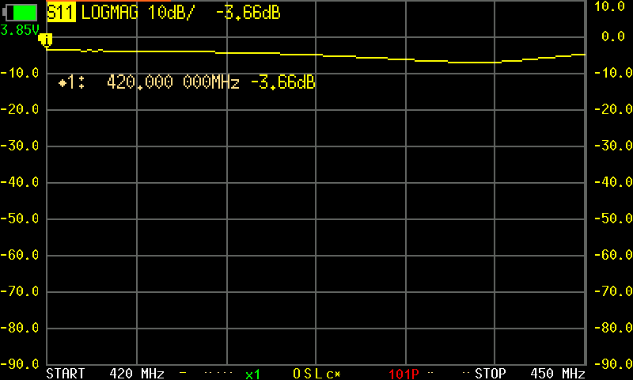
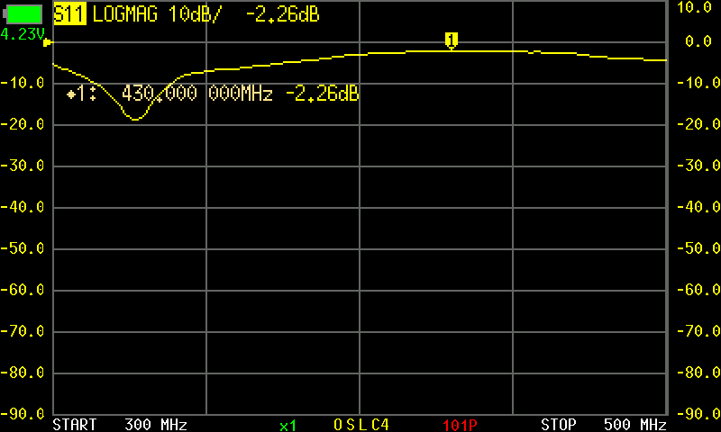
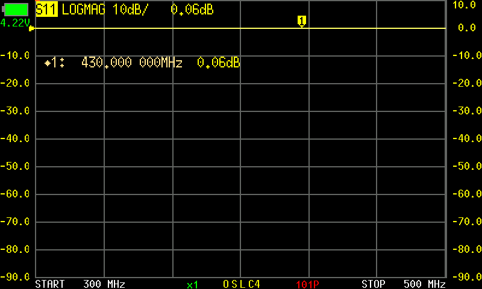
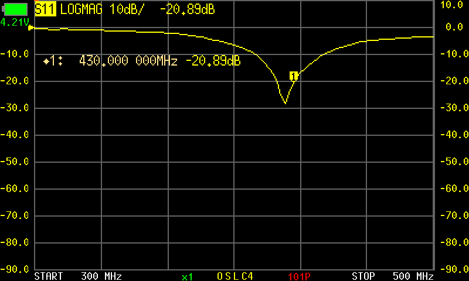

# 001 EMBER UHF antenna testing

**Status:** In progress  
**Started:** 2026-10-07  
**Updated:** 2026-10-08

I want a deployable UHF antenna for EMBER, starting with a simple dipole before deciding whether to move to a turnstile. The first tests became an investigation into the whole bench setup: the arm lengths, plastic mounting hub, nearby spacecraft metal, coax routing, and feed connections.

So far, a copper reference dipole has helped establish a useful tuning sequence. After fixing a feed connection and trimming the copper arms from 170 mm to approximately 160 mm each, measured VSWR at 436 MHz improved from 3.07 to 1.43. The Nitinol antenna, deployment behavior, and radiation performance are still unresolved.

## The problem

The intended operating frequencies are 435 MHz receive and 437 MHz transmit. I have Nitinol ribbon bought for its spring behavior, with the idea that it could be bundled for stowage and released into antenna arms. The purchase record describes 3 × 0.5 mm ribbon; those dimensions still need physical confirmation.

The questions are connected: how to mount it, how to connect it to coax, whether it recovers its shape, and whether the assembled antenna works at UHF. The bench work here focuses on input matching and troubleshooting. It has not yet established a flight antenna design.

## Equipment and setup

- NanoVNA identifying itself as NanoVNA-F V2, firmware 0.5.4, used for S11 sweeps and display captures.
- Nitinol dipole: two ribbons cut to 190 mm total length each. Initially about 169 mm and 167 mm extended beyond the plastic clamps. The inner ends were separated by roughly 15 mm.
- Coax connected through pieces of crimp terminals attached to the Nitinol arms. No balun or ferrite choke was installed during these tests.
- Plastic mounting jig, first near the spacecraft structure and later supported on a cardboard box above the bench and away from the metal structure.
- Copper reference: bare square copper wire, 1.30 × 1.30 mm, initially 170 mm per arm including the solder overlap. Plastic clamps covered about 10 mm of each arm.
- Available for later work: tinySA, SDRs, and a signal generator. The results below come from the NanoVNA, not radiation measurements with those instruments.

SOL means short, open, and load calibration. It was performed at the cable/fitting endpoint. After exploratory measurements, I repeated calibration with the cable supported in its test position, then made a separate 300–500 MHz calibration saved in slot 4, shown as C4 on the screen.

The later wide sweeps contain 101 points at 2 MHz intervals. They directly sample 436 MHz, but not 435 or 437 MHz. Those two operating frequencies need a finer sweep before making a final matching decision. Screenshots and numerical data were captured sequentially while the instrument was sweeping.

## Starting with the Nitinol dipole

The first narrow sweep covered 420–450 MHz. It gave VSWR 3.63 at 435 MHz and 3.35 at 437.1 MHz, the nearest sampled point to the intended transmit frequency. The best match in that span was at 443.7 MHz, but it was still only VSWR 2.62.

Initial Nitinol capture. A dip in the displayed trace was not enough to decide what to cut.

I then changed the cable routing and how far the ribbons extended from the clamps. With the coax routed down out of the spacecraft, the selected baseline gave VSWR 4.73 at 435 MHz. Pulling the ribbons outward changed that to 4.55; routing the coax across the top, perpendicular to the dipole, changed it to 3.73.

Those changes showed that the arrangement mattered. Pulling a ribbon out of a clamp did not change its 190 mm total conductor length, and moving the coax was not an arm-length experiment. The small improvement from extending the ribbons also needed repeatability checks before treating it as meaningful.

Moving the jig away from the spacecraft metal did not remove the low-frequency matching dip. I stopped short of cutting the Nitinol and checked the calibration instead.

## Checking calibration and connections

The original load check had a small resistance offset. After repeating narrow-band SOL with the supported cable, the load read about 49 Ω and VSWR 1.02 at 435 and 437 MHz. I then calibrated across 300–500 MHz in slot 4. The following load-like check had S11 below approximately −31.9 dB across that span. These were consistency checks using the calibration load, not independent validation with a separate standard.

With the Nitinol reconnected on the raised jig, the C4 sweep's best sampled match was at 328 MHz, with S11 −18.68 dB. At 436 MHz, VSWR was 8.23 and the derived impedance was about 17.5 − j67.1 Ω. The recorded reactance did not cross zero in the span, so I kept calling this a matching dip rather than assuming it was the isolated dipole's resonance.

Nitinol on the raised jig after wide calibration. The matching dip remained well below the operating band.

A resistance check also needed a correction. Initial readings of several ohms looked concerning, but the meter probes shorted together read 2.60 Ω. Ribbon and connection readings of 2.87 Ω and 2.70 Ω left differences of only about 0.27 Ω and 0.10 Ω. The readings stayed stable under flex, and center conductor to shield read open. That did not establish RF loss, but it removed the apparent evidence for an obvious bad DC junction.

## Building a copper reference

I left the Nitinol intact and made a copper dipole. Before the printed holder was ready, I took a preliminary reading with it hanging from one end at the soldering station. Its best sampled match was at 318 MHz and VSWR at 436 MHz was 13.12. This was an exploratory setup with nearby metal, not a controlled comparison of copper and Nitinol.

In the holder, the copper's best sampled matching dip moved to 384 MHz and VSWR at 436 MHz became 4.45. The arms were 170 mm total, including approximately 10 mm of solder overlap at each root. The braid side had about 20 mm exposed in total, including that overlap; the center side's exposed conductor was contained within its overlap.

I shortened the exposed feed connections. To accommodate that change, I also moved the clamp positions roughly 30 mm along the arms, without changing their 10 mm coverage. Because both feed and mounting geometry changed, the resulting comparison could not isolate the exposed braid's effect.

## Finding the failed feed connection

The next sweep was almost flat at 0 dB S11. The earlier matching dip had disappeared.

Failed connection capture. This was a troubleshooting result, not an antenna-tuning result.

The center conductor had pushed back into the coax. I repaired the antenna-side termination while keeping the new mounting geometry and short exposed braid. The calibrated cable and fittings were unchanged.

After repair, the matching dip returned at 404 MHz. At 436 MHz, VSWR was 3.07 and impedance was approximately 48.6 − j58.3 Ω. That became the baseline for trimming. Comparing it with the original holder setup includes the combined feed and clamp changes; it does not prove that shortening the braid alone caused the improvement.

## Trimming the copper arms

From the repaired 170 mm baseline, I removed approximately 2 mm from each outer tip at a time. The intended constants were the holder, repaired feed, coax route, sweep, and calibration. The lengths below are approximate, based on the starting length and reported cuts.

| Arm length mm | Best sampled dip MHz | S11 at 436 MHz dB | VSWR at 436 MHz | Reflected power at 436 MHz | Data |
| --- | --- | --- | --- | --- | --- |
| 170 | 404 | -5.87 | 3.07 | 25.9% | [CSV](files/copper-repaired-170/sweep.csv) |
| 168 | 408 | -6.58 | 2.76 | 22.0% | [CSV](files/copper-trim-168/sweep.csv) |
| 166 | 410 | -7.51 | 2.46 | 17.7% | [CSV](files/copper-trim-166/sweep.csv) |
| 164 | 414 | -8.89 | 2.12 | 12.9% | [CSV](files/copper-trim-164/sweep.csv) |
| 162 | 420 | -10.53 | 1.85 | 8.8% | [CSV](files/copper-trim-162/sweep.csv) |
| 160 | 426 | -15.11 | 1.43 | 3.1% | [CSV](files/copper-trim-160/sweep.csv) |

The matching dip moved upward through the sequence, and the match at 436 MHz improved with every recorded trim. The latest arms, approximately 160 mm each, gave impedance 61.7 − j16.0 Ω at 436 MHz. Their best sampled match was at 426 MHz, with S11 −28.10 dB.

Latest recorded copper sweep. The table uses the saved numerical sweep; the screen is a separate live capture.

For nearby directly sampled points, the latest VSWR was 1.35 at 434 MHz and 1.50 at 438 MHz. These are useful context, but they are not direct readings at 435 and 437 MHz.

## What the results establish

The copper trimming sequence produced a useful improvement in input match for this bench arrangement. It also showed why I needed to resolve the feed fault before tuning: a bad connection erased the antenna response entirely.

The earlier setup changes were less controlled. Cable routing, support position, clamp geometry, material, and calibration changed at different stages. They helped guide the investigation, but do not provide a clean copper-versus-Nitinol efficiency comparison. A good input match alone does not establish radiation efficiency, gain, polarization, or deployment reliability.

## Next steps

The last proposed trim was smaller: about 1 mm from each copper tip, toward 159 mm per arm. That step has not been recorded here as completed.

Before settling on the copper geometry, take a finer calibrated sweep that directly measures 435 and 437 MHz and check that the result repeats without unintended cable movement. Then use the reference setup to continue the Nitinol investigation, documenting any geometry differences. Feed control, comparative radiation measurements, and stow-and-release tests remain part of the unfinished work.

## Measurement files

The [measurement index](files/README.md) links the captures used here and records their local timestamps and configurations. It includes original CSV readings, available Touchstone S11, and raw console replies. The [latest CSV](files/copper-trim-160/sweep.csv) and [latest Touchstone file](files/copper-trim-160/snapshot.s1p) contain the approximately 160 mm copper result.

[Back to Lab Log](../../README.md)
