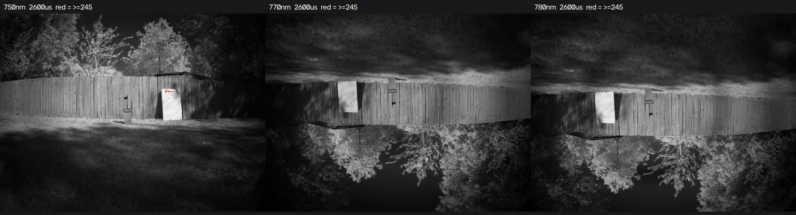
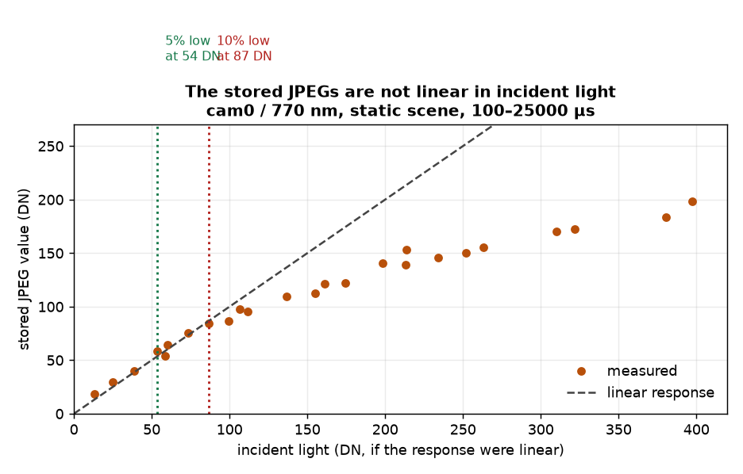
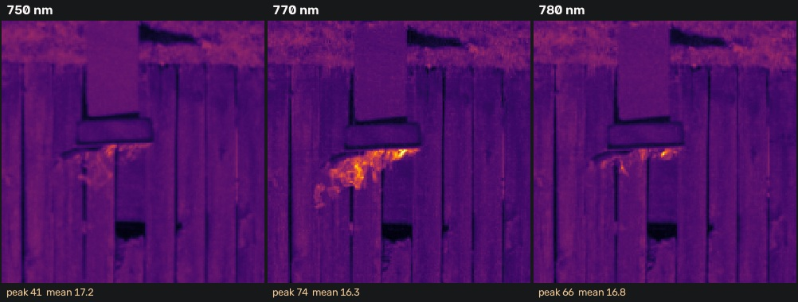
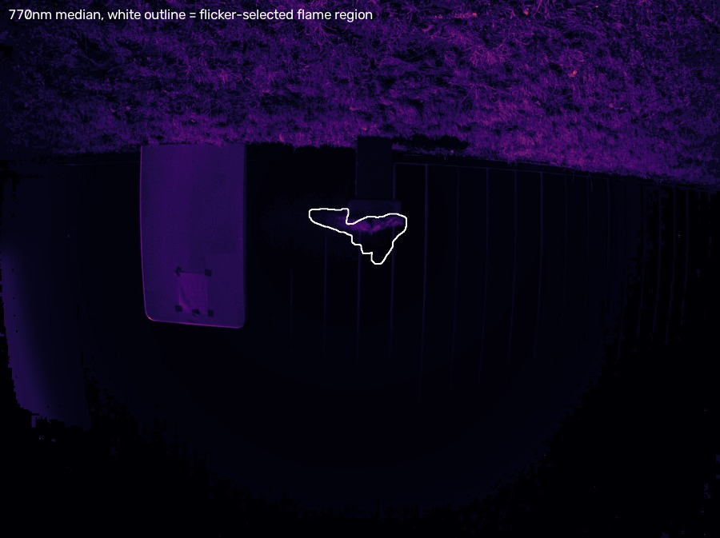
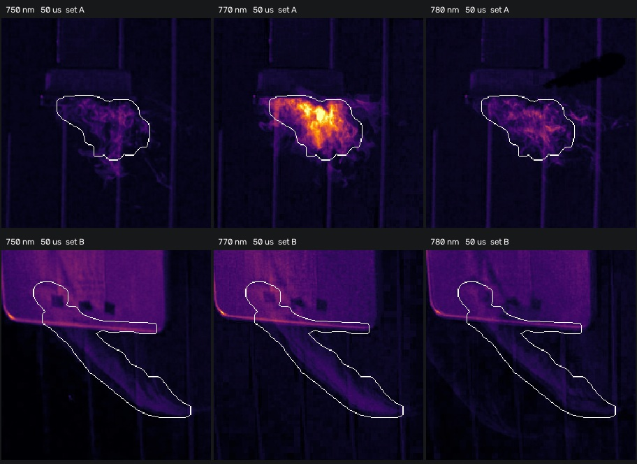

# 002 K-line payload: sensor linearity and two burn tests

**Status:** In progress
**Started:** 2026-10-14
**Updated:** 2026-10-14

Exposure setting and two burn tests of the three-camera narrowband payload, both in daylight about two hours apart. Three outcomes: **the stored JPEGs are not linear in incident light**; the first burn, against a sunlit fence, gave no usable index; and the second, after moving in front of a green-painted building, gave a clean **δ₇₇ = +2.49**. The backdrop was the only thing that changed.

## Goal

Pick an exposure that keeps the scene unclipped, record a no-fire baseline, then measure δ₇₇ on a real flame. δ₇₇ is the potassium index: how much more light arrives at 770 nm than the two continuum bands predict.

δ₇₇ = (S₇₇₀ − C) / C, where C = (S₇₅₀ + 2·S₇₈₀) / 3

## Setup

- Raspberry Pi 4, Arducam 4-port mux, 3× InnoMaker IMX296 at 1456×1088, gain 1.0, auto-exposure off.
- Thorlabs FBH750-10 / FBH770-10 / FBH780-10. **cam0 = 770 nm (on-line), cam1 = 750, cam2 = 780.**
- Flat field `correction_20261003.npz` (Teflon panel, 3 Oct) still valid — focus, filters and resolution unchanged.
- Two sites, both in direct daylight: a sunlit wooden fence (burn 1, from about 10:30 local), then a green-painted building wall roughly two hours later (burn 2, from about 12:45). A white board sat beside the target in both as a bright reference; the flame was on a bracket to its right.
- **Capture filenames are UTC and the payload Pi is set to `Europe/London`**, so neither its displayed clock nor the bracket manifest names are local time. Local time was UTC−5. A stem of `175138` is 12:51 local, not 17:51. This produced a wrong inference about the lighting, noted under burn 2.
- All 705 previous captures archived to `~/archive/pre_20261014/` after byte-verifying local copies, so the session started on an empty directory.

The scene at 2600 µs. The bright rectangle is the white board; red marks near-saturated pixels, which appear only in 750 nm.

## The linearity finding

I bracketed to find the longest exposure with no clipping and got 2600 µs. Then the white board measured δ₇₇ = +0.135 after flat correction, which should not happen on a neutral target. That prompted a check of whether the response is linear at all.

Holding the scene static and varying exposure from 100 to 25000 µs, tracking the same pixels:

Stored value against incident light for cam0 / 770 nm. The dashed line is a linear response fitted to the low-signal end.

| Incident light (linear-equivalent DN) | Stored DN | Shortfall |
| --- | --- | --- |
| 39 | 40.1 | −3% |
| 87 | 84.1 | 3% |
| 137 | 109.8 | 20% |
| 199 | 140.4 | 29% |
| 252 | 150.5 | 40% |

There is a tone curve in the image pipeline. Response is linear to roughly 55 DN, within 10% to about 87 DN, and 40% low by 250 DN. **A frame can report `clip% = 0.00` and still have its bright half badly compressed** — at 1600 µs, 4× the exposure of 400 µs gave only 2.2× the signal with nothing hard-clipped.

Two consequences:

- The working criterion is **peak ≤ 87 DN in raw values**, not "unclipped". Judge it before flat correction, since the curve acts at capture time.
- All three channels share the curve to within 1.2–1.3%, so it largely cancels in a band ratio. Where channels differ in brightness it does not fully cancel, and it compresses the brightest channel hardest.

I initially reported the 400 µs baseline as linear at 76 DN peak. That was measured after flat correction and is wrong; raw peak is 121 DN, which is marginal.

## No-fire baseline

Ten triplets at 400 µs, flat-corrected and registered. Registration was consistent to within 0.2 px across all ten: cam1 (+62.1, +132.4), cam2 (−43.8, +58.2), NCC 0.91–0.93.

| Measure | Value |
| --- | --- |
| δ₇₇, scene means | **−0.074** |
| δ₇₇, per-pixel median | −0.084 |
| p95 / p99 | +0.271 / +0.583 |
| Pixels above +0.5 | 1.51% |
| Pixels above +1.0 | 0.169% |

The last two are a **false-positive floor**. With no fire present, 1.5% of valid pixels still exceed +0.5, from registration residual on high-contrast edges and ratio noise at low signal. A detection therefore needs a contiguous region well above +1.0, not isolated hot pixels.

Only 26% of the frame is valid at 400 µs; the rest falls below the 8 DN floor where ratios become unstable. That is the cost of staying in the linear range.

Also recorded: no-fire references and dark frames at 100 / 200 / 400 / 800 µs. **Dark current is negligible** — mean 0.00005 DN, max 5 across 7.9 M pixels, matching the 24000 µs darks from 3 Oct. Dark subtraction is effectively a no-op on this sensor.

## Burn 1 — daylight, sunlit fence

Bracketing on the live flame, per-channel peak DN:

| Exposure | 750 | 770 | 780 | Brightest |
| --- | --- | --- | --- | --- |
| 50 µs | 31 | 20 | 26 | 750 |
| 100 µs | 50 | 43 | 50 | 750 |
| 200 µs | 80 | 58 | 88 | 780 |
| 400 µs | 133 | **147** | 118 | **770** |

At 400 µs, 770 becomes the brightest channel. On the no-fire scene it was consistently the **dimmest**. Comparing the same exposure with and without fire, 37 minutes apart:

| Band | No-fire peak | Fire peak | Increment |
| --- | --- | --- | --- |
| 750 | 125 | 133 | +8 |
| **770** | **85** | **147** | **+62** |
| 780 | 113 | 118 | +5 |

**770 gained roughly eight times what the continuum bands gained.** That channel inversion is the clearest result of the session and does not depend on how I draw a region. It is peak-based rather than integrated, taken 37 minutes apart with the sun moving, and 770 at 147 DN is compressed — which understates the gain.

The flame at 200 µs, aligned, identical scaling across all three. Peak above local background: 750 +24, 770 +58, 780 +49.

### Why burn 1 failed

I could not produce a stable integrated δ₇₇. Successive attempts gave +4.0, +0.45, −3.2, −9.0 and +2.07 on the same data, depending entirely on how the flame region and background annulus were defined. Several attempts drove the continuum estimate negative, making the ratio meaningless.

The cause is the background, not the flame. The flame is about 0.08% of the frame and sits against a sunlit fence of comparable brightness in 750 and 780. Note 780 reaches +49 against 770's +58 here, where a burn on 20 September in darkness gave 770 at six to ten times the continuum. Background structure dominates the integral.

I spent too long iterating on thresholds before looking at the frames. Rendering the flame region early would have shown the problem immediately.

## Burn 2 — green building wall, from about 12:45 local

Same rig, same filters, same flat field, about two hours later and still full daylight. The only change was moving the flame in front of a green-painted building instead of the sunlit fence.

In the frames below the background looks nearly black. That is the short exposure, not the time of day — at 50 µs only the flame clears the noise floor. I first wrote this session up as an evening test, having read the Pi's `Europe/London` clock as local time and taken the dark-looking background as corroboration. Both burns were in daylight.

Bracketing gave 100 µs with all three channels at 75–84 DN, just inside the linear limit. I took 15 triplets there, then two further sets at 50 µs.

### Locating the flame

The afternoon's failure was caused by the flame region, so this time I rendered the selected region over the frame before computing anything. The region comes from temporal flicker across all three channels — a flame moves between frames, the backdrop and board do not.

The flicker-selected region at 100 µs, outlined in white on the 770 nm median. It lands on the flame.

### The estimator matters

My first pass used a per-pixel **median** over the 15 frames, which gave δ₇₇ = +0.222 — but the raw peaks in the same region were 750 = 14 and 770 = 100, a 7× ratio that a 20% integral could not explain. A median rejects the flame as an outlier: at any given pixel the flame is only present in some frames. The **mean** preserves time-integrated flux and is the correct estimator for a flickering source.

| Estimator | S₇₅₀ | S₇₇₀ | S₇₈₀ | δ₇₇ |
| --- | --- | --- | --- | --- |
| Median over frames | 13.7k | 15.0k | 11.5k | +0.222 |
| **Mean over frames** | 14.5k | **28.1k** | 14.3k | **+0.957** |

### Result

The 100 µs set had 770 peaking at 100 DN, above the linear limit, so its δ₇₇ is a floor. The 50 µs set A is fully linear and is the measurement:

| Band | Integrated | Relative to 750 | Raw peak |
| --- | --- | --- | --- |
| 750 | 5.4k | 1.00 | 8 |
| **770** | **25.9k** | **4.79** | 83 |
| 780 | 8.4k | 1.56 | 31 |

| Measure | Value |
| --- | --- |
| δ₇₇, integrated | **+2.49** |
| δ₇₇, per-triplet median (n = 15) | **+3.40** |
| Per-triplet range | −0.24 to +5.09 |
| Triplets positive | 93% |
| Raw peak, 770 | 83 DN — **within the linear limit** |
| Region | 6337 px |

Mean of 15 frames, identical scaling, white outline marking the measured region. Top row, set A: the region is on the flame and 770 nm is visibly much brighter. Bottom row, set B: the region has latched onto the board edge and a diagonal object, not a flame.

**Set B is rejected.** Its region selected scene motion rather than a flame — the fire had died back and something moved through the frame between exposures. Its nominal δ₇₇ = +0.37 is not a measurement of anything. I only caught this by rendering the region; the numbers alone looked plausible.

### Why the backdrop was the whole problem

| | Burn 1, sunlit fence | Burn 2, green building |
| --- | --- | --- |
| Continuum bands agree with each other | 780 at +49 against 770's +58 | **750 and 780 within 1.4%** |
| Stability across region size | +4.0, −9.0, +2.07 | +0.22 to +0.50 |
| Result | unusable | **δ₇₇ = +2.49** |

In burn 1 the flame was about 0.08% of the frame against a fence of comparable brightness in the continuum bands, so background structure dominated the integral. In burn 2 the background sits near 0.6–0.8 DN and the flame is the only thing in the region.

## What this establishes

- The image pipeline is non-linear above roughly 90 DN. Measured, and it changes how every future exposure is chosen.
- A no-fire baseline of δ₇₇ = −0.074 with a quantified false-positive floor.
- **A flame against a green building wall gives δ₇₇ = +2.49 integrated, fully within the sensor's linear range**, with 93% of individual triplets positive. The two continuum bands agree with each other to 1.4%, which is the shape a line emitter should produce.
- **Background, not exposure or calibration, is what decides whether the measurement is possible.** Identical hardware and settings, both in daylight two hours apart, gave an unusable result against a sunlit fence and a clean one against a green building wall.
- For a flickering source, use the mean over frames. A median suppresses the signal.

Still unresolved: absolute calibration, the ~2 s gap between channels, and 8-bit storage. δ₇₇ remains aperture-dependent for an extended source, so any quoted figure needs its region stated.

## Next steps

Planned, not yet performed:

1. Investigate raw (DNG) capture. A tone curve is irreversible at 8 bits and no calibration recovers it; this session is the strongest argument yet for a raw path.
2. Repeat with a potassium-free fuel, such as an alcohol flame, as a negative control. That is what would turn a detection into a discriminator.
3. Keep the flame near frame centre; the outer 10% of the field is uncalibrated.

## Files and references

### Source captures, for independent validation

Raw frames as written by the payload, so these results can be checked against other software. See [`files/captures/`](files/captures/) for the per-set notes.

| Set | Session | Exposure | Triplets | What it supports |
| --- | --- | --- | --- | --- |
| [`172824/`](files/captures/172824/) | 1, sunlit fence | 200 µs | 10 | The case that could not be measured |
| [`184701/`](files/captures/184701/) | 2, green building | 100 µs | 15 | The median-vs-mean comparison; 770 above the linear limit |
| [`185113/`](files/captures/185113/) | 2, green building | 50 µs | 15 | **The result, δ₇₇ = +2.49** |

[`correction_20261003.npz`](files/correction_20261003.npz) is the flat field used throughout, from a Teflon panel on 3 Oct. Apply it **before** registration; the gain map is tied to the sensor's pixel grid.

Two things materially change the answer and are easy to miss: average frames with the **mean**, not the median, and check the **raw peak stays at or below 87 DN**. Both are covered above.

### Measurement manifests

- [Exposure and capture manifests](files/) — per-frame mean, p99, max and clipped fraction for every capture, with exposure. `163919` no-fire bracket, `165000` reference ladder, `165651` darks, `172754` burn 1 bracket, `184638` burn 2 bracket, `185113` the 50 µs set A used for the final result.
- The full day, 137 capture events across both sessions, is held outside this repo at `payload_raw/` alongside the payload repository. The three sets above are the subset needed to reproduce the stated results.
- Payload code, calibration and analysis tools: [`koenig_wildfire`](https://github.com/ngrabbs/koenig_wildfire). Flat-field provenance in `calibration/README.md`; the 20 September detection in `docs/potassium_detection.md`.
