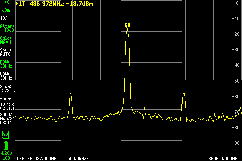

# 003 EMBER transceiver bring-up

**Status:** In progress  
**Started:** 2026-10-15  
**Updated:** 2026-10-15

The EMBER transceiver PCB arrived today. I am bringing it up in stages, starting
with unpowered checks before testing the supplies, controller, CAN interfaces,
and RF paths.

## Initial inspection and setup

I inspected the board under the microscope and did not see any solder bridges.
That is a visual observation; electrical shorts and assembly correctness have
not yet been ruled out by measurement.

The Pico and H1/H2 headers are not installed. Nothing has been connected to
the board: no supply, USB, or external interfaces. A multimeter and a NANKADF
current-limited bench supply are available. The supply model, multimeter model,
and individual board identifier have not yet been recorded. I plan to solder
one temporary power pin and one ground pin for the first tests.

## Unpowered supply resistance

With the Pico absent and the board disconnected, I measured:

| Measurement | Reported resistance |
| --- | --- |
| Meter probes touched together | 0.34 Ω |
| Across C117 — input 5 V to GND | 20 kΩ |
| Across C58 — protected 5 V to GND | 359 kΩ |
| Across C59 — 3.3 V to GND | 20 kΩ |

These readings do not indicate a hard short on the three measured rails. They
do not yet establish correct powered operation. The reported readings were taken after approximately 10 seconds of settling.
Initial readings and actual probe polarity were not separately recorded; no
lead-resistance correction has been applied.

## Power connection checks

The ordered-board pad record identifies H2 pads 25/26 as input `+5V_CON` and
H2 pads 29–32 as GND. Proposed temporary connections are H2 pad 25 for positive
and pad 29 for ground. Subsequent reported measurements were:

| Measurement | Reported resistance |
| --- | --- |
| H2 pad 25 → C117 pad 1 | 1.14 Ω |
| H2 pad 25 → C117 pad 2 | 2.38 MΩ |
| H2 pad 25 → H2 pad 29 | 5.3 MΩ |

The first reading suggests continuity along the input rail, but is above the
previous 0.34 Ω shorted-lead reading. Probe contact should be checked before
attributing that difference to the PCB. The two megohm readings differ from
the earlier 20 kΩ across C117. Probe polarity, settling time and contact for
this set were not recorded, so the discrepancy remains unresolved. Neither
measurement directly verifies H2 pad 29's connection to C117 ground.

### Correcting the measurement point

I found that I had been measuring the wrong pin and corrected the measurement
point. H2 pad 29 to C117 pad 2 then measured **1.3 Ω**, suggesting ground
continuity. The correction was moving the probe only, not relocating a soldered pin.
Which earlier readings used the wrong pin was not specified; those readings
are retained rather than treated as verified connections.

Repeating input-to-ground resistance at H2 pads 25/29 gave **4 MΩ and climbing**.
The requested orientation was red on pad 25 and black on pad 29. This is not a
settled value. A rising reading can result from the meter charging capacitance;
it does not indicate a hard short or establish powered operation.

Directly across C117, the subsequent reading was **OL**. This indicates the
meter was over range, not a measured infinite resistance. Together with the
high/rising input reading, this check has not identified a hard input-to-ground
short. The earlier 20 kΩ observation remains in the record; its difference is
not assigned a confirmed cause.

## First current-limited power-on

I confirmed the NANKADF settings at **5.0 V / 0.050 A**. The requested
connection was positive to H2 pad 25 and negative to H2 pad 29, with the Pico,
USB and other interfaces disconnected. The procedure called for a 1–2 second
power-on followed by output off; actual elapsed time and final output state
were not separately reported.

| Supply indication | Reported value |
| --- | --- |
| Output voltage | 2.95 V |
| Output current | 0.050 A |
| Regulation mode | CC |

The supply reached its current limit and did not hold the requested 5.0 V.
The 50 mA limit was deliberately conservative, not an operating-current budget.
This result alone does not distinguish normal circuit demand from a fault and
is not a successful nominal-voltage bring-up. These are supply-display values;
voltage at the board input and after U15 has not yet been measured.

### Input and protected-rail voltages

At the same 5.0 V / 50 mA supply settings, I measured **2.96 V across C117**
(board input) and **2.94 V across C58** (protected 5 V rail). Their approximately
20 mV difference shows the protection path is passing voltage in this condition.
The readings were taken separately; this is not a precision simultaneous drop
measurement or full qualification of U15. The board remains below nominal supply
voltage, and its normal operating current is still unknown.

### 100 mA current-limit step

With the supply set to 5.0 V and a 100 mA limit, the display read **3.89 V,
0.100 A, CC**. I noticed no smoke or heat during the check; no temperature
measurement was recorded. Voltage rose from the previous current-limited test,
but the board still did not reach nominal input voltage. Normal operating
current and the cause of the load remain unqualified.

### 150 mA current-limit step

At the 5.0 V setting and 150 mA limit, the supply displayed **4.97 V,
0.150 A, CC**. No smoke was observed. This is close to the requested voltage,
but the reported CC state means current limiting was still active; a stable
constant-voltage operating current has not yet been established.

### First constant-voltage result

At the 5.0 V setting with a 200 mA current limit, the supply displayed
**5.0 V, 0.150 A, CV**. No smoke was observed. This is the first reported
constant-voltage result, with current below the selected limit. The indicated
input power is approximately **0.75 W** (5.0 V × 0.150 A). It is a brief
observation, not a sustained-current or thermal qualification, and the Pico
is still absent.

### Board voltages at nominal input

The next measurements were **4.99 V across C117** and **4.97 V across C58**.
The approximately 20 mV difference is consistent with the earlier protection-path
check. The supply's current and mode were not separately reconfirmed with these
two readings. This establishes near-nominal voltage at both measured board nodes,
not yet all supply rails or functional operation.

### Lower-rail measurements with only 5 V applied

I measured **3.0 V across C105** and **0 V across C59**. C105 is on the local
`+3V0` regulator output; C59 is on the externally supplied `+3V3` rail. These
results show nominal voltage at the local 3.0 V measurement point and no measured
voltage on the unsupplied 3.3 V rail. Supply current and CV/CC mode were not
separately reconfirmed for this pair of readings.

The 5 V input/protected rail and local 3.0 V checks are encouraging, but this
is still a partial-power test. The 3.3 V-powered circuitry has not been brought
up. The Pico remains absent; installing it is not a substitute for verifying
the board's external 3.3 V supply arrangement.

## Preparing the second supply channel

A second channel capable of 3.3 V is available and reported connected, ready
for testing. Exact channel settings and its physical connection points have
not yet been reported. No dual-rail power-on result is recorded yet.

Proposed next procedure, with Pico/USB/CAN still disconnected:

1. Turn both outputs off. Use independent channels, not series or parallel mode.
   Confirm 5 V positive goes to H2 pad 25, 3.3 V positive to H2 pad 27 (or 28),
   and both negatives share board GND at H2 pad 29 (or another verified GND pad).
2. With sources disconnected, check the new positive connection to C59 pad 1
   and its ground connection to C59 pad 2 for low resistance. Return the meter
   to DC volts before powered measurements.
3. Set the 5 V channel to 5.0 V / 200 mA and the new channel to 3.30 V / 50 mA.
   The latter is an initial screening limit, not an established operating budget.
4. Enable 5 V first, then 3.3 V. Observe both channels for 1–2 seconds and record
   each voltage, current and CV/CC mode. Turn 3.3 V off, then 5 V off. Do not
   increase either current limit if it enters CC; review the readings first.

This order continues the already-tested 5 V-only configuration before adding
logic power; it is not a claim of complete board power-sequencing qualification.
Stop for smoke, odor or obvious heating. Board-rail measurements follow only
after the supply readings are reviewed.

## Identifying the second supply

I reported powering the 3.3 V connection, seeing the board's 3.3 V power LED
illuminate, and seeing the 5 V supply remain up. No numerical board voltage or
3.3 V current was recorded during that check. The second source did not have
the adjustable current limit assumed in the proposed procedure, so that
procedure was not completed as written.

Desktop inspection identified **WaveForms 3.25.1 with an Analog Discovery 3
rev C**, separate from the NANKADF 5 V source. At inspection, Master Enable
was off, the positive-supply setpoint was **3.004 V**, the negative supply was
disabled, and Hardware Power Limit was **Auto / 2.5 W**. This later UI snapshot
does not establish the voltage setting during the preceding LED observation.
No supply settings or output enables were changed during inspection.

The [Digilent manual](https://files.digilent.com/manuals/WaveForms/3.24.4/start10.html)
describes a shared adjustable power limit (0.6–15 W); it is not an adjustable
50 mA output-current limit. The displayed USB current is instrument input
current, not a measurement of current into the board's 3.3 V rail. Before the
next test, correct/verify the positive-supply setting at 3.30 V and establish
an appropriate protection and current-measurement arrangement. The next test below establishes the board voltage with both sources applied.

## Both supplies applied

For the next test, the requested settings were NANKADF **5.0 V / 200 mA** and
AD3 **V+ 3.30 V / 0.6 W hardware power limit**, with V− disabled and common
board ground. The procedure enabled 5 V first, then AD3, and called for AD3
to be switched off before 5 V after measurement. Those settings are the
requested procedure, not an independently captured instrument configuration.

I measured **3.29 V across C59**, saw **no WaveForms warnings**, and read
**0.149 A on the 5 V supply**. This confirms near-nominal external 3.3 V at the
board. The 5 V current is close to the earlier 150 mA observation; the 1 mA
difference is not interpreted as significant without instrument accuracy data.
Current into the 3.3 V rail remains unmeasured, so 149 mA is not total board
current or a complete power budget. No sustained or thermal qualification is
claimed.

### Pico supply feed

The reported voltage from **J7 pad 2 (PICO_VSYS) to J7 pad 3 (GND)** was
**4.9 V**, with the Pico still absent. This confirms voltage reaches the
Pico supply connection downstream of D14. It is an unloaded measurement at
that connector; startup with the Pico and its additional current remain untested.

## Planned check before firmware inspection

Keep both outputs off and identify the exact Pico variant and currently loaded
firmware before installation. Prepare a controlled bring-up image with RF/clock
outputs disabled before using the controller on the board. The supply measurements
do not yet establish MCU operation, CAN communication, clock generation or RF
performance. At this point, no controller installation or firmware change had been recorded.

## Bare Pico firmware inspection

I identified the controller as an original Raspberry Pi Pico, already running
transceiver comms firmware, and booted it separately with its USB console
available. It has not been installed on the new board.

A passive serial capture, with no commands sent, received:

```text
[comms] heartbeat #15  uptime=78192 ms  tasks=5  free_heap=119888  ihu=0 xacts
```

This confirms live firmware console output on the bare Pico. The boot report
was not captured, and the flashed binary was not read back or matched to a
source/build hash. No firmware was flashed and no reset or RF commands were sent.

The inspected source checkout was at EMBER commit
`9b714354fd0ca63ff51502d462ad13d26b3a837f`. Its older comms configuration uses
GP14/GP15 for an I²C housekeeping slave. The ordered PCB uses those GPIOs for
CAN_A_CSn / CAN_B_CSn at J6 pads 19/20. That source is therefore not suitable
unchanged for the current dual-CAN board. Its startup code drives TX_ACTIVE and
BPSK_DATA low and performs a read-only Si5351 status probe, but this source
inspection is not proof of the exact behavior of the flashed image.

## Safe bring-up firmware loaded

The original Pico's full 2 MiB flash was backed up and verified before replacement.
Its metadata identifies `comms`, SDK 2.1.1, original Pico, build date September 22,
2026. The backup is retained locally on two machines; SHA-256:
`b16f49870da54b0ffb7b866c33f907206b3c5daceb9b545a1fda1541b4261d1f`.
This identifies the saved image, without claiming an exact source match.

A separate `firmware/transceiver_bringup` application now uses the ordered Y24
pin map. It holds TX/RX inactive, both CAN controllers in reset and standby,
and BPSK low. It writes Si5351 output-disable register 3 to `0xFF` once per
second and checks readback. It has no CAN-transmit or clock-enable commands.
The original Pico build passed with compiler warnings treated as errors.
Host checks passed for ordered connector nets, GPIO initialization levels/order,
and I²C failure/readback handling. These checks do not measure physical pin levels.

The UF2 was flashed with readback verification and the Pico rebooted successfully.
UF2 SHA-256:
`38d1b070565c7feb6491eb5be7db8a50ca1e1ebedc706db55f0a0abaeb6073e0`.
A USB capture received:

```text
[y24-safe-v1] #6 TX=0 RX=0 CAN_A/B=reset+standby Si5351_disable=NOT_VERIFIED ADC1_raw=761
[y24-safe-v1] #7 TX=0 RX=0 CAN_A/B=reset+standby Si5351_disable=NOT_VERIFIED ADC1_raw=731
[y24-safe-v1] #8 TX=0 RX=0 CAN_A/B=reset+standby Si5351_disable=NOT_VERIFIED ADC1_raw=702
[y24-safe-v1] #9 TX=0 RX=0 CAN_A/B=reset+standby Si5351_disable=NOT_VERIFIED ADC1_raw=702
[y24-safe-v1] #10 TX=0 RX=0 CAN_A/B=reset+standby Si5351_disable=NOT_VERIFIED ADC1_raw=723
```

The Pico is still bare. `NOT_VERIFIED` is expected with the Si5351 absent;
the floating ADC readings are not receiver measurements. CAN and RF operation
remain untested.

Next: disconnect USB and switch both board supplies off before installing the
Pico. Verify orientation and inspect the soldering before the first installed
power-on. Do not power the installed Pico from USB alone with board rails off.

## First installed Pico console check

I soldered the Pico into the board, connected its USB console, and reported
both 5 V and 3.3 V supplies on. A passive six-second console capture received
heartbeats #464–470 with `Si5351_disable=verified_0xFF` on every line and
ADC1 values 2072, 2068, 2069, 2069, 2069, 2069, 2069.
The firmware continued reporting TX/RX inactive and both CAN controllers in
reset and standby. No commands or firmware changes were made during this check.

The Si5351 output-disable register now acknowledges and reads back correctly
through the installed Pico. This is not a scope measurement of clock outputs.
ADC readings correspond to approximately 1.67 V assuming a 3.30 V ADC reference,
consistent with the intended mid-supply receiver bias; reference voltage and
baseband voltage still need meter verification. This does not test RF reception.
USB is connected, so this observation does not isolate the board's VSYS feed.

Next measurements requested: 5 V supply current and regulation mode, C59 rail
voltage, RX_BASEBAND at J7 pad 9 relative to GND, and TX_ACTIVE at J6 pad 14
relative to GND. Results follow below.

## Installed-board idle measurements

With the Pico installed, USB connected, and both board supplies on, I measured:

| Check | Reported result |
| --- | --- |
| 5 V supply display | 5.00 V, 0.149 A |
| Across C59 | 3.29 V |
| J7 pad 9 — RX_BASEBAND to GND | 1.661 V |
| J6 pad 14 — TX_ACTIVE to GND | 14 mV |

The baseband voltage is near the intended 1.65 V idle bias, and TX_ACTIVE is
physically low. This supports the idle control state but does not measure RF
output power or prove the full mute path. The 5 V current matches the earlier
149 mA observation. USB can also supply the Pico, so this is not the total
installed-board current. CV/CC mode was not reported in this measurement set.

Next functional step: check each MCP25625 over SPI in configuration mode,
keeping RF muted and CAN transmission disabled. No CAN test has been performed yet.

## Dual CAN controller SPI check

Bring-up firmware v2 was built, tested on the host, flashed with readback
verification, and booted on the installed Pico. Firmware source is EMBER commit
`9402ebd` on `firmware/transceiver-y24-bringup`. UF2 SHA-256:
`5b0a235368464fc8d38bcee6370cbf21634e7047ad6f0dfe5e17abf880b1656c`.

The firmware holds both CAN transceivers in standby, releases the controller
resets after 10 ms, waits another 10 ms, and reads CANSTAT/CANCTRL through
SPI0 at 100 kHz, mode 0. It issues only SPI READ instructions. Unexpected
mode fields latch the affected controller back into reset until reboot.
Host tests covered chip-select exclusivity, read-only instructions, expected
mode decoding, invalid responses, and reset-on-failure behavior.

Six complete captured register reports, during heartbeats #9–14, all read:

```text
[can] A STAT=80 CTRL=87 CONFIG; B STAT=80 CTRL=87 CONFIG
```

These match configuration mode after reset as described in the
[Microchip MCP25625 datasheet](https://ww1.microchip.com/downloads/en/DeviceDoc/MCP25625-CAN-Controller-Data-Sheet-20005282C.pdf).
Both chip selects returned the expected values; identical reset values alone
do not prove that writes to each controller are independent. No register writes,
CAN frames, or bus acknowledgments were attempted. The transceivers remain in
standby and RF remains muted. The Si5351 disable readback passed throughout;
ADC readings over heartbeats #9–15 ranged from 2068 to 2070.

Next: verify independent register write/readback and then internal CAN loopback,
with transceivers still in standby, before connecting an external CAN peer.

## Independent registers and internal CAN loopback

Firmware v3 first wrote opposite `0x55` / `0xAA` patterns into the two
controllers' inactive TXB0D0 registers, swapped the patterns, verified each
readback, and restored the original bytes. This passed, establishing independent
access to the two controllers beyond their identical reset values.

The first loopback attempt reported frame-mismatch code 4 on both controllers
and held them in reset. A diagnostic build captured the receive buffers:

```text
A: 64 20 3B F6 08 A1 00 FF 55 AA 12 34 78
B: 64 20 FF D8 08 B2 00 FF 55 AA 12 34 78
```

ID, DLC and payload were correct. The test incorrectly compared the extended-ID
bytes, which are not part of the standard-ID frame. The comparison was corrected
to check the standard identifier, standard/data-frame flags, DLC and all eight
data bytes. Regression tests now allow arbitrary unused EID bits and reject
wrong IDs, DLCs, payloads, extended frames and remote frames. Host checks also
cover aliased chip selects, timeouts and failed mode transitions.

The corrected image built and flashed with verification. Its boot-time results
were reported consistently during captured heartbeats #9–12:

```text
[can] A STAT=80 CTRL=88 CONFIG; B STAT=80 CTRL=88 CONFIG
[selftest] independent_registers=PASS loopback_A=0 loopback_B=0 (0=PASS)
```

Each controller internally sent and received one standard-ID `0x321` frame,
DLC 8, with the payload shown above (A begins `A1`, B begins `B2`). These are
one-shot boot tests; repeated console lines report stored results. Both returned
to configuration mode, with CAN CLKOUT disabled and one-shot mode enabled.
Both transceivers stayed in standby. No normal-mode CAN traffic was enabled.
The Si5351 disable check still passed and ADC samples ranged from 2068 to 2072.

Firmware commit: `3bf6ba4`, branch `firmware/transceiver-y24-bringup`.
UF2 SHA-256:
`56d13b6da3ed1e7184c3a0105b4aed48086bf4c1c3989f0416028c929362b1ed`.

This validates independent SPI access and a small internal controller loopback
test, not CANH/CANL signaling, termination, bitrate accuracy or interrupt wiring.
Next: identify the available external CAN adapter/peer and plan a terminated
bench-bus test before enabling either transceiver.

## First powered-stack console check

I installed the transceiver headers and put the board in the stack with the
IHU and powered EPS. Both MCU USB consoles were connected. The first passive
capture showed the transceiver reporting `independent_registers=FAIL`, both
loopbacks skipped (code 6), and both CAN controllers held in reset. The Si5351
disable check still passed. This was a latched boot-test result, not a fresh
SPI test each second; the zero register readings were taken while reset was held.

After one software restart of only the transceiver Pico, with stack power
already on, independent-register and both loopback tests passed. Heartbeats
#7–11 reported both controllers back in configuration mode (`80/88`), Si5351
disable verified, and ADC1 raw 2085. No firmware was changed during this check.
Power-up sequencing is a candidate cause, not confirmed: the initial failure
was not captured at register-level detail. The boot test needs bounded rail-ready
handling and a cold-start retest before startup can be considered reliable.

The other console responded to `help` and `status` as `IHU_MCU`, firmware
`can-bench-v3`. It reported `can_ready=1`, configuration mode `80`, CNF registers
`00,f0,86`, and configured bitrate 500000. TEC, REC, EFLG and TX/RX counters
were zero. No `normal`, transmit, EPS-control or telemetry commands were issued.
Both transceiver CAN channels remain in standby; RF remains muted.

Next: establish which physical CAN channel connects the IHU to the transceiver
and verify stack termination before enabling bus traffic. The consoles and
internal tests alone do not establish the header bus connections.

## CAN A through the stack

I confirmed that IHU uses CAN A. The transceiver has no terminator; IHU and the
LTE Feather have the two terminators. CAN B is unconnected. This is the reported
termination arrangement; resistance across the assembled bus was not measured.
The ordered component record specifies 16 MHz CAN oscillators Y3/Y4, consistent
with CNF1/2/3=`00,f0,86` for the IHU's configured 500 kbit/s.

Bring-up firmware v4 adds explicit, ten-second CAN A receive windows: `l` for
listen-only and `n` for normal-mode reception with hardware acknowledgments.
All transmit requests are cleared before connecting A to the bus. CAN B stays
in standby and RF stays muted. After each window, A returns to standby and
configuration mode. No application frames are transmitted by this firmware.
SPI is now 1 MHz; both internal loopback tests continued to pass after flashing.

The IHU was explicitly put in normal mode. During the first, listen-only window,
one IHU `hello` request produced one observed frame, standard ID `0x710`.
The IHU reported FRAME_TX_FAILED and later an application timeout. Its status
showed TX success 0, failure 1 and TEC 8. This is consistent with no usable ACK
while the transceiver was silent; the LTE Feather's firmware/mode was not
inspected, so its participation is unknown.

With A acknowledging, a second `hello` produced six captured fragments and
six successful IHU frame transmissions. However, the capture ended with
`EFLG=0x40` (RX0 overflow). The diagnostic reader was changed to burst SPI reads,
RX0 rollover into RX1, and RAM capture with printing deferred until the end.
Error flags are cleared at the beginning of each new window.

A third `hello` then produced all six sequential fragments for request 3:

```text
E2 00 7E D9 08 11 00 03 00 0D 45 55 01
E2 00 3B F6 08 10 00 03 01 01 07 07 B8
E2 00 7E D9 08 10 00 03 02 8E 07 07 B8
E2 00 3B F6 08 10 00 03 03 8E 01 01 02
E2 00 7E D9 08 10 00 03 04 03 01 03 CD
E2 00 3B F6 06 12 00 03 05 C5 00 01 02
[listen_A] END frames=6 EFLG=00 mode_ok=1 restored=1
```

These are raw MCP receive-buffer bytes. Unused EID bytes and bytes past DLC
are not payload. IHU TX-success increased from 6 to 12, with failure count
remaining at 1 from the listen-only test; TEC/REC/EFLG were all zero afterward.
The HELLO application request still timed out, as this image captures frames
but does not implement a HELLO reply. No LTE upload commands were issued.

This is a successful short CAN A receive/acknowledgment test through the stack,
not full application communication or sustained-load qualification. The IHU
remains in normal mode with no pending request; both transceiver CAN channels
are back in standby/configuration. Startup sequencing, transceiver-originated
frames, IRQ wiring and application replies remain to be tested.

Firmware commit `144193b`, branch `firmware/transceiver-y24-bringup`.
Final UF2 SHA-256:
`095027b784670c91864e080caff19a3325c8381639ea74c38c4c7d6af422d970`.

## Complete IHU–transceiver HELLO exchange

Bring-up firmware v5 adds an explicit `h` window: ten seconds on CAN A,
allowing one HELLO_ACK reply to one validated IHU HELLO. The shared fragment
and COBS/CRC parsers verify the envelope, version, type, empty payload,
sender/origin relationship, and token/request correspondence. Other command
types are ignored. The reply preserves origin/request and supplies a fresh
nonzero responder boot ID. One-shot CAN transmission, bounded waits and a
single-response limit prevent indefinite retries or an open-ended service.

Host tests passed for the reply envelope and rejection of wrong version/type,
payload, origin, token, corrupted encoding/CRC and trailing partial data.
GPIO/loopback checks and the warning-as-error target build also passed. The
image was flashed with verification; both internal CAN tests passed again.

With IHU already in normal mode, an `h` window and one IHU `hello` produced:

```text
IHU: SUBMITTED request=4 type=1 bytes=0
IHU: RESULT request=4 outcome=CAN_HELLO_CONFIRMED peer=653843575 bytes=0 hex=
COMMS: [listen_A] END frames=6 EFLG=00 mode_ok=1 restored=1
COMMS: [hello_A] boot=653843575 request=4 attempted=1 tx_complete=1
```

The IHU matched the response to request 4 and identified the same responder
boot ID reported by the transceiver. Its TX-success count increased from 12
to 18, RX count from 0 to 6, and matched count from 0 to 1. TEC, REC, EFLG,
RX-bad, overflow and fragment-error counters were zero. TX-failure remained
at the prior value of 1; no new failure occurred in this exchange. Pending
was zero afterward.

This establishes one complete **IHU → CAN A → transceiver → CAN A → IHU**
application exchange at the configured 500 kbit/s. It is not a sustained-load,
redundancy, CAN B wiring, or RF qualification. Both transceiver CAN channels
returned to standby/configuration, TX/RX remained inactive, and the Si5351
disable readback passed. No LTE or EPS commands were sent.

Firmware commit `1070627`, branch `firmware/transceiver-y24-bringup`.
UF2 SHA-256:
`08dc90e9f5ea7a702872b0dfdfbcac0b37cdb5f55fcd516e2a82e10394066297`.
Next: address the startup-sequencing failure and perform a controlled cold-start
retest before moving on to RF clock measurements.

## Bounded startup readiness update

Firmware v6 keeps both CAN transceivers in standby while making up to twenty
reset/readback attempts, approximately five seconds total. Each attempt holds
reset low for 10 ms, waits 20 ms after release, and requires two configuration
register samples 20 ms apart. Failed attempts reassert reset and wait 200 ms.
Exhaustion holds both controllers in reset. Si5351 output-disable is attempted
during the sequence. Readiness indicates responsive controller registers, not
measured power-good signals. The original failure's physical cause is still
unconfirmed.

Host tests passed for delayed replies recovering on attempt 2, permanent failure
exhausting twenty attempts with reset asserted, and immediate recovery on a new
attempt sequence. Existing GPIO, loopback and HELLO parser tests also passed.
The warning-as-error build and flash verification passed.

With stack power already established, the restarted image reported:

```text
[startup] ready=1 attempts=1 last_A=80/87 last_B=80/87
[selftest] independent_registers=PASS loopback_A=0 loopback_B=0 (0=PASS)
```

Heartbeats #7–10 retained those results, verified Si5351 disable, and ADC1
2084–2085. This is a successful warm-start check; a true cold-start test remains
pending. No new CAN traffic was requested in this step.

Firmware commit `62a3e45`, branch `firmware/transceiver-y24-bringup`.
UF2 SHA-256:
`9d2bfaa703eabfa889f51ef723bdbe80f109fd213549371398de350651576a6e`.

Proposed cold-start check: unplug all USB power paths to the stack, turn stack
power off, verify power indicators extinguish and wait ten seconds. Restore
stack power first, wait five seconds, then reconnect MCU USB consoles. Inspect
startup logs before enabling CAN. This avoids deliberately running the installed
Pico from USB with board rails off. The test has not yet been performed.

## First controlled cold-start result

I reported the stack back up after the requested power-off/power-on procedure.
Both USB consoles were available again. No software reset, flash, or CAN-enable
command was sent during this inspection; only IHU `status` was requested.

The transceiver's retained boot result was:

```text
[startup] ready=1 attempts=1 last_A=80/87 last_B=80/87
[selftest] independent_registers=PASS loopback_A=0 loopback_B=0 (0=PASS)
```

Heartbeats #25–29 consistently showed both controllers in configuration mode,
both transceivers in standby, TX/RX inactive and Si5351 disable verified.
ADC1 ranged from 2084 to 2086. IHU reported a new boot ID, uptime approximately
23.7 seconds, CAN ready in configuration mode, and zero TX/RX/error counters.

This is one successful reported cold-start cycle with the requested stack-power-
first, USB-afterward sequence. No retry was needed, so it does not demonstrate
physical delayed-rail recovery or prove the original failure's cause. Repeated
cycles and other supported power sequences remain unqualified. No fresh CAN
round trip was performed after this cycle; the earlier exchange remains the
application-level evidence.

Next: identify available RF measurement equipment and plan clock measurements
before enabling a clock output. RF is still muted.

## RF instrument setup

Available instruments now include a Rigol DS1202Z-E and a tinySA, in addition
to the Analog Discovery 3. A read-only network SCPI query successfully identified
the Rigol as DS1202Z-E, firmware 00.06.04. CH1 was enabled, configured for a
10× probe, with its bandwidth limit off; CH2 was disabled. Timebase was
200 µs/div and trigger state WAIT. These are instrument settings, not evidence
of a connected probe's actual attenuation or a measured board waveform.
No settings were changed and no clock output was enabled.

The tinySA did not appear in the USB device inventory during this check.
Its exact variant, firmware and input arrangement still need identification
before spectrum measurements. The physical scope probe model is also pending.

## Probe and analyzer identified

I identified the scope probe as a Rigol PVP2350 with its switch at 10×.
I moved the IHU USB cable to the tinySA; the transceiver console remained
available. The analyzer's USB `info` response identified **tinySA ULTRA**,
firmware `tinySA4_v1.4-156-g4eb315d`, built February 27, 2024. No analyzer
measurement settings or generator modes were changed.

The Rigol was configured for a preliminary probe-compensation check: CH1,
10× scaling, DC coupling, 1 V/div, 500 µs/div, rising-edge trigger at 1.5 V,
auto sweep/run. It returned no SCPI error. Connecting the probe to the scope's
front-panel compensation output and inspecting the waveform is still pending.
No board clock outputs were enabled and no RF connection to the analyzer
was requested.

## Probe compensation check

The first capture was nearly flat because I had not connected the probe BNC
to the scope. After connecting it, CH1 measured approximately **1.000 kHz**,
**3.08 V peak-to-peak**, top **2.948 V**, and base **0.035 V** on the scope's
compensation output. These are scope-reported values, not calibration against
an independent reference.

The display showed square pulses with generally flat tops. A LAN settings
popup obscured part of the screen, so a separate waveform transfer was used
to check the plateau. In the 1200-point display waveform (5 µs/sample), early
high-plateau means were 2.962–2.980 V and later means approximately 2.960 V.
No substantial plateau droop/peaking was evident at this resolution, so no
compensation-screw adjustment was requested. This is a preliminary compensation
check, not a high-frequency probe calibration or edge/ringing qualification.

[Raw scope waveform and scaling preamble](files/probe-compensation-waveform.json)
are retained. The probe is still on the compensation output; no board clock
measurement or clock-enable operation has occurred.

## CAN A oscillator measurement

Moved the 10× PVP2350 probe to Y3 output pad 3, with pad 2 as the
requested ground point. CH1 used DC coupling, 1 V/div, 50 ns/div,
full bandwidth and a 1.5 V rising-edge trigger. The first reading was
approximately zero with 160 mV peak-to-peak noise and no measurable frequency.
After another probe attempt, a clock was present.

The repeat capture reported 16.129 MHz (62 ns period), high plateau 3.264 V,
low plateau 0.013 V and 3.60 V peak-to-peak. Separate extrema queries read
+3.48 V and −0.20 V; these running-acquisition measurements are not necessarily
from the same cycle. The display waveform has 0.5 ns sample spacing, so the
quick frequency result establishes approximately 16 MHz operation, not
oscillator frequency accuracy. Probe loading and grounding can affect the
observed overshoot; edge quality remains unqualified.

Y3 is oscillating at approximately its nominal frequency with a roughly 3.3 V
logic swing. No Si5351 clock-enable command was issued. Next is the equivalent
Y4 CAN B oscillator check, followed by controlled Si5351 testing.

Raw captures: [initial attempt](files/y3-can-a-clock-waveform.json) and
[clock present](files/y3-can-a-clock-retry-waveform.json).

## CAN B oscillator measurement

With the probe moved to Y4 (requested tip pad 3, ground pad 2), the same
10×, DC-coupled, 1 V/div, 50 ns/div setup measured a clock with high plateau
**3.251 V** and low plateau **0.020 V**. The scope reported **3.64 V
peak-to-peak**, with separately queried extrema +3.48 V and −0.20 V.
Frequency and period queries returned 16.129 MHz and 63 ns respectively;
these separate running-acquisition readings have limited resolution and
are not mutually exact. They establish approximately **16 MHz** operation,
not oscillator accuracy. The transferred waveform uses 0.5 ns sample spacing.

Y4's frequency and logic swing are similar to Y3's. Both CAN oscillators now
have direct scope evidence of operation; CAN B bus signaling remains untested.
No Si5351 output was enabled. Next is preparation of controlled Si5351 tests
with the hardware TX mute held inactive.

[Raw Y4 waveform, readings and settings](files/y4-can-b-clock-waveform.json).

## Preparing the Si5351 test

Bring-up v7 adds a single-byte `c` command for a ten-second maximum, 10 MHz
CLK0 test: 25 MHz crystal → PLLA ×32 → MS0 ÷80, with 2 mA drive.
TX_ACTIVE, RX_ACTIVE and BPSK remain low; the hardware AND gate U14 is
commanded muted. CLK1/CLK2 remain disabled. Register readback, PLLA lock,
crystal-loss status and a deadline guard the window; any received console
input aborts. Shutdown attempts both register 3 disable and CLK0 power-down.
An I²C fault can prevent those writes, so shutdown is verified and reported,
not assumed. Physical mute isolation remains to be measured.

Host tests passed for the register plan, timing, each individual I²C failure,
missing/lost PLL lock, bad readback and input abort. Existing CAN/GPIO and HELLO
tests and the target build passed. Firmware was flashed with readback
verification. UF2 SHA-256:
`4901e8e01af0d5939a94098a34abbf9b730ae3f89674b6a34352f82f138daa7a`.

Only the new read-only `s` command was sent after flashing:

```text
[clock_status] r0=11 r3=FF r16=00 r17=00 r18=00 r183=D2
```

The output-disable readback remained FF, both internal CAN loopbacks passed,
and startup succeeded on attempt 1. No clock-enable command has been sent.
Register 183 remains at D2 (10 pF internal load selection). The exported
circuit also includes external 15 pF C1/C2; combined loading and frequency
accuracy need evaluation, and no load-setting change has been made.
Programming reference: [Skyworks AN619 rev 0.8](https://www.skyworksinc.com/-/media/Skyworks/SL/documents/public/application-notes/AN619.pdf).

Next: place the 10× scope probe on TP1 (AC-coupled CLK0_OUT after C6/R3),
with a short ground connection to C81 pad 2, then request the bounded test.
The tinySA remains disconnected. This is test preparation, not a measured
Si5351 output or RF result.

## First Si5351 output measurement

After confirming the probe on TP1 with the requested C81 pad 2 ground,
sent one `c` command. The Rigol was DC coupled, 10×, 1 V/div, 50 ns/div,
auto trigger at 1 V. During the bounded window it reported **10.000 MHz**,
**100 ns**, **3.32 V peak-to-peak**, high plateau **2.689 V** and low plateau
**−0.451 V**. Separately queried extrema were +2.76 V and −0.52 V.
These running acquisitions are not necessarily the same cycle; the frequency
reading is not a calibrated accuracy result.

Firmware reported `complete=1 shutdown_verified=1 status=11`. Afterward the
scope showed no measurable frequency, 120 mV peak-to-peak noise and mean
−4.7 mV. Readback was `r3=FF r16=80 r17=80 r18=80 r183=D2`. Both register
and scope evidence therefore support successful clock generation and shutdown.
TX/RX controls remained low; RF mute isolation was not measured.

The negative plateau at TP1 needs investigation before higher-frequency tests.
The exported netlist shows C6 (100 nF), R3 (0 Ω), then TP1/U7 input, with no
separate DC bias connection on that net. AC coupling and input-clamp action
are a candidate explanation, not a confirmed diagnosis. The
[TI SN74LVC1G86 datasheet](https://www.ti.com/lit/gpn/SN74LVC1G86)
gives a −0.5 V absolute input-voltage limit, with a clamp-current exception;
clamp current has not been measured. The observed undershoot is not accepted
as a qualified input waveform. Probe grounding and source-side levels need
comparison. Clock remains off; next proposed point is C6 pad 1, before the
coupling capacitor. No component changes have been made.

[Raw waveform, console results and post-window readings](files/clk0-10mhz-first-waveform.json).

## Source-side comparison attempt

After the requested move to C6 pad 1, another bounded test detected 10 MHz
and completed with verified shutdown. However, sequential scope voltage
queries varied substantially: VMAX +2.28 V, VMIN −1.84 V, VTOP +3.76 V,
VBASE −0.92 V and VAVG +2.50 V. These cannot describe one consistent waveform.
The separately transferred waveform ranged from −1.28 to +2.80 V, with
mean +0.770 V. DC coupling and 10× scaling were verified.

This is not an accepted source-voltage measurement. Probe/ground contact,
measurement-point identification and acquisition stability need checking;
no circuit fault is diagnosed from this attempt. After the window, the scope
showed no frequency, 160 mV peak-to-peak noise and mean −2.7 mV; registers
3/16/17/18 were FF/80/80/80. The clock remains disabled. Next: secure the
probe and ground before a repeat using a stopped, single acquisition.

[Raw source-side attempt](files/clk0-10mhz-c6-source-waveform.json).

## Stable source-side capture

After confirming the tip and ground were steady, repeated the bounded test
and stopped the scope during the active window. STOP was verified before
reading measurements and transferring the waveform. C6 pad 1 measured
**10.000 MHz / 100 ns**, with high plateau **3.199 V**, low plateau **0.062 V**,
and extrema **0.00–3.32 V**. The transferred waveform independently gives
0.00–3.32 V and mean 1.650 V, consistent with the scope's mean 1.653 V.

This supports normal source-side clock swing at 10 MHz. The previous erratic
source-side attempt was not reproduced; its precise cause remains unconfirmed.
It does not yet resolve the negative plateau previously measured downstream
at TP1. Next: repeat TP1 using the same stopped-acquisition method before
changing components or increasing frequency.

Firmware again reported complete=1 and shutdown_verified=1. After resuming
scope acquisition following the window, no frequency was measurable, mean
was −2.1 mV and peak-to-peak noise 160 mV. Registers 3/16/17/18 read
FF/80/80/80. Clock is off and TX remains commanded muted.

[Raw frozen source-side waveform and console](files/clk0-c6-source-frozen-waveform.json).

## TP1 negative level reproduced

Repeated the TP1 measurement after the stable source-side check. At 10 MHz,
TP1 again measured high plateau **2.687 V**, low plateau **−0.458 V**, and
extrema **−0.52 to +2.76 V**. The transferred waveform independently matches
those extrema and a mean of 1.124 V. A STOP command was sent before measurement,
but the immediate trigger-status response was TD rather than STOP, so this
attempt does not establish a verified frozen acquisition. Nevertheless, its
consistent measurements reproduce the earlier downstream negative plateau.

The contrast with the source-side 0.062–3.199 V plateaus supports a DC-level
shift across the AC-coupled connection. Input-clamp action is plausible but
clamp current is unmeasured. Do not increase clock frequency until resolving
this input condition. A direct CMOS connection in place of C6 is the proposed
rework to evaluate: the exported board record places both devices on 3.3 V,
and there is no independent DC bias network on CLK0_OUT. No rework has occurred.

Firmware reported complete=1/shutdown_verified=1, and readback was
FF/80/80/80 for registers 3/16/17/18. Afterward the scope detected no frequency,
with 160 mV peak-to-peak noise and mean −5.6 mV. TX remains commanded muted.

[Raw TP1 repeat and console](files/clk0-tp1-frozen-waveform.json).

## Open issue: CLK0 AC-coupled XOR input

**OPEN — C6 rework deferred.** A 0 Ω link is not available, so C6 remains
unchanged at the user's direction. TP1's repeated negative plateau is retained
as an unresolved electrical issue, not waived or marked acceptable. Proposed
remedy is a direct CMOS connection in place of C6, followed by repeat voltage,
edge and operating-frequency checks; no fix has been tested.

Continue bounded 10 MHz diagnostic checks with TX_ACTIVE low. Full-frequency
and transmit-path qualification remain deferred. Next measure the signal at
U14 pin 1 (U7 XOR output), then U14 pin 4 to check whether the mute suppresses
a verified input clock. A flat mute output without checking its input would
not alone demonstrate the gate's function. No new clock command was sent
while arranging these probe moves.

## First conducted TX carrier test

At my request, proceeded with a short TX tone while leaving C6 unchanged.
Reported connection: J9 → external DC block → 30 dB pad → tinySA RF input;
confirmed the scope probe was removed. Firmware v8 (`5b5609a`) adds `t`:
PLLA 874 MHz, CLK0 divide-by-six, BPSK low, RX clock off, TX path selected
before clock enable with 1 ms settling, then ten-second maximum transmission.
Cleanup always restores TX_ACTIVE low, including I²C failures. Host clock/TX
fault tests, existing checks and target build passed; flashing was verified.
UF2 SHA-256:
`50fdd4f371886a77895c32171f8a75e83940670c8161d0d05484dfa9e6c273e9`.

TinySA was set to input mode, LNA off, internal attenuation 10 dB, external
gain 0, requested RBW 30 kHz, 435–439 MHz. The 201-point USB scan completed
2.70 seconds after the command and returned a peak at **436.98 MHz**, reported
level **+5.844 dBm**. This level is anomalously high for this board with the
reported external attenuation: adding 30 dB would imply power inconsistent
with the expected amplifier/supply budget. Do not interpret it as calibrated
board power. Check attenuator identity/connection, analyzer calibration and
overload before further TX measurements. Frequency is only a coarse peak bin.

Firmware reported complete=1, shutdown_verified=1, TX=0. The after-window
scan maximum was −84.625 dBm and output controls read FF/80/80/80, supporting
carrier generation through the conducted path and subsequent shutoff. C6,
operating-frequency logic behavior, RF spectrum and output power remain open.

I saw the TX LED but not a trace on the analyzer. USB scan leaves sweeping
paused, and the later after-window scan replaced the trace with noise. A screen
capture confirmed PAUSED. Display was then restored to live 437 MHz center,
4 MHz span, +10 dBm reference and max hold, without another TX command.

[Raw baseline, during/after scans and console](files/y24-first-tx-tone.json).

## Corrected attenuator hookup and repeated TX burst

**Correction to the preceding test:** I discovered that the 30 dB pad was
not installed. The first TX burst went through the external DC block directly
to the tinySA RF input. The earlier setup description records what was reported,
not the actual connection. Its +5.844 dBm reading must not have 30 dB added.
That exposure does not by itself establish damage or analyzer health.

After installing the 30 dB pad and confirming readiness, repeated one ten-second
`t` window. Analyzer settings remained input mode, LNA off, 10 dB internal
attenuation, external gain 0, requested RBW 30 kHz, 435–439 MHz sweep.
The USB scan returned **−18.656 dBm at 436.98 MHz**; a subsequent live/max-hold
display showed **436.972 MHz, −18.7 dBm**. The difference in frequency is
consistent with the different sweep grids, not an accuracy claim.

Adding nominal external attenuation gives **+11.34 dBm, approximately 13.6 mW**
at the board before accounting for cable/DC-block losses. This is preliminary:
attenuator loss and analyzer calibration are unverified. The observed level
change from the unattenuated attempt is 24.5 dB rather than 30 dB, so the two
runs do not validate absolute power or pad loss; overload/compression, loading
and setup differences remain possible explanations.

The retained display also shows smaller peaks approximately 1 MHz either side
of the carrier, around −59 dBm on this trace. Their source and levels require
further investigation. This narrow scan does not qualify harmonics or the full
TX spectrum. C6 and frequency accuracy remain open issues.

Firmware reported complete=1, shutdown_verified=1, TX=0; registers 3/16/17/18
read FF/80/80/80. Max hold deliberately retains the carrier after TX shuts off;
it is not evidence of continued transmission. Unlike the previous run, no
after-window spectrum scan overwrote the retained trace.



[Raw attenuated TX scan and console](files/y24-pad-tx-tone.json).

## Analyzer attenuation cross-check

With the external 30 dB pad still installed, ran separate ten-second TX windows
at 10 and 20 dB internal attenuation. LNA was off, external gain zero, RBW
requested 30 kHz, averaging/max hold off for the USB measurements. Each run
included a baseline and after-window scan.

| Internal attenuation | Carrier peak | Lower side peak | Upper side peak |
| --- | --- | --- | --- |
| 10 dB | 436.980 MHz, −19.156 dBm | 435.960 MHz, −61.125 dBm | 437.980 MHz, −60.156 dBm |
| 20 dB | 436.980 MHz, −19.156 dBm | 435.980 MHz, −60.125 dBm | 437.980 MHz, −60.156 dBm |

The analyzer-referred carrier level agreed at its reported resolution, and the
side peaks were approximately 41–42 dB below the carrier. This makes simple
analyzer overload less likely; it does not establish their origin or calibrate
the power measurement. Nominal pad correction gives +10.844 dBm, about 12.1 mW,
excluding cable/DC-block loss. The prior estimate was approximately 13.6 mW;
these are preliminary readings, not a calibrated output specification.

Both tests reported complete=1/shutdown_verified=1. After-window carrier-band
maxima were −91.656 and −83.656 dBm respectively, consistent with the higher
noise floor at greater internal attenuation. No carrier remained apparent.

[Raw attenuation comparison](files/y24-tx-attenuation-comparison.json).

## Targeted leakage and harmonic windows

A further ten-second window used 20 dB internal attenuation, the same external
30 dB pad, LNA off and requested 30 kHz RBW. Four 101-point windows were captured
between 1.70 and 2.31 seconds after the TX command; matching baselines were
captured before TX.

| Window | Highest during-TX reading | Highest baseline reading |
| --- | --- | --- |
| 145.3–146.0 MHz (drive) | −85.375 dBm | −85.375 dBm |
| 291.0–291.7 MHz (twice drive) | −79.625 dBm at 291.308 MHz | −83.625 dBm |
| 436.6–437.3 MHz (carrier) | −19.156 dBm at 436.971 MHz | −81.656 dBm |
| 873.4–874.6 MHz (twice carrier) | −73.656 dBm | −72.656 dBm |

No clear rise above the sampled baseline maxima appeared in the drive or
second-carrier windows. The roughly 4 dB rise near 291.3 MHz is marginal against
the measured noise and is not a quantified harmonic result. Band-dependent
sensitivity and calibration are not established; these narrow windows do not
replace a full spectrum survey or provide certified suppression limits.

Shutdown again reported verified with TX=0 and registers FF/80/80/80.
The analyzer was returned to live 437 MHz center / 4 MHz span; max hold is off,
so the present display is the muted noise floor.

Open items: C6 input bias/undershoot; approximately 29 kHz apparent carrier
offset (analyzer/reference calibration needed before assigning cause);
approximately ±1 MHz side peaks; calibrated output power; full spectrum;
modulated TX and RX functionality. No hardware changes were made.

[Raw targeted windows and console](files/y24-tx-harmonic-windows.json).

## Fractional PLL comparison: 437 / 437.5 / 437 MHz

Firmware v9 adds diagnostic command `u`, targeting 437.5 MHz with PLLA
875 MHz = 25 MHz ×35 and the same divide-by-six clock/tripler path. The PLL
ratio has no fractional remainder; FBA_INT stays clear because 35 is odd,
following [AN619 §3.2.1](https://www.skyworksinc.com/-/media/Skyworks/SL/documents/public/application-notes/AN619.pdf).
The normal `t` command remains 437 MHz (PLL ratio 34+24/25). This comparison
does not change the board's design frequency. Fault-injection tests, existing
host checks and target build passed; flashing was verified. UF2 SHA-256:
`0f01ab3d63c9027aaeb0d805531ec04f1d4fdefb0513225e97488c13e2e9c45d`.

Used the unchanged external DC block/30 dB pad, tinySA internal attenuation
20 dB, LNA off, external gain zero. Three ten-second windows ran in order
`t`, `u`, `t`. Each included a 435–440 MHz, 301-point scan at requested 30 kHz
RBW, then a ±100 kHz, 101-point scan at requested 3 kHz RBW. Both scans
finished about 3.61 seconds after each command. Baselines were captured first.

| Nominal carrier / PLL ratio | Fine-scan peak | Fine-scan level | Maxima in ±1 MHz neighborhoods, wide scan |
| --- | --- | --- | --- |
| 437 MHz / 34+24/25 | 436.972 MHz | −19.156 dBm | −60.625 / −59.656 dBm |
| 437.5 MHz / 35 | 437.472 MHz | −19.156 dBm | −76.656 / −75.656 dBm |
| 437 MHz / 34+24/25, repeat | 436.972 MHz | −19.156 dBm | −60.125 / −59.656 dBm |

The integer-ratio setting reduced those neighborhood maxima by approximately
16 dB without a substantial carrier-level change; the peaks returned with the
original fractional setting. This strongly implicates clock synthesis in the
side peaks. It does not isolate the mechanism conclusively, and the lower
readings are neighborhood maxima, not necessarily residual discrete spurs.
Do not treat this as full spectral qualification or a reason to silently
change the required operating frequency.

Both nominal frequencies read approximately 28 kHz low (about 64 ppm), on a
2 kHz measurement grid. This common fractional offset is consistent with a
reference-frequency error somewhere in the source/analyzer measurement chain;
an independent reference is needed before blaming the crystal or applying
firmware correction. Crystal loading, including external C1/C2, remains open.

Every burst reported complete=1/shutdown_verified=1 and TX=0. Final register
readback was FF/80/80/80; startup and both internal CAN tests passed. All clocks
are disabled. C6 remains unchanged and its input-level issue remains open.

[Raw comparison spectra and console](files/y24-tx-pll-comparison.json).

## Independent Rigol frequency-counter cross-check

The C6-to-C81 ground span was impractical for the probe. Used C6 pad 1 as
the tip point and requested Y1 ground pad 2 or 4 instead; the exact selected
ground pad was not specified. Y1 crystal-signal pads 1/3 were explicitly excluded.
The probe remained 10×. Enabled the Rigol's CH1 frequency counter rather than
relying on its coarser waveform frequency measurement.

During one muted ten-second 10 MHz clock window, five counter queries returned
9,999,461.2; 9,999,463.6; 9,999,463.6; 9,999,463.2; and 9,999,462.8 Hz.
Their mean is **9,999,462.88 Hz**, or approximately **−53.7 ppm** relative to
the programmed nominal frequency. Displayed digits and the 2.4 Hz sample
spread are not instrument accuracy specifications; repeated values may share
a counter update. Waveform frequency queries still rounded to 10.000 MHz,
and peak-to-peak voltage was 3.32 V.

The Rigol independently observes a low frequency, supporting a source/reference
issue rather than an effect solely in the tinySA peak display. Its indicated
fractional error would correspond to approximately −23.5 kHz at 437 MHz,
compared with the tinySA's approximately −28 kHz result. Neither timebase has
been checked against a calibrated standard; no firmware correction is justified
from this comparison alone. Possible crystal-loading error remains a hypothesis.

The test completed and shutdown was verified, with TX held low throughout.
Afterward the scope detected no frequency, 160 mV peak-to-peak noise and mean
+3.6 mV; registers 3/16/17/18 read FF/80/80/80. No TX tone was requested.
Next proposed check is Y3's nominal 16 MHz oscillator using this same Rigol
counter, as an additional reference comparison rather than a calibration.

[Raw counter readings and console](files/clk0-rigol-frequency-counter.json).

## CAN oscillator counter comparison with accessible ground

The first Y3 counter attempt showed no clock and 120–160 mV peak-to-peak
noise. A subsequent attempt showed approximately 25 MHz at 0.88–1.04 V
peak-to-peak, with no counter result. That did not match Y3 and was not accepted
as a Y3 measurement; the contacted node was not confirmed. Directly spanning
Y3 pads 2/3 was impractical, so used the user-proposed **C8 pad 2 ground to
Y3 pad 3 output** instead.

Six counter queries then returned 16,000,191; 16,000,190; 16,000,192;
16,000,192; 16,000,190; and 16,000,193 Hz. Mean **16,000,191.33 Hz** is
approximately **+12.0 ppm** relative to nominal 16 MHz. Peak-to-peak voltage
was 3.64–3.68 V. The coarse waveform-frequency measurement alternated between
15.873 and 16.129 MHz; it is unsuitable for this ppm comparison. Use the
frequency-counter readings, while retaining the distinction between repeatability
and absolute accuracy.

The same Rigol counter reads Y3 slightly high and Si5351 CLK0 approximately
53.7 ppm low: their normalized readings differ by about 65.7 ppm. This supports
a difference between the board's two clock sources, rather than attributing
all the Si5351 result to a common scope timebase error. Y3 is not a calibrated
reference, and the Si5351 crystal/load setting, temperature and probe effects
remain unqualified. No absolute frequency correction has been applied.

No firmware commands or TX windows were used in these Y3 checks. Next proposed
investigation: verify the Si5351 crystal-loading arrangement and compare its
supported internal load settings with outputs otherwise muted, before choosing
any frequency correction or component rework.

Raw records: [no signal](files/y3-rigol-frequency-counter.json),
[unidentified 25 MHz attempt](files/y3-rigol-frequency-counter-retry.json),
and [accepted Y3/C8 comparison](files/y3-c8-ground-frequency-counter.json).

## Reversible crystal-load comparison

Firmware v10 (`fd26103`) adds commands `0`, `8`, `6` for temporary 10/8/6 pF
internal load settings. Each saves register 183, disables clocks, writes and
verifies the selected documented value (D2/92/52), waits 200 ms, runs one
muted ten-second 10 MHz window, then disables clocks and restores the saved
value. TX/RX/BPSK remain low. Reserved load selection 00 is never used.
Single-transfer I²C fault sweeps, abort/lock tests, existing checks and target
build passed; firmware flash verification passed. UF2 SHA-256:
`148000f8ab4865d5ad8deddfb94bd789453d9f7b494c552dea5dff513cc4c6a3`.

With the user-confirmed C6 pad 1 tip and Y1 ground pad 2 or 4, ran 10 → 8 →
6 → 10 pF. Each row is the arithmetic mean of five Rigol counter queries,
not a calibrated frequency result. External C1/C2 remained unchanged.

| Internal load setting | Mean measured frequency | Offset from 10 MHz |
| --- | --- | --- |
| 10 | 9999462.80 Hz | -53.72 ppm |
| 8 | 9999521.36 Hz | -47.86 ppm |
| 6 | 9999608.68 Hz | -39.13 ppm |
| 10 | 9999462.32 Hz | -53.77 ppm |

The 8 pF set contained one 9,999,506 Hz reading versus four 9,999,525.2 Hz
readings; it is retained rather than discarded. Its median is 9,999,525.2 Hz
(−47.48 ppm). Displayed precision and sample spread do not establish absolute
accuracy or statistical independence of counter updates.

Reducing internal load raised the frequency, with a roughly 14.6 ppm shift
from 10 to 6 pF. Returning to 10 pF reproduced the starting frequency within
0.5 Hz in these sample means. This demonstrates sensitivity to load setting,
but the minimum setting still read approximately 39 ppm low. It does not prove
how much of the remaining error comes from crystal tolerance, external loading,
probe coupling or scope timebase. External capacitor removal/substitution and
traceable calibration remain unperformed; no permanent correction was chosen.

All four windows reported configuration, completion, shutdown and restoration
successful. Between windows the scope could not measure a frequency. Final
status was r3=FF, r16/17/18=80, r183=D2: original 10 pF restored, outputs off.
TX remained muted throughout; no RF carrier was requested.

[Raw load comparison and console](files/y24-crystal-load-comparison.json).

## External crystal capacitors: review and proposed rework

The ordered design records specify Y1 as ABM8G-25.000MHZ-B4Y-T and C1/C2
as 15 pF from XA/XB respectively to ground. The [Abracon ordering table](https://abracon.com/Resonators/ABM8G.pdf)
specifies a default 10 pF crystal load; this part has no alternate load option.
Its initial frequency tolerance is ±30 ppm, separate from temperature stability.

[Si5351 datasheet section 4.1.1](https://www.skyworksinc.com/-/media/Skyworks/SL/documents/public/data-sheets/Si5351-B.pdf)
provides internal crystal loading and limits optional additional external loading
to 2 pF equivalent (4 pF on each crystal terminal). Our two 15 pF capacitors
exceed that guidance. With internal loading already set to 10 pF, excess
external loading is a likely contributor to the observed low frequency. The
reversible load test supports the direction of this effect, but does not prove
that it accounts for the whole offset or the fractional-PLL side peaks.

Proposed next experiment, not yet performed: disconnect all board power and
USB, remove C1 and C2, and leave their pads open. Do not bridge these pads:
each capacitor connects a crystal terminal to ground. Leave C6 unchanged so
only one issue is tested. After inspection, restore power and compare startup,
PLL lock and the same muted 10 MHz counter measurement with internal loading
at 10 pF. Absolute frequency accuracy remains uncalibrated. No hardware,
KiCad source, firmware setting or instrument state was changed in this review.

## C1/C2 removal reported; power check pending

The user reports C1 and C2 are now open. A subsequent read-only console check
found the Pico running v10, but every requested Si5351 register read failed;
both CAN controllers also reported failed startup/readiness. TX/RX GPIOs were
reported low. This is consistent with missing peripheral power, but power
state has not yet been confirmed. No clock or TX test was started, and these
results do not establish an oscillator failure after capacitor removal.
Next: confirm board rails, restart the Pico after rails are stable, and restore
the C6 pad 1 / Y1 ground probe setup before the muted frequency comparison.

## First clock measurements with C1/C2 open

Reconnecting USB did not restart the board-powered Pico: its earlier failed
startup state persisted. A targeted USB application reboot restarted only the
transceiver Pico. Startup then passed on the first readiness attempt; independent
CAN register tests and both internal loopbacks passed. Si5351 responded with
10 pF loading selected and outputs disabled.

With the user reporting the probe ready, ran two muted ten-second 10 MHz
windows at internal 10 pF. Before removal, the last 10 pF mean was
9,999,462.32 Hz (−53.77 ppm). After removal:

| Window | Mean counter frequency | Offset | Observed range |
| --- | --- | --- | --- |
| First, 5 queries | 9,999,843.76 Hz | −15.62 ppm | 9,999,728–9,999,928 Hz |
| Repeat, 6 queries | 9,999,901.93 Hz | −9.81 ppm | 9,999,871.2–9,999,928.8 Hz |

The repeat explicitly set CH1 to 10×, DC coupling, 1 V/div, bandwidth limit
off, 50 ns/div, positive-edge triggering at 1.5 V and CH1 counter source.
Both windows completed with shutdown and load restoration verified; final
r3=FF, r16/17/18=80, r183=D2 and TX=0. No RF transmission was requested.

Frequency moved toward nominal, consistent with reducing excess crystal
loading. However, readings fluctuate substantially more than the pre-rework
baseline. Sequential voltage measurements were also inconsistent (reported
VBASE below VMIN and VPP incompatible with the separate extrema), so they do
not establish a valid voltage swing. Probe contact/ground and acquisition need
checking before treating this as a stable frequency result or applying any
calibration. The Rigol timebase remains uncalibrated.

Raw records: [first window](files/y24-c1-c2-removed-counter.json) and
[repeat](files/y24-c1-c2-removed-repeat.json). Next: reseat C6 pad 1 tip and
Y1 ground, then capture a stable waveform and repeat the counter check.

[Related antenna investigation](../001-ember-antenna/README.md) ·
[Back to Lab Log](../../README.md)
