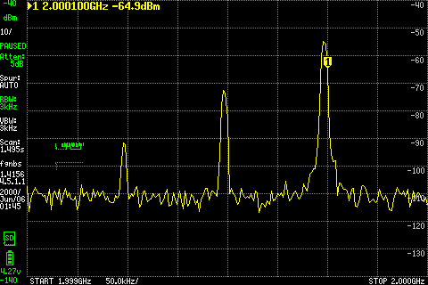
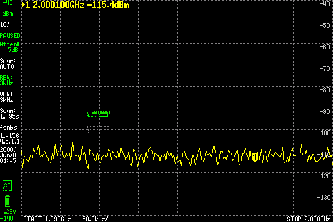
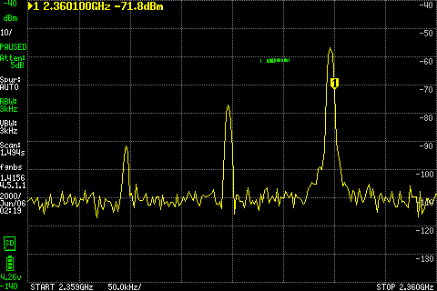
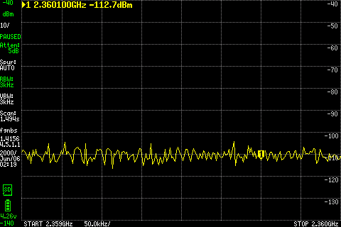
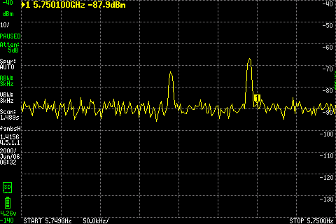

# 004 LibreSDR TX power check

**Status:** In progress  
**Started:** 2026-10-18  
**Updated:** 2026-10-21

During SDRB testing, the received tone looked weak. Before choosing attenuation
between the radios, I wanted to check what LibreSDR was actually delivering.

## Setup

LibreSDR **TXA → cable/DC block → tinySA Ultra RF INPUT**. There were **no
external pads**. The earlier setup description incorrectly included 30 dB pads;
that was corrected before this isolated measurement. SDRB stayed halted.

LibreSDR used UHD 4.6.0.0 and its verified custom B210-compatible FPGA image.
The source was a complex sine at +100 kHz from a 434 MHz LO, sampled at
2 MS/s, with amplitude **0.1** held fixed. Each run transmitted for 14 seconds.
UHD channel 0 selected `TX/RX`, corresponding to the connected TXA port.

The tinySA Ultra used **30 dB internal attenuation**, LNA off, 3 kHz RBW,
and zero external gain correction. Each scan covered 434.0–434.2 MHz in
201 points. Existing calibration offsets were retained; no fresh calibration
was performed. [Exact setup and software identities](files/setup.json).

## Measurements

One scan before, during and after each transmission:

| UHD TX gain setting | Tone frequency indicated | TX-on level | TX-off peak before / after¹ |
| --- | --- | --- | --- |
| 20 dB | 434.099 MHz | −62.6 dBm | −85.6 / −83.6 dBm |
| 40 dB | 434.099 MHz | −42.5 dBm | −83.1 / −83.5 dBm |

¹ Maximum within ±5 kHz of nominal 434.1 MHz. These background peaks need
not occupy the same bin as the transmitted tone.

Increasing the gain setting by 20 dB increased the indicated tone level by
**20.03 dB**. The tone appeared with transmission and disappeared after stopping.
Both source runs completed without reported TX events or reference RX errors.

## What this establishes

These are **analyzer-indicated levels at the end of the cable/DC-block chain**.
Cable and block losses were not measured or removed. Gain settings are not dBm,
and this fixed-amplitude, single-frequency check does not establish maximum
output, frequency response, harmonics or absolute calibration accuracy.

The measured source levels give us a basis for choosing attenuation rather
than assuming a fixed 30 dB pad. SDRB receive behavior and its return TX level
remain separate checks; this measurement does not qualify the complete link.

[Gain-20 results](files/gain-20-result.json) ·
[Gain-40 results](files/gain-40-result.json).
Raw before/active/after analyzer scans are alongside them in [files](files/).

## 2.0 GHz reference — October 21

After a weak [SDRB J1 receive result](../007-sdrb-rf-out/README.md#j1-mid-band-rx-check--october-21), moved the same source lead to **tinySA RF INPUT**: **LibreSDR TXRA → DC block → one 10 dB / 2 W pad → tinySA**. The J10/20 dB lead was removed. SDRB remained powered off.

One **14-second** tone: LO **2.0 GHz**, +100 kHz, gain **40 dB**, amplitude **0.1**, 2 MS/s; UHD **4.6.0.0**, verified custom B210 FPGA. tinySA: **5 dB internal attenuation**, Ultra on, LNA off, **3 kHz RBW**, external correction zero, 1999.8–2000.2 MHz / 201 points. No fresh calibration.

| After the external 10 dB pad | Before | Tone on | After |
|---|---:|---:|---:|
| Strongest bin within ±25 kHz of nominal 2000.1 MHz | −108.03 dBm | **−54.88 dBm at 2000.096 MHz** | −108.88 dBm |

About **53 dB off/on contrast**; no reported reference stream errors, timestamp gaps or stop errors. All three actual LCD/raw/PNG pairs pass hash checks; the finite source stopped.

Actual LCD. The fixed **2000.100 MHz** marker reads **−64.9 dBm**, off the observed peak near **2000.096 MHz**. The table follows that numerical peak; the LCD uses an adjacent sweep.

After stopping: fixed marker **−115.4 dBm**.

A clear reference reaches the end of the lead previously connected to J1. This indicated level does not calibrate SDRB gain or identify a filter fault. The earlier **4.33 dB RX power-contrast result remains below its planned criterion**, and 3.5 GHz remains untested. The subsequent [frequency-plan review](../007-sdrb-rf-out/README.md#rx-frequency-plan-correction--october-21) found that 2.0 GHz was outside the selected filter passband; it proposed 2.36 GHz instead.

## 2.36 GHz reference — October 21

Same **TXRA → DC block → 10 dB / 2 W → tinySA** setup; SDRB off. One **14-second** run, changing only LO to **2.36 GHz**: +100 kHz tone, gain 40 dB, amplitude 0.1, 2 MS/s, same UHD/FPGA. tinySA retained 5 dB internal attenuation, Ultra on, LNA off, 3 kHz RBW and zero external correction; span **2359.8–2360.2 MHz**, 201 points. No fresh calibration.

| After the external 10 dB pad | Before | Tone on | After |
|---|---:|---:|---:|
| Strongest bin within ±25 kHz of nominal 2360.1 MHz | −106.66 dBm | **−56.66 dBm at 2360.096 MHz** | −106.16 dBm |

**49.5 dB** minimum off/on contrast. No reported stream errors, timestamp gaps or stop errors; the finite source stopped normally. All three raw/PNG capture pairs verify.

Actual LCD, adjacent sweep: the fixed **2360.100 MHz** marker reads **−71.8 dBm**, off the peak near 2360.096 MHz. The numerical table follows the peak.

After stopping: fixed marker **−112.7 dBm**.

This confirms a clear reference at the proposed in-passband frequency, at the end of the source lead. SDRB reception is still untested at 2.36 GHz; no calibrated source-power or receiver-gain claim. No additional RF run. Next coordinate the return to J1 for one short RX capture.

## 5.75 GHz reference — October 21

Before the proposed SDRB high-band J1 check: **LibreSDR TXRA → same DC block → 10 dB / 2 W → tinySA RF INPUT**. J10 analyzer lead removed; SDRB cleanly halted, then operator-confirmed off with power/backfeeds removed.

One **14-second** tone, LO **5.75 GHz** +100 kHz, gain **40 dB**, amplitude **0.1**, **2 MS/s**; same UHD 4.6.0.0 and verified custom B210 FPGA. tinySA: **5 dB internal attenuation**, Ultra on, LNA off, **3 kHz RBW**, correction **0 dB**, **5749.8–5750.2 MHz / 201 points**. No fresh calibration.

| After the external 10 dB pad | Before | Tone on | After |
|---|---:|---:|---:|
| Strongest bin within ±25 kHz of nominal 5750.1 MHz | −87.38 dBm | **−66.88 dBm at 5750.090 MHz** | −85.88 dBm |

**19.0 dB** minimum off/on contrast; frequency is 10 kHz below the nominal tone. No reported source RX/TX errors, timestamp gaps or stop errors. The finite source stopped normally after **14.009 seconds**; all three actual raw/PNG pairs verify.

The fixed **5750.100 MHz** LCD marker reads **−87.9 dBm**, off the visible peak near 5750.090 MHz; the table follows the numerical peak from a separate sweep. Actual [before LCD](images/5750mhz-reference-before.png) and [after LCD](images/5750mhz-reference-after.png) markers read **−86.4 / −84.4 dBm**.

This establishes a detectable reference at the end of the proposed J1 input lead. It does not calibrate source power, receiver gain or filter loss. The subsequent [SDRB J1 check](../007-sdrb-rf-out/README.md#j1-high-band-at-575-ghz--october-21) detects a spectral peak but fails its planned integrated-power contrast criterion; source/receiver gain and path loss remain uncalibrated.

[Back to Lab Log](../../README.md)
