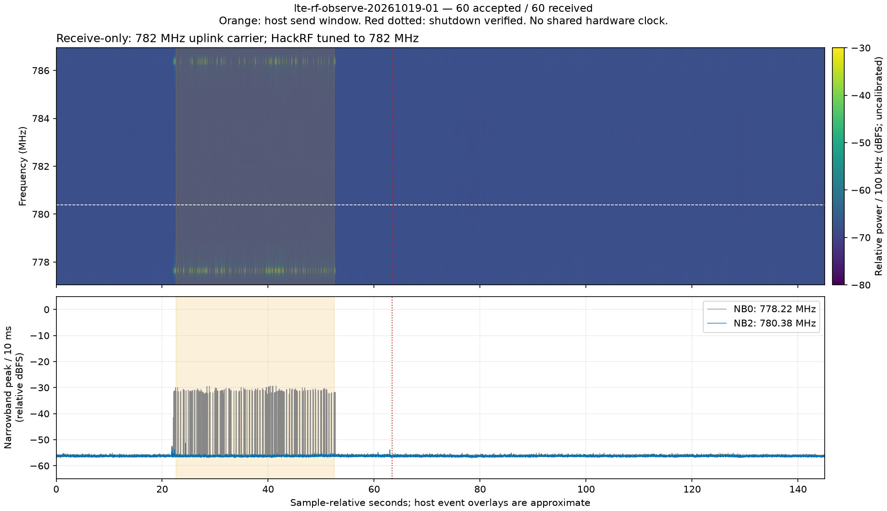
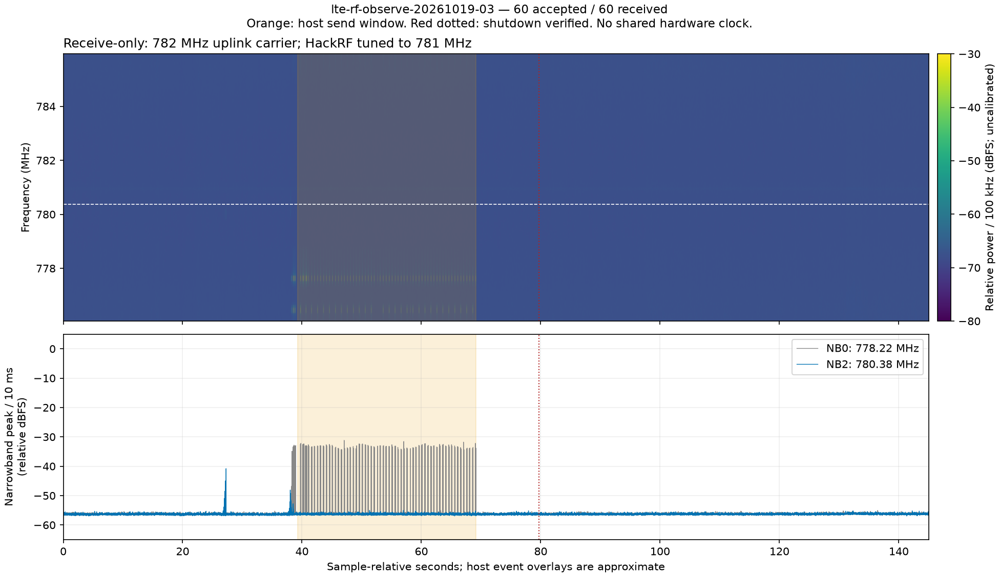
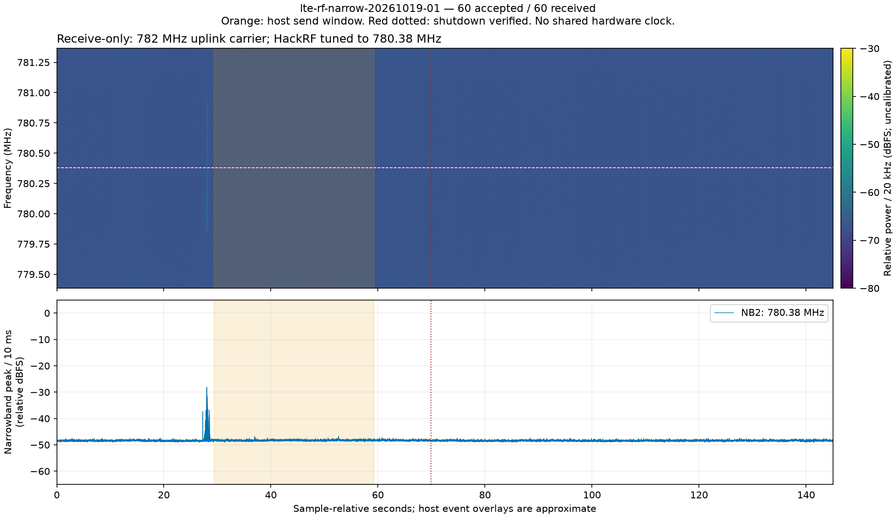
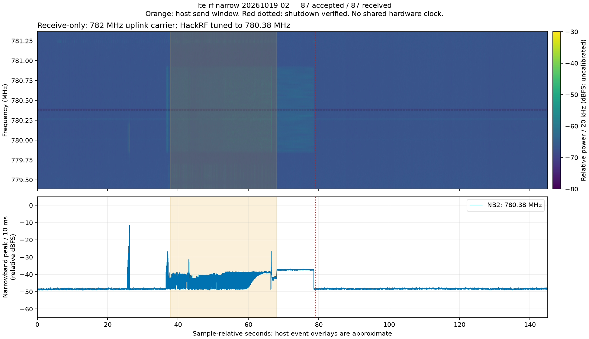
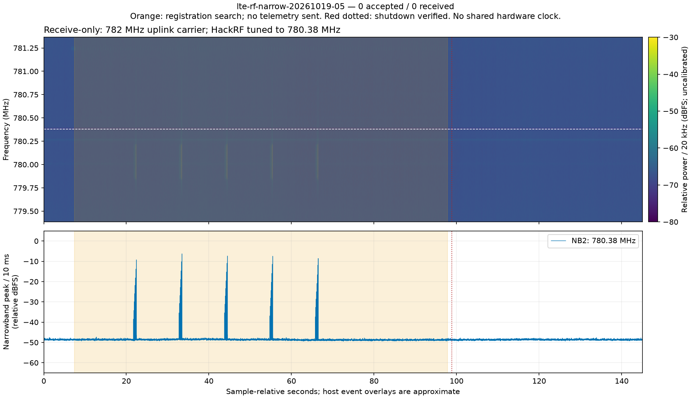
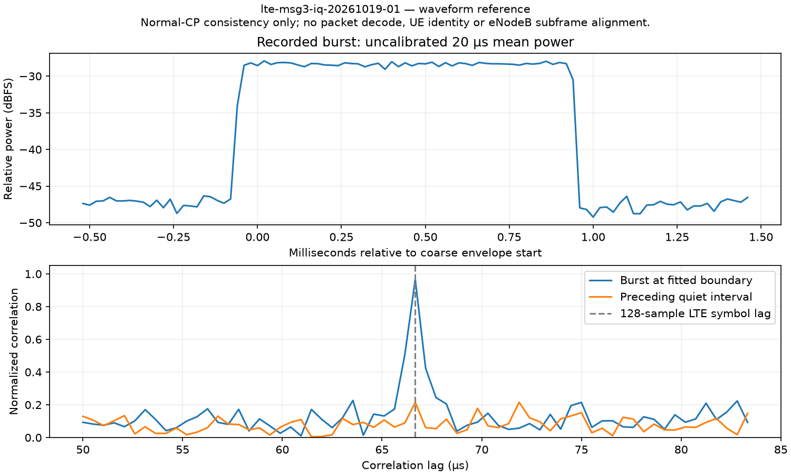

# 005 Walter LTE-M data rates

**Status:** Complete  
**Started:** 2026-10-19  
**Updated:** 2026-10-20

The bounded direct-Walter pacing check delivered **180/180 packets across three
separate 30-second runs at 8.192 kbps**, with none missing or late. The best
ten-second burst was 11.8784 kbps with a delayed tail. Walter's original 0.3.0
firmware is restored; USB and the final IHU→COMMS→Walter check confirm modem OFF. Maximum rate and long-term reliability remain unqualified.

## Setup

| Part | Setup |
| --- | --- |
| Walter | QuickSpot ESP32-S3 application 0.3.0 + Sequans LTE-M modem; `firmware/walter` |
| Walter MCU | RP2040 CAN Bus Feather, installed LTE_CAN 0.8.0; separate `firmware/walter_mcu` |
| IHU | Installed production 0.15.0, clean source `701e96c`; retain its existing code |
| Ground | LibreSDR detected as B210-compatible USB device; UHD 4.8.0.0; OAI/EPC binary hashes recorded |
| Console | One USB cable shared between IHU, Walter MCU and Walter; other boards stay powered |

During the full-path rate attempts, console USB stayed on IHU and no firmware
was flashed. All ten rate attempts ended
with Walter OFF, original output permissions restored, unchanged IHU firmware/boot
and zero reported CAN errors. The cell/EPC/capture processes are stopped.
Ground/OAI sources have local changes and were left untouched.
[Software/image identities](files/2026-10-19-ground-setup.json).
EPS battery is disconnected; near-zero VBAT is expected, not a battery-health result.

RF setup confirmed: stock LibreSDR antennas, all fitted; Walter full-band LTE
antenna (698–960 / 1710–2690 MHz); 1 m separation over the air. Band 13 uses
751 MHz downlink / 782 MHz uplink, 50 PRB. Profile
`enb.band13.emtc.ce300tx20diag.conf` has `tx_gain=90`, `rx_gain=110`,
`att_tx=20`, `att_rx=30`. These are configuration values, not calibrated RF power.
Yamcs uses instance `ember`, link `lte-tm-in`. [RF settings](files/2026-10-19-rf-setup.json).
During the earlier full-path runs, `lte modem firmware` returned Walter ESP32
identity. The direct check below reads the actual Sequans release: `UE8.2.1.0`.

## Results

The initial sweep’s completed 30-second windows delivered **378/378 packets** to the receiver and
Yamcs: 1.024 kbps at 1 packet/s (three runs), 2.048 kbps at 2 packet/s (two runs),
and 2.8672 kbps when requesting 5 packet/s (two runs). The last rate actually
submitted 2.8 packet/s because of command pacing. No late or duplicate packets
were observed in these completed windows. **Two additional sessions delivered
zero packets; see the interrupted attempts below.**

Baseline: one fresh 128-byte EPS packet reached receiver and Yamcs byte-exact;
registered READY in 21.945 s. [Baseline counts](files/2026-10-19-baseline.json).

Full path: EPS → IHU → CAN → Walter MCU → UART → Walter → LTE-M → LibreSDR →
ground receiver → Yamcs. Each run uses 128-byte packets and a 30-second offer
window, followed by a 10-second drain.

| Requested packets/s | Run | Planned slots | Accepted / received | Skipped slots | Local refusals | Received kbps | Missing / duplicates | Data |
| --- | --- | --- | --- | --- | --- | --- | --- | --- |
| 1 | 1 | 30 | 30 / 30 | 0 | 0 | 1.024 | 0 / 0 | [Counts](files/2026-10-19-1pps-run01.json) · [Packets](files/2026-10-19-1pps-run01-receipts.csv) |
| 1 | 2 | 30 | 30 / 30 | 0 | 0 | 1.024 | 0 / 0 | [Counts](files/2026-10-19-1pps-run02.json) · [Packets](files/2026-10-19-1pps-run02-receipts.csv) |
| 1 | 3 | 30 | 30 / 30 | 0 | 0 | 1.024 | 0 / 0 | [Counts](files/2026-10-19-1pps-run03.json) · [Packets](files/2026-10-19-1pps-run03-receipts.csv) |
| 2 | 2 | 60 | 60 / 60 | 0 | 0 | 2.048 | 0 / 0 | [Counts](files/2026-10-19-2pps-run02.json) · [Packets](files/2026-10-19-2pps-run02-receipts.csv) |
| 2 | 4 | 60 | 60 / 60 | 0 | 0 | 2.048 | 0 / 0 | [Counts](files/2026-10-19-2pps-run04.json) · [Packets](files/2026-10-19-2pps-run04-receipts.csv) |
| 5 | 1 | 150 | 84 / 84 | 66 | 0 | 2.867 | 0 / 0 | [Counts](files/2026-10-19-5pps-run01.json) · [Packets](files/2026-10-19-5pps-run01-receipts.csv) |
| 5 | 2 | 150 | 84 / 84 | 66 | 0 | 2.867 | 0 / 0 | [Counts](files/2026-10-19-5pps-run02.json) · [Packets](files/2026-10-19-5pps-run02-receipts.csv) |

[Completed-window counts](files/2026-10-19-rate-summary.csv) ·
[All ten rate attempts, including failures](files/2026-10-19-all-trials.csv).
Accepted and received counts
were checked against exact packet bytes in both the native receiver and Yamcs.

One console request is allowed in flight at a time. A skipped slot means the
sender was still waiting for the previous request. A local refusal means IHU
explicitly rejected the command before transmission (for example `SENSOR_BUSY`).
Neither is counted as a lost accepted LTE packet; both reduce delivered goodput.
Received goodput uses a fixed 30-second receiver window starting at its first
matching packet: received bytes × 8 / 30 / 1000 kbps. Late drain arrivals are
reported separately in each counts file. Console-to-modem-acceptance times are
command completion times, not one-way radio latency. These tests measure the
complete path; they do not establish the modem's maximum throughput.
Raw radio/core logs and captures remain private on the bench.

Interrupted attempts have no valid 30-second rate result:

| Attempt | Modem accepted | Received | Stop reason | Data |
| --- | --- | --- | --- | --- |
| 2 packet/s, run 1 | 7 | 7 | IHU `SENSOR_BUSY` | [Counts](files/2026-10-19-2pps-interrupted.json) |
| 2 packet/s, run 3 | 45 | 0 | Walter `NOT_READY`, registration drop | [Counts](files/2026-10-19-2pps-session-failure.json) |
| 5 packet/s, run 3 | 60 | 0 | Walter `NOT_READY`, registration drop | [Counts](files/2026-10-19-5pps-session-failure.json) |

Across the two failed sessions, **105 modem-accepted packets were missing at
the ground receiver**. Both reported one
registration drop and last CEREG status 4 (registration state unknown), then
`PEER_REJECTED reason=8` (`UL_ERR_NOT_READY`). No matching native UDP packets
appeared in either capture or Yamcs; the receiver service remained active. The
first failure also had no captured GTP-U traffic despite completed attach.
Root cause is unresolved. The sweep stopped after the second such failure;
these failures are not hidden by the completed-window rates above.

The host now counts explicit local refusals and advances to the next slot without
retrying telemetry. Unknown outcomes stop the run. Initial preparation also hit
local control guards; a premature overlapping cell startup was cancelled. A lock
and process check now serialize cell runs.

Earlier October 2 delivery demo: 3/3 × 128-byte packets, arrival gaps 1.239980 s
and 1.239864 s. That retired firmware intentionally waited one second between
queued acceptances; this was not a maximum-rate test.
[Original UTC receipts](files/2026-10-03-early-delivery.csv), October 3 UTC /
October 2 locally; [archived test](https://github.com/ngrabbs/ember/blob/56b03fb/ground/lte/results/2026-10-02-queued-eps.md).

## Fresh-session checks

Four fresh cell/EPC/modem sessions each sent one real 128-byte EPS packet after
registered READY, then made read-only diagnostic queries for 35 seconds. **4/4
packets reached receiver and Yamcs; no registration drops or duplicates.** No
second telemetry packet or retry was sent in these sessions.

| Probe | READY seconds | Received / Yamcs | Registration drops | Data |
| --- | --- | --- | --- | --- |
| 1 | 53.956 | 1 / 1 | 0 | [Record](files/lte-session-probe-20261019-01.json) |
| 2 | 21.641 | 1 / 1 | 0 | [Record](files/lte-session-probe-20261019-02.json) |
| 3 | 43.679 | 1 / 1 | 0 | [Record](files/lte-session-probe-20261019-03.json) |
| 4 | 22.194 | 1 / 1 | 0 | [Record](files/lte-session-probe-20261019-04.json) |

[Probe summary](files/2026-10-19-session-probes.csv). All four ended with Walter
OFF and unchanged IHU firmware/boot. These passes do not resolve the earlier
intermittent failures.

The earlier failed sessions had scheduled uplink grants but **zero successfully
decoded scheduled uplinks and zero uplink data-channel messages** during their
active test intervals. The working reference had 1122 decoded scheduled uplink
log messages and delivered 84 UDP packets. These are log-event counts, not an
RF calibration or a packet error-rate measurement.
[Trace comparison](files/2026-10-19-uplink-log-comparison.json).

This narrows the observed failure to the UE/eNodeB scheduled uplink path, before
ground UDP/Yamcs. Whether Walter transmits at an unexpected time/frequency, or
the eNodeB fails to receive/decode it, remains unresolved.

## Passive RF follow-up

HackRF was reconnected as a receive-only observer. Three further 30-second tests
all delivered their exact packet bytes to receiver and Yamcs; **205/205 packets**,
zero missing, duplicates, late arrivals or registration drops.

| RF run | Requested packets/s | Accepted / received | Skipped / local refused | Received kbps | Receiver center MHz | Data |
| --- | --- | --- | --- | --- | --- | --- |
| 1 | 2 | 60 / 60 | 0 / 0 | 2.0480 | 782 | [Delivery](files/lte-rf-observe-20261019-01-delivery.json) · [RF](files/lte-rf-observe-20261019-01.json) |
| 2 | 5 | 85 / 85 | 64 / 1 | 2.9013 | 782 | [Delivery](files/lte-rf-observe-20261019-02-delivery.json) · [RF](files/lte-rf-observe-20261019-02.json) |
| 3 | 2 | 60 / 60 | 0 / 0 | 2.0480 | 781 | [Delivery](files/lte-rf-observe-20261019-03-delivery.json) · [RF](files/lte-rf-observe-20261019-03.json) |

[RF summary](files/2026-10-19-rf-observations.csv). Each capture received
1,450,000,000 complex samples at 10 MS/s over 145 seconds, with **zero reported
overruns and zero clipped ADC samples**. LNA 0 dB / VGA 8 dB, RF amplifier and
antenna power OFF, 10 MHz baseband filter. IQ was reduced to relative power;
original power arrays remain private, with hashes in the RF records. An initial
receive-only baseline overran and was excluded before these LTE runs.

Receiver retuning from 782 to 781 MHz retained a dominant burst feature in the
777.5–777.7 MHz bins. This supports an RF origin for that feature; other
image/alias features remain unclassified. The configured data-channel band
(center 780.38 MHz) was **not clearly distinguishable from the observer’s noise
floor**, even in sessions with verified packet delivery. These settings therefore
cannot yet establish that Walter is absent from an expected data-channel slot.
No failed session was captured by HackRF in this follow-up.

These are uncalibrated relative-power plots. Orange marks the approximate host
send interval; red marks host shutdown verification. There is no shared hardware
clock or demonstrated grant/subframe alignment. Compare only overlapping RF
passbands after retuning. Per-run 100 ms envelopes and mean spectra are in files:
[run 1 envelope](files/lte-rf-observe-20261019-01-envelope.csv),
[run 1 spectrum](files/lte-rf-observe-20261019-01-spectrum.csv),
[retuned envelope](files/lte-rf-observe-20261019-03-envelope.csv),
[retuned spectrum](files/lte-rf-observe-20261019-03-spectrum.csv).

All seven follow-up sessions passed; the earlier failures were not reproduced.
The initial two zero-delivery sessions remain unresolved. No IHU/Walter firmware
or ground radio configuration was changed.

## Narrow-band receiver check

The next check centered HackRF on **780.38 MHz**, with 2 MS/s acquisition and a
1.75 MHz baseband filter. This covers the configured 1.08 MHz data band. The
radio transmit settings and all production firmware stayed unchanged.

| Run | Requested packets/s | Accepted / received / Yamcs | Received kbps | HackRF LNA / VGA dB | Data |
| --- | --- | --- | --- | --- | --- |
| 1 | 2 | 60 / 60 / 60 | 2.0480 | 0 / 16 | [Delivery](files/lte-rf-narrow-20261019-01-delivery.json) · [RF](files/lte-rf-narrow-20261019-01.json) |
| 2 | 5 | 87 / 87 / 87 | 2.9696 | 24 / 16 | [Delivery](files/lte-rf-narrow-20261019-02-delivery.json) · [RF](files/lte-rf-narrow-20261019-02.json) |
| 3 | 5 | 81 / 81 / 81 | 2.7648 | 24 / 16 | [Delivery](files/lte-rf-narrow-20261019-03-delivery.json) · [RF](files/lte-rf-narrow-20261019-03.json) |

Run 1 had no missing, duplicate, late or skipped packets and no registration
loss. The receive stream had zero overruns and zero clipped ADC samples. Data-band
power during telemetry was still close to the post-shutdown noise floor; this
capture alone does not establish where individual data bursts occur.

[100 ms power envelope](files/lte-rf-narrow-20261019-01-envelope.csv) ·
[20 kHz mean spectrum](files/lte-rf-narrow-20261019-01-spectrum.csv).
The plots use approximate host timing and uncalibrated relative power.

At LNA 24 / VGA 16 dB, run 2 showed data-band activity during the working LTE
session: the 100 µs power samples' 99th percentile was **−38.99 dBFS** in the
approximate send interval, versus **−48.43 dBFS** after shutdown. This is an
observer reference, not a calibrated signal level or decoded LTE waveform.
There is no demonstrated alignment to individual scheduled uplink slots.

Run 2 delivered 87 packets in 30 seconds, with 63 of 150 requested slots skipped
by the one-request-at-a-time host path. No missing, duplicate or late packets,
registration drops, RX overruns or clipped samples. **2.9696 kbps was the best
completed full-path result at this point; it is not Walter's maximum modem rate.**

[Run 2 envelope](files/lte-rf-narrow-20261019-02-envelope.csv) ·
[Run 2 spectrum](files/lte-rf-narrow-20261019-02-spectrum.csv).

The same higher-gain settings were repeated in run 3: **81/81** received and
archived, 69 skipped slots, no missing/duplicate/late packets or registration
loss. Data-band p99 power was −41.02 dBFS during sends and −48.54 dBFS after
shutdown. Zero receive overruns or clipped samples.
[Run 3 envelope](files/lte-rf-narrow-20261019-03-envelope.csv) ·
[Run 3 spectrum](files/lte-rf-narrow-20261019-03-spectrum.csv) ·
[Run 3 plot](images/lte-rf-narrow-20261019-03.png).

Together these three runs delivered **228/228 packets** to receiver and Yamcs.
All ended with Walter OFF, original output flags restored, unchanged IHU
firmware/boot and zero CAN errors. Cell/EPC/capture processes are stopped.
Through run 3, the earlier failure had not reproduced in ten follow-up sessions
(four single-packet probes and six RF-observed rate runs). Its cause remains
unresolved.

### Further fresh-session tests

The next batch stopped at its first anomaly, after two of three planned sessions.
Same 780.38 MHz observer settings: 2 MS/s, 1.75 MHz filter, LNA 24 / VGA 16 dB.

| Run | Outcome | Accepted / received / Yamcs | Received kbps | Data |
| --- | --- | --- | --- | --- |
| 4 | Passed | 90 / 90 / 90 | **3.0720** | [Delivery](files/lte-rf-narrow-20261019-04-delivery.json) · [RF](files/lte-rf-narrow-20261019-04.json) |
| 5 | Registration timeout | 0 / 0 / 0 | Not measured | [Result](files/lte-rf-narrow-20261019-05-delivery.json) · [RF](files/lte-rf-narrow-20261019-05.json) |

Run 4 skipped 60 of 150 requested slots while waiting for command completion.
All 90 packets arrived in the receiver window; no missing, duplicate or late
packets. **3.072 kbps is the best completed full-path result so far.** It remains
a paced 128-byte EPS test, not the modem's maximum throughput.

Run 5 never reached registered READY within the 90-second preparation limit.
Walter reported CEREG 2 (searching), with no recorded registration loss. No
telemetry was attempted, so this is a bring-up failure with no data-rate result.
It differs from the earlier sessions that accepted packets but delivered none.

The eNodeB logged 40 generated random-access responses, 40 unsuccessful Msg3
reception events and no successful Msg3 reception. The core logged no attach
request. These are whole-run log-event counts; false detections and activity
after shutdown can occur. They do not establish that each response was for Walter.
[Working/failed log comparison](files/2026-10-19-registration-comparison.json).

HackRF captured brief RF bursts during the failed search. Selected burst spectra
are near 780.02 MHz, consistent with the generated two-PRB Msg3 allocation.
This is an inference from relative power and the generated grants: waveform,
transmitter identity and subframe timing have not been verified.
[Burst spectrum checks](files/2026-10-19-registration-burst-check.json).

[Failed-search envelope](files/lte-rf-narrow-20261019-05-envelope.csv) ·
[Failed-search mean spectrum](files/lte-rf-narrow-20261019-05-spectrum.csv) ·
[Working reference plot](images/lte-rf-narrow-20261019-04.png).

Both captures had zero receive overruns/clipping. Both sessions ended with Walter
OFF, original output flags restored, unchanged IHU firmware/boot and zero CAN
errors. The radio/core/capture processes are stopped. No firmware or transmit
settings changed. The failed bring-up is preserved; its cause remains open.

## Triggered IQ check

Two more fresh sessions used the same RF settings, with short IQ recordings
saved around strong bursts. No firmware or transmit settings changed.

| Run | READY seconds | Accepted / received / Yamcs | Local SENSOR_BUSY refusals | Received kbps | Data |
| --- | --- | --- | --- | --- | --- |
| 1 | 15.647 | 54 / 54 / 54 | 6 | 1.8432 | [Delivery](files/lte-msg3-iq-20261019-01-delivery.json) · [Waveform](files/lte-msg3-iq-20261019-01-waveform.json) |
| 2 | 42.140 | 60 / 60 / 60 | 0 | 2.0480 | [Delivery](files/lte-msg3-iq-20261019-02-delivery.json) · [Waveform](files/lte-msg3-iq-20261019-02-waveform.json) |

**114/114 accepted packets reached receiver and Yamcs**, with no duplicates,
missing or late packets. Six offers in run 1 were refused locally, not lost over
LTE. Both captures had zero overruns/clipping; Walter ended OFF with original
output flags, unchanged IHU firmware/boot and zero CAN errors.

Run 2 logged **16 unsuccessful Msg3 receptions before one nonempty Msg3 CCCH
indication**, then registered and delivered telemetry.
[Access log counts](files/2026-10-19-iq-access-log-summary.json).
OAI's “No signal in Msg3” label checks for a missing/all-zero decoded buffer;
it does not establish that RF was absent.

The recorded bursts match LTE-like normal cyclic-prefix structure, with strong
correlation above quiet/off-lag controls. This is waveform evidence, not a packet
decode or proof that a burst corresponds to a particular Msg3 attempt. Ground
subframe alignment is still unverified. [Setup and summary](files/2026-10-19-triggered-iq-summary.json).
[Waveform reference: ETSI TS 136 211](https://www.etsi.org/deliver/etsi_ts/136200_136299/136211/16.06.00_60/ts_136211v160600p.pdf).

Raw IQ remains private: 0.8 MB from run 1 and 6.0 MB from run 2, selected by a
−30 dBFS power trigger with a 9.6 MB cap per session. These are partial captures.
Neither complete session failed; the earlier timeout and delivery failures remain
unresolved. The next comparison needs matched random-access/Msg3 events and
receiver timing, rather than assuming a power burst is the scheduled packet.

The wider, paired-band follow-up is recorded separately in
[006 — LTE-M random-access capture](../006-lte-m-access-capture/README.md):
120/120 packets delivered; roughly 13 ms preamble/response candidate spacing.

## Direct Walter benchmark — 2026-10-19

USB is now on Walter. A temporary USB-controlled benchmark is installed, keeping
IHU and Walter MCU firmware unchanged. It sends directly through Walter's modem
UART to a separate UDP receiver on port 51002, outside EPS/Yamcs.

| Check | Result |
| --- | --- |
| Original image | Production 0.3.0 identified; two matching complete 16 MiB restore images verified locally before writing |
| Temporary image | `WALTER_THROUGHPUT_TEMP` 0.1.0; upload and application flash verification passed |
| Startup and command guards | Six OFF-state checks passed; invalid RF windows and sends while OFF rejected |
| USB log drops | 0 |
| RF during installation | No RF window opened; delivery test follows below |

The modem UART remains 115200 baud, 8N1: raw payload ceiling 92.16 kbps before AT
command overhead. The direct measurement removes IHU/CAN pacing but still includes
this UART and one AT send transaction at a time. It measures application
goodput; it does not establish the modem's maximum LTE-M rate.

[Installation checks and image identity](files/2026-10-19-direct-bench-installation.json).
The original flash backups stay private. Walter is OFF, with the temporary image
left installed for the next test; restoration is still pending.

### First direct delivery check

One modem window capped at 120 seconds, same radio profile and 1 m antenna separation.
Synthetic packets went to the separate receiver; IHU/CAN and EPS/Yamcs were
outside this test.

| Packet bytes | Offered packets/s | Window seconds | Accepted / received | Skipped / missing / duplicates / late | Received kbps |
| --- | --- | --- | --- | --- | --- |
| 128 | 1 | 10 | 10 / 10 | 0 / 0 / 0 / 0 | **1.024** |

Registered READY in 60.094 s. Actual modem release: `UE8.2.1.0`.
Operator reply after registration: `+COPS: 1,2,"99970",7`.
Payload CRC/content checks passed; zero malformed packets and USB log drops.
Goodput counts all 128 UDP payload bytes, including the 32-byte benchmark header,
over 10 seconds from the first valid receiver arrival.

[Counts and setup](files/2026-10-19-direct-smoke.json) ·
[Packet receipts](files/2026-10-19-direct-smoke-receipts.csv).

This is one low-rate baseline, not maximum throughput or a reliability result.
Walter ended OFF; cell/core/receiver stopped. Ground sources, binaries and radio
profile were unchanged. No firmware builds or flashes were needed for this run.
The temporary image remains installed for the next points.

### 512-byte packets at the same offered rate

Only payload size changed from the first direct check. Same firmware, UART,
radio profile and antenna setup. A fresh bounded modem window reached registered
READY in 38.385 s.

| Packet bytes | Offered packets/s | Window seconds | Accepted / received | Skipped / missing / duplicates / late | Received kbps |
| --- | --- | --- | --- | --- | --- |
| 512 | 1 | 10 | 10 / 10 | 0 / 0 / 0 / 0 | **4.096** |

CRC/content checks passed; zero malformed/out-of-order packets and USB log drops.
The rate counts all 512 UDP payload bytes, including the 32-byte benchmark header.
This is four times the 128-byte baseline at the same offered packet rate; it is
still a paced application result, not maximum LTE-M throughput.

[Counts and setup](files/2026-10-19-direct-512.json) ·
[Packet receipts](files/2026-10-19-direct-512-receipts.csv).

Walter ended OFF; cell/core/receiver stopped. Ground sources, binaries and RF
profile stayed unchanged. No firmware builds or flashes. IHU and Walter MCU
firmware unchanged; temporary Walter image remains installed for further points.

### Offered-rate sweep stopped on registration loss

October 20 UTC / October 19 local. Same 512-byte direct setup; the second point was
conditional on clean delivery at the first.

| Offered packets/s | Planned slots | Attempted / accepted / received | Unreached | Result |
| --- | --- | --- | --- | --- |
| 2 | 20 | 3 / 3 / 0 | 17 | Registration lost; no valid rate |
| 5 | — | Not attempted | — | Sweep stopped |

Registered READY in 60.574 s, then `+CEREG: 2` during sending. The firmware stopped
with `registration_lost`; all three modem-accepted packets were absent from the
completed ground capture. Zero uncertain or rejected sends; 17 future slots were
never attempted. The run did not complete its 10-second window.

[Counts and setup](files/2026-10-20-direct-512-rate-failure.json).

The accepted-but-undelivered symptom can occur on the direct path, bypassing
IHU/CAN. Cause and rate dependence remain unresolved; this does not establish
a capacity ceiling. The best completed direct point remains 4.096 kbps at 1 packet/s.
No retry or 5 packet/s attempt was made.

Walter ended OFF; cell/core/receiver stopped, ground source/binary/profile
integrity checks passed, USB log drops 0. No firmware builds/flashes or production
IHU/Walter MCU changes. The temporary Walter image remains installed.

### Offline comparison of the early removal

No new RF test. Compare equal 1.216-second intervals after RRC reconfiguration,
ending at the failed session's tunnel deletion. Target-UE scheduled uplinks only;
random-access log events excluded.

| Saved observation | Working 1 packet/s | Failed 2 packet/s |
| --- | --- | --- |
| Uplink decoder log events, OK / error | 48 / 12 | 2 / 58 |
| Last pending LCID 2 report after setup | 0.136 s | 1.215 s |
| Tunnel deletion after setup | 45.541 s | 1.216 s |
| Release request logged | After host-confirmed OFF | None recorded |

Both sessions completed authentication and bearer setup. Source review found a
matching cleanup path from signaling retry exhaustion to release complete,
tunnel deletion and cleanup timer expiry. This is a strong lead, not a confirmed
trigger: the decisive retry messages were debug-level and were not recorded.
The pending LCID 2 buffer makes signaling bearer 2 a candidate; its identity at
retry exhaustion remains unverified.

Counts are decoder log events, not UDP packets or RF calibration. Individual USB
responses lack UTC timestamps, so precise ordering against modem reset is also
unavailable. [Comparison, source hashes and limits](files/2026-10-20-direct-release-comparison.json).

No source changes, build, flash or additional radio session. Higher-rate sweep
remains paused; the best completed direct result is still 4.096 kbps.

### Diagnostic capture aborted; host reader revised

One RLC/RRC-debug attempt stopped during modem configuration on a USB JSON
parsing error. No registered READY or benchmark run; zero packets attempted.
The collector's cleanup confirmation also failed, then an independent OFF/status
check confirmed reset held. Cell/core/receiver stopped; ground integrity passed.

The reader treated a timed-out USB read as a complete JSON line. A later OFF-only
check saved a partial 83-byte status response; the transport-side stall remains
unexplained. The revised reader buffers partial lines, saves raw bytes/chunk
timestamps and uses bounded read-only cleanup retries. Host fragmentation tests
passed; a live OFF-only check parsed 12 status replies with zero parse errors and
final OFF confirmed. **No second RF window.**

[Capture outcome and reader checks](files/2026-10-20-direct-rlc-capture-abort.json).

No firmware builds/flashes. The revised reader is still awaiting an RF capture;
this attempt produced no new throughput result or signaling-failure evidence.

### Revised-reader capture completed

October 20 UTC / October 19 local. One bounded attempt, with only RLC/RRC logging
changed from the baseline profile. Same firmware, UART, antennas and 1 m spacing.

| Packet bytes | Offered packets/s | Window seconds | Accepted / total received | In window / late | Received kbps |
| --- | --- | --- | --- | --- | --- |
| 512 | 2 | 10 | 20 / 20 | 19 / 1 | **7.7824** |

READY in 16.854 s. No skipped, rejected or uncertain sends; no missing, duplicate,
malformed or out-of-order packets. CRC/content checks passed. The final packet
arrived 10.079680 s after the first. Offered rate was 8.192 kbps; the fixed
ten-second receiver window counts 19 packets, giving 7.7824 kbps. This is one
paced application result, not maximum LTE-M rate or repeated reliability.

[Counts and diagnostic summary](files/2026-10-20-direct-512-2pps.json) ·
[Packet receipts](files/2026-10-20-direct-512-2pps-receipts.csv).

The earlier registration-loss failure did not recur. SRB1 retry exhaustion was
logged about 25 seconds after commanded OFF: a shutdown reference, not the
missing live-failure trigger. The revised USB reader recorded zero parse errors
and zero firmware log drops, retaining raw byte/chunk timing privately.

Walter ended OFF; cell/core/receiver stopped and all ground integrity checks
passed. No builds, flashes or production IHU/Walter MCU changes. No second RF
window or higher-rate retry. The temporary Walter image remains installed.

### Five packet/s: partial delivery and ground crash

October 20 UTC / October 19 local. One attempt, same firmware/profile/antennas;
only requested rate changed. READY in 16.525 s.

| Payload bytes | Requested packets/s | Offered seconds | Attempted / accepted / received | Missing / late | Received kbps |
| --- | --- | --- | --- | --- | --- |
| 512 | 5 | 10 | 50 / 50 / 12 | 38 / 0 | 4.9152 |

All 50 sends were accepted by the modem; only sequences 0–11 reached the receiver.
No further packets arrived in the ten-second drain or remaining capture. Zero
skipped, rejected or uncertain sends; zero malformed, duplicate or out-of-order
receipts. Modem acceptance does not prove delivery. Offered rate was 20.48 kbps.
The 12 received packets give 4.9152 kbps over the fixed ten-second receiver window.

The OAI eNodeB crashed during drain on **`NPRB > 0` / `NPRB == 0`**, in
`fill_dci_and_dlsch()`, `dci_tools.c:657`, exit −6. This code requires a positive
resource-block count after converting a downlink allocation. The crash was after
send completion and the last receipt, before Walter's commanded OFF. Why the
allocation became zero, and whether it explains the earlier missing packets,
remain open. Walter still reported registered after drain; that status does not
prove a working bearer.

[Counts, crash details and limits](files/2026-10-20-direct-512-5pps.json) ·
[Packet receipts](files/2026-10-20-direct-512-5pps-receipts.csv).

This is a failed delivery/ground-radio test. The completed accounting window is
not a delivery pass or a modem capacity measurement. Best direct result remains
**7.7824 kbps**. No retry or second RF window. Walter ended OFF; cell/core/receiver
stopped, ground source/binary/profile integrity passed. No firmware builds,
flashes or production changes. USB parsing/log drops were zero.

### Offline scheduler review: overwritten control-message slot

The saved crash log shows a new connection setup while the old radio context
is still present. Source review found the dedicated LTE-M scheduler selects a
control-message slot before looping through contexts, then reuses that slot
while incrementing the message count. Two qualifying contexts can overwrite
one record and leave another counted slot unwritten.

A reduced CPU fixture using the real NFAPI structures and allocation converter
reproduces this defect. A zero unwritten slot is interpreted as legacy DCI
Format1 with zero resource blocks—the same assertion path. A stale nonzero
slot can behave differently. Refreshing the append pointer prevents the defect
in the fixture; ten cases passed AddressSanitizer/UndefinedBehaviorSanitizer.

This is a concrete bookkeeping defect and a strong crash explanation. The live
slot contents were not captured, so runtime causality remains unconfirmed.
Missing uplink packets began earlier; this does not explain all 38 missing
packets or the older session failures.

[Source identities, fixture cases and limits](files/2026-10-20-mpdcch-slot-analysis.json).

A small candidate patch is prepared locally, keeping the assertion. It has not
been applied to the ground checkout or built/tested as a complete radio. No RF
window or firmware change; fresh ground integrity checks passed. Best direct
goodput remains **7.7824 kbps**.

### Candidate applied to the existing ground build

At my request, the patch was applied directly to the existing ground checkout.
The previous source changes and original radio binary were backed up and
hash-verified on ground and locally. The full radio rebuilt successfully.

| Check | Result |
| --- | --- |
| MAC Msg4 action / uplink HARQ helpers | 2/2 passed |
| PHY DLSCH context helper | 1/1 passed |
| CMake cache / runtime libraries | Unchanged |
| Candidate and preserved-reference integrity checks | 12/12 passed |
| New RF windows / firmware flashes | 0 / 0 |

[Build identities and checks](files/2026-10-20-mpdcch-slot-build.json).

The assertion is retained. The existing helper tests do not cover the complete
multi-context scheduler, and the rebuilt radio has not yet been tested over RF.
No delivery improvement or crash-prevention claim yet. Cell/core remain stopped;
production IHU/Walter MCU/Walter firmware unchanged. Best direct result remains
7.7824 kbps.

### Rebuilt radio: all packets delivered, with a delayed tail

One bounded 512-byte, 5 packet/s comparison. Same temporary Walter firmware,
UART, profile and antennas; the ground slot-pointer patch is the only source
change. Registered READY in 16.284 s.

| Offered packets/s | Offer seconds | Attempted / accepted / total received | In ten-second window / late | Received kbps |
| --- | --- | --- | --- | --- |
| 5 | 10 | 50 / 50 / 50 | 29 / 21 | **11.8784** |

All 50 passed CRC/body checks. Zero missing, duplicate, malformed or out-of-order
packets; zero skipped, rejected or uncertain sends. Last arrival was 15.700036 s
after the first. The 21 late packets arrived during drain. Offered rate was
20.48 kbps; **11.8784 kbps** counts only the 29 packets inside the fixed ten-second
receiver window. This is one short application result, not a maximum LTE-M
rate or proof that the offered pace is sustainable.

[Counts and trace limits](files/2026-10-20-direct-slot-512-5pps.json) ·
[Packet receipts](files/2026-10-20-direct-slot-512-5pps-receipts.csv).

The earlier unpatched 5 packet/s attempt delivered 12/50 and crashed; this run
delivered 50/50 without crashing. Only one completed RRC setup context was
observed, so the previous two-context crash condition was not demonstrated.
This comparison does not prove the patch caused all delivery improvement.

Actual radio/core exits were their planned timeouts; 12 integrity checks passed.
Walter ended OFF and all ground processes stopped. Zero USB parse errors/log
drops; no new firmware, build or source change during this run. No retry.

### Three packet/s: lower load still has a delayed tail

One bounded point with the same firmware, candidate radio, UART and RF setup.
Registered READY in 16.504 s. Only requested rate changed.

| Payload bytes | Requested packets/s | Offer seconds | Attempted / accepted / received | In ten-second window / late | Received kbps |
| --- | --- | --- | --- | --- | --- |
| 512 | 3 | 10 | 30 / 30 / 30 | 23 / 7 | **9.4208** |

All 30 passed CRC/body checks; zero missing, duplicate, malformed or out-of-order
packets, and zero skipped, rejected or uncertain sends. Seven arrived during
drain; last arrival was 12.520027 s after the first. Offered rate was 12.288 kbps.
The fixed receiver window counts 23 packets, giving 9.4208 kbps. Delivery still
fell behind the offered pace. Best measured direct rate remains 11.8784 kbps.

[Counts and trace limits](files/2026-10-20-direct-slot-512-3pps.json) ·
[Packet receipts](files/2026-10-20-direct-slot-512-3pps-receipts.csv).

Radio/core reached planned timeouts without crashing; 12 integrity checks passed,
Walter OFF and all ground processes stopped. Zero USB parse errors/log drops;
no source changes, builds, firmware flashes or retry. One completed RRC setup
context observed; prior crash prevention remains unqualified. This is one short
pacing result, not a general capacity or reliability limit.

### Two packet/s over 30 seconds: delivery kept pace

Same firmware, candidate radio, UART and RF setup; requested rate and duration
changed. READY in 16.554 s. The host required 46 seconds remaining in the
120-second modem window before starting; 103.445 seconds remained.

| Payload bytes | Requested packets/s | Offer seconds | Accepted / received | In 30-second window / late | Received kbps |
| --- | --- | --- | --- | --- | --- |
| 512 | 2 | 30 | 60 / 60 | 60 / 0 | **8.192** |

All 60 passed CRC/body checks; zero missing, duplicate, malformed, out-of-order,
skipped, rejected or uncertain packets. First-to-last arrival span 29.499926 s;
no receipts during the ten-second drain. The receiver kept pace for this
30-second point. This is not repeated reliability or maximum modem throughput.

[Counts and checks](files/2026-10-20-direct-slot-512-2pps30.json) ·
[Packet receipts](files/2026-10-20-direct-slot-512-2pps30-receipts.csv).

Actual radio/core exits were planned timeouts without a crash; 12 integrity checks
passed. Walter OFF and ground processes stopped; zero USB parse errors/log
drops. No source changes, builds, firmware flashes or second attempt. The earlier
two-context crash condition was not demonstrated.

### Pacing repeats and restoration

Both planned repeats passed; no retries or further rate tests.

| Point | READY seconds | Packets within 30s | Missing / late | Received kbps | Data |
| --- | --- | --- | --- | --- | --- |
| Initial | 16.554 | 60/60 | 0/0 | 8.192 | [Counts](files/2026-10-20-direct-slot-512-2pps30.json) |
| Repeat 1 | 16.054 | 60/60 | 0/0 | 8.192 | [Counts](files/2026-10-20-direct-slot-512-2pps30-repeat02.json) · [Receipts](files/2026-10-20-direct-slot-512-2pps30-repeat02-receipts.csv) |
| Repeat 2 | 15.925 | 60/60 | 0/0 | 8.192 | [Counts](files/2026-10-20-direct-slot-512-2pps30-repeat03.json) · [Receipts](files/2026-10-20-direct-slot-512-2pps30-repeat03-receipts.csv) |

**180/180 in their respective receiver windows**, zero missing, late, duplicate,
malformed or out-of-order packets; zero skipped, rejected or uncertain sends.
Each repeat passed CRC/content, actual radio-exit and integrity checks. These
are three separate 30-second paced sessions, not a continuous 90-second run or
a maximum-rate/long-term reliability qualification.

[Repeat summary and restore checks](files/2026-10-20-direct-pacing-closeout.json).

The complete original 16 MiB Walter image was restored with flash parameters kept.
Fresh chip/security checks and full-image verification passed. USB reports
original firmware 0.3.0, clean 9fcb020, with modem OFF. No RF window opened during
restoration. IHU/Walter MCU firmware unchanged. Ground processes are stopped;
the patched ground build and its rollback backup are retained.

## Versioned implementation

The ground patch set is experimental **0.1.0**, with local OAI tag
`ember-lte-m-v0.1.0`. The slot fix is separate commit `f5080d1`; the earlier
eight-patch baseline is `87e5409`. All nine patches reproduce the running source.
[Version manifest and patch order](https://github.com/ngrabbs/ember/blob/docs/lte-throughput-plan/ground/lte/patches/ember-lte-m-v0.1.0.json).
This records a concrete bookkeeping fix with bounded bench evidence; the original
two-context crash condition remains unqualified.

## Closeout

On October 20, the read-only IHU→COMMS→Walter check passed: IHU 0.15.0,
COMMS 0.8.0 and Walter 0.3.0, all clean. Walter was OFF, unregistered, with
zero radio-window time. CAN remained normal with zero error registers; output
permissions and error counters stayed unchanged during the final check.

The first query hit a stale Walter session after restoration and incremented
the IHU unknown counter once. Its immediate retry needed HELLO; another check
met background-discovery busy responses. Renewing HELLO recovered the link,
and the final check passed without further unknown/error increments. No firmware
changes or RF commands were needed. This checks control communication, not RF delivery.

The bounded benchmark and restoration are complete. No more temporary RF runs
planned. Earlier failures remain unresolved; maximum rate and long-term
reliability remain unqualified.

Next LTE work is parked: bounded production EPS telemetry endurance sessions,
then a deliberate ground-cell interruption and recovery check. Record packet
delivery, dashboard receipt and whether recovery needs manual intervention.
No test-only production IHU changes are planned.

[Back to Lab Log](../../README.md)
