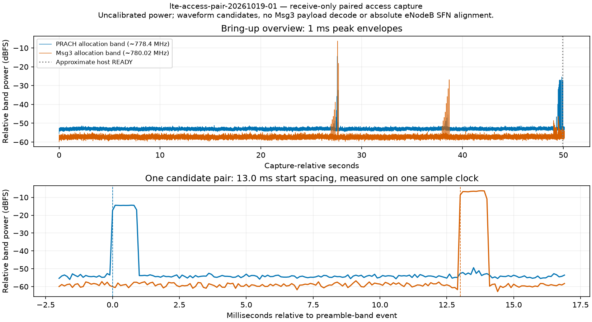
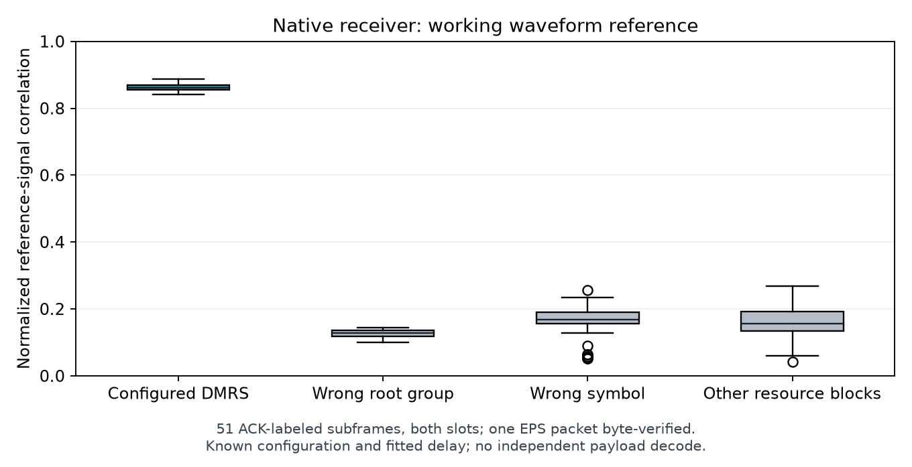

# 006 LTE-M random-access capture

**Status:** Paused  
**Started:** 2026-10-19  
**Updated:** 2026-10-20

Capture the random-access preamble and Msg3 bands on one receiver clock while
investigating the intermittent attach failures from [the data-rate tests](../005-walter-lte-m-data-rates/README.md).

## Setup

| Item | Setting |
| --- | --- |
| Link | EPS → production IHU → CAN → Walter MCU → Walter LTE-M → LibreSDR → receiver/Yamcs |
| Radio | Band 13, DL 751 / UL 782 MHz, 50 PRB; existing OAI/EPC profile |
| Antennas | LibreSDR stock antennas; Walter full-band LTE antenna; 1 m separation |
| Observer | HackRF One, receive only, centered at 779.1 MHz; 5 MS/s; 2.5 MHz filter |
| Observed allocations | PRACH about 778.4 MHz / 1.08 MHz; two-PRB Msg3 about 780.02 MHz / 360 kHz |
| IQ recording | First 5 seconds establish noise; trigger at each band's p99 + 6 dB; retain previous/current/next 100 ms blocks; 40 MB cap |
| Benchmark | 128-byte EPS packets offered at 2 packets/s for 30 seconds; drain 10 seconds |

HackRF RF amplifier and antenna power were OFF. The analog filter has rolloff;
these captures support timing/waveform checks, not calibrated power comparisons.
Raw IQ and core logs remain private. Production firmware and ground transmit
settings stayed unchanged. [Software identities](../005-walter-lte-m-data-rates/files/2026-10-19-ground-setup.json).
EPS battery remains disconnected.

## Results

| Run | HackRF LNA / VGA dB | READY seconds | Accepted / received / Yamcs | Received kbps | Data |
| --- | --- | --- | --- | --- | --- |
| 1 | 16 / 8 | 42.764 | 60 / 60 / 60 | 2.048 | [Delivery](files/lte-access-pair-20261019-01-delivery.json) · [Setup](files/lte-access-pair-20261019-01-setup.json) |
| 2 | 24 / 0 | 15.134 | 60 / 60 / 60 | 2.048 | [Delivery](files/lte-access-pair-20261019-02-delivery.json) · [Setup](files/lte-access-pair-20261019-02-setup.json) |

**120/120 packets reached receiver and Yamcs.** No missing, duplicate, late,
skipped or refused packets. This is paced full-path goodput, not a modem maximum.
Both 145-second captures received 725,000,000 complex samples with zero overruns
and zero clipped ADC samples. Each reached the 40 MB IQ cap; power recording
continued for the complete observation. Gain distribution changed between runs;
these were different access sessions, not a controlled sensitivity measurement.

Run 1 logged **18 unsuccessful Msg3 receptions before one nonempty Msg3 CCCH
indication**. Run 2 logged none before its first success.
[Selected log counts](files/2026-10-19-access-log-summary.json).
Both ultimately registered. Neither reproduced the earlier final timeout or
accepted-but-undelivered session failure.

## Over-air access timing

Six strong preamble-band events in run 1 passed the format-0 prefix check.
The root fits favor **u = 688**, corresponding to configured logical root 89.
Preamble 60 is consistent with the ground logs, but integer frequency/shift
ambiguity prevents claiming an independently validated preamble decode.
[Root fits](files/lte-access-pair-20261019-01-root-fit.json) ·
[Selected log events](files/2026-10-19-selected-log-events.json).

Four of these events had one later response-band candidate with LTE-like normal
cyclic-prefix structure: start spacings **13.0, 13.0, 12.9 and 13.0 ms**, measured
on the same HackRF sample clock at 0.1 ms resolution.
[Run 1 analysis](files/lte-access-pair-20261019-01-analysis.json).

[Plotted samples](files/2026-10-19-paired-window.csv).
These are waveform/time candidates; Msg3 payload and CRC have not been decoded.
Later power spikes that failed the prefix check were not counted as preambles.

The successful access was weaker. A conditional fit using the ground-log
preamble-60 hypothesis places its preamble about **13.1 ms** before the response
candidate. The template correlation was 0.256, versus 0.060/0.064 for quiet/other-
root controls. This supports the hypothesis but does not independently identify
the preamble. [Conditional fit](files/2026-10-19-conditional-preamble-fit.json).
Run 2's preamble did not pass the strong-event prefix threshold.
[Run 2 analysis](files/lte-access-pair-20261019-02-analysis.json).

Retry candidates and the conditional successful candidate have similar spacing.
**No gross timing offset or receiver fix is established.** Absolute eNodeB SFN
alignment and transmitter identity remain unverified. [Summary](files/2026-10-19-summary.json).
Waveform checks follow [ETSI TS 136 211](https://www.etsi.org/deliver/etsi_ts/136200_136299/136211/14.04.00_60/ts_136211v140400p.pdf).

## Grant and receiver check

All **20 generated RARs** from the two captures matched the temporary identity
in their MAC receive callbacks. Their Msg3 targets were six subframes after the
logged RAR frame/subframe. Every grant used narrowband 2, two resource blocks,
MCS 7 and repetition code 0. These fields did not distinguish failures from
successes. [Run 1 joins](files/lte-access-pair-20261019-01-rar-msg3-join.json) ·
[Run 2 joins](files/lte-access-pair-20261019-02-rar-msg3-join.json).
This checks generated grants, not whether Walter received each RAR over the air.

One additional session used a copied ground profile with only PHY logging
changed from `info` to `debug`. No HackRF capture was made. A first launch failed
before cell startup because of a quoting error in that temporary config; it was
corrected before the test. Production firmware, radio binary and transmit
settings stayed unchanged.

| READY seconds | Modem accepted | Receiver / Yamcs | Local refusals | Outcome |
| --- | --- | --- | --- | --- |
| 16.328 | 45 | 0 / 0 | 5 | Registration lost; next send rejected NOT_READY; test stopped |

The final refusal was explicit, so there were no unknown send outcomes. Nine
planned slots were never reached. **The window did not complete; no data-rate
result is assigned.** [Delivery](files/lte-phy-context-20261019-02-delivery.json).

Msg3 decoded successfully on the first attempt. Its PHY context matched the
assigned temporary identity and target frame/subframe: HARQ 0, first RB 13,
two RBs, QPSK, 224-bit transport block and RV 0.
[Msg3 context](files/lte-phy-context-20261019-02-rar-msg3-join.json).
Later six-RB scheduled uplink receptions logged repeated decode failures and
retransmissions. [Selected PHY fields](files/lte-phy-context-20261019-02-phy-summary.json).
These are receiver log events, not independently identified RF transmissions or
a packet error rate.

This is another accepted-but-undelivered session, with CEREG 4 and one recorded
registration drop. Verbose logging changes real-time load, so a common cause with
the earlier failures is **not established**. No fix is claimed. The original
logging profile remains the normal profile.
[Setup, limits and cleanup](files/2026-10-19-grant-context-summary.json).

## Saved working/failed session comparison

No additional radio run or firmware change was needed for this comparison.
All three zero-delivery sessions logged RRC reconfiguration completion before
the first telemetry offer. The working references continued logging uplink data;
the failed sessions logged no UL-DTCH events during their telemetry intervals.
[Comparison](files/2026-10-19-post-attach-comparison.json).
These log events are not telemetry packet counts or a radio packet error rate.

In the PHY-debug session, **1,373 grants matched both receiver programming and
demodulation records**, with no mismatch in the checked NDI, RV, HARQ, resource
allocation or transport-block fields. One final grant at the end of the selected
log interval had no receiver record inside that interval.
[Grant/receiver joins](files/2026-10-19-dci-receiver-join.json).
This establishes internal eNodeB consistency; UE receipt and over-air timing
remain unverified. The working logs lack these PHY fields, so a working/failed
DMRS comparison is still missing.

The earlier 2 packet/s failure also removed the active UE context about 247 ms
after the first telemetry offer. Its release trigger remains unresolved. The
other two retained scheduled receive activity much longer. Keep these failure
paths distinct. [Selected transitions](files/2026-10-19-post-attach-transitions.json).

## Release probe and native capture preparation

A single-packet probe enabled only RLC/RRC debug; PHY logging and RF settings
stayed unchanged. It reached the 90-second registration timeout with CEREG 2,
**zero telemetry attempts** and no nonempty Msg3 CCCH indication. The bounded
log contains 36 RARs and 36 unsuccessful Msg3 events. The release path was never
reached. [Probe result](files/2026-10-19-release-probe.json).

Source review found a possible path from exhausted signalling-bearer retries to
release completion and immediate tunnel/context cleanup. Other release paths
also exist. The original logs hide the relevant debug events, so this is **a
candidate path, not a confirmed trigger**.
[Source review](files/2026-10-19-release-path-source.json).

A separate eNodeB build now enables OAI's existing native sample/decode trace
hooks, preserving the current local patches. The active source tree, radio binary
and production firmware are unchanged. At preparation time it had **not started
a cell**; its subsequent bench checks follow below.
[Build and checks](files/2026-10-19-native-trace-preparation.json).

Synthetic checks passed: 456 sample/decode pairs matched, extracted samples were
byte-exact, frame/subframe filtering worked, truncated input was rejected, and
time/file-size limits behaved correctly. The observer defaults to **1 second /
128 MiB**, with a small event allowlist and no NAS/MAC payload events.
These software checks do not establish radio timing or throughput.

The existing sample hook has a source TODO about buffer selection. Qualify that
selection and the reference-signal correlation using a byte-verified working
delivery before interpreting a failed reception.

## Native receiver working reference

The first launch stopped before cell startup because of an argument-ordering
problem in the config loader. Moving trace options earlier in the launcher fixed
it; both modes passed an offline parsing check. No modem window was opened in
that failed launch. [Launch check](files/2026-10-19-native-launch-check.json).

| Mode | READY seconds | Accepted / receiver / Yamcs | Registered observation | Data |
| --- | --- | --- | --- | --- |
| Native build, tracing off | 27.617 | 1 / 1 / 1 | 35 seconds, no drop | [Delivery](files/lte-native-baseline-20261019-02-delivery.json) |
| Native build, tracing on | 16.696 | 1 / 1 / 1 | 35 seconds, no drop | [Delivery](files/lte-native-capture-20261019-01-delivery.json) |

**2/2 EPS packets byte-matched receiver and Yamcs.** These are single-packet
delivery checks, with no throughput result. The temporary host driver waits for
the observer before sending; missing/failed observer and short-window checks
stop without telemetry and restore OFF.

The native observation recorded **64,120,248 bytes** around a one-second window,
below its 128 MiB cap. It contains 1,012 input buffers and 52 decode events; all
52 have matching input records. The connected UE has **51 ACKs**. One NACK used
a different temporary identity and is excluded from this working reference.
[Capture setup and summary](files/2026-10-19-native-reference-summary.json).

The 51 checked buffers each contain 15,360 complex samples. Their normal-prefix
correlation is **0.755–0.923**. Configured DMRS correlation across both slots is
**0.840–0.888**; wrong-root, wrong-symbol and other-RB controls remain below
**0.269**. No int16 sample clipping was found in those checked buffers.
[Method and per-buffer results](files/lte-native-capture-20261019-01-waveform.json).

This supports the sample-buffer waveform match under the known working
configuration. It is not an independent payload decode or absolute SFN check;
periodic reference signals alone cannot exclude a whole-frame buffer lag.
**A registration-loss transition has not yet been captured with this observer,
and no failure cause is fixed.** Raw native samples remain private.

## Fresh-session repeat: delivery passed, registration dropped

A fresh session used the same native build, original RF profile and one-second
observer. Walter reached READY in **21.913 seconds**. The single EPS packet
byte-matched the receiver and Yamcs: **1 / 1 / 1**, with no duplicate or unknown
send. [Delivery](files/lte-native-compare-20261019-01-delivery.json).

Registration was still present at the 10.386-second check after acceptance,
but absent at 15.383 seconds, with CEREG 2 and one drop event. It remained absent
through the 35.244-second check. These checks bound when the loss occurred;
they do not establish its exact onset. **Delivery passed; registration stability
failed.** No additional repeat was started.

The recorder retained **64,707,292 bytes** below the 128 MiB cap: 1,021 input
buffers and 53 matched decode events. Walter's connected identity had **47 ACKs
and 4 NACKs**; two other-identity NACKs are kept separate. The four connected-
identity NACK input records precede the host's telemetry offer. They are decode
events, not four lost EPS packets. Their waveform comparison follows below.
[Capture and registration checks](files/lte-native-compare-20261019-01-summary.json).

The one-second capture covers initial delivery, **not the registration loss
roughly 15 seconds later**. A capture around that later transition is the next
useful test. This session adds no throughput result and establishes no fix.
Production firmware and RF settings stayed unchanged.

## Delayed capture and failed-decode waveform check

The next fresh session moved the recorder to the later window: start about
12 seconds after the host observed acceptance, record for three seconds, with a
256 MiB hard cap. Firmware and RF settings stayed unchanged.

Walter reached READY in **38.124 seconds** and delivered **1 / 1 / 1** EPS packet
to modem acceptance, receiver and Yamcs. All eight registration checks through
35.379 seconds remained registered, with zero drops. **The loss did not recur.**
[Delivery](files/lte-native-delayed-20261019-01-delivery.json) ·
[Setup and observations](files/lte-native-delayed-20261019-01-summary.json).

The recording completed normally: **190,520,616 bytes**, 3.010 seconds active,
3,014 input buffers and **150 matched ACK events, zero NACKs**. This is a later
working reference; it does not capture the failed transition or qualify
reliability. No throughput result is assigned to this single packet.

Offline checks also compared the previous session's four connected-identity
NACK buffers with its 47 ACK buffers. All four NACKs have matching six-RB receive
records and narrowband-2 allocation logs. Under the configured DMRS hypothesis,
NACK reference-signal correlation is **0.990–0.994**, versus **0.987–0.994** for
ACKs. Wrong-root, wrong-symbol and adjacent-RB controls stay below **0.284**;
no checked int16 clipping was found.
[Method, allocation checks and failed-buffer fits](files/lte-native-compare-20261019-01-nack-waveform.json).

The failed decodes contain a strong matching reference signal. That makes a
missing waveform less likely for those four events; it does not prove correct
payload decoding, absolute frame alignment or the cause of the later registration
loss. They precede the telemetry offer and are not four lost EPS packets.

## Failure-triggered native recording

A temporary ground-side recorder now retains up to six seconds of sample history
and one second after a trigger. It triggers on a reported registration loss or
four consecutive NACKs for the connected identity after arming following modem
acceptance. Other identities cannot trigger it. The ring is capped at 384 MiB,
output at 512 MiB and streaming time at 45 seconds. With no trigger, it ends
after 37 seconds and saves only the final second.

Synthetic checks passed for both triggers, identity filtering, ACK reset, ring
age/byte eviction, post-trigger stop, malformed-length rejection and a scaled-
clock no-trigger timeout. These are software checks, not RF qualification.

One fresh session reached READY in **27.192 seconds** and delivered **1 / 1 / 1**
EPS packet. All eight checks through 35.380 seconds stayed registered, with zero
drops. [Delivery](files/lte-native-triggered-20261019-01-delivery.json).

**The decode-failure trigger fired.** It retained **205,517,876 bytes**, including
2.338 seconds before the trigger and 1.000 second after it. The trigger occurred
early, so less than the full six-second history existed. No ring byte-cap
evictions occurred. The snapshot has **151 ACK / 16 NACK** events for Walter's
connected identity; one ACK and one NACK from other identities are kept separate.
[Recorder and registration results](files/lte-native-triggered-20261019-01-summary.json) ·
[Connected-identity decode events](files/lte-native-triggered-20261019-01-decode-events.json).

All 16 NACKs join to six-RB schedule records with MCS field 4 and first RB 0
within the narrowband. Four new-transmission allocation logs identify narrowband
2; twelve retransmission schedules are retained separately. Under the configured
DMRS hypothesis, **six NACK buffers have both slot correlations below 0.3; ten
have both above 0.95**. The 151 ACK buffers span **0.980–0.999**. No checked int16
clipping was found. [Scheduling and waveform checks](files/lte-native-triggered-20261019-01-waveform.json).

This captures transient decode failures alongside a delivered EPS packet and
continued registration. Keep weak-pilot and strong-pilot failures separate.
Low pilot correlation does not prove Walter was silent; strong correlation does
not prove correct payload decoding. The registration-loss transition remains
uncaptured. Continuous native sample streaming also changes runtime load, so
these events are not established as the cause of the earlier session failures.
No throughput result or fix is claimed. Production firmware and RF settings
stayed unchanged.

## Saved retry-group comparison

No new radio run was needed. All **167** connected-identity attempts join to
schedule records: **155 new transmissions**, including **151 first-attempt ACKs**
and four groups that each failed on the initial attempt and three retries.
None of the twelve retries succeeded. These are transport decode events, not
EPS packet counts.

| New-transmission frame | Four attempts' pilot matches | Previous / next ACK frame | New-data indicator |
| --- | --- | --- | --- |
| 992 | Weak / weak / weak / weak | 990 / 1000 | 1 |
| 0 | Strong / strong / strong / strong | 1022 / 8 | 0 |
| 20 | Weak / weak / strong / strong | 18 / 28 | 1 |
| 66 | Strong / strong / strong / strong | 64 / 74 | 1 |

The frame counter wraps from 1023 to 0. Every checked attempt uses HARQ 0,
MCS field 4 and six RBs. Each new-transmission record reports a 51-byte transport
block. The new-data indicator alternates across all 155 new transmissions;
there are no toggle errors in those records.
[Corrected comparison and adjacent ACKs](files/lte-native-triggered-20261019-01-harq-comparison-corrected.json).

**Data correction:** the earlier waveform export's `schedule.timestamp_ns`
field used an incorrect byte offset. Those schedule timestamps are invalid.
The new comparison reparses them correctly and checks timestamp bounds when
joining records. Counts, frame-based joins, input timestamps and waveform fits
are unchanged. The original export is retained.

Source review maps retry rounds 0–3 to redundancy versions 0, 2, 3, 1 for both
the grant and receive configuration. This is source evidence; the actual decoder
values were not recorded. Its soft-buffer reset decision and decode return/abort
state are also missing. The existing PHY grant trace has a legacy calculated
HARQ-ID field marked TODO, while the actual grant uses the LTE-M HARQ field;
that trace field cannot establish an on-air mismatch.

**No mismatch or failure cause is established by the checked fields.** The next
step is narrow diagnostic-only tracing of actual grant, receiver and decoder
state, including NDI, redundancy version and buffer reset. Keep the original
radio build and production MCU firmware unchanged.

## Decoder-state build: offline checks

A separate diagnostic build now adds five scalar event types. The existing
radio builds and production MCU firmware are unchanged.

| Stage | Recorded information |
| --- | --- |
| Grant | Constructed 10 MHz DCI fields: HARQ, NDI, redundancy version, allocation and repetition code |
| Receiver | Input/stored NDI, redundancy version, transport size, round and context-reset decision |
| Rate unmatching | The supplied soft-buffer clear/combine flag, redundancy version and repetition state |
| Segment completion | Decoder return value/iterations, iteration limit and abort flag |
| Transport completion | Final-segment abort, round, status and repetition state before cleanup |

The full base-station executable, radio modules and uplink simulator built
successfully. OAI's event-database checker returned 0. A C emitter sent **1,150
synthetic events across all five types** through the real tracer transport; every
signed field matched and truncated input was rejected. Recorder fixtures also
verified both triggers with the new event types and rejected malformed lengths
and incorrect state-field counts.

CTest reported both selected 10 MHz LTE uplink cases passed: **53.26 and
60.41 seconds**. These exercise the shared LTE uplink code; they are not Walter
or LTE-M over-air qualification. Preparation review corrected an error-path
trace placement and the event database's required VCD ordering before accepting
the build. [Offline checks and build identities](files/2026-10-19-harqstate-preparation.json) ·
[Field schema](files/2026-10-19-harqstate-schema.json).

No cell had been started with this build at the point these offline results
were saved. The next check is one EPS packet with tracing off, followed by one
with state recording only if delivery and registration observation succeed.
No failure fix or new throughput result is claimed.

## Decoder-state bench: missing delivery and early context removal

The new build was checked with tracing off, then with state recording enabled.
RF settings and production firmware stayed unchanged.

| Run | READY seconds | Accepted / receiver / Yamcs | Registration observation |
| --- | --- | --- | --- |
| Tracing off | 56.023 | 1 / 1 / 1 | 35 seconds, zero drops |
| First tracing-on attempt | 26.818 | No telemetry attempted | Recorder setup error; gate stopped the send |
| Tracing-on repeat | 22.263 | 1 / 0 / 0 | 35 seconds, zero reported drops |

[Tracing-off delivery](files/lte-harqstate-baseline-20261019-01-delivery.json) ·
[Setup error](files/lte-harqstate-triggered-20261019-01-setup-error.json) ·
[Missing delivery](files/lte-harqstate-triggered-20261019-02-delivery.json).
The setup error was a missing recorder parent directory. Directory creation was
fixed and the missing-parent case checked with a synthetic stream before the
repeat. No uncertain telemetry send was retried.

**The missing-delivery session removed its initial UE context before the host
offered telemetry, despite modem readiness remaining asserted.** Selected UTC
markers are:

| Event | UTC time |
| --- | --- |
| Initial RRC reconfiguration complete | 21:33:51.846 |
| Initial UE context removed | 21:33:52.309 |
| Host offers EPS telemetry | 21:33:52.858 |
| Modem accepts it | 21:33:53.168 |
| Later RRC connection setup begins | 21:33:58.118 |
| Later RRC reconfiguration complete | 21:33:58.406 |

Removal precedes the offer by about **0.55 seconds** using the host clocks.
An after-run clock audit bounds ground-versus-console offset within about
±0.18 seconds, assuming no intervening clock step. These are event timestamps,
not a one-way radio latency measurement.
[Run summary, clock audit and transitions](files/2026-10-19-harqstate-bench-summary.json).

The recorder retained all scalar events for 37 seconds. For
the later context, **1,576 complete grant → receiver → rate-unmatching → segment
→ completion chains** matched MAC records: **1,542 ACKs and 34 NACKs**, with no
mismatch in the checked NDI, redundancy version, round, HARQ, allocation,
transport size, clear/combine flag or decoder-result relationships. One partial
grant chain at the capture boundary was excluded.
[State checks and failed chains](files/lte-harqstate-triggered-20261019-02-state-checks.json).

**Those checks cover the later context, not the failed initial one.** No initial-
context state events were retained. The sample trigger stayed tied to the first
identity; it timed out and saved the final one-second IQ fallback, while the
complete scalar stream remained available. That fallback does not capture the
early release. It is not yet clear whether the release was an expected idle
transition or an error path, or whether it caused the missing packet. No fix is
claimed.

The next observation must start before registration, retain all identities and
record the release cause. A modem registration flag alone did not establish
usable telemetry delivery in this session. No new throughput measurement was
made.

## Scalar recording from startup

The recorder now connects before the IHU opens Walter's RF window and keeps
scalar events for every identity. It records no IQ or payloads, has a 16 MiB
hard cap and a 140-second deadline. Offline socket checks passed startup before
any UE events, changing identities, signed fields, stop/deadline handling and
rejection of malformed events or excess data.

Only RLC/RRC logging changed to debug. PHY logging, RF settings, radio executable
and production firmware stayed unchanged.

| Run | READY seconds | Accepted / receiver / Yamcs | Registration observation |
| --- | --- | --- | --- |
| Startup capture | 33.844 | 1 / 1 / 1 | 35 seconds, zero drops |
| Same-settings repeat | 66.087 | 1 / 1 / 1 | 35 seconds, zero drops |

[Delivery](files/lte-release-startup-20261019-01-delivery.json) ·
[Setup, state checks and release markers](files/2026-10-19-startup-state-summary.json).

The recorder saved **1,198,282 bytes over 71.98 seconds**, with no incomplete
record at stop. All **1,918 complete grant → decoder chains** matched MAC
records: **1,860 ACK / 58 NACK**, with no mismatch in the checked fields.
These decode events are not EPS packet counts or a packet error rate.

**The early context-removal failure did not recur.** The context stayed present
through the telemetry observation. The host requested Walter OFF at
21:50:20.088 UTC. A later release request at 21:50:44.990 logged cause 21,
“radio connection with UE lost.” SRB1 max-retry was logged afterward, at
21:50:45.476, followed by context removal. This is a post-shutdown reference;
it does not explain the earlier pre-telemetry release or establish SRB retry
exhaustion as the trigger for that earlier failure.

Startup recording is now bench-checked. The next useful run is the same bounded
observation when the missing-delivery or early-release failure recurs. No new
throughput result or fix is claimed.

### Same-settings startup repeat

The repeat also delivered **1 / 1 / 1**, with no duplicate or unknown send.
All eight checks through **35.364 seconds** stayed registered with zero drops.
The early release and missing delivery did not recur.
[Delivery](files/lte-release-startup-20261019-02-delivery.json) ·
[Setup and state checks](files/2026-10-19-startup-state-repeat-summary.json).

The recorder saved **1,212,686 bytes over 104.41 seconds**, with no incomplete
record at stop. All **1,929 complete chains** matched MAC records:
**1,773 ACK / 156 NACK**, with no mismatch in the checked fields. There was no
release-request or context-removal marker in this bounded session log, including
the interval after commanded OFF and before cell shutdown.

The two startup captures contain 27 and 49 two-RB receiver snapshots. Their
outcomes were 2 ACK / 25 NACK and 2 ACK / 47 NACK. All snapshots used the same
checked receiver configuration: HARQ 0, NDI 0, RV 0, first RB 13, two RBs,
224-bit transport block, context reset and soft-buffer clear enabled.
[Two-RB state comparison](files/2026-10-19-startup-two-rb-state-comparison.json).
These are decoder records; they are not independently decoded access messages
or lost EPS packets. No differing receiver-state field explains their outcomes.

Both startup captures now provide working references. The original failures
remain open; repeated delivery does not establish a fix or modem maximum speed.

## Bounded startup batch: attach timeout

The next batch allowed up to three fresh sessions and stopped at the first
unsuccessful session. Settings, scalar recorder and production firmware were
unchanged. It stopped after two sessions.

| Session | READY seconds | Accepted / receiver / Yamcs | Result |
| --- | --- | --- | --- |
| 1 | 21.810 | 1 / 1 / 1 | Registered through 35.259 seconds, zero drops |
| 2 | Not reached within 90 seconds | No telemetry attempted | Registration timeout; cached CEREG 4 |

[Session 1 delivery](files/lte-release-startup-20261019-03-delivery.json) ·
[Session 2 timeout](files/lte-release-startup-20261019-04-delivery.json) ·
[Batch setup, observations and state checks](files/2026-10-19-startup-state-batch-summary.json).

Session 1 has **1,891 complete decoder chains** matched to MAC records, with no
mismatch in the checked fields. One incomplete chain at the capture boundary
was excluded. Its release request occurred after commanded OFF.

**Session 2 never reached registered READY, so no EPS packet was offered.**
The recorder connected before RF admission and saved **144,306 bytes of startup
metadata over 93.98 seconds**, but no selected PHY/MAC events. The eNodeB logged
zero RARs, zero unsuccessful ULSCH events and zero nonempty Msg3 CCCH events.
No release marker was captured. This differs from the earlier timeout
with repeated Msg3 failures and from accepted-but-undelivered telemetry.

The cell logged steady-state startup, but these logs do not prove its RF output
or whether Walter transmitted an access preamble. The next diagnostic is an
independent receive-only check of the cell's downlink and Walter's access band
during a timeout. No third session was started. This batch adds no throughput
measurement or failure fix.

## Independent RF check: reliability investigation paused

This was the final bounded reliability diagnostic before returning to data-rate
testing. Transmitter settings and production firmware stayed unchanged.

| Check | Receiver settings | Result |
| --- | --- | --- |
| Initial downlink OFF/ON | 751 MHz, 10 MS/s, LNA 0 / VGA 8 dB | 2.58 dB increase; below preselected 6 dB gate; Walter window not opened |
| Receiver qualification, ON then OFF | Same frequency/rate, LNA 16 / VGA 8 dB | 15.06 dB increase with cell ON |
| Attach run, downlink OFF/ON | Same LNA 16 / VGA 8 dB settings | 12.55 dB increase before Walter RF admission |
| Attach run, access-band recording | 779.1 MHz, 5 MS/s, 2.5 MHz filter, LNA 16 / VGA 8 dB | No above-threshold PRACH/Msg3-band bins in 150 seconds |

[Setup, source observation and cleanup](files/2026-10-19-independent-rf-summary.json) ·
[RF measurements and limits](files/lte-independent-rf-20261019-02-rf-analysis.json) ·
[Attach timeout](files/lte-independent-rf-20261019-02-delivery.json).

All downlink contrasts used matched three-second captures and integrated the middle
9 MHz of the configured channel. The gain change qualified the independent
receiver; it was not an LTE link fix. All captures had zero reported overruns
and zero clipped samples. RF amplifier and antenna power stayed OFF.

**The single Walter attempt timed out at 90 seconds without registration.**
Cached CEREG was 4. No telemetry was offered. The eNodeB logged zero RAR,
ULSCH-error and nonempty Msg3 CCCH events. Scalar recording contained startup
metadata only.

The access observer received **750,000,000 complex samples**. Neither configured
access band exceeded its first-five-second noise p99 + 6 dB threshold in any
100 µs bin. The same frequency/rate/filter/gain settings had detected access
bursts in the earlier working capture. No IQ trigger fired in this run.

This gives a useful lead toward modem acquisition/network selection for this
particular timeout, but no confirmed cause. The one receiver checked downlink
and uplink sequentially; downlink was not monitored throughout the timeout.
A post-timeout downlink check was skipped because there was insufficient time
before cell shutdown. Weaker or off-frequency transmissions remain possible.
This result does not explain the earlier Msg3-retry, early-release or
accepted-but-undelivered failures.

**Reliability debugging is paused.** The separate direct-Walter benchmark and
original-image restoration are now complete; see [entry 005](../005-walter-lte-m-data-rates/README.md).
The access, early-release and missing-delivery findings here remain unresolved.

## Next

- Keep the recordings and unresolved findings; no more blind startup repeats.
- When LTE work resumes, first check production telemetry endurance and recovery.
- If acquisition debugging resumes, inspect live modem selection/acquisition
  state before changing radio parameters. Operator selection was unmeasured
  during the sessions recorded here.

Walter ended OFF after all eighteen radio sessions. Original IHU output flags,
firmware/boot and zero CAN errors were verified; radio/core/capture processes
are stopped.

[Data-rate investigation](../005-walter-lte-m-data-rates/README.md) · [Back to Lab Log](../../README.md)
