# 007 SDRB RF_Out check

**Status:** In progress  
**Started:** 2026-10-20 · **Updated:** 2026-10-21

Check the signal at **J10/RF_Out** using driver-only Path B, with the final PA off.

## Setup

`SDRB J10/RF_Out → DC block → 30 dB / 2 W pad → 10 dB / 2 W pad → tinySA Ultra`

- Main power and AmpPwr1 share **9.0 V**, current limit **0.7 A**. AmpPwr2 disconnected. Startup: **0.567 A, CV**; no visible supply change during the first checks, around **0.570 A** afterward.
- Native UHD channel 1, LO **438 MHz** (145 MHz for the follow-up below), complex tone **+100 kHz**, amplitude **0.1**, nominal **2.304 MS/s**. Each transmission lasts **8 seconds**.
- tinySA Ultra: **30 dB internal attenuation**, LNA off, **3 kHz RBW**, external correction **0 dB**. Scans: LO to LO +200 kHz, 201 points. Firmware `tinySA4_v1.4-156-g4eb315d`; no fresh calibration.
- Software: **0.1.0-dev.3**, with temporary RAM-only MPM changes from `0c8e7f744023b649bec167de9afc3b41fb57b7a3` and explicit `sdrb_tx_path=rf_out_b`. Original card files unchanged; FPGA PA enable remains low.

An initial silent boot was traced to a disturbed boot jumper. Restoring the documented SD-boot straps allowed Linux to boot.

## Results

Levels are measured **after the external 40 dB pads**. Off-state values are the strongest bin within ±5 kHz of 438.1 MHz; those bins need not match the tone bin.

| TX gain | Before | Tone on | After | Observation |
|---|---:|---:|---:|---|
| 30 dB | −82.4 dBm | −81.9 dBm | −81.9 dBm | Indistinguishable from background |
| 60 dB | −83.9 dBm | **−62.9 dBm at 438.100 MHz** | −82.4 dBm | Clear off/on/off contrast |
| 60 dB, repeat | −80.8 dBm | **−62.3 dBm at 438.100 MHz** | −87.8 dBm | Reference for the next gain step |
| 70 dB | −85.8 dBm | **−52.3 dBm at 438.100 MHz** | −83.8 dBm | +10.00 dB relative to the repeated gain-60 run |

All four runs completed without reported stream or cleanup errors and returned to background. A **10 dB gain-setting increase produced a 10.00 dB indicated increase** in the same-setup comparison. Adding nominal pad attenuation gives approximately **−22.3 / −12.3 dBm before the pads** for the repeated gain-60/gain-70 pair. Cable/DC-block loss, pad tolerance and analyzer calibration uncertainty are uncorrected.

## 145.1 MHz spot check

Same wiring, amplitude, rate and analyzer settings; LO changed to 145 MHz. Numerical levels remain after the 40 dB pads:

| TX gain | Before | Tone on | After | Observation |
|---|---:|---:|---:|---|
| 60 dB | −86.6 dBm | −81.6 dBm | −83.1 dBm | Too close to background for clear detection |
| 70 dB | −84.0 dBm | **−73.0 dBm at 145.099 MHz** | −85.0 dBm | Clear tone; no reported stream or cleanup errors |

The gain-70 reading is about **20.7 dB lower** than the earlier 438.1 MHz reading at the same gain. The cause is unresolved; this is an uncalibrated comparison of the complete setup, not an isolated driver-gain measurement.

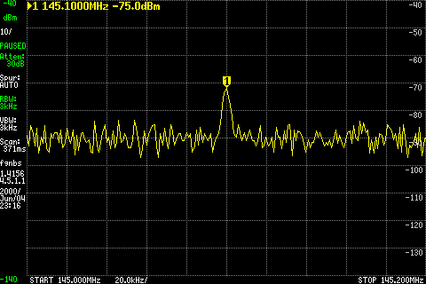
Actual LCD capture during the gain-70 run. Fixed marker: **145.100 MHz, −75.0 dBm**. The screen uses a separate sweep immediately after the numerical scan, so its fixed-marker reading differs from the table's strongest bin within ±5 kHz.

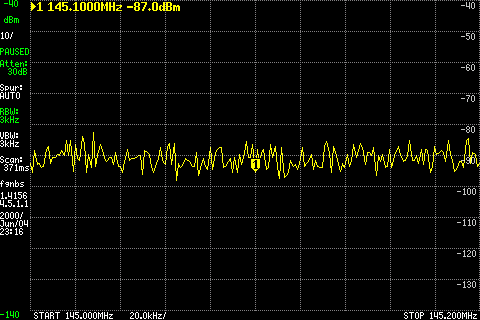
Actual LCD capture after stopping; the same marker reads **−87.0 dBm**. Display: 10 dB/div, −40 dBm reference, 145.0–145.2 MHz, external correction still zero. The first 145 MHz run finished before screenshot capture was requested; these images belong to the gain-70 run only.

These checks demonstrate tones through **driver-only Path B** at two frequencies. They do not establish maximum output, final-PA/doubler operation, full frequency response or endurance. Raw bench records are retained separately; selected actual screen captures are included here.

## TX-A low-pass path

After a cold boot, same J10 wiring and gain **70 dB**, amplitude **0.1**, eight-second tones. tinySA internal attenuation changed to **10 dB**; external pads remain **40 dB**. Ultra mode enabled above 800 MHz. Software remains the RAM-only `0c8e7f7` Path B override.

| Channel / selected branch | Tone | Before | Tone on | After |
|---|---:|---:|---:|---:|
| 1 / TX1A, U19 | 438.1 MHz | −101.8 dBm | **−52.3 dBm** | −104.8 dBm |
| 0 / TX2A, U23 | 438.1 MHz | −104.3 dBm | −101.8 dBm | −104.8 dBm |
| 1 / TX1A, U19 | 900.1 MHz | −103.5 dBm | **−56.0 dBm** | −102.2 dBm |
| 1 / TX1A, U19 | 1300.1 MHz | −100.7 dBm | **−64.8 dBm** | −105.7 dBm |
| 1 / TX1A, U19 | 1600.1 MHz | −102.4 dBm | **−82.9 dBm** | −103.5 dBm |

TX1 shows a tone at each point; its indicated output falls above 900 MHz. These are uncalibrated source-to-analyzer measurements, not isolated filter insertion loss. **TX2's expected tone was not detected**; no further TX2A frequency checks were run. No stream errors were reported. The later FPGA-selector check below addresses this missing tone.

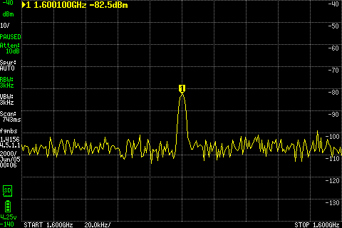
Actual LCD capture, fixed marker **1600.100 MHz, −82.5 dBm**.

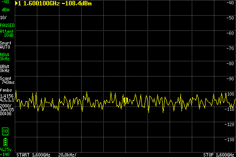
After stopping, fixed marker **−108.4 dBm**. Screens use a separate completed sweep after each numerical scan; table values use the strongest bin within ±5 kHz. Actual on/off screens were retained for every completed check.

One initial 900 MHz capture attempt stopped on a malformed tinySA text value outside the tone window. That attempt is retained separately; one repeat completed the numerical scan and screenshots. No invalid bin was substituted or used for a reported tone level.

## TX-B high-pass path

Same conducted setup, channel **1**, gain **70 dB**, amplitude **0.1** and eight-second tones. Temporary native MPM r9 and Python bindings built from `38ed43e2e5e1821fbd8011333648dc7a7185c972`; explicit `sdrb_tx_path=rf_out_b,sdrb_tx_filter=highpass`. TX1B selects U28; TX2B/U30 is checked later below. Both banks also pass through common U32/U13 low-pass filters and the AmpPwr1 drivers.

The rebuilt component first reproduced the low-pass 438.1 MHz tone at **−52.8 dBm**, about 0.5 dB below the earlier reading. For high-pass checks, tinySA uses **5 dB internal attenuation**, LNA off and Ultra mode; the external pads remain 40 dB.

| Selected branch | Tone | Before | Tone on | After |
|---|---:|---:|---:|---:|
| TX1B / U28 | 2000.1 MHz | −110.9 dBm | **−88.6 dBm** | −107.9 dBm |
| TX1B / U28 | 2500.1 MHz | −106.7 dBm | **−74.7 dBm** | −104.2 dBm |
| TX1B / U28 | 3500.1 MHz | −105.1 dBm | −106.1 dBm | −104.9 dBm |
| TX1B / U28 | 5800.1 MHz | −84.0 dBm | −85.5 dBm | −86.0 dBm |

Tones were detected at **2000.1/2500.1 MHz**, but **not at 3500.1/5800.1 MHz**. Background was much higher at 5800 MHz. No stream or cleanup errors were reported. The absent tones do not establish filter rejection or a hardware fault; source/control behavior and the complete RF/measurement path remain unresolved.

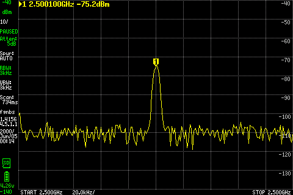
Actual LCD capture at 5 dB internal attenuation: fixed marker **2500.100 MHz, −75.2 dBm**.

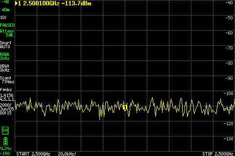
After stopping, fixed marker **−113.7 dBm**. Numerical peaks and fixed LCD markers come from adjacent sweeps.

The initial 2000/2500 MHz checks used 10 dB internal attenuation and displayed “REDUCED LINEARITY.” Those records are retained; the table uses the repeated checks at 5 dB. The matching [tinySA firmware warning condition](https://github.com/erikkaashoek/tinySA/blob/4eb315d/plot.c#L1891) depends on frequency and configured attenuation.

## TX2 selector correction

The FPGA used MPM's TX-channel-select bit as a codec reset, and the SISO mux selected by nonzero sample data. Corrected RTL separates reset from selection and synchronizes the selector; the old faults reproduce and the corrected regression passes.

Cold-booted **dev.3 + tx-select.1**, FPGA source `a1092059e0d566ae4efb54d0f6bca967df994e57`. Only BOOT.BIN changed, SHA256 `12258ce5e2d2df23681fd751782d198a3baa118cf2e57828bc3568713f9cadde`; Linux/rootfs unchanged, rollback backed up. Boot and software identities verified. Same J10 setup, RAM-only `0c8e7f7` Path B override, **channel 0 / TX2A**, gain 70 dB, amplitude 0.1, 2.304 MS/s, eight seconds. tinySA: 10 dB internal attenuation, Ultra/LNA off, 3 kHz RBW.

| Tone | Before | Tone on | After |
|---|---:|---:|---:|
| 438.100 MHz | −107.2 dBm | **−49.7 dBm** | −102.7 dBm |

The previously missing TX2 tone is now clearly detected through **U23 and J10**. No reported stream or cleanup errors; target metadata read back and SHA256 verified. This establishes one TX2A spot check, without qualifying its full filter response or the separate upper-band issue.

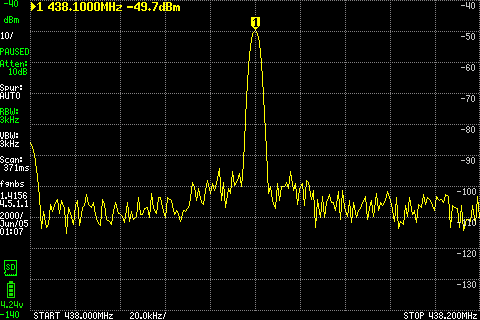
Actual LCD capture: fixed marker **438.100 MHz, −49.7 dBm**.

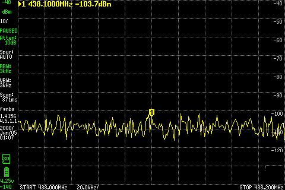
After stopping: **−103.7 dBm** at the fixed marker. Table values use the numerical peak within ±5 kHz; LCD captures use adjacent completed sweeps.

## 3.5 GHz both-sideband check

Same wiring with **40 dB external attenuation**, tx-select.1 FPGA and temporary r9 high-pass override; channel 1 / TX1B, gain 70 dB, amplitude 0.1, 2.304 MS/s. One **12-second** tone, with tinySA scanning **3499.8–3500.2 MHz**, 201 points, 2 kHz spacing, 3 kHz RBW, internal attenuation 5 dB, Ultra on and LNA off.

| Frequency window | Before | Tone on | After |
|---|---:|---:|---:|
| LO +100 kHz | −108.4 dBm | −107.4 dBm | −105.1 dBm |
| LO −100 kHz | −107.1 dBm | −107.1 dBm | −107.4 dBm |

**No tone detected on either side of the LO**; no reported stream or cleanup errors. This does not support a simple frequency inversion. Source inspection retains port B across the tested range and checks PLL lock, but does not establish RF output. The reference check below uses the same measurement chain.

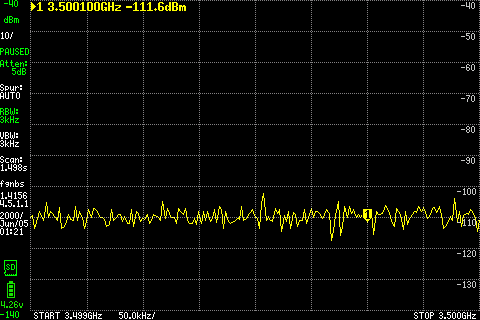
Actual LCD capture; fixed +100 kHz marker **−111.6 dBm**, a separate sweep from the numerical table.

Two analyzer-only preflights exceeded the original capture-time guard and stopped **before transmission**. The completed check uses 12 seconds to accommodate the measured sweep and LCD-capture time. No calibration was changed. [tinySA documents reduced high-frequency sensitivity and harmonic-mode conversion-loss variation](https://tinysa.org/wiki/pmwiki.php?n=TinySA4.Ultra); absent tones alone do not identify filter rejection.

## LibreSDR measurement-chain reference

Moved the existing measurement chain to **LibreSDR TXRA** (operator-confirmed printed label); SDRB remained halted with its RF output disconnected. Same DC block, **30 dB + 10 dB pads**, tinySA input and analyzer settings. LibreSDR: LO 3.5 GHz, +100 kHz complex tone, gain 40 dB, amplitude 0.1, 2 MS/s, **14 seconds**, verified custom B210 FPGA. No reported TX/RX errors or timestamp gaps.

| Observed-tone window | Before | Tone on | After |
|---|---:|---:|---:|
| ±5 kHz around 3500.094 MHz | −104.1 dBm | **−91.6 dBm** | −106.1 dBm |

The full 40 dB measurement chain **does detect a weak 3.5 GHz reference**. The owner noted that this much attenuation often buries LibreSDR output; this check has only about 12.5–14.5 dB off/on contrast. It does not establish SDRB output power or a filter fault. Use less external attenuation for the next bounded SDRB check rather than treating a background-level reading as rejection.

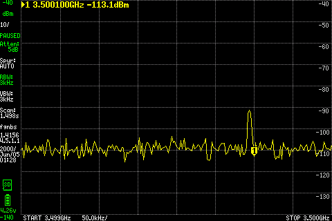
Actual LCD capture. The visible peak lies left of the fixed **3500.100 MHz** marker; that marker reads **−113.1 dBm**. The table follows the observed numerical peak at **3500.094 MHz**, not the nominal marker. No fresh frequency or level calibration.

## 3.5 / 5.8 GHz with a 20 dB pad

Returned J10/RF_Out to the same DC block and tinySA, replacing the 30 +10 dB pads with **one 20 dB / 2 W pad**. Main + AmpPwr1: 9 V / 0.7 A limit; AmpPwr2 disconnected. The 3.5 GHz check followed a captured cold boot; 5.8 GHz used the same powered session. Boot/software hashes verified before each. Same tx-select.1 FPGA, temporary r9 high-pass override, channel 1 / TX1B, gain 70 dB, amplitude 0.1, 2.304 MS/s and **12 seconds per tone**. Analyzer settings unchanged; each scan spans LO ±200 kHz.

| Tone, measured after the 20 dB pad | Before | Tone on | After |
|---|---:|---:|---:|
| 3500.100 MHz | −107.4 dBm | **−89.4 dBm** | −107.6 dBm |
| 5800.100 MHz | −88.0 dBm | **−71.5 dBm** | −87.0 dBm |

**Both tones are detected**, with about 18 dB contrast at 3.5 GHz and 15.5–16.5 dB at 5.8 GHz; no reported stream or cleanup errors. Adding the nominal extra 20 dB would put them near **−109.4 / −91.5 dBm**, below the earlier measurement floors, consistent with the previous non-detections. These two tone-detection gaps are closed; full filter response and calibrated output power remain unqualified.

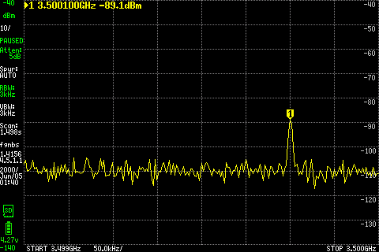
Actual LCD capture: fixed **3500.100 MHz** marker **−89.1 dBm**.

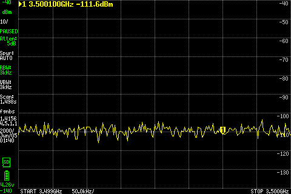
After stopping: fixed marker **−111.6 dBm**. Numerical peaks and LCD readings use adjacent sweeps. Target metadata read back and SHA256 verified; original software restored and diagnostic RAM removed.

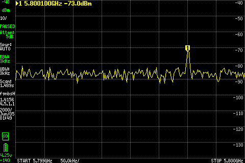
Actual LCD capture: fixed **5800.100 MHz** marker **−73.0 dBm**.

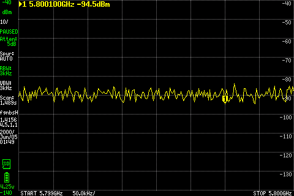
After stopping: fixed marker **−94.5 dBm**. The higher harmonic-mode background remains visible. Table and LCD use adjacent sweeps; no fresh level calibration.

## TX2B / U30 spot check

Same J10 → DC block → **20 dB / 2 W pad** → tinySA setup, tx-select.1 FPGA and temporary r9 high-pass override. Select **UHD channel 0 / TX2B**, LO 2500 MHz, +100 kHz tone; gain 70 dB, amplitude 0.1, 2.304 MS/s, **12 seconds**. Analyzer: 5 dB internal attenuation, Ultra on, LNA off, 3 kHz RBW, LO ±200 kHz scan.

| Tone, measured after the 20 dB pad | Before | Tone on | After |
|---|---:|---:|---:|
| 2500.100 MHz | −105.1 dBm | **−57.6 dBm** | −105.6 dBm |

**TX2B is detected**, with about 48 dB off/on contrast and no reported stream or cleanup errors. Channel/bank metadata read back and SHA256 verified; original software restored and diagnostic RAM removed.

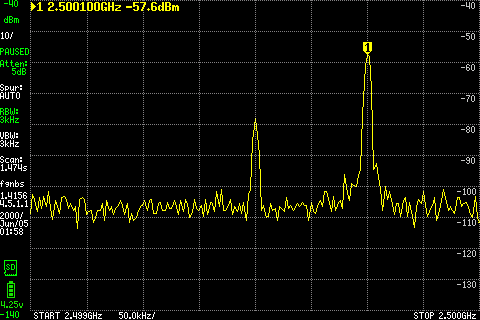
Actual LCD capture: fixed **2500.100 MHz** marker **−57.6 dBm**; the LO peak is also visible.

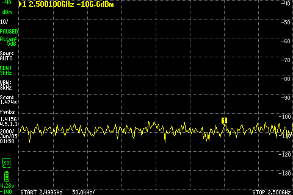
After stopping: fixed marker **−106.6 dBm**. Numerical peaks and LCD readings use adjacent sweeps.

## Integrated dev.4 check

Cold-booted **0.1.0-dev.4**, source `ed4b273`, with the selector-corrected FPGA and installed native MPM r9; boot/application/library hashes match the verified image. Same J10 → DC block → **20 dB / 2 W** → tinySA path, 9 V / 0.7 A main + AmpPwr1, AmpPwr2 disconnected. Channel **1 / TX1A**, default TX-A filter, gain **70 dB**, amplitude **0.1**, 2.304 MS/s, **12 seconds**. A RAM-only copy of the flow adds `sdrb_tx_path=rf_out_b`; installed application and MPM files are unchanged. tinySA: 10 dB internal attenuation, Ultra/LNA off, 3 kHz RBW, 437.8–438.2 MHz, external correction zero; no fresh calibration.

| Tone, after the 20 dB pad | Before | Tone on | After |
|---|---:|---:|---:|
| 438.100 MHz | −104.1 dBm | **−33.1 dBm** | −101.1 dBm |

Tone detected and returned to background; no reported stream or cleanup errors. Target metadata read back and SHA256 verified; diagnostic code removed and installed hashes rechecked. This closes the TX1A tone-detection check on the new FPGA/image at this setting; RF receive passes below; clean forwarding acceptance remains open.

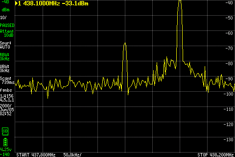
Actual LCD, fixed marker **438.100 MHz, −33.1 dBm**.

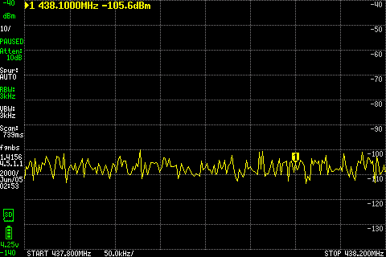
After stopping, fixed marker **−105.6 dBm**. Table values use the numerical peak within ±5 kHz; LCD captures use adjacent sweeps.

## dev.4 receive and forwarding

Added **LibreSDR TXRA → DC block → 10 dB / 2 W pad → J1/Antenna_in**; the J10 → DC block → 20 dB → tinySA path is unchanged. LibreSDR: 434 MHz LO +100 kHz, gain 40 dB, amplitude 0.1, 2 MS/s. SDRB: channel 1, RX gain 40, 2.304 MS/s and 8000-byte frames. Same dev.4 image and installed native r9, boot/software identities verified after the wiring cold boot.

A **12-second stock-CLI RX capture** contains four seconds of source tone. RMS is **−59.9 / −35.6 / −60.3 dBFS** before/on/after; the on-state peak is near +100 kHz. Saved-file hash and complete timestamp coverage pass; no reported overflow or cleanup errors.

Forwarding uses the RAM flow with the native J10 argument, **434.1 → 438.1 MHz**, TX gain 60 dB, unity multiplier and **six seconds**. Same tinySA settings as the dev.4 TX1A check:

| After the 20 dB pad | Before | Forwarding on | After | Stream result |
|---|---:|---:|---:|---|
| 438.100 MHz | −100.7 dBm | **−58.7 dBm** | −101.7 dBm | **Failed: three TX underflows**, no RX overflow or cleanup error |

A single six-second diagnostic repeat added event-receipt timestamps around start/active/stop and reported **zero underflows**. The intermittent failure remains unresolved; that clean repeat does not establish a fix. The originally planned second run was stopped after the first failure. Metadata readback/SHA and actual screen hashes verified; diagnostic code removed, installed hashes unchanged, both transmitters stopped and SDRB idle/unclaimed with zero failed services.

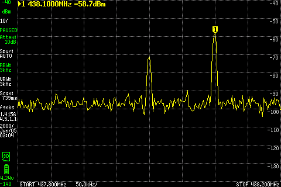
Actual LCD: **438.100 MHz, −58.7 dBm**. A visible tone does not establish error-free forwarding.

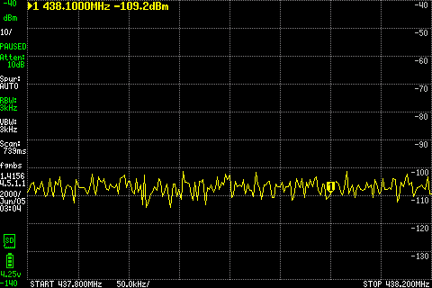
After stopping: fixed marker **−109.2 dBm**. Table and LCD use adjacent sweeps. Clean forwarding acceptance remains open.

## Forwarding start follow-up

Same setup and six-second forwarding settings as above. A RAM-only prototype schedules RX 0.5 seconds ahead and TX 50 ms after RX; installed dev.4 stays unchanged.

| Run | TX underflows reported | 438.100 MHz after 20 dB pad |
|---|---:|---:|
| Untimed control | **4 — failed** | −58.75 dBm |
| Timed-start prototype | 0 | −58.75 dBm |
| Return to untimed control | 0 | −58.75 dBm |

The failed control's notifications arrived 0.173, 0.392, 0.396 and 2.399 seconds into the active phase. These are callback receipt times, not exact FPGA event times. No reported RX overflow or cleanup error. An initial timed observation is inconclusive: its reference source ended before the active capture; the timed run above used a fresh reference verified active through measurement.

Both the timed prototype and the later untimed control were clean, so **timed start has not established an improvement**. Forwarding acceptance remains open. The next check below adds page-fault and context-switch counters at phase boundaries.

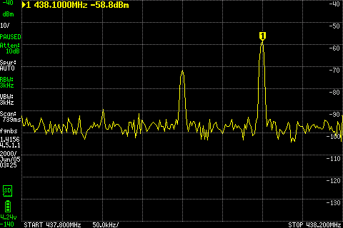
Actual LCD during the prototype: **438.100 MHz, −58.8 dBm**. Tone detection alone does not establish a fix.

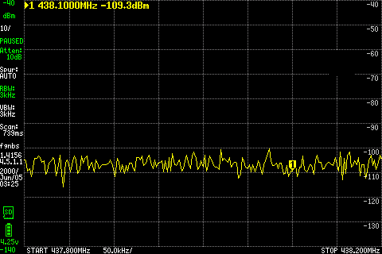
After stopping: **−109.3 dBm**. LCD and numerical results use adjacent sweeps. Both transmitters stopped; diagnostic code removed, all 22 installed/boot identities unchanged, SDRB idle/unclaimed with zero failed services.

## Receive/save → forwarding follow-up

Same powered dev.4 session and RF wiring. A RAM-only flow adds process/thread counters at phase boundaries; streaming/start/buffer settings are unchanged. LibreSDR stays off for a nominal 12-second background RX capture, then supplies the tone for one nominal six-second forwarding run.

| Check | Result |
|---|---|
| RX and post-stop save | 223,152,800 bytes saved; SHA256 readback matches, timestamp coverage complete, no reported overflow/gap |
| Forwarding, 438.100 MHz after 20 dB pad | Before **−102.25**, on **−58.75**, after **−101.75 dBm**; no reported RX/TX or cleanup errors |
| Active forwarding counters | **24 minor / 0 major faults**, 44,710 voluntary / 966 involuntary context switches between snapshots |

The earlier underflow **did not reproduce**. These counters cannot identify its cause: no failure to correlate, no per-thread run-queue timing exposed by this kernel, and each active-boundary snapshot itself took about **47 ms** (RX: 51–55 ms). Durations are wall-clock requests with snapshot/stop overhead, not exact sample-count acquisitions. No maintained code or image change; acceptance stays open.

Actual LCD: **438.100 MHz, −58.8 dBm**.

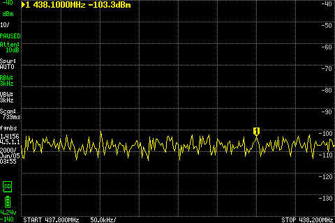
After stopping: **−103.3 dBm**. Numerical peaks and LCD use adjacent sweeps. Metadata/screen hashes verified, diagnostic RAM code removed and all 22 installed/boot identities unchanged. Both transmitters stopped; SDRB idle/unclaimed, zero failed services.

## First-forwarding and event-time checks

Same dev.4 image, wiring and six-second forwarding settings. One clean halt/operator power cycle, then identity/control checks and the unchanged event-only RAM flow; no preceding RX/save, counter scans or scheduled starts. All 22 installed/boot hashes match. Active forwarding begins about **93 seconds after boot**.

| 438.100 MHz, after 20 dB pad | Before | Forwarding on | After |
|---|---:|---:|---:|
| First forwarding after power cycle | −104.69 dBm | **−58.69 dBm** | −103.19 dBm |
| Event-time diagnostic, warm session | −101.69 dBm | **−58.69 dBm** | −102.19 dBm |

**Both checks report no RX/TX or cleanup errors** in 6.001 seconds each. Numerical values use the peak within ±5 kHz. For the power-cycle check, the initial console capture/newline probe received zero bytes; a later capture starts during Linux startup and reaches login, so this is not a complete power-on transcript. One clean first-forwarding run does not establish a fix for the earlier intermittent underflows; acceptance remains open.

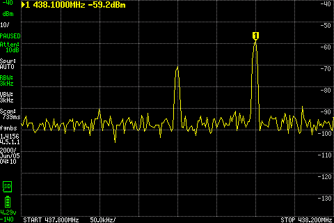
Actual LCD: **438.100 MHz, −59.2 dBm**.

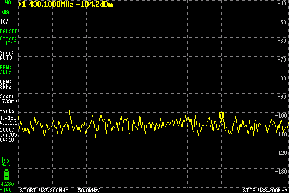
After stopping: **−104.2 dBm**. LCD and numerical results use adjacent sweeps. Metadata/screen hashes verified, diagnostic code removed, installed identities unchanged; both transmitters stopped, SDRB idle/unclaimed with zero failed services.

The warm follow-up uses a RAM-only collector that retains existing device-event timestamps/UHD stream-channel numbers, plus one pre-start device-clock read (**1.42 ms**). Fifteen ARM GNU Radio/PMT replay cases pass. **No TX event occurred during RF**, so this run does not exercise event timestamp capture on hardware or establish a fix. No active polling, timed start or maintained image change. The diagnostic is retained privately for a future recurrence during normal work.

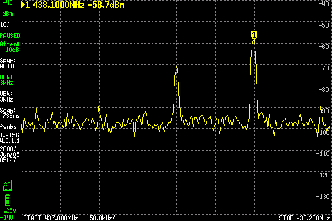
Actual LCD: **438.100 MHz, −58.7 dBm**.

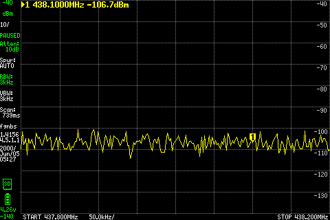
After stopping: **−106.7 dBm**. Numerical results and LCD use adjacent sweeps. Metadata/screen hashes and all 22 installed/boot identities verified; diagnostic code removed, both transmitters stopped, SDRB idle/unclaimed with zero failed services.

## RAM-backed file playback

Same dev.4/J10 setup; LibreSDR stopped, no RX stream. Repeat a RAM-backed **73,728-sample / 589,824-byte cf32_le file**, containing a unit-amplitude +100 kHz complex tone (25 cycles per 576 samples). CLI multiplier **0.1**, channel **1 / TX-A low-pass**, TX gain **70 dB**, 2.304 MS/s / 8000-byte frames, six-second request. The RAM flow retains event metadata and adds the native RF_Out argument; the maintained file-source → multiply → UHD-sink graph is unchanged.

| 438.100 MHz, after 20 dB pad | Before | File playback on | After |
|---|---:|---:|---:|
| Numerical peak within ±5 kHz | −100.69 dBm | **−33.19 dBm** | −100.19 dBm |

Completed in **6.002 seconds**, with no reported TX or cleanup errors. Waveform hash matches before/after playback; target metadata/screens and all 22 installed/boot identities verified. RAM code/input removed, SDRB idle/unclaimed, zero failed services. This establishes one **RAM-backed** playback check; SD-backed playback, arbitrary input files/rates and endurance remain unqualified. The forwarding underflow is still open.

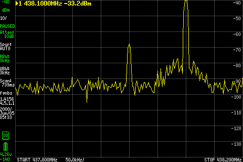
Actual LCD marker: **438.100 MHz, −33.2 dBm**. The −40 dBm display reference clips the top of the trace; the table retains the numerical scan result. This is not a spectral-purity measurement.

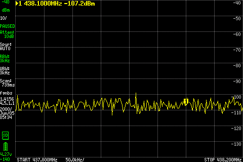
After stopping: **−107.2 dBm**. LCD and numerical results use adjacent sweeps; no fresh calibration.

## Integrated dev.4 branch checks

Same integrated image (`ed4b273`), J10/DC block/**20 dB / 2 W** pad and 9 V / 0.7 A setup; AmpPwr2 disconnected. Three six-second tones, amplitude **0.1**, TX gain **70 dB**, 2.304 MS/s / 8000-byte frames. LibreSDR stopped; no RX stream. A RAM flow supplies native RF_Out/filter arguments and retains event metadata; tone streaming is unchanged. tinySA: 3 kHz RBW, LO ±200 kHz / 201 points, LNA off, external correction zero; low-band internal attenuation 10 dB / Ultra off / −20 dBm display reference, high-band 5 dB / Ultra on / −40 dBm reference.

| Branch / UHD channel | Tone | Before | On | After |
|---|---:|---:|---:|---:|
| TX2A low-pass / 0 | 438.100 MHz | −99.66 | **−30.16** | −103.16 |
| TX1B high-pass / 1 | 2500.100 MHz | −105.56 | **−54.56** | −103.56 |
| TX2B high-pass / 0 | 2500.100 MHz | −108.56 | **−57.56** | −106.56 |

Numerical peaks within ±5 kHz, **dBm after the pad**. All three complete with no reported TX/cleanup errors. Together with the earlier integrated TX1A check, all four branches now have tone-detection evidence on this image. These are individual frequency/settings checks, not full filter or calibrated-power acceptance.

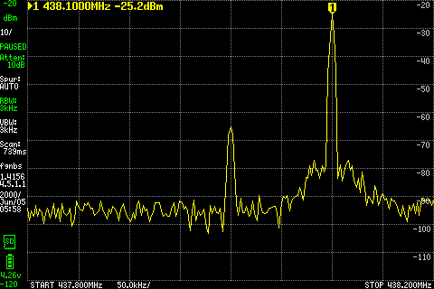
Actual adjacent LCD: **438.100 MHz, −25.2 dBm**, about **5 dB above** the numerical scan. That difference is retained as a measurement limit; this check does not establish stable output power.

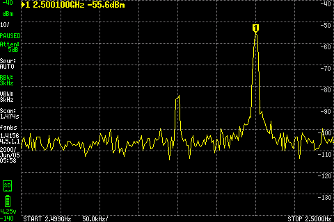
Actual LCD: **2500.100 MHz, −55.6 dBm**.

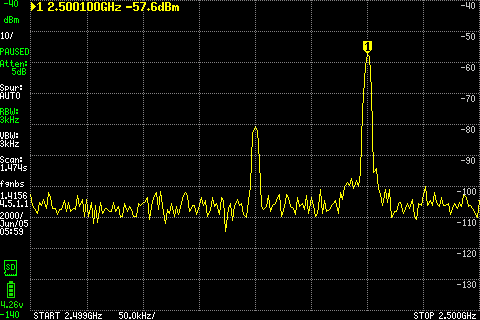
Actual LCD: **2500.100 MHz, −57.6 dBm**. LCD and numerical readings are adjacent sweeps; no fresh calibration.

## One receive/save → forwarding replay

Same J1/J10 wiring and integrated image. First, a 12-second RAM-first capture at **434 MHz**, RX gain **40 dB**, channel 1, 2.304 MS/s / 8000-byte frames. LibreSDR sends a **434.1 MHz** tone for four seconds, gain **40 dB**, amplitude **0.1**, 2 MS/s. After capture and save complete, a fresh reference supplies the same tone for one six-second **434.1 → 438.1 MHz** forwarding check, RX/TX gain **40/60 dB**, unity multiplier. The light RAM diagnostic retains event device timestamps/channel plus one pre-start clock read; no active counter scans or scheduled start.

| Check | Result |
|---|---|
| Received RMS before/on/after | **−60.77 / −35.86 / −60.64 dBFS**; approximately +99 kHz offset in active windows, no clipping observed |
| Post-stop save | **221,188,736 bytes**; SHA256 readback matches, complete captured-range timestamp coverage, no reported RX error |
| Forwarding after 20 dB pad, before/on/after | **−103.63 / −59.13 / −106.12 dBm**; 6.001 seconds, no reported RX/TX or cleanup error |

The intermittent underflow **did not recur**. No device TX event occurred, so hardware event-timestamp retention remains unexercised. No causal fix, image change or new forwarding acceptance is claimed; MR !6 stays draft. This was one bounded workflow replay, not a repeat-until-failure campaign.

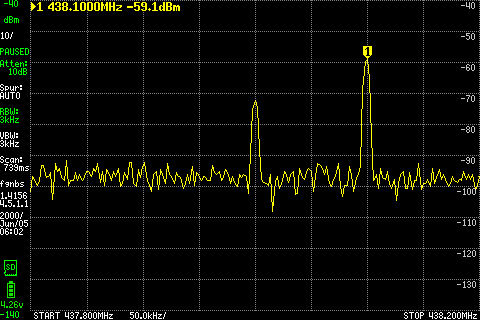
Actual LCD: **438.100 MHz, −59.1 dBm**. Target metadata and all twelve before/on/after screenshots match their hashes. All **22 installed/boot identities** remain unchanged; diagnostic code removed, both transmitters stopped, SDRB powered idle/unclaimed with zero failed services. The saved IQ and raw records remain private.

## Forwarding failure with device timestamps

Same powered dev.4 image (`ed4b273`), J1/J10 wiring, six-second forwarding and reference settings as the preceding replay. A RAM flow uses maintained reporting source `9c8c67c`, plus the explicit RF_Out argument and one pre-start device-clock read. No active polling or streaming-policy change; installed files unchanged. The concrete wrapper passes 21 ARM tests and four anchor checks before RF. An initial off-board wrapper scope failure was corrected and retained privately.

**Failed: three device-timestamped TX underflows retained in JSON**, no reported RX overflow, metadata-decode or cleanup error. The reference has no reported stream errors or timestamp gaps. After the 20 dB pad, numerical before/on/after peaks are **−101.16 / −59.16 / −101.66 dBm**. A visible forwarded tone is not error-free operation.

A later accounting audit found **four underflows in the console logs**, with the fourth logged after `stopping`; its device timestamp was not retained, so its hardware occurrence cannot be assigned to active streaming or shutdown. A real off-board GNU Radio queue test reproduces post-stop messages missing from the JSON. The table lists the three retained timestamps; the original run remains failed.

| Underflow | UHD device time (s) | Estimated seconds after flow start |
|---|---:|---:|
| 1 | 6.031214 | 0.347 |
| 2 | 10.033699 | 4.350 |
| 3 | 10.034777 | 4.351 |

The one-shot clock-read bracket is **1.44 ms** wide; elapsed-time mapping assumes device-clock continuity and is not calibrated synchronization. All three device timestamps and UHD stream-channel **0** were retained. That local streamer index does not identify physical TX2: this run requests UHD channel **1 / TX1A**. Callback receipts arrive roughly **26–36 ms** after the mapped device events.

Hardware event retention is now exercised. The later events mean this failure cannot be dismissed as startup-only; they do not establish a scheduler, RX-producer or transport cause. The current kernel lacks ftrace and scheduler statistics, so there is no host timing trace to correlate. No fix, new image acceptance or MR merge is claimed.

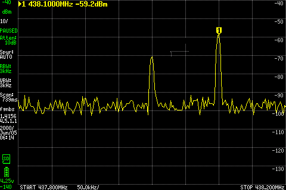
Actual LCD: **438.100 MHz, −59.2 dBm**.

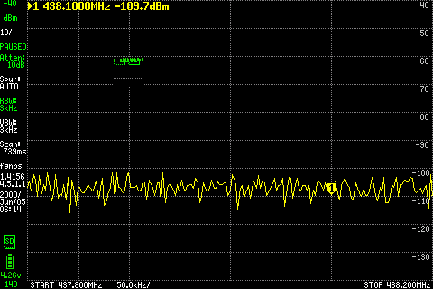
After stopping: **−109.7 dBm**. Numerical scans and LCD use adjacent sweeps. Target metadata and three screenshot hashes verified; all **22 installed/boot identities** unchanged. RAM code removed, both transmitters stopped, SDRB powered idle/unclaimed with zero failed services. This was one finite attempt, with the failed result retained; acceptance remains open.

## Single instrumented forwarding check

Private **0.1.0-dev.4-trace.1**, source `672e099278fa64ec5e9144acc1dc4e6f3b981846`; same J1/J10 wiring, reference, rate and gains as above. Boot matches all **24 expected file hashes**, with zero failed services and tracing disabled by the startup guard. One **6.001-second** forwarding flow runs with bounded RAM scheduler/IRQ/internal-packet tracing and one pre-start device-clock read.

No reported TX underflow, RX overflow, decode or cleanup error. The reference reports no stream errors or timestamp discontinuities. Numerical before/on/after peaks after the **20 dB pad**: **−101.66 / −58.66 / −102.16 dBm**. No underflow recurred, so this does **not** establish its cause or close acceptance.

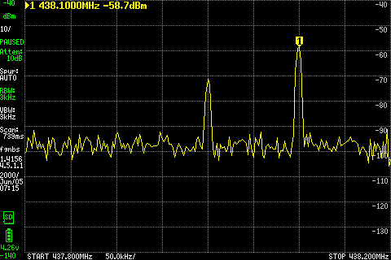
Actual LCD: **438.100 MHz, −58.7 dBm**.

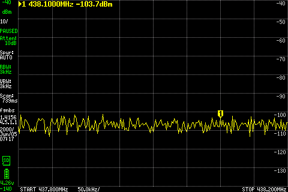
After stopping: **−103.7 dBm**. Numerical readings and LCD are separate sweeps; the after capture was recovered separately. All three actual LCD/PNG pairs pass hash verification.

The flow and trace-stop commands finish successfully; tracing is off before saving the trace to SD. A host deadline during post-stop export and subsequent USB-hub disconnects interrupt initial analysis. Recovery later copies the complete **5,233,467-byte** compressed trace to the host with matching SHA-256. Retained events span the full flow on both CPUs; **34,872 initialization events** were overwritten. All **9,752 recorded Linux TX driver returns** are zero. A zero driver return does not establish DMA completion or FPGA delivery. No underflow exists to correlate, and instrumentation changes timing. Recovery confirms all **24 file identities**; the final check finds SDRB powered idle/unclaimed, zero failed services, tracing/events off. No additional RF run; MR !6 remains draft. Raw evidence stays private.

## Trace.1 receive/save → forwarding

Same trace.1 image, J1/J10 wiring and settings. One **12-second RAM-first receive/save**, with a four-second LibreSDR tone, followed by one **6.001-second forwarding** run. Tracing covers forwarding only; export occurs after both radios stop.

| Check | Result |
|---|---|
| RX RMS before/on/after | **−60.66 / −35.86 / −60.55 dBFS** |
| Post-stop save | **221,204,704 bytes**; SHA-256 readback matches, complete timestamp coverage, no reported RX error |
| Forwarding after 20 dB pad, before/on/after | **−106.12 / −59.13 / −105.13 dBm**; no reported RX/TX/decode/cleanup error; reference healthy |

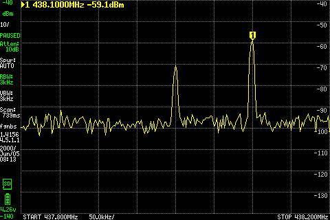
Actual LCD: **438.100 MHz, −59.1 dBm**.

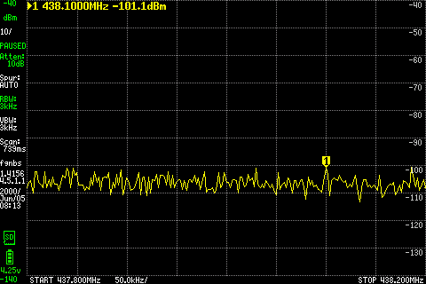
After stopping: **−101.1 dBm**. Numerical scans and LCD are separate sweeps; all three actual LCD/PNG pairs pass hash verification.

The saved trace spans forwarding on both CPUs, with **zero overruns or dropped events**. No underflow occurred to correlate; instrumentation changes timing and this does not establish a fix. All **24 installed/boot identities** match afterward; SDRB is powered idle/unclaimed, tracing/events off, zero failed services. IQ and the checksum-verified raw trace remain on SD; metadata, analysis and screens are archived privately on the host. This was one workflow, with no additional RF repeats. MR !6 acceptance stays open.

## Trace.2 forwarding failure

Private **0.1.0-dev.4-trace.2**, source `b6cfe3452849f5df7ca2d86928ff969c6cfb26f1`. Same J1/J10 wiring, reference and forwarding settings above: **434.1 → 438.1 MHz**, 2.304 MS/s, 8000-byte frames, RX gain 40, TX gain 60, unity multiplier. A RAM adapter imports the installed app, adds the RF_Out device argument and bounded trace hooks; its native result/accounting code is unchanged.

| Six-second check | Result |
|---|---|
| Before/on/after, after the 20 dB pad | **−104.13 / −59.13 / −102.13 dBm** |
| Stream result | **Failed: one timestamped TX underflow**; no reported RX overflow, decode or cleanup error; reference healthy |
| Shutdown accounting | Queued burst acknowledgement retained as `post_stop_drain`; drain completed |

The underflow maps to **2.2 ms after flow-start return** (1.6 ms clock-read bracket; continuity assumed). The trace spans the run on both CPUs with zero overruns/drops; its 9,579 Linux TX driver returns are zero. A zero driver return does not establish DMA completion or FPGA delivery. This startup event does not explain the earlier mid-run failures or establish a fix. All 24 identities and final idle state pass; the complete raw trace is now copied and checksum-verified on the host and locally; summaries/screens are archived privately. No repeat; acceptance remains open.

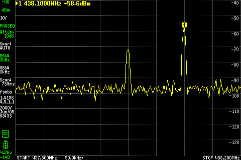
Actual LCD: **438.100 MHz, −58.6 dBm**.

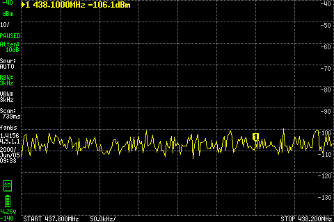
After stopping: **−106.1 dBm**. Numerical readings and LCD use separate sweeps; all three actual LCD/PNG checksum pairs match.

## Trace.3 forwarding check

Private **0.1.0-dev.4-trace.3**, source `3b6989a339426f453efae8142497fdd8f8dea294`, adds the full-TX-ring driver correction. Same J1/J10 wiring, 20 dB output pad, reference, forwarding settings and trace hooks as trace.2 above.

| Six-second check | Result |
|---|---|
| Before/on/after, after the 20 dB pad | **−105.66 / −58.66 / −101.66 dBm** |
| Stream result | Completed; no reported underflow, RX overflow, decode or cleanup error; reference healthy |
| Shutdown accounting | One benign burst acknowledgement retained after stop; drain completed |

All 24 identities and final idle state pass. The trace spans the run on both CPUs with zero overruns/drops; raw trace is checksum-verified on the card. **One clean run does not establish a causal fix for the earlier intermittent failures; acceptance remains open.**

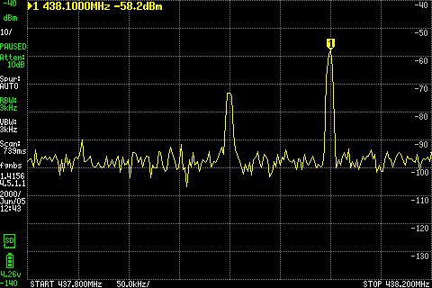
Actual LCD: **438.100 MHz, −58.2 dBm**.

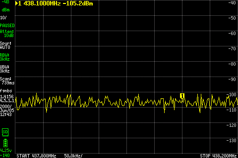
After stopping: **−105.2 dBm**. Numerical readings and LCD use separate sweeps.

## Trace.4 forwarding check — October 21

Private **0.1.0-dev.4-trace.4**, source `e807109da5278cbe339bf125465e624ab98d1c5e`, adds the TX-ring capacity and stop/wake correction. Same J1/J10 wiring, 20 dB output pad, reference, rate, gains and trace hooks as trace.3. Power-up preceded console capture; all **24 running-image identities** match, but early boot output was not captured.

| Six-second check | Result |
|---|---|
| Before/on/after, after the 20 dB pad | **−103.81 / −58.31 / −103.81 dBm** |
| Stream result | Completed; no reported underflow, RX overflow, decode or cleanup error; reference healthy |
| Shutdown accounting | One benign burst acknowledgement retained after stop; drain completed |

The trace spans the run on both CPUs with zero overruns/drops; SD save and checksum analysis pass. Final 24 identities match, zero failed services, both transmitters stopped and tracing off. **One clean run does not establish a causal fix for the earlier intermittent failures; acceptance remains open.**

Actual LCD: **438.100 MHz, −58.3 dBm**.

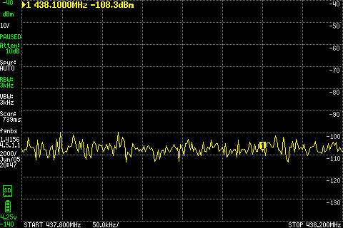
After stopping: **−108.3 dBm**. Numerical readings and LCD use separate sweeps.

## Trace.4 restart and capture checks — October 21

Same image and wiring; LibreSDR stopped. One captured **software reboot** reaches U-Boot/Linux/login in about **26 seconds**; all 24 identities match afterward, zero failed services and tracing off. The original power-on transcript remains unavailable. Boot warning patterns also appear in trace.3.

| Check | Result |
|---|---|
| Default / explicit master clock | **18.432 / 16.384 MHz**, readbacks within 1 Hz; 2.304 MS/s RX/TX rate readback passes; no sample streams |
| 12-second background RX and post-stop SD save | **221,204,704 bytes**, SHA-256 readback matches; complete timestamp coverage, no reported stream/cleanup error |
| RX interrupted about two seconds after start | **36,886,080 bytes** saved; SHA-256 readback matches, complete timestamp coverage and clean interrupted status |

Final 24 identities and idle/unclaimed state pass. These are background transport/storage checks, with no new transmission or RF-reception claim. Acceptance remains open.

## Trace.4 TX tone, file and branch checks — October 21

Same trace.4 image (`e807109`), J10 → DC block → **20 dB / 2 W** pad → tinySA, 9 V / 0.7 A main + AmpPwr1, AmpPwr2 disconnected. LibreSDR stopped. Five **six-second** transmissions: 2.304 MS/s, 8000-byte frames, gain **70 dB**, multiplier **0.1**, +100 kHz tone. RAM adapters change only the native J10/filter device argument; installed main/error accounting is unchanged, tracing off.

File playback repeats **73,728 cf32_le samples / 589,824 bytes** from RAM (unit-amplitude +100 kHz waveform before the 0.1 multiplier). tinySA: 3 kHz RBW, LO ±200 kHz / 201 points, LNA off, external correction zero. Low-pass: 10 dB internal attenuation, Ultra off; high-pass: 5 dB, Ultra on. No fresh calibration.

| Check | Tone MHz | Before | On | After | Actual LCD |
|---|---:|---:|---:|---:|---|
| TX1A tone | 438.1 | -103.81 | **-32.81** | -104.31 | [on](images/trace4-tx1a438-on.png) / [off](images/trace4-tx1a438-off.png) |
| TX1A RAM-file playback | 438.1 | -103.81 | **-32.81** | -104.81 | [on](images/trace4-filetx438-on.png) / [off](images/trace4-filetx438-off.png) |
| TX2A tone | 438.1 | -101.31 | **-29.81** | -105.81 | [on](images/trace4-tx2a438-on.png) / [off](images/trace4-tx2a438-off.png) |
| TX1B tone | 2500.1 | -108.72 | **-54.22** | -106.22 | [on](images/trace4-tx1b2500-on.png) / [off](images/trace4-tx1b2500-off.png) |
| TX2B tone | 2500.1 | -108.22 | **-57.22** | -107.22 | [on](images/trace4-tx2b2500-on.png) / [off](images/trace4-tx2b2500-off.png) |

Levels are **dBm after the 20 dB pad**. All five complete without reported TX, decode or cleanup errors; each retains one benign burst acknowledgement after stop. All fifteen actual LCD/PNG pairs and target metadata hashes verify; waveform SHA-256 is unchanged. Final 24 identities match, zero failed services, MPM idle/unclaimed and tracing off. RAM adapters/input removed; raw evidence remains private.

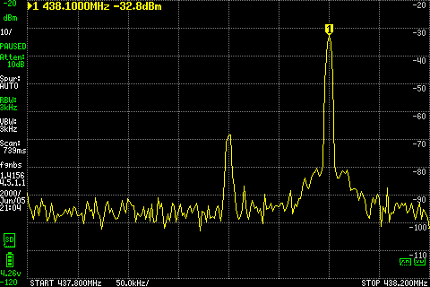
Actual LCD: **438.100 MHz, −32.8 dBm**.

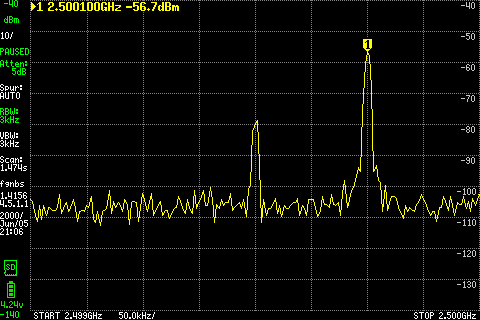
Actual LCD: **2500.100 MHz, −56.7 dBm**. Numerical scans and LCD use separate sweeps.

These add tone-detection evidence for all four branches and RAM-file playback on **trace.4**. They do not establish full filter response, calibrated power, SD-backed playback or a causal fix for the earlier forwarding underflows; acceptance remains open.

## Nontracing rc.1 checks — October 21

**0.1.0-dev.4-rc.1**, source `71574766d0983f17ed80f9b77058420476d3e81e`, uses the maintained fixes with the original nontracing kernel settings and no diagnostic startup guard. Full card write/readback and a captured cold boot pass; all **22 installed/boot identities** match.

Same conducted wiring: LibreSDR TXRA → DC block → **10 dB / 2 W** → J1/Antenna_in; J10/RF_Out → DC block → **20 dB / 2 W** → tinySA. Main + AmpPwr1 at 9 V / 0.7 A; AmpPwr2 disconnected. Same six-second tone/file settings and tinySA setup as the trace.4 TX section. RAM adapters change only the native J10/filter device argument; no trace hooks or streaming-policy changes.

Default/explicit master-clock readbacks (**18.432 / 16.384 MHz**) are within 1 Hz; RX/TX rate readbacks pass. With LibreSDR stopped, the 12-second background RX saves **221,188,736 bytes**; interruption at about two seconds saves **36,886,080 bytes**. Both SD SHA-256 readbacks and full captured-range timestamp coverage pass, without reported stream or cleanup errors. This is background capture/save evidence; reference-tone reception is demonstrated separately by forwarding below.

| Six-second check | Tone MHz | Before | On | After | Actual LCD |
|---|---:|---:|---:|---:|---|
| TX1A tone | 438.1 | -103.72 | **-32.72** | -105.22 | [on](images/rc1-tx1a438-on.png) / [off](images/rc1-tx1a438-off.png) |
| TX1A RAM-file playback | 438.1 | -104.72 | **-32.72** | -102.72 | [on](images/rc1-filetx438-on.png) / [off](images/rc1-filetx438-off.png) |
| TX2A tone | 438.1 | -105.22 | **-30.22** | -103.72 | [on](images/rc1-tx2a438-on.png) / [off](images/rc1-tx2a438-off.png) |
| TX1B tone | 2500.1 | -108.12 | **-55.12** | -106.12 | [on](images/rc1-tx1b2500-on.png) / [off](images/rc1-tx1b2500-off.png) |
| TX2B tone | 2500.1 | -104.62 | **-57.16** | -106.66 | [on](images/rc1-tx2b2500-on.png) / [off](images/rc1-tx2b2500-off.png) |
| J1 → J10 forwarding | 438.1 | -103.22 | **-58.72** | -105.25 | [on](images/rc1-forward-on.png) / [off](images/rc1-forward-off.png) |

Levels are **dBm after the 20 dB pad**, numerical peaks within ±5 kHz. All six RF checks complete without reported underflow, RX overflow, decode or cleanup error; each retains one benign post-stop burst acknowledgement. Forwarding uses **434.1 → 438.1 MHz**, RX/TX gain **40/60 dB**, unity multiplier, 2.304 MS/s and 8000-byte frames; LibreSDR gain 40 dB, amplitude 0.1 and 2 MS/s. The finite reference reports no stream errors or timestamp gaps.

All **18 actual LCD/PNG pairs**, six target metadata records and the unchanged RAM waveform hash verify. RAM code/input removed; raw evidence stays private. A captured software reboot reaches login; the immediate identity probe finds MPM not yet active. Its journal records readiness at 24.57 seconds with zero restarts; the subsequent identity/idle check passes, with zero failed services. The early failed probe is retained. Prior boot warning patterns remain unresolved.

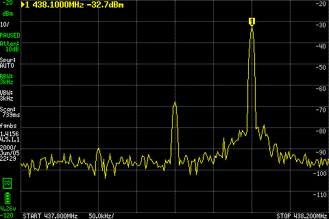
Actual LCD: **438.100 MHz, −32.7 dBm**.

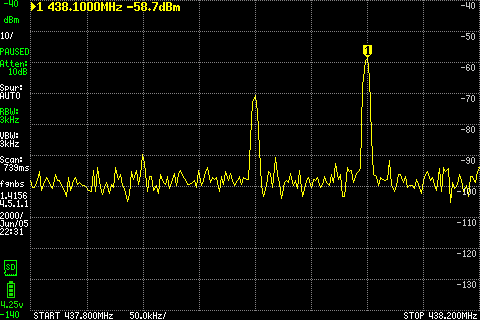
Actual LCD: **438.100 MHz, −58.7 dBm**. Its adjacent sweep is separate from the numerical table.

**Accepted scope:** rc.1 is a limited developer baseline for the bounded checks above. **Forwarding remains experimental**, with unresolved intermittent TX underflows tracked in [SDRB issue #2](https://gitlab.amsat.org/engineering/golf/sdrb/-/work_items/2). A single clean run does not establish a fix. Full filter response, calibrated power, SD-backed playback, final PA/doubler and endurance remain unqualified. The rc.1 image/source are unchanged; publication and a new Ray package remain deferred.

## One boundary-recording check — October 21

Same rc.1 image, J1/J10 wiring, reference and six-second forwarding settings above. A private GNU Radio **3.10.10.0 gr-uhd** library records RX recv and TX send/work boundaries in RAM; installed files, native main/event accounting and streaming policy are unchanged. One pre-start device-clock read; no kernel tracing or active file output. Diagnostic library SHA-256: `c56461d09367bad77f93ac4d1df5279763b8c489d386061f43634a8849e76069`. Off-board ARM compatibility, mock-stream and export checks pass; instrumentation changes timing.

| Single 6.001-second check | Result |
|---|---|
| Before/on/after, dBm after 20 dB pad | **−103.72 / −58.72 / −104.22** at the 438.1 MHz window |
| Stream health | No reported underflow, RX overflow, decode or cleanup error; reference healthy; one benign post-stop acknowledgement |
| Boundary records | **10,326 RX / 3,390 TX**; no drops, clock errors or offset discontinuities; no RX timeout, zero return or partial TX send |

**No failure recurred to correlate; issue #2 remains open and forwarding experimental.** No repeat was run. An initial loader-check mistake stopped before SDRB radio initialization; corrected off-board, with the failed preflight retained.

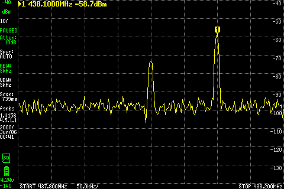
Actual LCD: **438.100 MHz, −58.7 dBm**.

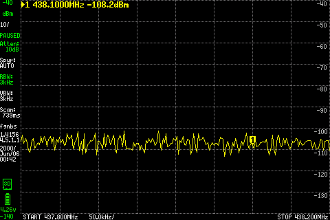
After stopping: **−108.2 dBm**. LCD and numerical values use adjacent sweeps. All three actual LCD/PNG pairs and the post-stop SD archive/readback pass SHA-256 checks. RAM diagnostic removed, both transmitters stopped; all **22 rc.1 identities** match, powered idle/unclaimed, zero failed services. Raw records and diagnostic binaries remain private.

## SD-backed file playback — October 21

Same nontracing **dev.4-rc.1** image/source above; J10 → DC block → **20 dB / 2 W** → tinySA, main + AmpPwr1 9 V / 0.7 A, AmpPwr2 disconnected. LibreSDR stopped; no RX stream. Native **file-source → ×0.1 → TX1A**, gain **70 dB**, LO 438 MHz, 2.304 MS/s / 8000-byte frames, one **six-second** run. Installed main/accounting and gr-uhd unchanged; RAM adapter supplies the J10 argument only.

Input: **147,456,000 bytes / 18,432,000 cf32_le samples**, eight seconds of unit-amplitude +100 kHz tone on the SD ext4 filesystem. Full SHA-256 matches before/after: `c40fe734366f148daec7200d2d9bcd10d538a8d8ec57e70c9a1870304e006a78`. File-specific cache eviction leaves **0/36,000 pages resident before launch**, versus **27,184 afterward**; normal buffered reads/readahead apply. An initial mount-alias preflight stopped before RF; corrected using block-device identity, with the failure retained.

| 438.1 MHz, dBm after 20 dB pad | Before | Playback on | After |
|---|---:|---:|---:|
| Numerical peak within ±5 kHz | −104.22 | **−32.72** | −103.72 |

Completed in **6.001 seconds**, no reported TX/decode/cleanup error; one benign post-stop acknowledgement. tinySA: 10 dB internal attenuation, 3 kHz RBW, 437.8–438.2 MHz, LNA/Ultra off, external correction zero; no fresh calibration.

Actual LCD: **438.100 MHz, −33.2 dBm**.

After stopping: **−106.2 dBm**. LCD and numerical values use adjacent sweeps. All three actual LCD/PNG pairs and metadata readback hashes verify. RAM helpers removed; all **22 rc.1 identities** match, both transmitters stopped, powered idle/unclaimed, zero failed services. Input/evidence retained privately on SD and metadata/screens on the host.

This demonstrates **one short SD-backed file playback**, not sustained storage performance, arbitrary files/rates or endurance. It does not resolve the forwarding underflows; issue #2 remains open.

## J1 mid-band RX check — October 21

Unchanged **dev.4-rc.1**, image source `71574766`, native internal RX1/channel 1. Same **LibreSDR TXRA → DC block → 10 dB / 2 W → J1/Antenna_in** wiring. Main + AmpPwr1 9 V / 0.7 A; AmpPwr2 disconnected. One **eight-second** RX capture at **2.0 GHz**, gain **40 dB**, 2.304 MS/s / 8000-byte frames; SDRB TX off. Native policy selects the mid-band route at this frequency; this is not an isolated-filter measurement.

LibreSDR: 2.0 GHz LO +100 kHz, gain 40 dB, amplitude 0.1, 2 MS/s. Zero samples → tone → zero samples, host controls at about **2.01 / 5.01 seconds** after the stream marker. The reference TX chain stays enabled; “off” means the tone samples are zero, with possible LO leakage.

| Saved-IQ measurement | Before | Tone on | After |
|---|---:|---:|---:|
| Median RMS, dBFS | **−66.13** | **−61.79** | **−66.12** |

A tone is visible at **LO +96.19 kHz**, but the **4.33 dB** integrated-power rise fails the planned **>10 dB** contrast criterion. **Stopped: 3.5 GHz was not run; no repeat.** This does not identify a filter fault: the source/input RF level is unmeasured. Next check that reference level before further SDRB RF.

Actual saved-IQ analysis: 0.1-second RMS windows and 4096-sample Hann FFTs. Host gate timing is not exact RF-edge timing. Digital levels and frequency are uncalibrated.

The **147,464,480-byte / 18,433,060-sample** capture passes full SD hash/readback and complete timestamp coverage, with no reported RX/decode/cleanup error; reference stream health is clean. Peak sample magnitude **0.00244**, no clipping observed. All 22 rc.1 identities match afterward; RAM helpers removed and both transmitters stopped. Raw IQ stays private on SD; verified metadata/analysis are archived on the host. SDRB was then cleanly halted, with all filesystems unmounted, for the proposed reference-level cable move.

[Actual tinySA LCD during the RX check](images/rc1-rx2g-j10-context.png): analyzer remained on **J10 at 438.1 MHz**, so this is context only, **not the RX input-level measurement**. Its raw/PNG hashes verify.

The subsequent [isolated LibreSDR reference check](../004-libresdr-tx-power/README.md#20-ghz-reference--october-21) detects **2000.096 MHz at −54.88 dBm after the same 10 dB pad**, about 53 dB above the analyzer background. Source stream health and all three actual screenshot pairs pass. This confirms a reference at the end of the former J1 lead, without establishing expected SDRB gain or a filter fault. SDRB stays powered off. The off-board review below corrects the test-frequency choice.

### RX frequency-plan correction — October 21

The off-board review found a planning error: **software route thresholds are not filter passbands**. The pinned native code agrees with the [maintained board mapping](https://gitlab.amsat.org/engineering/golf/sdrb/-/blob/71574766d0983f17ed80f9b77058420476d3e81e/docs/uhd/UHD-MPM-INTEGRATION.md#analog-port-mapping-for-the-native-ad9361-client): 2.0 GHz selects GPIO state 1 and balanced AD9361 input B, through U6/U7, BFCN-2360+. That part is specified for **2.25–2.47 GHz**, so this check was outside its passband. The proposed 3.5 GHz check would also be outside the selected BFCN-5750+ path's **5.65–5.85 GHz** passband. [Mini-Circuits mid-band specification](https://www.minicircuits.com/WebStore/dashboard.html?model=BFCN-2360%2B) · [Filter specifications](https://www.minicircuits.com/WebStore/RF-Filters.html?filterTypeNum=1&interface=SMT&technology=LTCC).

Channel 1 maps to physical RX1; gain 40 passes unchanged to its native gain-index register, with the 1.3–4 GHz gain table selected and gains reapplied after tuning. Saved gain readback is 40. No route/gain mismatch was identified in this static review; the readback does not calibrate total RF gain. Actual fitted parts, switch state and filter loss remain unmeasured.

The **4.33 dB criterion failure is retained**. Out-of-passband attenuation is a plausible explanation, not a proven cause. No additional RF run or image change. Next proposed check: one finite **2.36 GHz reference measurement** in the current LibreSDR → DC block → 10 dB → tinySA setup, then coordinate a J1 receive check if the reference is healthy. Cancel 3.5 GHz; any later high-band check should use an in-passband frequency such as **5.75 GHz**, after confirming its reference level. The subsequent [2.36 GHz reference check](../004-libresdr-tx-power/README.md#236-ghz-reference--october-21) measures **−56.66 dBm after the 10 dB pad**, 49.5 dB above background, with clean stream health and actual screens. SDRB stayed off for that reference measurement; the subsequent receive check is recorded below.

## J1 at 2.36 GHz — October 21

Restored **LibreSDR TXRA → DC block → 10 dB / 2 W → J1/Antenna_in**, with **J10 → DC block → 20 dB / 2 W → tinySA**. Main + AmpPwr1 **9 V / 0.7 A**, AmpPwr2 disconnected. Captured cold boot; all 22 identities match unchanged **dev.4-rc.1**, source `71574766`. One **eight-second** native RX1/channel 1 capture, LO **2.36 GHz**, gain 40, 2.304 MS/s / 8000-byte frames; SDRB TX off. LibreSDR: same verified source profile, 2.36 GHz LO +100 kHz, gain 40, amplitude 0.1, 2 MS/s, zero → tone → zero at about 2.01 / 5.01 seconds after the host stream marker.

| Saved-IQ measurement | Before | Tone on | After |
|---|---:|---:|---:|
| Median RMS, dBFS | **−65.19** | **−51.30** | **−65.17** |

A tone near **LO +96.19 kHz**, with **13.87 dB** RMS contrast and peak sample magnitude **0.00461**, clears the planned contrast threshold without observed clipping. **The check still fails:** native metadata reports “RX timestamp monitoring did not cover the saved capture.” The file contains **18,435,056 samples**, but the monitor covers **18,433,060**: a **1,996-sample count difference**. No reported RX overflow, inferred timestamp gap/overlap, decode or cleanup error; those counters do not establish continuity of the uncovered samples.

Post-stop analysis of the actual saved IQ; uncalibrated digital levels. Original failed metadata is retained unchanged. The **147,480,448-byte** file passes full SHA-256 readback: `19a75f603baa699d7c0e6dfff76f4e81aaf1bec6f62f87343a3d958ef50c7b24`. This is evidence of tone reception, **not a qualified capture pass**.

[Actual tinySA LCD during this check](images/rc1-rx2360-j10-context.png): **438.100 MHz, −106.7 dBm**, on J10 during RX only. Context only, not a 2.36 GHz input measurement; raw/PNG hashes verify. Source stream health is clean and its finite run stopped. RAM helpers removed; all 22 final identities match, MPM idle/unclaimed, zero failed services and both transmitters stopped. SDRB remains powered on, wiring unchanged.

**No repeat or high-band test.** Next review timestamp-monitor/file-sink shutdown accounting off-board against this retained failure. Cause, full RX filter response and calibrated receiver gain remain unresolved.

Off-board follow-up: the file sink and timestamp monitor consume separate source branches, so shutdown can leave a saved prefix longer than the monitored prefix. A controlled monitor delay reproduces that validation failure with synthetic samples on the real ARM GNU Radio runtime. A private inline-monitor prototype passes **31 existing ARM regressions and five synthetic cases**, preserving nonconstant IQ bytes and rejecting real timestamp gaps and missing tags. It also covers a file sink stopped at a shorter prefix. This demonstrates the topology defect, without proving the exact bench scheduling sequence. **No installed change, RF repeat or capture-pass claim.** The maintained correction is now **0.1.0-dev.4-rc.2 / examples r10**, source `d969d407`, in [draft SDRB MR !9](https://gitlab.amsat.org/engineering/golf/sdrb/-/merge_requests/9). All **37 real-ARM regressions** pass, including six synthetic flow cases. The pinned rc.2 image now passes the full off-board build, **37 installed-image ARM tests**, runtime/content/filesystem checks and complete **4,563,406,848-byte disk-image readback**. The complete live rc.1 partition range is now backed up with verified decompression/SHA, preserving all **40 home files** and original failures. The rc.2 test card passes full **4,563,406,848-byte write/direct readback** and is safely ejected. Captured boot, throughput and exact-image RX acceptance remain pending; no new RF run.

## Rc.2 affected-path check — October 21

Same J1/J10 wiring and 9 V / 0.7 A power setup above. Cold boot of **dev.4-rc.2**, source `d969d407`, passes all **22 image identities**, unchanged nontracing kernel configuration, zero failed services and idle/unclaimed MPM. The first identity helper retained an old rc.1 kernel-name expectation; correcting it to the rc.2 manifest passes without changing the board.

One **eight-second J1 RX1/channel 1** check at **2.36 GHz**, gain **40**, **2.304 MS/s / 8000-byte frames**, same LibreSDR zero/tone/zero reference. SDRB TX off. **Failed:** native exit 2 reports **19 RX overflows** and **5,155,504 missing samples inferred from timestamp gaps**. Timestamp coverage is complete; this does not establish continuity. No decode or cleanup error reported. The reference reports no stream errors.

The retained **102,992,120-byte / 12,874,015-sample** IQ file passes full SHA-256 readback: `1cd61037885b63e964674366370e527120294496f44b07a920e3980cad39850d`. Original failed metadata and separate post-stop analysis are preserved. Sample-index time is compressed by the gaps, so no host-gate contrast acceptance is assigned.

Actual J10 context screen: **438.100 MHz, −107.2 dBm**, with SDRB TX off. This is not the 2.36 GHz RX input measurement; raw/PNG hashes verify.

**No repeat, interrupted-capture test or high-band test.** RAM helpers removed; all 22 final identities match, zero failed services, radio idle/unclaimed and both transmitters stopped. SDRB remains powered on. Rc.2 fails affected-path acceptance; [MR !9](https://gitlab.amsat.org/engineering/golf/sdrb/-/merge_requests/9) stays draft. Next: review observer overhead and scheduling off-board before proposing another candidate. The overflow cause and forwarding underflows remain unresolved.

## Coverage and limits

| Filter | Recorded tone evidence through J10 | Configuration |
|---|---|---|
| U19, TX1A low-pass | Four original points, 438.1–1600.1 MHz; 438.1 MHz repeated on dev.4 | Original dev.3 FPGA + `0c8e7f7`; integrated dev.4 at 438.1 MHz |
| U23, TX2A low-pass | 438.1 MHz; absent with original FPGA | tx-select.1 + `0c8e7f7` override; repeated on integrated dev.4 |
| U28, TX1B high-pass | 2000.1/2500.1 MHz with 40 dB pads; 3500.1/5800.1 MHz with 20 dB | r9; original FPGA at lower points, tx-select.1 at upper points; integrated dev.4 at 2500.1 MHz |
| U30, TX2B high-pass | 2500.1 MHz with 20 dB pad | tx-select.1 + r9; repeated on integrated dev.4 |
| U32/U13, common low-pass | Included in responding paths; individual response and stopband unqualified | Builds/settings above |

All four TX filter branches now have tone-detection evidence on integrated dev.4 at the stated spot frequencies, as well as the earlier recorded configurations. This is not full passband/stopband, isolated insertion-loss, spectral-purity or calibrated-power qualification. No direct-pad comparison: its coax was removed. The onboard source's 6 GHz ceiling also prevents a complete common-filter stopband check.

After the earlier component checks, original dev.3 software was restored and diagnostic RAM removed. The test card now contains the verified dev.4-rc.2 candidate, with captured boot passing but RX acceptance failed on overflows; the live rc.1 and preceding trace.4 images and bench data are backed up, and the published dev.3 image and original rollback card are unchanged. The J10 chain retains the single 20 dB pad. Raw results stay outside Git; Ray packaging remains deferred.

[Back to Lab Log](../../README.md)
