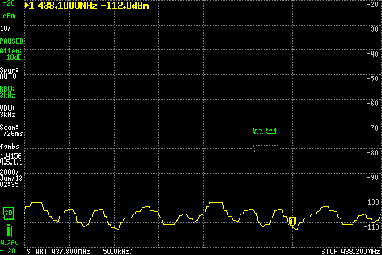
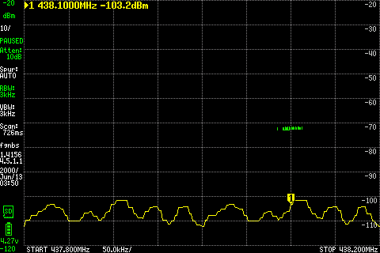
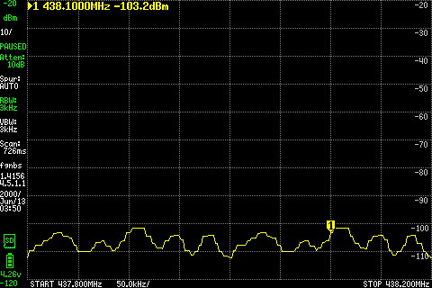
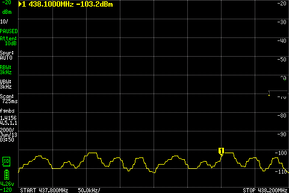

# 007 SDRB RF_Out check

**Status:** In progress  
**Started / updated:** 2026-10-20 / 2026-10-28

Check the signal at **J10/RF_Out** using driver-only Path B, with the final PA off.

## Setup

`SDRB J10/RF_Out → DC block → 30 dB / 2 W pad → 10 dB / 2 W pad → tinySA Ultra`

- Main power and AmpPwr1 share **9.0 V**, current limit **0.7 A**. AmpPwr2 disconnected. Startup: **0.567 A, CV**; no visible supply change during the first checks, around **0.570 A** afterward.
- Native UHD channel 1, LO **438 MHz** (145 MHz for the follow-up below), complex tone **+100 kHz**, amplitude **0.1**, nominal **2.304 MS/s**. Each transmission lasts **8 seconds**.
- tinySA Ultra: **30 dB internal attenuation**, LNA off, **3 kHz RBW**, external correction **0 dB**. Scans: LO to LO +200 kHz, 201 points. Firmware `tinySA4_v1.4-156-g4eb315d`; no fresh calibration.
- Software: **0.1.0-dev.3**, with temporary RAM-only MPM changes from `0c8e7f744023b649bec167de9afc3b41fb57b7a3` and explicit `sdrb_tx_path=rf_out_b`. Original card files unchanged; FPGA PA enable remains low.

An initial silent boot was traced to a disturbed boot jumper. Restoring the documented SD-boot straps allowed Linux to boot.

## Results

Levels are measured **after the external 40 dB pads**. Off-state values are the strongest bin within ±5 kHz of 438.1 MHz; those bins need not match the tone bin.

| TX gain | Before | Tone on | After | Observation |
|---|---:|---:|---:|---|
| 30 dB | −82.4 dBm | −81.9 dBm | −81.9 dBm | Indistinguishable from background |
| 60 dB | −83.9 dBm | **−62.9 dBm at 438.100 MHz** | −82.4 dBm | Clear off/on/off contrast |
| 60 dB, repeat | −80.8 dBm | **−62.3 dBm at 438.100 MHz** | −87.8 dBm | Reference for the next gain step |
| 70 dB | −85.8 dBm | **−52.3 dBm at 438.100 MHz** | −83.8 dBm | +10.00 dB relative to the repeated gain-60 run |

All four runs completed without reported stream or cleanup errors and returned to background. A **10 dB gain-setting increase produced a 10.00 dB indicated increase** in the same-setup comparison. Adding nominal pad attenuation gives approximately **−22.3 / −12.3 dBm before the pads** for the repeated gain-60/gain-70 pair. Cable/DC-block loss, pad tolerance and analyzer calibration uncertainty are uncorrected.

## 145.1 MHz spot check

Same wiring, amplitude, rate and analyzer settings; LO changed to 145 MHz. Numerical levels remain after the 40 dB pads:

| TX gain | Before | Tone on | After | Observation |
|---|---:|---:|---:|---|
| 60 dB | −86.6 dBm | −81.6 dBm | −83.1 dBm | Too close to background for clear detection |
| 70 dB | −84.0 dBm | **−73.0 dBm at 145.099 MHz** | −85.0 dBm | Clear tone; no reported stream or cleanup errors |

The gain-70 reading is about **20.7 dB lower** than the earlier 438.1 MHz reading at the same gain. The cause is unresolved; this is an uncalibrated comparison of the complete setup, not an isolated driver-gain measurement.

Actual LCD capture during the gain-70 run. Fixed marker: **145.100 MHz, −75.0 dBm**. The screen uses a separate sweep immediately after the numerical scan, so its fixed-marker reading differs from the table's strongest bin within ±5 kHz.

Actual LCD capture after stopping; the same marker reads **−87.0 dBm**. Display: 10 dB/div, −40 dBm reference, 145.0–145.2 MHz, external correction still zero. The first 145 MHz run finished before screenshot capture was requested; these images belong to the gain-70 run only.

These checks demonstrate tones through **driver-only Path B** at two frequencies. They do not establish maximum output, final-PA/doubler operation, full frequency response or endurance. Raw bench records are retained separately; selected actual screen captures are included here.

## TX-A low-pass path

After a cold boot, same J10 wiring and gain **70 dB**, amplitude **0.1**, eight-second tones. tinySA internal attenuation changed to **10 dB**; external pads remain **40 dB**. Ultra mode enabled above 800 MHz. Software remains the RAM-only `0c8e7f7` Path B override.

| Channel / selected branch | Tone | Before | Tone on | After |
|---|---:|---:|---:|---:|
| 1 / TX1A, U19 | 438.1 MHz | −101.8 dBm | **−52.3 dBm** | −104.8 dBm |
| 0 / TX2A, U23 | 438.1 MHz | −104.3 dBm | −101.8 dBm | −104.8 dBm |
| 1 / TX1A, U19 | 900.1 MHz | −103.5 dBm | **−56.0 dBm** | −102.2 dBm |
| 1 / TX1A, U19 | 1300.1 MHz | −100.7 dBm | **−64.8 dBm** | −105.7 dBm |
| 1 / TX1A, U19 | 1600.1 MHz | −102.4 dBm | **−82.9 dBm** | −103.5 dBm |

TX1 shows a tone at each point; its indicated output falls above 900 MHz. These are uncalibrated source-to-analyzer measurements, not isolated filter insertion loss. **TX2's expected tone was not detected**; no further TX2A frequency checks were run. No stream errors were reported. The later FPGA-selector check below addresses this missing tone.

Actual LCD capture, fixed marker **1600.100 MHz, −82.5 dBm**.

After stopping, fixed marker **−108.4 dBm**. Screens use a separate completed sweep after each numerical scan; table values use the strongest bin within ±5 kHz. Actual on/off screens were retained for every completed check.

One initial 900 MHz capture attempt stopped on a malformed tinySA text value outside the tone window. That attempt is retained separately; one repeat completed the numerical scan and screenshots. No invalid bin was substituted or used for a reported tone level.

## TX-B high-pass path

Same conducted setup, channel **1**, gain **70 dB**, amplitude **0.1** and eight-second tones. Temporary native MPM r9 and Python bindings built from `38ed43e2e5e1821fbd8011333648dc7a7185c972`; explicit `sdrb_tx_path=rf_out_b,sdrb_tx_filter=highpass`. TX1B selects U28; TX2B/U30 is checked later below. Both banks also pass through common U32/U13 low-pass filters and the AmpPwr1 drivers.

The rebuilt component first reproduced the low-pass 438.1 MHz tone at **−52.8 dBm**, about 0.5 dB below the earlier reading. For high-pass checks, tinySA uses **5 dB internal attenuation**, LNA off and Ultra mode; the external pads remain 40 dB.

| Selected branch | Tone | Before | Tone on | After |
|---|---:|---:|---:|---:|
| TX1B / U28 | 2000.1 MHz | −110.9 dBm | **−88.6 dBm** | −107.9 dBm |
| TX1B / U28 | 2500.1 MHz | −106.7 dBm | **−74.7 dBm** | −104.2 dBm |
| TX1B / U28 | 3500.1 MHz | −105.1 dBm | −106.1 dBm | −104.9 dBm |
| TX1B / U28 | 5800.1 MHz | −84.0 dBm | −85.5 dBm | −86.0 dBm |

Tones were detected at **2000.1/2500.1 MHz**, but **not at 3500.1/5800.1 MHz**. Background was much higher at 5800 MHz. No stream or cleanup errors were reported. The absent tones do not establish filter rejection or a hardware fault; source/control behavior and the complete RF/measurement path remain unresolved.

Actual LCD capture at 5 dB internal attenuation: fixed marker **2500.100 MHz, −75.2 dBm**.

After stopping, fixed marker **−113.7 dBm**. Numerical peaks and fixed LCD markers come from adjacent sweeps.

The initial 2000/2500 MHz checks used 10 dB internal attenuation and displayed “REDUCED LINEARITY.” Those records are retained; the table uses the repeated checks at 5 dB. The matching [tinySA firmware warning condition](https://github.com/erikkaashoek/tinySA/blob/4eb315d/plot.c#L1891) depends on frequency and configured attenuation.

## TX2 selector correction

The FPGA used MPM's TX-channel-select bit as a codec reset, and the SISO mux selected by nonzero sample data. Corrected RTL separates reset from selection and synchronizes the selector; the old faults reproduce and the corrected regression passes.

Cold-booted **dev.3 + tx-select.1**, FPGA source `a1092059e0d566ae4efb54d0f6bca967df994e57`. Only BOOT.BIN changed, SHA256 `12258ce5e2d2df23681fd751782d198a3baa118cf2e57828bc3568713f9cadde`; Linux/rootfs unchanged, rollback backed up. Boot and software identities verified. Same J10 setup, RAM-only `0c8e7f7` Path B override, **channel 0 / TX2A**, gain 70 dB, amplitude 0.1, 2.304 MS/s, eight seconds. tinySA: 10 dB internal attenuation, Ultra/LNA off, 3 kHz RBW.

| Tone | Before | Tone on | After |
|---|---:|---:|---:|
| 438.100 MHz | −107.2 dBm | **−49.7 dBm** | −102.7 dBm |

The previously missing TX2 tone is now clearly detected through **U23 and J10**. No reported stream or cleanup errors; target metadata read back and SHA256 verified. This establishes one TX2A spot check, without qualifying its full filter response or the separate upper-band issue.

Actual LCD capture: fixed marker **438.100 MHz, −49.7 dBm**.

After stopping: **−103.7 dBm** at the fixed marker. Table values use the numerical peak within ±5 kHz; LCD captures use adjacent completed sweeps.

## 3.5 GHz both-sideband check

Same wiring with **40 dB external attenuation**, tx-select.1 FPGA and temporary r9 high-pass override; channel 1 / TX1B, gain 70 dB, amplitude 0.1, 2.304 MS/s. One **12-second** tone, with tinySA scanning **3499.8–3500.2 MHz**, 201 points, 2 kHz spacing, 3 kHz RBW, internal attenuation 5 dB, Ultra on and LNA off.

| Frequency window | Before | Tone on | After |
|---|---:|---:|---:|
| LO +100 kHz | −108.4 dBm | −107.4 dBm | −105.1 dBm |
| LO −100 kHz | −107.1 dBm | −107.1 dBm | −107.4 dBm |

**No tone detected on either side of the LO**; no reported stream or cleanup errors. This does not support a simple frequency inversion. Source inspection retains port B across the tested range and checks PLL lock, but does not establish RF output. The reference check below uses the same measurement chain.

Actual LCD capture; fixed +100 kHz marker **−111.6 dBm**, a separate sweep from the numerical table.

Two analyzer-only preflights exceeded the original capture-time guard and stopped **before transmission**. The completed check uses 12 seconds to accommodate the measured sweep and LCD-capture time. No calibration was changed. [tinySA documents reduced high-frequency sensitivity and harmonic-mode conversion-loss variation](https://tinysa.org/wiki/pmwiki.php?n=TinySA4.Ultra); absent tones alone do not identify filter rejection.

## LibreSDR measurement-chain reference

Moved the existing measurement chain to **LibreSDR TXRA** (operator-confirmed printed label); SDRB remained halted with its RF output disconnected. Same DC block, **30 dB + 10 dB pads**, tinySA input and analyzer settings. LibreSDR: LO 3.5 GHz, +100 kHz complex tone, gain 40 dB, amplitude 0.1, 2 MS/s, **14 seconds**, verified custom B210 FPGA. No reported TX/RX errors or timestamp gaps.

| Observed-tone window | Before | Tone on | After |
|---|---:|---:|---:|
| ±5 kHz around 3500.094 MHz | −104.1 dBm | **−91.6 dBm** | −106.1 dBm |

The full 40 dB measurement chain **does detect a weak 3.5 GHz reference**. The owner noted that this much attenuation often buries LibreSDR output; this check has only about 12.5–14.5 dB off/on contrast. It does not establish SDRB output power or a filter fault. Use less external attenuation for the next bounded SDRB check rather than treating a background-level reading as rejection.

Actual LCD capture. The visible peak lies left of the fixed **3500.100 MHz** marker; that marker reads **−113.1 dBm**. The table follows the observed numerical peak at **3500.094 MHz**, not the nominal marker. No fresh frequency or level calibration.

## 3.5 / 5.8 GHz with a 20 dB pad

Returned J10/RF_Out to the same DC block and tinySA, replacing the 30 +10 dB pads with **one 20 dB / 2 W pad**. Main + AmpPwr1: 9 V / 0.7 A limit; AmpPwr2 disconnected. The 3.5 GHz check followed a captured cold boot; 5.8 GHz used the same powered session. Boot/software hashes verified before each. Same tx-select.1 FPGA, temporary r9 high-pass override, channel 1 / TX1B, gain 70 dB, amplitude 0.1, 2.304 MS/s and **12 seconds per tone**. Analyzer settings unchanged; each scan spans LO ±200 kHz.

| Tone, measured after the 20 dB pad | Before | Tone on | After |
|---|---:|---:|---:|
| 3500.100 MHz | −107.4 dBm | **−89.4 dBm** | −107.6 dBm |
| 5800.100 MHz | −88.0 dBm | **−71.5 dBm** | −87.0 dBm |

**Both tones are detected**, with about 18 dB contrast at 3.5 GHz and 15.5–16.5 dB at 5.8 GHz; no reported stream or cleanup errors. Adding the nominal extra 20 dB would put them near **−109.4 / −91.5 dBm**, below the earlier measurement floors, consistent with the previous non-detections. These two tone-detection gaps are closed; full filter response and calibrated output power remain unqualified.

Actual LCD capture: fixed **3500.100 MHz** marker **−89.1 dBm**.

After stopping: fixed marker **−111.6 dBm**. Numerical peaks and LCD readings use adjacent sweeps. Target metadata read back and SHA256 verified; original software restored and diagnostic RAM removed.

Actual LCD capture: fixed **5800.100 MHz** marker **−73.0 dBm**.

After stopping: fixed marker **−94.5 dBm**. The higher harmonic-mode background remains visible. Table and LCD use adjacent sweeps; no fresh level calibration.

## TX2B / U30 spot check

Same J10 → DC block → **20 dB / 2 W pad** → tinySA setup, tx-select.1 FPGA and temporary r9 high-pass override. Select **UHD channel 0 / TX2B**, LO 2500 MHz, +100 kHz tone; gain 70 dB, amplitude 0.1, 2.304 MS/s, **12 seconds**. Analyzer: 5 dB internal attenuation, Ultra on, LNA off, 3 kHz RBW, LO ±200 kHz scan.

| Tone, measured after the 20 dB pad | Before | Tone on | After |
|---|---:|---:|---:|
| 2500.100 MHz | −105.1 dBm | **−57.6 dBm** | −105.6 dBm |

**TX2B is detected**, with about 48 dB off/on contrast and no reported stream or cleanup errors. Channel/bank metadata read back and SHA256 verified; original software restored and diagnostic RAM removed.

Actual LCD capture: fixed **2500.100 MHz** marker **−57.6 dBm**; the LO peak is also visible.

After stopping: fixed marker **−106.6 dBm**. Numerical peaks and LCD readings use adjacent sweeps.

## Integrated dev.4 check

Cold-booted **0.1.0-dev.4**, source `ed4b273`, with the selector-corrected FPGA and installed native MPM r9; boot/application/library hashes match the verified image. Same J10 → DC block → **20 dB / 2 W** → tinySA path, 9 V / 0.7 A main + AmpPwr1, AmpPwr2 disconnected. Channel **1 / TX1A**, default TX-A filter, gain **70 dB**, amplitude **0.1**, 2.304 MS/s, **12 seconds**. A RAM-only copy of the flow adds `sdrb_tx_path=rf_out_b`; installed application and MPM files are unchanged. tinySA: 10 dB internal attenuation, Ultra/LNA off, 3 kHz RBW, 437.8–438.2 MHz, external correction zero; no fresh calibration.

| Tone, after the 20 dB pad | Before | Tone on | After |
|---|---:|---:|---:|
| 438.100 MHz | −104.1 dBm | **−33.1 dBm** | −101.1 dBm |

Tone detected and returned to background; no reported stream or cleanup errors. Target metadata read back and SHA256 verified; diagnostic code removed and installed hashes rechecked. This closes the TX1A tone-detection check on the new FPGA/image at this setting; RF receive passes below; clean forwarding acceptance remains open.

Actual LCD, fixed marker **438.100 MHz, −33.1 dBm**.

After stopping, fixed marker **−105.6 dBm**. Table values use the numerical peak within ±5 kHz; LCD captures use adjacent sweeps.

## dev.4 receive and forwarding

Added **LibreSDR TXRA → DC block → 10 dB / 2 W pad → J1/Antenna_in**; the J10 → DC block → 20 dB → tinySA path is unchanged. LibreSDR: 434 MHz LO +100 kHz, gain 40 dB, amplitude 0.1, 2 MS/s. SDRB: channel 1, RX gain 40, 2.304 MS/s and 8000-byte frames. Same dev.4 image and installed native r9, boot/software identities verified after the wiring cold boot.

A **12-second stock-CLI RX capture** contains four seconds of source tone. RMS is **−59.9 / −35.6 / −60.3 dBFS** before/on/after; the on-state peak is near +100 kHz. Saved-file hash and complete timestamp coverage pass; no reported overflow or cleanup errors.

Forwarding uses the RAM flow with the native J10 argument, **434.1 → 438.1 MHz**, TX gain 60 dB, unity multiplier and **six seconds**. Same tinySA settings as the dev.4 TX1A check:

| After the 20 dB pad | Before | Forwarding on | After | Stream result |
|---|---:|---:|---:|---|
| 438.100 MHz | −100.7 dBm | **−58.7 dBm** | −101.7 dBm | **Failed: three TX underflows**, no RX overflow or cleanup error |

A single six-second diagnostic repeat added event-receipt timestamps around start/active/stop and reported **zero underflows**. The intermittent failure remains unresolved; that clean repeat does not establish a fix. The originally planned second run was stopped after the first failure. Metadata readback/SHA and actual screen hashes verified; diagnostic code removed, installed hashes unchanged, both transmitters stopped and SDRB idle/unclaimed with zero failed services.

Actual LCD: **438.100 MHz, −58.7 dBm**. A visible tone does not establish error-free forwarding.

After stopping: fixed marker **−109.2 dBm**. Table and LCD use adjacent sweeps. Clean forwarding acceptance remains open.

## Coverage and limits

| Filter | Recorded tone evidence through J10 | Configuration |
|---|---|---|
| U19, TX1A low-pass | Four original points, 438.1–1600.1 MHz; 438.1 MHz repeated on dev.4 | Original dev.3 FPGA + `0c8e7f7`; integrated dev.4 at 438.1 MHz |
| U23, TX2A low-pass | 438.1 MHz; absent with original FPGA | tx-select.1 + `0c8e7f7` override |
| U28, TX1B high-pass | 2000.1/2500.1 MHz with 40 dB pads; 3500.1/5800.1 MHz with 20 dB | r9; original FPGA at lower points, tx-select.1 at upper points |
| U30, TX2B high-pass | 2500.1 MHz with 20 dB pad | tx-select.1 + r9 |
| U32/U13, common low-pass | Included in responding paths; individual response and stopband unqualified | Builds/settings above |

All four TX filter branches now have tone-detection evidence in the recorded configurations. This is not full passband/stopband, isolated insertion-loss, spectral-purity or calibrated-power qualification. No direct-pad comparison: its coax was removed. The onboard source's 6 GHz ceiling also prevents a complete common-filter stopband check.

After the earlier component checks, original dev.3 software was restored and diagnostic RAM removed. The test card now contains integrated dev.4; the published dev.3 image and rollback card are unchanged. The J10 chain retains the single 20 dB pad. Raw results stay outside Git; Ray packaging remains deferred.

[Back to Lab Log](../../README.md)

## J14 doubler follow-up — October 25, 2026

The [J14 drive-check entry](../008-sdrb-j14-drive-check/README.md) records the corrected Jx1/J14 connection, a direct-to-tinySA experiment with no external pad, and gain 0/30/60 measurements with the driver supply off and on at 9 V. It includes actual LCD captures and numeric scans. No distinct 5.184050 GHz tone was detected; this exploratory frequency is below the doubler's specified output band. It does not extend the qualified scope of the checks above.

## Rc.4 boot and software checks — October 28, 2026

**Setup:** new **0.1.0-dev.4-rc.4** image, source `ac1b437`, on the existing 64 GB test card; J12 console captured before power-up. Supply **9 V / 1.5 A limit**, AmpPwr1 at 9 V, AmpPwr2 disconnected. LibreSDR TXRA → DC block → J1/Antenna_in; J10/RF_Out → DC block → LibreSDR RXA. **No attenuators fitted; neither radio was claimed or initialized.**

| Check | Result |
|---|---|
| Rollback backup | All 63,864,569,856 card bytes backed up; full decompression/checksum match |
| New image/card | Build and offline image checks pass; all 4,563,406,848 bytes written and verified by direct readback |
| Captured boot / J12 | U-Boot and Linux captured; configured automatic root login observed, UID 0 verified |
| Installed identity / final state | All **23 hashes** match; zero failed services; MPM active and unclaimed |
| Software DSP | **64 complex samples**, maximum absolute error **4.64 × 10⁻⁷**; UHD blocks/native observer import |
| CLI dry runs | All **12** RX-policy/TX-route/bank combinations pass, including separate RX/TX channel arguments; hardware access disabled |

The first identity check stopped because its harness expected rc.3's old kernel suffix. The running **6.6.40-xilinx-g7220e40a5fc8** matches the rc.4 build; kernel configuration, tracked source-tree identity and NI driver bytes match rc.3. The failed record is retained; correcting that expectation completes the check without a reboot or RF repeat.

**Boot and software checks pass.** At this checkpoint RF acceptance was pending; the subsequent attempt below failed. Dry runs do not establish physical filter switching, mixed-channel RF operation, forwarding stability or calibrated power. The board stays powered idle with no stream running; an attenuation/power budget is needed before radio initialization. Raw build, backup and console evidence remain outside Git. Candidate source review: [MR !13](https://gitlab.amsat.org/engineering/golf/sdrb/-/merge_requests/13).

## Rc.4 J10 initialization failure — October 28, 2026

**Setup:** same rc.4/source `ac1b437` and 9 V / 1.5 A supply; AmpPwr1 at 9 V, AmpPwr2 disconnected. With power removed, J10/RF_Out was moved to DC block → **30 dB / 2 W pad → tinySA**. RX lead remained LibreSDR TXRA → DC block → J1; LibreSDR was not initialized.

**Result:** one requested six-second TX1A/channel 1, lowpass tone (438 MHz LO + 100 kHz, gain 60, amplitude 0.1, 2.304 MS/s) stopped during initialization with exit 2: `sensor_value_t` has no `.value` property. The routing acknowledgement could not be read; the CLI did not reach the gain-setting or stream-start stage. RFIC initialization/calibration did occur, so this does not establish absence of RF emission. No active-tone level or filter result was obtained; no retry. Final 23 image identities match, MPM is unclaimed and zero services failed.

*Actual tinySA LCD before the attempt: 438.100 MHz marker −112.0 dBm, external 30 dB pad, internal 10 dB attenuation, 3 kHz RBW, LNA/Ultra off. This is a baseline screen, not a tone measurement; no active or after screen was captured.*

**RF acceptance is blocked.** Next: correct the GNU Radio sensor binding, add a regression using a real sensor object, then build and verify a matched replacement before one bounded RF retry. Logs/metadata remain outside Git; [MR !13](https://gitlab.amsat.org/engineering/golf/sdrb/-/merge_requests/13) stays draft.

**Off-board follow-up:** replacement **0.1.0-dev.4-rc.5**, source `d4bfe82`, exposes the sensor value read-only. All **6 real sensor-object +22 routing tests** pass under installed ARM/QEMU, along with the full build and image readback; the same real-sensor check reproduces the rc.4 failure as a negative control. The returned card’s rc.4 partitions/MBR and every overwritten byte are backed up with full decompression/checksum verification; rc.5 card write and all 4,563,406,848 bytes of direct readback also pass. Boot and RF validation were pending at that checkpoint; the failed rc.4 measurement above is unchanged.

## Rc.5 board and J10 check — October 28, 2026

**Setup:** **0.1.0-dev.4-rc.5**, source `d4bfe82`; same J10 → DC block → **30 dB / 2 W → tinySA** path. Main + AmpPwr1: **9 V / 1.5 A limit**; AmpPwr2 disconnected. TX1A/channel 1, LO 438 MHz +100 kHz, gain **60**, amplitude **0.1**, **2.304 MS/s**, 8000-byte frames, one **six-second** tone. tinySA: 10 dB internal attenuation, 3 kHz RBW, LNA/Ultra off, 437.8–438.2 MHz/201 points, external correction zero. LibreSDR was not opened.

| Check | Result |
|---|---|
| Captured boot / image | U-Boot, Linux and automatic root console captured; **25 identities** match before/after |
| Installed software | **6 real sensor tests**, 64-sample DSP and **12** hardware-free routing combinations pass |
| Installed CLI stream | Routing acknowledgement passes; **6.000972 s**, target exit **0**, requested gain/rate readbacks pass; no reported stream/decode/cleanup errors, one post-stop burst acknowledgement |
| Frozen RF detection gate | **Failed:** 0 dB returned contrast against the predeclared ≥10 dB gate; **all 201 values identical** before/on/after |
| Passive analyzer check | Explicit `trace 1 freeze off` did **not** restore freshness: two subsequent background scans still returned the same 201 values; no additional RF source started |

These data do **not** establish output power, filter rejection or a physical SDRB RF fault. The numerical target-window peak returned −101.6562 dBm in all three scans; the fixed LCD marker reads −103.2 dBm. Treat these as retained analyzer outputs with **unverified freshness**, not valid tone measurements. Unfreezing the trace alone did not solve the problem. No RF repeat, gain increase or filter sweep.

| Before | During the requested stream | After |
|---|---|---|
|  |  |  |

*Actual 480 × 320 LCD captures, with original RGB565/PNG hashes verified. The capture timing does not establish measurement freshness.*

SDRB remains powered idle/unclaimed with zero failed services; verified metadata was exported and removed from RAM. **Next: verify tinySA with a known reference while SDRB is idle before another bounded RF check.** [MR !13](https://gitlab.amsat.org/engineering/golf/sdrb/-/merge_requests/13) stays draft; RF acceptance is unresolved. Raw records stay outside Git.
