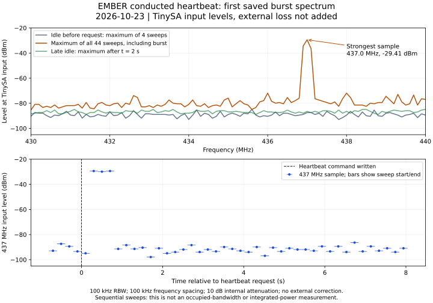
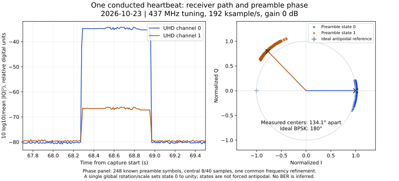
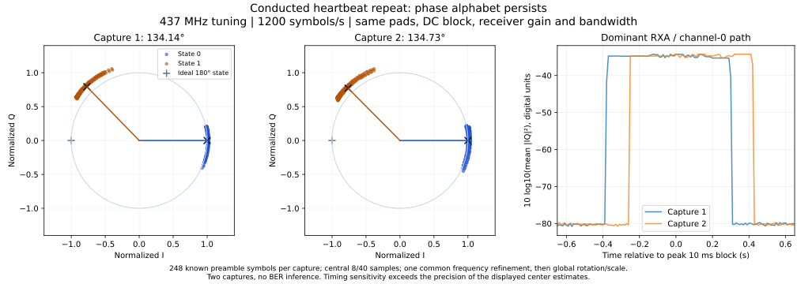
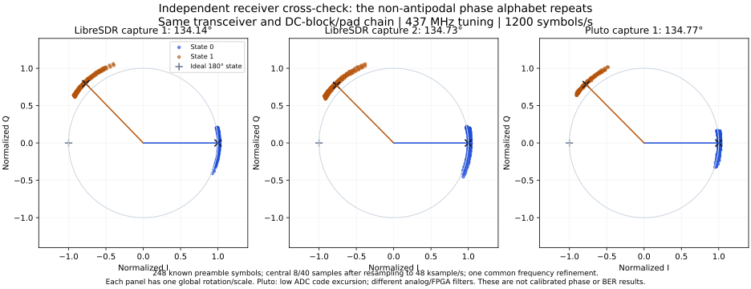

# 008 BPSK: from the communications theory paper to the bench

**Status:** In progress  
**Started:** 2026-10-23  
**Updated:** 2026-10-23

Over the summer I took ECE-4813 Communications Theory and wrote a paper about a
Doppler-affected UHF BPSK satellite link. The intended application was the
transceiver I was designing. The hardware now sends packets back to my ground
station successfully. I want to find out how the working link relates to the
model: where the predictions hold, where the receiver behaves differently, and
what measurements would explain the difference.

This entry combines the **test plan** with conducted spectrum checks, two
LibreSDR IQ heartbeat captures and a Pluto cross-check. The earlier
[transceiver bring-up](../003-ember-transceiver-bringup/README.md) is the starting
evidence. Proposed tests remain distinct from the dated results.

## What I want to learn

1. How close are the transmitted phase states to ideal BPSK, and what does the
   actual waveform cost in noise margin?
2. Does measured BER follow the appropriate theoretical curve once the receiver,
   noise bandwidth and energy-per-bit definitions match?
3. How much frequency offset can the link acquire, and how much *residual* offset
   can it tolerate after acquisition?
4. Do longer packets fail because of independent noise errors, synchronization
   loss, phase drift, or transmitter/receiver timing?
5. Can measured power, sensitivity and frequency tolerance replace the assumed
   numbers in the paper's practical link budget?

The first useful outcome is a measured baseline and an explanation of its largest
departure from the model. A complete satellite qualification is outside this
investigation.

## What matches the paper, and what does not

The reviewed paper source is *Performance Analysis of a Doppler-Affected UHF BPSK
Satellite Link with Frequency-Offset Compensation*. Its MATLAB driver uses eight
samples per symbol, unit-energy rectangular pulses, AWGN and flat Rayleigh
channels. It compares coherent detection with no offset, no compensation, and a
known-preamble frequency estimate followed by one phase correction. The principal
comparisons use 16/64 preamble symbols and 64/256/1024 data bits. The source
versions are identified in [the provenance record](files/source-notes.md).

| Item | Paper model | Reviewed hardware/software path | Consequence for the test |
| --- | --- | --- | --- |
| TX waveform | Ideal antipodal rectangular BPSK | Si5351A → XOR → tripler → RF filters/amplifier → antenna switch | Measure phase separation, amplitude imbalance and transitions first. |
| Bit mapping and detection | Direct coherent symbol decisions | Differential encoding; ground decoder integrates symbols and decides from adjacent-symbol products | Use the DBPSK baseline for the operational receiver; keep coherent results separate. |
| Frequency estimate | Known preamble removed, then FFT peak/interpolation | Ground decoder squares IQ, estimates the doubled carrier, then derotates | Compare algorithms on the same recordings. Longer transmitted preamble does not automatically lengthen this decoder's estimator observation. |
| Preamble | 16 or 64 known pseudorandom symbols | 32 bytes of `55`, or 256 symbols | A paper-equivalent replay needs its own known preamble, not a silent change to the live frame. |
| Packet | Ideal known data, boundaries supplied | Sync `1ACFFC1D`, version 3, sequence, length, native packet, outer CRC32, guard | Separate acquisition, BER, frame integrity and application delivery. |
| Channel knowledge | Exact timing; perfect CSI in Rayleigh baseline | Finite timing search, independent clocks, actual filters and ADC | Measure these effects; a room is not a controlled Rayleigh channel. |

The ground decoder is `ground/bpsk/modem.py`; the current transmitter framing is
in `firmware/transceiver/bpsk_packet.h`. The supplied local `firmware/comms/`
directory describes an older runtime and is not the full current packet path.
The separate `ground/uhf/` FSK demo is not a BPSK reference.

Earlier entry 003 records 185/185 packets in an 11.5-minute demonstration and
nonideal phase steps around 90° at 2 mA and 135° at 4 mA in earlier measurements.
Those are historical observations, not a measurement of today's setup. Successful
short-range decoding does not establish the expected BER curve. The user now
reports receiving packets successfully; record the exact direction and firmware
again at the start rather than assuming the older board-RX limitation still holds.

## Equipment and connections

The shared [equipment inventory](../../equipment/README.md) is the reference for
this investigation. Use LibreSDR with the installed B210/B205-compatible image as
the main IQ receiver and Pluto as the candidate independent BPSK source for
board RX. HackRF and RTL-SDR are optional cross-checks. Record exact installed
images and verify Pluto waveform tooling before the session.

The inventory also lists a NanoVNA-F V2, Rigol DS1202Z-E scope, Analog Discovery,
Nooelec 1/2/3/6/10/20 dB pads, PCB attenuator boards, BECEN DC blocks, DMMs and
bench supplies. The Analog Discovery generation is unconfirmed; use it as an
optional logic/baseband capture tool only after identifying its inputs and limits.
Use the DMMs for board-rail checks and the current-limited supply for powering the
existing configuration. No additional amplifier is needed for the initial tests.

A standalone RF signal generator was reported available in an earlier entry,
but its model, UHF coverage, output accuracy and current availability are
unconfirmed. It is an optional tone source after those details are established,
not a prerequisite. No dedicated calibrated noise source is established by the
inventory; retain offline noise injection and the SDR-generated waveform route.

The [May 17 attenuator characterization](../../equipment/characterizations/attenuators/README.md)
includes original Touchstone files. At the saved 434.8089 MHz sample, the nominal
20+10 dB chain has 29.56 dB loss, and the all-six chain has 41.13 dB loss
(nominally 42 dB despite its historical “41dB” filename). These are historical
low-power VNA measurements near the band, not current 437 MHz calibration or
proof of power handling. Pad identity, cables, reference planes and uncertainty
must be established for the actual assembly.

Use the NanoVNA with a fresh through/response calibration appropriate to the
measurement, preferably a full two-port calibration where supported, to measure
S21 of each intended pad/cable/DC-block chain at the actual TX/RX frequencies.
Save the new calibration description and Touchstone data separately from the
May files. Verify DC-block passband rather than assuming it from the inventory's
upper-frequency rating. With all active sources disconnected, the VNA can also
characterize suitable passive filter/antenna paths; document bias isolation and
do not connect it to a live transmitter. The historical files' zero-filled S12
and S22 are unavailable measurements, and their unresolved S11 excursions are
not a certified match specification.

Use three arrangements in order:

```text
A. Board TX → rated fixed attenuation → selectable fixed pads → LibreSDR RX
   Swap the receiver for TinySA at the same reference plane for level checks.

B. Known SDR waveform → calibrated attenuation → board antenna/RX port
   Record board ADC samples and receive decisions; use LibreSDR separately
   to characterize the source before connecting it to the board.

C. Clean saved IQ or ideal symbols → controlled noise/CFO → offline receivers
   No RF transmission needed for this arrangement.
```

Before A/B, record the measured or conservatively bounded source power, pad power
ratings, instrument input limits for the actual ports, cable loss, DC blocking
requirements and selected reference plane. Choose total loss so the maximum
possible input stays below the lowest applicable input limit with margin. Verify
the level through the initial fixed pad before connecting the SDR. Do not infer
RF power from an SDR gain number or the amplifier's advertised capability.
Use a suitable 50 Ω UHF termination for ports that require it. The inventory's
Pacific Antenna dummy load is listed for DC–50 MHz; do not assume it is a
437 MHz load. Save a connection photo and diagram
with actual pad values before enabling a finite burst.

Use the scope for GP16 bit timing, accessible baseband and supply behavior. Use
complex IQ for UHF phase-state measurements; no assumption is made that the
scope can directly measure phase accurately at 437 MHz. Use TinySA for carrier,
relative products and power checks within its verified settings and limits.
Record model/firmware, reference level, attenuation, RBW/VBW and detector. If no
traceable level reference is available, label power as estimated and retain its
uncertainty; do not turn an approximate spectrum reading into calibrated sensitivity.

Fix RX gain, sample rate, filter bandwidth, antenna/cable arrangement and clock
source within each series. Disable AGC where possible. Record actual rate/tune
readback, overflow/underflow counters, clipping, firmware identity and physical
reworks. Start with the working 1200-symbol/s configuration. Other rates are later
experiments, not assumed supported options.

## Measurements and denominators

Save original IQ, TX bytes, TX attempt outcomes and receiver logs before analysis.
The normal decoder only returns CRC-valid packets, so **its output cannot measure
raw BER**. An offline diagnostic must retain decisions from a predetermined bit
window even when sync, header or CRC fails. This diagnostic does not forward data
or weaken normal packet acceptance. Its implementation is a prerequisite for BER
runs; it is not supplied by this documentation change.

For controlled BER, use known test bits and an independent burst-time/window
manifest. Freeze timing/alignment rules on a clean baseline before the noise
sweep. Do not align every noisy packet by choosing the offset with the fewest
payload errors. Distinguish oracle timing from the operational timing search.
For live native telemetry, retain the actual generated TX bytes and sequence;
do not substitute an expected constant heartbeat for changing data.

Report these separately:

- **BER on scheduled, alignable windows:** erroneous scored bits / scored bits,
  with the number of erased/unscorable windows and acquisition coverage beside it.
  Also show BER conditioned on acquisition, explicitly labelled.
- **RF packet success:** exact expected frames recovered once / independently
  confirmed completed RF attempts. Missing, malformed and CRC-failed frames fail.
  Report admitted requests and local TX failures separately; they explain service
  reliability but are not a noise-only RF denominator.
- **Service delivery:** unique original packets reaching the application archive /
  submitted requests. Local RF completion, decoder acceptance, UDP send and archive
  confirmation are different observations. Disable retries or count every RF attempt.

For each packet, retain bit-error count and positions, burst start, CFO estimate,
residual CFO estimate, timing estimate, CRC outcomes and reason for rejection.
If a corrupt header prevents packet identity, classify the scheduled window as
failed/erased rather than dropping it. Deduplicate overlapping decode windows.
Stream gaps invalidate the affected measurement interval; retain the failed run.

Use fixed sample budgets chosen before each sweep: start with 2,000 packets per
packet-success point and 10^6 scored bits per BER point, split over at least three
independent captures/seeds. At 1200 bit/s, 10^6 payload bits already needs at least
13.9 minutes before overhead and gaps. Pilot runs can use 100 packets; do not
present them as final statistics. Plan larger fixed budgets where the expected
error count is below roughly 100. Report counts and 95% intervals, not only ratios.
For zero independent events in N trials, the one-sided 95% upper bound is
`1 - 0.05^(1/N)`, approximately `3/N`; zero observed errors is not zero BER.
Differential decisions share samples and phase slips cluster errors: use capture-
or packet-block intervals for BER rather than claiming independent bit trials.
Packet binomial intervals likewise assume independent attempts; report correlations
and capture-to-capture spread when that assumption fails.

## Test sequence

### T0 — preserve and repeat the working link

Record board ID/revision, reworks, installed firmware release/source SHA/dirty flag,
UF2 hash if available, modem revision, clock/drive settings and actual RF frequency.
Save the current known-good configuration without reflashing. Capture at least
100 bounded transmissions and compare TX bytes with RF bytes. Run a separate
TX-off capture of equal duration to check false detections and sample continuity.
If RX on the board is working, record a separate source → board receive test;
an SDR downlink capture is not evidence about the board's analog RX path.

**Proceed when:** packet identity and attempt accounting agree, sample streams are
continuous, input levels are credible and no clipping is present. A failure here
gets its own retained record before any BER interpretation.

### T1 — measure the actual phase alphabet

Capture the existing preamble and known patterns through the conducted TX path
at a comfortable nonsaturating level. Additional held-phase, all-zero/all-one,
alternating and seeded pseudorandom patterns require a reviewed bounded test
image or existing verified test command; do not invent a console command.

Estimate CFO once over a clean reference segment; remove only that common linear
rotation. Plot symbol-center IQ, amplitudes by state, phase separation and spread,
transition trajectories and adjacent-symbol phase differences. Report uncertainty
across bursts. A fitting algorithm that forces every symbol onto ±1 would hide
the defect being measured. Measure GP16 deadlines/jitter with the scope alongside
the IQ observations. Repeat the present drive setting; compare 2/4 mA only as
separate, recorded configurations if supported and electrically acceptable.

For the tripler, an ideal odd harmonic preserves antipodal states because
`3π = π (mod 2π)`; it also multiplies phase error. Actual filtering, duty cycle
and drive can change the result. This is a hypothesis to investigate, not a
diagnosis. Plot transition and steady-state behavior separately.

**Output:** waveform baseline, relative spectrum/occupied-bandwidth observations,
symbol timing and a decision on whether ideal-BPSK theory is an appropriate
reference. If the phase states are non-antipodal, retain that configuration as
the baseline and add a measured-waveform simulation; record any later repair as
a new configuration.

### T2 — controlled noise, with matched receiver comparisons

First reproduce the paper's AWGN baseline in an isolated copy of its MATLAB
sources, using the documented seed and eight samples/symbol. Do not overwrite
submitted results. Then test ideal differential symbols and a clean captured
hardware waveform at proposed `Eb/N0 = -4, -2, 0, 2, 4, 6, 8, 10, 12 dB`.
Use common noise realizations for paired receiver comparisons and independent
seeds across repeats. Apply these receiver variants offline:

| Receiver | Purpose |
| --- | --- |
| Coherent with known phase/frequency/timing | Paper's AWGN reference and waveform ceiling |
| Coherent with paper-style known-preamble estimate and one phase correction | Reproduce the paper's synchronization assumptions |
| Differential with known CFO/timing | Isolate differential detection loss |
| Current squared-carrier estimator, timing search and differential detector | Measure the operational ground receiver |

For coherent detection of a differentially encoded stream, score transmitted
phase symbols against coherent BPSK theory. If decisions are then differentially
decoded, score original data separately; the latter has a different error law.
Use paper-format direct BPSK packets to reproduce its original data-BER curves.

At zero residual CFO and ideal antipodal symbols, plot coherent
`Pb = 0.5 erfc(sqrt(Eb/N0))` and differential
`Pb = 0.5 exp(-Eb/N0)` as distinct references, with linear `Eb/N0` in both
expressions. The differential expression assumes ideal two-symbol detection;
frequency/timing acquisition and distorted phase states can add loss.
[MathWorks lists these separate cases](https://www.mathworks.com/help/comm/ug/analytical-expressions-used-in-berawgn-function-and-bit-error-rate-analysis-app.html).

For unfiltered complex samples with white noise and one bit/symbol,
`Eb/N0_dB = SNR_sample_dB + 10 log10(Fs/Rb)`.
After filtering, use the actual noise PSD or equivalent noise bandwidth, not
sample rate as a substitute. For measured power,
`Eb/N0_dB = C_dBm - N0_dBm_per_Hz - 10 log10(Rb)`; equivalently use C/N in
a documented noise bandwidth B and add `10 log10(B/Rb)`.
[The sample/SNR distinction is documented here](https://www.mathworks.com/help/comm/ug/awgn-channel.html).

Estimate signal power on active symbols after subtracting same-gain TX-off noise.
The clean capture already contains noise: add only the variance needed to reach
the target, and reject targets cleaner than the original recording. Add circular
complex noise before the modeled receive filter; document variance convention,
seed and all filtering. Do not use an `awgn` SNR argument as if it were Eb/N0.

Offline injection tests the captured waveform and software receiver. It does not
measure analog sensitivity or noise added ahead of the board LNA. Follow it with
conducted attenuation sweeps in both directions where available: proposed 3 dB
steps to locate the knee, then about 1 dB near it, checking gain and clipping each
time. Use measured combinations of the available fixed pads; a calibrated step
attenuator is not assumed. Stop TX before changing connections, record the actual
total chain loss for each point, and recheck the baseline after reconnecting.
Without a calibrated input noise density, plot PER versus input power/loss and
leave the Eb/N0 axis unclaimed. An SDR can later generate a known signal plus
noise before the board input; characterize its DAC/RF distortion and output level
first. No standalone noise generator is required for the first stage.

**Output:** BER/PER curves, calibration uncertainty and implementation loss at a
common supported BER such as 10^-3. Separate hardware waveform loss from estimator
and detector loss. Do not extrapolate an unmeasured tail.

### T3 — separate acquisition from residual frequency error

At proposed 4, 8 and 12 dB Eb/N0, inject signed normalized offsets
`ν = Δf/Rb = 0, ±0.01, ±0.05, ±0.10, ±0.25, ±0.50`. At 1200 bit/s these are
0, ±12, ±60, ±120, ±300 and ±600 Hz. Use a broader acquisition test at
0, ±1, ±2, ±5 and ±10 kHz, only where the source, RF/baseband filters and sample
rate pass the entire shifted signal. Repeat selected points with actual source
tuning; post-capture CFO cannot test analog passband rejection or front-end capture.
Measure actual offset rather than treating a requested tuning delta as truth.

Run the paper receiver and differential receiver with correction enabled and
disabled, plus a known-CFO control. Report acquisition probability, estimate bias,
RMSE and residual distribution separately from post-acquisition BER. The current
48 ksample/s ground estimator's square-and-FFT search is nominally ambiguous
outside ±12 kHz; analog bandwidth and estimator failures may narrow that range.
This is not automatically the capture range of the board's real ADC receiver.

To isolate the paper's within-symbol result, use an explicitly **oracle**
symbol-center phase reference after integration. Its amplitude is `sinc(ν)` and
power factor is `sinc²(ν)`; at ν=0.5 the continuous-time loss is 3.92 dB. With
finite rectangular sampling, compare the exact discrete factor
`[sin(πν)/(Ns sin(πν/Ns))]²` as well, using the limit 1 at zero. This oracle
experiment differs from an uncorrected packet receiver.

A coherent receiver with a single preamble phase correction retains a phase
ramp `2π f_res t`; plot error locations down the packet. A differential receiver
instead sees approximately `2π f_res/Rb` between adjacent symbols. Its ideal
noiseless decision margin reaches zero at `|f_res| = Rb/4` (300 Hz here), before
considering integration loss or waveform distortion. This derived boundary is
a test hypothesis, not a measured tolerance or a claim that all offsets fail the
same way. Resolve frequency sign and BPSK phase ambiguity with the known preamble.

**Output:** separate capture-range and residual-tolerance plots, with the actual
received passband and correction method on each plot.

### T4 — preamble length and packet duration

In paper-equivalent replay, test preambles 16/64/256 symbols and data 64/256/1024
bits at selected near-knee noise levels and ν=0/±0.10. Hold receiver settings
fixed, then deliberately vary only the estimator's observation length. A 16- or
64-symbol prefix cut from the live `55` preamble is not the paper's pseudorandom
training waveform. Use exact known sequences and label the two experiments.

On hardware, start with the current 256-symbol preamble and existing native
packet sizes; record the exact scored field and full RF-frame length. The
reviewed transmitter permits 128 native bytes, with 63 framing/guard bytes:
191 bytes × 8 /1200 = 1.2733 seconds, including 128 guard symbols. A 1024-bit
paper payload is not a 1024-bit complete RF frame. Check the actual installed
limits before changing lengths, and retain the finite payload deadline and hard
mute. Arbitrary payload/preamble sweeps need a bounded test mode first.

Compare directly measured packet success with `(1-Pb)^Nb` only as the independent
bit approximation over the stated scored region. Full-frame delivery also
depends on preamble/sync/header/CRC acquisition; differential errors can be
correlated. Plot errors versus bit index and inter-error spacing to explain a
mismatch rather than fitting away the difference.

**Output:** useful packet length and preamble overhead for each receiver and an
explanation of any length-dependent floor.

### T5 — drifting offset, fading and board RX

These follow the static tests. Inject `exp(j 2π(f0 t + 0.5 a t²))` for proposed
rates a=0, ±50 and ±270 Hz/s. The last value is a paper-derived stress case, not
a measured orbit. A 270 Hz/s drift changes frequency by about 344 Hz across the
1.2733-second frame, so the paper's short-packet constant-CFO approximation may
be insufficient for this 1200-baud link. Compare first/middle/end residual phase,
acquisition and packet success. Even a small frequency change can accumulate
material phase over a long coherent packet.

Reproduce the paper's flat Rayleigh/perfect-CSI curve in software separately.
If adding fading to hardware IQ, specify its time correlation/coherence time and
receiver channel knowledge. A moving antenna experiment is useful afterward,
but distance and multipath are uncontrolled variables, not an exact validation
of that Rayleigh formula.

For the board RX direction, characterize the SDR source, then sweep input level,
static offset and selected drift cases through the real RF/baseband path. Record
ADC rate, bias, clipping, filter response and actual decoder. A single real ADC
channel/Hilbert reconstruction is not automatically equivalent to complex SDR IQ
or perfect carrier recovery. If firmware exposes only accepted packets, measure
PER first and add diagnostic ADC/decision logging before claiming board BER.
Repeat downlink and uplink independently; a round trip mixes both probabilities.

## Revisiting the practical conclusions

The paper's illustrative +20 dBm TX, antenna gains, losses and thermal noise
density are assumptions, not present-board measurements. Replace them with
measured antenna-port power, feed/filter/switch losses, antenna data, receiver
noise/sensitivity and their uncertainty. Report link margin at a stated BER/PER
and rate. Keep the conducted result distinct from an antenna/range test and any
orbital prediction. Include receiver noise figure/system temperature; -174 dBm/Hz
alone is not the receiver's effective noise floor.

The source's compensated-receiver approximation neglects some acquisition/phase
effects. Its semi-analytical implementation uses a high-SNR frequency-estimation
variance proportional to `1/(Eb/N0 · Np³)`, so a high-SNR finite-run flattening
should not automatically be called an irreducible asymptotic floor. Likewise the
`cos²(phase)` approximation loses the sign of a coherent decision beyond ±90°.
Use signed decision statistics and empirical phase/error plots in those regimes.

The comparison is useful even if the curves disagree. A fixed horizontal loss
can suggest waveform/filter/noise-calibration issues; failure only before
acquisition suggests estimator range; errors accumulating late in coherent
packets suggest residual drift; changes with drive suggest modulation quality.
These are hypotheses to test one at a time, not conclusions from packet success.

## October 23 — first conducted spectrum check

With the transceiver off, I removed the antenna from J9 and assembled the
Nooelec 20/10/6/3/2/1 dB pads with one DC block at the 20 dB end. I calibrated
the NanoVNA over 430–440 MHz and saved it to slot 0. The assistant read the USB
console and collected the measurements. No calibration slot was overwritten.

The instrument identified itself as NanoVNA-F V2, firmware 0.5.4, with 101 points.
It reported open/short/load/thru calibration applied. The initial console read
returned noise-like S21 while only an S11 display trace was enabled. Switching
that trace to S21 produced the through results below; the first read was not
accepted as a cable-loss result.

| Connection / quantity | Recorded result |
| --- | --- |
| Cables joined by through adapter, three reads | S21 −0.071 to +0.099 dB over 430–440 MHz |
| DC block plus all six pads, five reads, 435 MHz | Mean attenuation 41.355 dB |
| Same assembly, 437 MHz | Mean attenuation 41.384 dB |
| Same assembly, all five reads over 430–440 MHz | Attenuation 41.233–41.552 dB |

The through check is consistent with the saved calibration, not an independent
absolute-accuracy verification. These readings establish assembled-chain UHF
loss, not the DC block's isolated loss or the pads' power handling. The historical
May chain measurement was a different setup and is not subtracted to estimate
DC-block loss. [Forward S21 data](files/2026-10-23/vna-s21.csv) retains every read.

I moved the complete assembly to J9 and connected the 1 dB end directly to the
TinySA RF port. The transceiver and IHU were powered, with LibreSDR disconnected.
Additional adapter details and current supply readings were not separately
recorded. TinySA identified firmware `tinySA4_v1.4-156-g4eb315d`, hardware
V0.4.5.1.1. IHU identified version 0.15.0, clean source
`701e96c00c8a9a207d29a746eee74c7108a2a1b3`; this does not identify the installed
transceiver firmware. The IHU had no outstanding UHF requests, retained a previous
faulted-run state, and reported three older faults. Those records were preserved.

A receive-only survey used input mode, LNA off, zero external gain correction,
100 kHz RBW and 430–440 MHz. The first idle survey used 30 dB internal attenuation.
For the burst test, internal attenuation was reduced to 10 dB and a fresh baseline
was taken at that setting. No TinySA level calibration or firmware change was made.

### The failed recorder attempt

One heartbeat request was sent, but the first recording script aborted when a
scan yielded 100 parsed points rather than the expected 101. It failed before
saving its in-memory spectrum and console replies. There is no usable burst
spectrum or retained completion reply for that attempt; it is not counted as a
successful captured measurement. The cause of the incomplete scan is unresolved.

The recorder was changed to stream JSONL records immediately, retain incomplete
sweeps without inventing missing points, and save errors and command-write events.
A receive-only check completed 14/14 sweeps with no RF-producing commands.
I then explicitly authorized one additional heartbeat. There were no automatic
retries.

### The saved heartbeat capture

The corrected run wrote **one** `uhf heartbeat` command. The IHU reported:

```text
SUBMITTED request=16 type=128 bytes=38
UHF request=16 outcome=QUEUED status=0 bytes=38 digest=152a17f7 ground_ack=0 outstanding=1
UHF request=16 outcome=RF_TX_COMPLETE status=0 bytes=38 digest=152a17f7 ground_ack=0 outstanding=0
```

All **44/44 sweeps** had the complete 101-point grid. Four preceded the command;
40 covered the subsequent eight-second window. Three sweeps sampled the strong
437 MHz signal at approximately −29.41, −29.91 and −29.41 dBm at the TinySA
input. Later sweeps returned to the idle level. IHU pending and UHF-pending
counts ended at zero; matched replies increased from 28 to 30. CAN error
registers and RX overflow stayed zero, while the pre-existing lifetime TX-failure
count remained 3. Local RF completion is not a ground acknowledgment.



The upper plot is calculated from saved sweeps, not an instrument max-hold
screenshot. Horizontal bars in the lower plot show sweep intervals; the individual
437 MHz sample occurs somewhere within each interval. The 100 kHz frequency grid
and RBW only locate the burst near 437 MHz. They do not resolve exact CFO,
phase-state quality or occupied bandwidth.

Using the strongest input reading and the measured external loss gives:

```text
estimated J9 level = −29.406 dBm + 41.384 dB = +11.978 dBm ≈ 15.8 mW
```

This is a **rough in-band level estimate**, not calibrated total modulated output
power. It uses a swept detector sample, with TinySA absolute calibration accuracy
and reconnection uncertainty unestablished. The instrument's displayed input
level already accounts for its internal attenuator; the 10 dB internal setting
is not added again. No packet was decoded by the TinySA and no BER/PER or ground
delivery result is inferred.

[All saved sweep levels](files/2026-10-23/heartbeat-spectrum-02.csv) ·
[IHU replies, board hardware ID redacted](files/2026-10-23/heartbeat-spectrum-02-ihu.txt) ·
[Settings, input hashes and derivation](files/2026-10-23/session.json) ·
[Plot reproduction script](files/2026-10-23/plot_capture.py)

Original captures remain unchanged in the local bench archive. Published CSVs
are explicitly derived exports; the session file records their original input
hashes. The failed first attempt is retained as an error record, not reconstructed
as a successful capture.

## October 23 — LibreSDR IQ capture and first phase estimate

The LibreSDR did not enumerate on the controller host. Restarting only the USB
controller with no enumerated devices brought back a hub but not the radio; the
other controller, carrying the mounted backup drive and consoles, was not reset.
The cause of that USB failure was not established. Moving to the ground station
allowed enumeration. UHD initially lacked its image-directory setting; using the
existing image files restored discovery. The FPGA SHA-256 matched the installed
capture helper's expected value. The hardware probe passed register loopback and
reported USB3 operation, firmware 8.0 and FPGA 16.0.

I connected the existing measured assembly to the radio's physical **RXA** port,
leaving the transceiver off initially. Reported connector labels are TXRA, RXA,
RXB and TXRB. The ground station's idle `ember-fire-uplink.service` was temporarily
stopped so it could not compete for or transmit through the radio during the
bench work. Its prior active state was recorded for restoration after the session;
unit configuration and enablement were unchanged.

Two receiver-preparation attempts failed before any stream started: a Python
getter needed an explicit motherboard argument, then UHD rejected a 49.152 MHz
master clock for simultaneous dual RX. These distinct error reports and empty
arrays are retained, not presented as noise measurements. With the getter corrected
and a 30.72 MHz clock, the five-second idle baseline completed at nominal
192 ksample/s on both channels, gain 0 dB, RX2 selection, AGC disabled and 200 kHz
analog bandwidth. No UHD errors or timestamp gaps were detected.

After I powered on the transceiver, the assistant started a bounded two-minute
dual-channel recording and, with explicit authorization, sent exactly one
heartbeat request through the IHU. The receiver itself used no TX API and
forwarded nothing. A fresh CAN HELLO confirmed the peer before the request.

| Observation | Result |
| --- | --- |
| Recorded IQ | 120 seconds, 23,040,000 complex samples per channel |
| Receiver settings | 437 MHz requested, nominal 192 ksample/s, gain 0 dB, RX2 selected on channels 0/1 |
| Clock / bandwidth readback | About 30.72 MHz master clock; 200 kHz analog bandwidth |
| Stream integrity | No reported UHD errors or detected timestamp gaps; no nonfinite samples |
| Near-full-scale check | Zero I/Q components at or above the explicit 0.99 criterion |
| IHU request | Request 18, 38 bytes, QUEUED then RF_TX_COMPLETE, digest `4104665e`, ground_ack=0 |
| Strong receive path | Physical RXA → UHD channel 0 with this FPGA and RX2 selection |
| Burst interval | Approximately 68.28–68.97 seconds into the capture using a 10 ms block-power threshold |
| Normal decoder | One HEARTBEAT recovered on channel 0, outer RF sequence 18, native sequence 14 |
| Source comparison | Recovered native length 38 and CRC32 `4104665e` match the IHU report |
| Channel 1 | A much weaker copy of the same frame also decoded; this is not another transmission |

The decoder's normal `dbpsk` path was used, with no phase-diagnostic fallback.
It validated the outer frame CRC32 and the native packet CRC16. The IHU console
retained the transmitted length and digest, not the full transmitted byte string:
this establishes a matching length/digest, rather than an independently saved
byte-for-byte TX/RX comparison. Nothing was forwarded to Yamcs, and no RF ground
acknowledgment was transmitted.

Both channels saw the same burst, but channel 0's peak 10 ms block power was about
32 dB above channel 1's. The unconnected second input's recovery may reflect
coupling/leakage; the mechanism is unmeasured. Do not count these copies as two
packets or infer isolation from a calibrated two-port measurement.

### Frequency and phase observations

The normal ground decoder estimated **−7347.20 Hz** relative to the requested
437 MHz receiver center on channel 0. That is an uncalibrated relative CFO estimate,
not a precise absolute TX-frequency measurement or evidence of Doppler on this
stationary bench. Its raw normalized offset is approximately **−6.12** at
1200 symbols/s, well outside the paper's residual-offset sweep of 0–0.5. The
working receiver removes bulk CFO before integrating symbols, so the raw offset
must not be inserted into the paper's post-correction BER curve.



The phase estimate uses 248 known preamble symbols, omitting four at each end.
After the normal decoder's single carrier correction, timing candidates were
compared using within-state variance on the known preamble. Each candidate used
the central 8 of 40 samples per symbol. The best candidate gave **134.16°** between
the two complex state centers. Fitting one additional common linear phase slope
across the preamble changed that to **134.14°**, with a state-amplitude ratio of
about **1.105**. The fitted additional slope was about +0.76 Hz; it is an offline
training-based refinement, not a change to the operational receiver or a verified
frequency standard.

The plotted points use that one common frequency refinement and one global
rotation/scale. The two state centers remain independent and are not forced
antipodal. Within-state phase standard deviations after refinement were about
9.7° and 9.8°; these describe this preamble, not independent-trial uncertainty.
An earlier full-symbol average at the first CRC-valid timing produced about
121°, illustrating how integration-window placement and transition mixing can
bias a phase-state estimate. This is why neither number is treated as a direct,
calibrated RF phase measurement at J9.

The approximately 134° steady-symbol estimate is consistent with the earlier
non-antipodal observations in entry 003. It explains why successful differential
decoding is not sufficient evidence of ideal 180° BPSK. Current drive strength and
the responsible circuit stage were not measured in this session; a cause is not
assigned. No BER is inferred from one CRC-valid heartbeat.

### CAN observation retained separately

The IHU's lifetime TX-failure count increased **3 → 4** during this run. TEC
was 7 immediately afterward and returned to zero on a later read-only status
check; REC, EFLG and RX overflow were zero. The later fault report retained a new
code-3 record at uptime 94,251,323 ms. The requested RF packet nevertheless
received a local RF_TX_COMPLETE reply and was decoded from IQ. Cause and
repeatability of the CAN failure remain unresolved. No counter was cleared and
no automatic RF retry was issued.

The finite receiver stream stopped after its full sample budget. The original
two NPY files remain on the ground station, **184,320,128 bytes each**, with
SHA-256 hashes in the session metadata. The fire-uplink service remains paused
while this bench session continues and must be restored afterward.

[Capture settings, hashes and analysis](files/2026-10-23/iq-heartbeat-01-session.json) ·
[IHU replies and later fault status, hardware ID redacted](files/2026-10-23/iq-heartbeat-01-ihu.txt) ·
[Burst block-power data](files/2026-10-23/iq-heartbeat-01-power.csv) ·
[Preamble symbol measurements](files/2026-10-23/iq-heartbeat-01-preamble.csv) ·
[Plot reproduction script](files/2026-10-23/plot_iq_capture.py)

## October 23 — repeat capture and phase comparison

I repeated the conducted heartbeat with the same J9 → DC block →
20/10/6/3/2/1 dB pad chain → physical RXA connection. Between IQ captures I
switched off **only the 5 V supply**; the 3.3 V supply stayed on. Both rails
were back on before the second capture. This was a partial power interruption,
not a full board reboot: the COMMS boot ID remained unchanged. Receiver settings
and the reviewed runtime images were unchanged, and no MCU firmware was modified.

The assistant started another 120-second dual-channel IQ recording and enabled
IHU console debug output for timestamped CAN logging. The first logger reported
ready and then exited because its event writer passed the UTC field twice. The
pre-transmit liveness check caught that failure, so **no heartbeat was sent with
the failed logger**. Its files were retained. The corrected logger was started
and checked again while IQ recording continued; I then authorized exactly one
heartbeat. There were no automatic RF retries.

The IHU submitted request **19**, 38 bytes, and reported QUEUED followed by
RF_TX_COMPLETE with digest `74342ca7`. The normal DBPSK decoder recovered a
HEARTBEAT with outer RF sequence 19 and native sequence 15 on both channels.
The native CRC32 matched `74342ca7`; the outer CRC32 and native CRC16 both passed.
As before, the second channel is a weaker copy of the same RF event. Independently
saved full TX bytes are still unavailable, so the sender comparison remains a
length/digest match. No packet was forwarded or acknowledged over RF.

| Quantity | First IQ capture | Repeat IQ capture |
| --- | --- | --- |
| Completed RF attempts | 1 | 1 |
| IHU request / native digest | 18 / `4104665e` | 19 / `74342ca7` |
| Outer RF / native sequence | 18 / 14 | 19 / 15 |
| Normal DBPSK decode | Passed on both channels | Passed on both channels |
| Samples per channel | 23,040,000 | 23,040,000 |
| UHD errors / detected gaps / I/Q components ≥0.99 | 0 / 0 / 0 | 0 / 0 / 0 |
| Channel-0 burst interval, 10 ms power threshold | 68.28–68.97 s | 64.17–64.85 s |
| Channel-0 peak block power / median idle power | 45.96 dB | 45.96 dB |
| Normal decoder relative CFO, channel 0 | −7347.20 Hz | −7373.68 Hz |
| Known-preamble common frequency refinement | +0.756 Hz | +4.646 Hz |
| Refined relative CFO | −7346.44 Hz | −7369.03 Hz |
| Phase separation after common refinement | **134.14°** | **134.73°** |
| State-1 / state-0 mean amplitude ratio | 1.105 | 1.086 |
| Within-state phase standard deviations | 9.72° / 9.82° | 10.75° / 10.73° |
| IHU lifetime CAN TX-failure count | 3 → 4 | 4 → 4 |

The repeat's peak 10 ms digital power on channel 0 differed by only **+0.011 dB**
from the first capture. This is a relative receiver observation, not a calibrated
TX power comparison. The refined relative CFO shifted by about **−22.59 Hz**;
the two independent RF clocks were not calibrated, so this cannot be assigned
to transmitter drift alone.

### Is the phase separation still around 134 degrees?

**Yes, within this method's timing sensitivity.** Reprocessing the first capture
reproduced its published timing, variance metric, coarse phase separation,
common frequency refinement and final **134.1439°** result to floating-point
precision. Applying the same sequence of operations to the repeat yielded
**134.7273°**, a difference of **+0.5834°**.



Both measurements use 248 known preamble symbols, omit four at each end, and
average the central 8 of 40 samples per symbol. Timing is selected by normalized
within-state complex variance among CRC-valid frame alignments, after the normal
decoder's squared-IQ frequency estimate. One additional common linear phase slope
is then fitted across the preamble. The two complex state centers remain
independent; neither is forced to the ideal 180° alphabet. The plots use one
global rotation/scale per capture solely to align state 0 for viewing.

The repeat also shows a limitation of that ordering. Before the common frequency
refinement, its residual phase rotation spreads the points almost around a full
circle: the selected timing's raw state-center separation is 136.08°, with about
96° within-state phase spread. It is not a stable steady-state constellation at
that stage. Removing the fitted common +4.646 Hz slope produces the tighter clouds
shown above. The normal differential decoder already accepted the packet before
this offline refinement; the refinement was not needed to make its CRC pass.

As a sensitivity check, applying the same single common frequency refinement at
each CRC-valid timing gives separations of **134.14–135.62°** for the first capture
and **133.62–135.35°** for the repeat. Those ranges are timing sensitivity, not
confidence intervals. The sub-degree difference between the selected results is
smaller than that variation, so the defensible observation is a repeatable
**roughly 134–135°** phase alphabet. These are waveform estimates through this
receiver/filter path, not calibrated phase measurements directly at J9.

This repeats the largest departure from the paper's ideal antipodal transmitter.
It does not yet quantify the BER or noise-margin cost. Two decoded heartbeats are
a useful repeatability check, not the planned packet-success trial budget. Current
clock drive, installed transceiver firmware identity, circuit-stage responsibility,
and an independent receiver cross-check remain to be measured.

### CAN logging result and retained files

The corrected logger captured the heartbeat and more than two minutes afterward.
IHU status snapshots kept `tx_fail=4`, `tx_timeout=0`, TEC=0, REC=0 and RX overflow=0;
no new FRAME_TX_FAILED message or code-3 fault appeared. Thus the earlier CAN
failure **did not recur in this repeat**; its cause is still unresolved. Ten-second
status snapshots cannot exclude a short counter/register excursion between reads,
although the continuous debug stream covered the interval. Logging restored
`cli_debug=0` when it closed at 16:22:57.720 UTC. Neither the failure counters nor
the fault history was cleared.

Both new IQ originals remain unchanged on the ground station, 184,320,128 bytes
each, with SHA-256 recorded below. The failed logger and the earlier local analysis
draft were retained separately. The latter used a different variance normalization;
correcting it to reproduce the first measurement did not change the selected timing
or either final phase separation. Published derived files use the reproduced method.

[Repeat settings, hashes, comparison and timing candidates](files/2026-10-23/iq-heartbeat-02-session.json) ·
[Complete corrected IHU console log, hardware ID redacted](files/2026-10-23/iq-heartbeat-02-ihu.txt) ·
[Repeat block-power data](files/2026-10-23/iq-heartbeat-02-power.csv) ·
[Repeat preamble symbol measurements](files/2026-10-23/iq-heartbeat-02-preamble.csv) ·
[Offline analysis script](files/2026-10-23/analyze_iq_repeat.py) ·
[Comparison plot reproduction](files/2026-10-23/plot_iq_repeat.py)

## October 23 — Pluto independent receiver cross-check

The next check was whether a second receiver would see the same non-antipodal
phase states. I moved the complete DC-block/pad chain from LibreSDR RXA to
**Pluto RX** and connected Pluto by USB to the ground station. Both transceiver
rails were reported on at the start; the transmitter stayed idle until the
explicitly authorized heartbeat. No drive setting or MCU firmware was changed.

The unit identified as **PlutoSDR Rev. C, Z7010/AD9363A, firmware v0.37**.
The host lacked libiio, so `libiio0`, `libiio-utils` and `python3-libiio` version
0.26-2 were installed. A first broad attribute survey encountered an unreadable
attribute; targeted reads worked. This was a host-tool setup step, not a Pluto
firmware update. Pluto's DDS sources were disabled, TX attenuation set to
−89.75 dB and TX LO powered down; no TX buffer was created.

The RX setup requested 437 MHz, manual 0 dB gain, AGC off and 200 kHz analog
bandwidth. RX LO readback was 436,999,998 Hz, which is a register readback, not
an absolute-frequency calibration. The PHY ran at **2.304 Msample/s**, with the
advertised FPGA 8:1 RX decimation producing **288 ksample/s**. A five-second idle
check saved 1,440,000 complex samples without a reported read error or near-full-
scale component. The same numeric gain setting does not establish equal analog
gain or input calibration between Pluto and LibreSDR.

After that check, the assistant started a bounded 120-second IQ recording and
150-second IHU debug logger, verified both processes were running and the IHU had
no pending request, then issued exactly **one** heartbeat. Request **20** reported
QUEUED and RF_TX_COMPLETE, 38 bytes, digest `13049149`. There were no retries.

### Decode and phase comparison

The unchanged normal DBPSK decoder recovered **one HEARTBEAT**, outer RF sequence
**20**, native sequence **16**, with valid outer CRC32 and native CRC16. Recovered
length 38 and native CRC32 `13049149` match the IHU report. No diagnostic phase
threshold was substituted to obtain acceptance. Full independently saved TX
bytes remain unavailable; no RF acknowledgment or application forwarding occurred.

| Quantity | LibreSDR 1 | LibreSDR 2 | Pluto 1 |
| --- | --- | --- | --- |
| IHU request / native digest | 18 / `4104665e` | 19 / `74342ca7` | 20 / `13049149` |
| Outer RF / native sequence | 18 / 14 | 19 / 15 | 20 / 16 |
| Normal DBPSK decode and sender length/digest match | Passed | Passed | Passed |
| Recorded stream rate | 192 ksample/s | 192 ksample/s | 288 ksample/s |
| Recording duration / samples per channel | 120 s / 23,040,000 | 120 s / 23,040,000 | 120 s / 34,560,000 |
| Reported stream errors | 0 | 0 | 0 |
| Timestamp continuity check | No detected gaps | No detected gaps | Not available in this IIO stream |
| Normal decoder relative CFO | −7347.20 Hz | −7373.68 Hz | −3241.47 Hz |
| Additional common frequency refinement | +0.756 Hz | +4.646 Hz | +4.369 Hz |
| Refined relative CFO | −7346.44 Hz | −7369.03 Hz | −3237.10 Hz |
| Phase separation after refinement | **134.14°** | **134.73°** | **134.77°** |
| State-1 / state-0 mean amplitude ratio | 1.105 | 1.086 | 1.103 |
| Within-state phase spread | 9.72° / 9.82° | 10.75° / 10.73° | 7.89° / 7.96° |
| IHU lifetime CAN TX-failure count | 3 → 4 | 4 → 4 | 4 → 4 |



Pluto's primary result is **134.7692°**, just **0.0419°** from the second LibreSDR
capture and **0.6253°** from the first. These differences are smaller than the
method's timing sensitivity, so the useful conclusion remains **roughly 134–135°**,
not fractional-degree calibration. Pluto timing candidates that also decode the
same CRC-valid frame give **134.56–135.62°** after common frequency refinement.
These ranges are sensitivity checks, not confidence intervals.

To handle the different input rate, the Pluto excerpt was filtered with a
193-tap Hamming-windowed lowpass at 18 kHz and decimated 6:1 to 48 ksample/s.
Scaling from 129 taps at 192 ksample/s approximately preserves the first analysis
filter's duration. It does not make the receivers' native analog/FPGA filters
identical. From 48 ksample/s onward the procedure is unchanged: normal squared-IQ
CFO correction, 40 timing candidates with CRC-valid frame alignment, central
8 of 40 samples on 248 known preamble symbols, lowest normalized within-state
complex variance, then one common linear phase refinement with two unconstrained
state centers. No per-symbol phase rotation or enforced antipodal mapping is used.

As an offline filter check, **129 taps at 288 ksample/s** recovered the identical
packet and gave **134.7491°**, only **0.0201°** below the primary result. Both
filters' CSVs and timing candidates are retained. The pre-refinement Pluto
estimate was 135.66° with about 95° within-state phase spread; the common
+4.369 Hz refinement removes the residual rotation before the plotted comparison.
The normal differential decoder accepted the packet before this refinement.

Agreement through the independent receiver makes a **LibreSDR-only artifact less
likely** and strengthens the evidence that the received waveform is non-antipodal.
The common analysis method and passive path remain shared, and the responsible
transmitter stage has not been isolated. The paper's ideal 180° BPSK waveform is
still a reference model; these captures do not yet measure the resulting BER or
noise-margin penalty.

### Pluto measurement limits and CAN result

The Pluto burst's largest raw I/Q component was **26 counts out of nominal
2048 full scale**, only about **1.27%**, with zero components meeting the stated
0.99-full-scale clipping criterion. At fixed gain 0 dB, **76.98% of the 10 ms
blocks had exactly zero digital power**, making median idle power zero. An
idle-referenced digital SNR is therefore **unavailable**, not infinite. The small
ADC code excursion limits accuracy and should be improved in a later, separately
recorded gain check. The lower plotted phase spread is not proof that Pluto is a
better receiver, and raw digital power cannot be compared as calibrated RF power.

The burst occupies approximately **4.39–5.08 s** into the recording using an
explicit **20 dB below peak block-power** threshold. This is a different threshold
from the LibreSDR idle-referenced display. An initial analysis draft labelled all
nonzero blocks as above a zero-median noise threshold; that draft was retained
and corrected before publication. The correction did not change the decoded
packet, selected excerpt or phase result.

All **34,560,000** requested samples were saved, and refills reported no errors.
Unlike the UHD recordings, this libiio path supplies no per-sample timestamps and
no independently read FPGA overflow counter was collected. Thus the sample count
and successful reads do **not** establish gap-free continuity. The original NPY
is **138,240,128 bytes** and its SHA-256 was recomputed before analysis; full-rate
evidence and derived excerpts remain separate.

The IHU's corrected continuous log contains one heartbeat command. Status
snapshots kept TX failures at 4, TX timeouts at 0, TEC/REC at 0 and RX overflow at
0, with no new fault. Debug output returned to `cli_debug=0` when logging closed
at **16:40:37.500 UTC**. The original CAN failure remains unresolved. The ground
fire-uplink service remains paused while the bench session continues.

[Pluto settings, hashes, quantization limits and timing candidates](files/2026-10-23/iq-pluto-01-session.json) ·
[IHU console, hardware ID redacted](files/2026-10-23/iq-pluto-01-ihu.txt) ·
[Five-second block-power excerpt](files/2026-10-23/iq-pluto-01-power.csv) ·
[193-tap preamble measurements](files/2026-10-23/iq-pluto-01-preamble-193tap.csv) ·
[129-tap control measurements](files/2026-10-23/iq-pluto-01-preamble-129tap.csv) ·
[Offline Pluto analysis](files/2026-10-23/analyze_pluto_capture.py) ·
[Three-capture plot reproduction](files/2026-10-23/plot_pluto_comparison.py)

## Current outcome and next session

The conducted spectrum check, two LibreSDR IQ heartbeats and independent Pluto
heartbeat all succeeded. Normal decoding recovered matching sender length/digests
in all three RF events. The roughly 134–135° non-antipodal phase estimate appears
through both receivers. This strengthens the waveform observation, while receiver
filtering, Pluto quantization and common analysis still limit its accuracy.
The separate CAN failure occurred in the first IQ run and has not recurred in
the two logged repeats. The investigation remains **In progress**.

Next: record current clock drive and installed transmitter firmware identity.
A separately recorded Pluto gain check should increase ADC code usage while
retaining ample headroom, before treating it as a phase reference. Then isolate
modulation timing and circuit stages before changing clock drive or expanding
packet/noise trials. Preserve these captures as the baseline and keep continuous
CAN logging. Keep the complete pad/DC-block chain in place and power the
transceiver down before reconnecting instruments. Restore the ground station's
paused fire-uplink service when the bench session ends.

Use the [session worksheet](files/session-template.md) and
[measurement table](files/measurements.csv) for subsequent runs. Keep original
data unchanged and distinguish proposed tests from performed steps.

[Sources and revisions](files/source-notes.md) ·
[Related bring-up](../003-ember-transceiver-bringup/README.md) ·
[Back to Lab Log](../../README.md)
