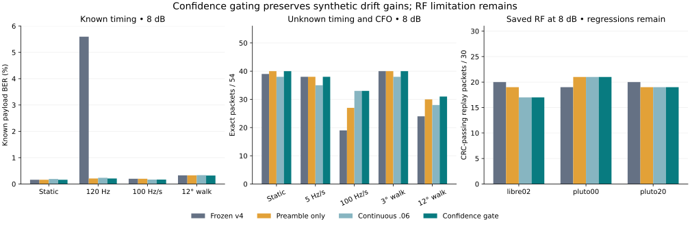

# Confidence-gated carrier tracking

Performed **2026-10-23**, offline only. Status: **experimental; RF regression
remains**. This revision keeps v5.1 acquisition, the libre01-derived 134.0815°
geometry, its 64-symbol carrier initializer and the free three-symbol sequence
path. It changes when continuous tracking runs. No radio, firmware, console,
live receiver, service or physical connection was accessed.

The gate keeps the synthetic ramp benefit while avoiding most tracking noise in
static tests. Noisy synthetic packets improve **442/540 → 452/540**. It does
**not** fix the saved-RF packet regression: **147/180**, versus 149/180 for the
preamble-only control and frozen v4. This is a useful partial result, not a live
receiver upgrade or a universally better detector.

## Training boundary and selection

Only **libre01 and fresh synthetic training realizations** selected settings.
[The protocol](protocol.json) was saved before the sweep. Synthetic seed 1063301,
libre01 noise seed base 1070000 and development seed 1080001 are separate from
all earlier training and stress realizations. The new synthetic training uses
IID payloads, 24-bit runs and one-per-48 sparse bits, with static, ±84/156 Hz
offsets, ±8/80/160 Hz/s ramps and 5°/18° phase walks. It includes:

- 216 symbol-level cases: three patterns × eight profiles × 4/8/12 dB × three trials.
- 60 whole-excerpt cases: three patterns × five profiles × 4/8/12 dB/no-added-AWGN.
- 49 libre01 trials: one clean plus 16 each at 4/8/12 dB, with unknown shifts,
  carrier offsets, phases and gains.

The unchanged acquisition misses six synthetic and six libre01 training cases,
all at 4 dB. These are retained; all methods share those failures. The 313 aligned
cases supply known-bit errors: 304 independently known payload bits in synthetic
cases and 156 disjoint preamble bits in libre01. Captured body replay bytes are
not used to select the gate. No CRC answer chooses a receiver branch.

The 18 candidates combine drift-score thresholds 3/5/8, minimum rates 0/20 Hz/s
and symbol decision-gap cutoffs 0/2/4. Alpha stays .06. Eligibility requires **no
trial-level known-bit error increase against preamble-only correction** in any
aligned static synthetic or libre01 training trial. Among eligible candidates,
minimize all training known-bit errors; ties favor the more restrictive gate.
The saved fallback is preamble-only if no gate is eligible. All 18 qualify here.

Selected: **drift score≥3, |estimated drift|≥20 Hz/s, decision gap 0**. Total
training errors are **1,768**, versus 1,810 preamble-only and 1,857 continuous.
It enables tracking on 107/313 aligned training cases and has zero protected-trial
regressions. Positive per-symbol decision cutoffs increased training errors;
therefore the selected revision uses **frame-level drift confidence only**.
The per-symbol gate is implemented and tested, but is inactive at cutoff 0.

[Training source](train.py) · [Full candidate/trial ledger](training.json) ·
[Selected model](model.json) · [Pre-replay freeze](selection.json)

Source, model, training, protocol, harnesses, tests and dependency hashes were
frozen at **2026-10-23 22:38:58 UTC**, before any new held-out evaluation. No
setting or receiver source changed afterward. Earlier outcomes already informed
the research question, and all evaluation inputs were previously examined, so
this remains **retrospective reused-input evaluation**, not a new prospective
holdout. No new numerical repair or second freeze was needed in this revision.

## What confidence means here

For known symbols 0..63 and 224..287, remove the known learned-state waveform and
estimate frequency by FFT/interpolation within ±300 Hz at the symbol rate. Fit a
complex gain, then derive an approximate phase-slope standard error from the
pilot residual phases. Let early/late frequencies be f0/f1 and their standard
errors s0/s1. The frame gate uses:

```text
drift_rate = (f1 - f0) / (224 / 1200)           # Hz/s between pilot centers
score = abs(f1 - f0) / sqrt(s0*s0 + s1*s1)
track only if score >= 3 and abs(drift_rate) >= 20
```

This is an **AWGN-style heuristic score**, not a calibrated three-sigma probability.
Filter distortion, phase walks and correlated errors violate its simple error
model. The measured pilot-frequency difference need not equal physical oscillator
acceleration. No true timing, frequency, phase trajectory or payload is supplied.
Acquisition still searches the complete excerpt using the unchanged v5.1 code.

When disabled, return the **exact v5.1 alpha=0 preamble-only decisions**. When
enabled, use the inherited alpha=.06 second-order loop. The implemented optional
symbol confidence is `(distance_to_other² - distance_to_selected²) / noise_variance`
with nonnegative distances ordered by the nearest learned state; noise variance
comes from the early-pilot residual. A rejected update preserves the NCO frequency
and lets its phase free-run. Selected cutoff 0 accepts all 744 eligible updates.
No known bits or CRC constrain the final sequence path.

The late pilot lies after the start of tracking, so this gate is **noncausal**
for early symbols: the offline implementation buffers the frame, then tracks from
symbol 64. It has not been tested as a streaming or hardware receiver. The final
trellis already uses full-frame traceback and overlapping composite likelihood,
not exact whole-frame ML.

[Receiver](receiver.py) · [Seven behavioral tests](test_receiver.py)

## Frozen synthetic replay

All prior **3,240 detector cases** and **570 full-receiver cases** rerun, with
unchanged payloads, nuisance draws and inputs. Continuous and preamble-only
comparators are rerun too; every comparator decision matches the previous v5.1
archive. Every full synthetic IQ SHA256 reproduces, and all 570 acquisition outputs
match v5.1 exactly: **540/540 noisy +30/30 no-added-AWGN correct starts**, no misses
or wrong starts. No gate can improve acquisition in this experiment because it
runs afterward.

At 8 dB in the known-timing layer, each row scores 54,720 independent payload bits:

| Profile | Frozen v4 errors | Preamble-only | Continuous | Gated | Gate enabled /180 |
| --- | ---: | ---: | ---: | ---: | ---: |
| Static | 88 | 88 | 104 | **88** | 0 |
| Residual 24 Hz | 104 | 96 | 114 | **96** | 0 |
| Residual 120 Hz | 3,061 | 115 | 129 | **115** | 0 |
| ±100 Hz/s ramp | 109 | 109 | 92 | **92** | 180 |
| 3° phase walk | 100 | 100 | 107 | 100 | 13 |
| 12° phase walk | 180 | 180 | 184 | 176 | 114 |

Thus static 8 dB BER returns to **0.1608%**, and residual 120 Hz is **0.2102%**.
The constant-offset gain is still preamble frequency estimation, not continuous
tracking. All 12 dB detector profiles have zero payload errors. At 4 dB, inherited
preamble-only correction still gives 3,285 static errors versus 3,281 for v4, and
phase-walk losses remain; turning tracking off is not identical to returning to
v4's different carrier/acquisition path. One 3°-walk 8 dB packet is lost relative
to preamble-only despite equal aggregate payload errors. Full decisions, CRCs,
per-pattern results and these small regressions remain in the archives.

| Full receiver, 8 dB | v4 packets | Preamble-only | Continuous | Gated | Gate on /54 |
| --- | ---: | ---: | ---: | ---: | ---: |
| Static | 39 | 40 | 38 | **40** | 0 |
| ±5 Hz/s ramp | 38 | 38 | 35 | **38** | 0 |
| ±100 Hz/s ramp | 19 | 27 | 33 | **33** | 54 |
| 3° phase walk | 40 | 40 | 38 | **40** | 3 |
| 12° phase walk | 24 | 30 | 28 | **31** | 35 |

At 8 dB: **182/270 gated packets**, versus 172 continuous, 175 preamble-only and 160
v4. There are 11 recoveries and one regression against continuous tracking; seven
recoveries and zero regressions against preamble-only; 22 recoveries and zero
regressions against v4. All 270 12 dB packets pass, as do all 30 no-added-AWGN cases.
Noisy total is **452/540**, versus 442 continuous, 445 preamble-only and 419 v4.

On the same 82,080 8 dB payload bits, errors fall 176 continuous →152 gated
(preamble-only 162). On the 76,912 bits acquired by both v4 and the new path,
errors are 158 v4 →150 gated. These comparisons keep the denominator fixed;
all-trial packet counts retain acquisition failures in the earlier baseline.
The full ramp cell is exactly unchanged from continuous tracking: 42 payload
errors and 33 packets. Its improvement over preamble-only is 10 fewer errors on
16,416 bits, approximate paired trial-block BER delta −0.0609 percentage points
(95% interval −0.1123..−0.00958). This finite-model pilot does not establish an RF
performance curve or a generally calibrated gate.

## Held-out RF captures: remaining limitation

All **214 capture input hashes** match the earlier harness. The three clean
held-out frames pass with zero known-bit errors. All 180 noisy starts still align,
and all 90 12 dB packets pass. The 8 dB packet counts are:

| Capture /30 trials | v4 | Preamble-only | Continuous | Gated | Gate on |
| --- | ---: | ---: | ---: | ---: | ---: |
| libre02 | 20 | 19 | 17 | **17** | 20 |
| pluto00 | 19 | 21 | 21 | **21** | 0 |
| pluto20 | 20 | 19 | 19 | **19** | 7 |

Gated total remains **147/180 noisy RF packets**, equal to continuous tracking,
below 149/180 preamble-only and v4. Against continuous tracking there are two
recoveries and two regressions. Against preamble-only there are two regressions
and no recoveries, both on libre02. Against v4: four regressions and two recoveries.
Equal packet totals do not mean equal failed frames; every case is retained.

On the common **13,884 disjoint preamble bits** in mutually acquired 8 dB trials,
errors are 24 v4 →26 gated, versus 30 continuous. All newly aligned trials give
26/14,040 gated, versus 22 preamble-only. The scored symbols 68..223 exclude both
pilot fields, unlike the legacy 184-bit scorer (retained as 34/16,560). Pilot
correlation and selection still make this conditional preamble BER; captured
bodies remain clean-decode replay references, not independently saved TX truth.
CRC success is not hardware payload BER or native application acceptance.

Why did the RF condition remain? The clean recordings' two-pilot estimates are
about **−20.50 Hz/s libre02, −14.30 pluto00 and −18.20 pluto20**. They sit near the
trained 20 Hz/s cutoff: the gate enables on libre02 and some noisy pluto20 frames.
That evidence of a frequency difference does not guarantee a noisy decision-
directed loop will help. It may include waveform/filter bias or correlated phase
noise; these recordings alone do not separate those causes. No cutoff was moved
after seeing these values. A confidence gate trained on libre01 did not generalize
enough to remove this RF regression.



## Connection to the paper

The paper's true symbol-center carrier reference isolates finite integration
loss, approximately sinc²(nu). Its phase-3 preamble frequency estimate followed
by a phase correction is closer to the preamble-only ablation. Here the large
constant residual-offset penalty is corrected without running the loop; the gate
only adds tracking when the early/late pilot measurements support drift. This
preserves the large-ramp benefit while avoiding continuous injection of decision
noise on static synthetic frames.

The RF outcome exposes an assumption missing from an ideal carrier-reference
curve: confidence in an estimated drift is not confidence that the chosen noisy
tracking loop will improve packet decisions. Geometry, differentially decoded
bits, structured hardware preamble, filters, pilot bias and finite estimation
errors still matter. The hardware 0x55/sync fields are not the paper's PN sequence.
No earlier ideal controls or paper curves were changed/recomputed to match this
new receiver. See the [v5 paper comparison](../offline-tracking-v5/README.md) and
[original controls](../offline-synthetic-stress/paper-control.csv). This experiment
does not establish calibrated analog sensitivity, fading performance or new RF BER.

## Reproduce and inspect

Python 3/NumPy only; run in this directory. Model/source hashes must match the
selection before replay; training invalidates a freeze if it changes anything.

```sh
OPENBLAS_NUM_THREADS=1 python3 -m unittest test_receiver.py
# Uses only libre01 and the separate synthetic training generator.
OPENBLAS_NUM_THREADS=1 python3 train.py
# For a frozen rerun, archive existing outputs first; stress refuses overwrite.
OPENBLAS_NUM_THREADS=1 python3 run.py
OPENBLAS_NUM_THREADS=1 python3 stress.py detector
OPENBLAS_NUM_THREADS=1 python3 stress.py full
python3 analyze.py
python3 compare_controls.py
```

Seven behavioral tests pass: exact gate-off fallback, clean static behavior,
tracking a ramp with unforced payload bits, rejected-update free-running,
gain/phase invariance, invalid/zero inputs and reduced update counts with positive
symbol confidence cutoffs. Independent counting reconstructs every synthetic
metric from true frame bytes, decisions and CRC; all control decisions reproduce.
The 16 frozen dependencies remain unchanged after replay. Thirty noise-only
controls yield zero detections, not a general false-alarm qualification.

Intervals treat whole frames as Monte Carlo blocks. Nonzero BER uses an
approximate trial-block normal interval; zero-error rows use a conservative
zero-error trial bound. Paired all-zero differences have no estimated interval.
Packet intervals use Wilson counts on all trials. Per-pattern noisy full cells
have only nine frames. These model-conditional intervals are not independent
hardware confidence limits.

[Audit](audit.json) · [Capture comparison](capture-comparison.csv) ·
[RF source breakdown](capture-by-source.csv) · [RF paired trials](capture-paired-trials.csv) ·
[RF regressions](capture-regressions.json) · [Stress summary](stress-summary.csv) ·
[Pattern summary](pattern-summary.csv) · [Gate versus controls](gate-vs-controls.json) ·
[Shared v4 trials](paired-stress.json) · [Acquisition/packet changes](stress-failures-and-changes.json) ·
[Detector decisions](detector-trials.jsonl.gz) · [Full receiver decisions](full-trials.jsonl.gz) ·
[Changed control packets](packet-control-changes.jsonl.gz) · [RF decisions](trials.jsonl) ·
[Analyzer](analyze.py) · [Control comparison source](compare_controls.py) · [Plot source](plot.py)

Keep this result frozen. A further training-only investigation could model pilot
bias and correlated phase noise using libre01, or test whether loop benefit itself
can be predicted reliably. Do not move the threshold to rescue libre02/pluto
outcomes. Prospective validation still needs new captures with independently saved
TX payload bytes; no receiver has been deployed by this offline experiment.
