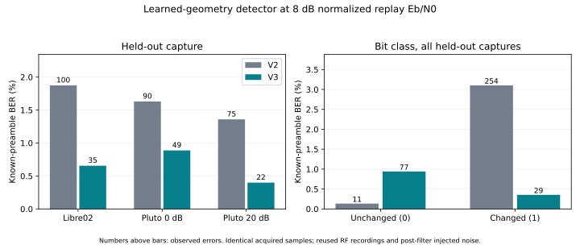

# Learned-geometry detector comparison — 2026-10-23

This offline follow-up tests a detector that accounts for the measured roughly
135° phase separation. The [v2 acquisition receiver and results](../offline-start-v2/README.md)
remain unchanged. **Only libre01 IQ is used for development**; the selected
receiver is frozen before rerunning the same held-out cases. No hardware access,
RF commands, live modem changes or original-input edits occur.

## Detector and fixed acquisition

The previous detector declares a change when Re(z[k] conj(z[k−1])) < 0. That rule
places a phase-difference boundary at 90°. The recorded states are about 134°
apart, which gives changed symbols a smaller margin than unchanged symbols.

V3 uses the two complex state means already learned from libre01. For an observed
adjacent pair y = [z[k−1], z[k]], form templates v00, v01, v10 and v11 from those
means. For each template, fit one unknown complex gain a by least squares:

```
a_hat = (vᴴ y) / (vᴴ v)
score(v) = |vᴴ y|² / (vᴴ v)
selected_pair = argmax score(v)
bit[k] = previous_state XOR current_state
```

Maximizing this score minimizes ||y − a v||². This is a **pairwise generalized
likelihood-ratio detector** under a common complex gain per pair and equal-variance
complex Gaussian symbol noise. It uses both the learned phase separation and
amplitude ratio, and fits nuisance gain/phase from each observed pair. It is not
an optimal sequence decoder, coherent phase tracker, or isolated ablation of phase
angle versus amplitude geometry/decision rule. Adjacent bit decisions share a
symbol, so their errors need not be independent. Bit zero still has no observed
predecessor and is explicitly unscorable.

The wrapper calls the **unchanged v2 acquisition source**, then integrates at its
returned start/CFO and replaces only the bit decisions. No CRC, expected body,
sequence, clean test geometry, true CFO or true timing selects decisions. The
model JSON is byte-identical to v2, including its threshold and state geometry.
`acquire(iq, model)` receives no evaluation reference. An exactly antipodal model
reduces this pair detector to the old sign rule; a behavioral test verifies that
on 999 random adjacent pairs. Other tests cover all state transitions with unknown
phase/gain, changed pairs inside 90°, invalid geometry, CRC-failure retention,
unknown timing/CFO and the previous acquisition edge cases (ten tests total).

## Training-only selection

`train.py` opens only libre01 IQ and its isolated [training metadata](training-source.json).
One new detector candidate is compared with v2 on the same clean training waveform,
60 noisy replays (30 at 8 and 12 dB, independent training seeds 55001–55003) and
30 noise-only windows (860000–860029). The previous training noise seeds were not
reused. Acquisition is identical pair by pair; one 8 dB training case is missed by
both versions. Only aligned cases contribute known-preamble BER.

| Training point | Aligned / all, both | V2 errors / scored bits | V3 errors / scored bits | V2 frames | V3 frames |
| --- | --- | --- | --- | --- | --- |
| Clean | 1/1 | 0/184 | 0/184 | 1/1 | 1/1 |
| 8 dB | 29/30 | 95/5,336 (1.78%) | 29/5,336 (0.543%) | 2/30 | 2/30 |
| 12 dB | 30/30 | 6/5,520 | 0/5,520 | 27/30 | 29/30 |

Both return zero candidates in the 30 training noise-only windows. Selection
requires fewer training preamble errors at 8 dB and overall, identical acquisition,
a valid clean frame and no training noise candidates. CRC/frame counts and body
reference errors do not select the detector. The [selection record](selection.json), saved at 19:39:37 UTC,
freezes wrapper/model, v2 acquisition dependency and development hashes **before**
held-out execution. No detector or acquisition changes are made after inspection
of the v3 held-out results.

## Paired held-out evaluation

The harness repeats the same 214 cases as v2: three clean held-out captures,
180 noisy held-out cases (30 per capture at 8/12 dB), 30 noise-only windows and one
training clean check. The entire 192,000-sample excerpts are searched; timing/CFO
are not supplied. Existing truth is used only by the evaluator for normalization,
noise construction and post-output scoring. The unknown injected delay ±40,000
samples, CFO ±1,500 Hz, phase ±π and gain 2^U, U uniform [−1,1], use unchanged
seeds/draw order. Exact input IQ hashes, every acquisition output and the saved
baseline bit decisions must match v2 before comparing detectors.

Correct starts are within 20 samples of the clean reference plus injected delay.
BER scores the same 184 independently specified preamble bits 68–251 on shared
aligned cases. Every miss remains in all-trial acquisition/frame denominators;
CRC never gates BER. Frame success is exact sync plus outer CRC32/header checks.
Per-bit-class counts distinguish unchanged bit 0 from changed bit 1. Body-error
counts are clean-decode replay-reference comparisons, **not independent TX-body BER**.

## Results

All 214 input IQ hashes match v2 exactly. Detection decisions, start samples,
CFO estimates, scores and baseline decision bytes also match exactly. Acquisition
remains **179/180** noisy trials, with the same one miss and zero wrong starts.
The 30 noise-only controls still emit no candidates. All three clean held-out
captures decode with zero errors in 552 known preamble bits and valid frames.

| Capture | Replay Eb/N0 | Shared scored bits | V2 errors (BER) | V3 errors (BER) | V2 frames / all | V3 frames / all |
| --- | --- | --- | --- | --- | --- | --- |
| libre02 | 8 | 5336 | 100 (1.874%) | 35 (0.6559%) | 0/30 | 1/30 |
| libre02 | 12 | 5520 | 7 (0.1268%) | 0 observed | 23/30 | 30/30 |
| pluto00 | 8 | 5520 | 90 (1.63%) | 49 (0.8877%) | 2/30 | 0/30 |
| pluto00 | 12 | 5520 | 1 (0.01812%) | 0 observed | 25/30 | 30/30 |
| pluto20 | 8 | 5520 | 75 (1.359%) | 22 (0.3986%) | 0/30 | 5/30 |
| pluto20 | 12 | 5520 | 5 (0.09058%) | 0 observed | 28/30 | 30/30 |



At **8 dB**, both detectors score the same **16,376 bits in 89 aligned trials**:

- V2: **265 errors / 16,376 = 1.618%**.
- V3: **106 errors / 16,376 = 0.6473%**, a **60% reduction in observed errors**.
- The paired comparison fixes 225 former bit errors and introduces 66 new ones.
  The paired trial-block BER change is −0.971 percentage points, with approximate
  95% interval **−1.180 to −0.762 percentage points**, conditional on these fixed
  acquired waveforms. This is not a confidence interval over new RF realizations.

The bit-class result explains the tradeoff. On 8,188 scored bits per class at 8 dB:

| Known bit | V2 errors (BER) | V3 errors (BER) |
| --- | --- | --- |
| 0: unchanged phase state | 11 (0.1343%) | **77 (0.9404%)** |
| 1: changed phase state | 254 (3.102%) | **29 (0.3542%)** |

At **12 dB**, V2 has 13 errors / 16,560 known bits; V3 has **zero observed errors**
in those same 90 trials. Zero observed errors do not establish zero true BER.
The conservative independent-trial zero-error bound used in the saved per-capture
intervals is intentionally much wider than an IID-bit bound; sparse tails should
be read from their counts, not treated as a precise BER curve.

Frame success rises from **78/180 to 96/180** overall: 20 frames recover and two
regress. At 8 dB the total is 2/90 → 6/90 (six recoveries, two regressions); at
12 dB it is 76/90 → 90/90. Both regressed frames are Pluto00 at 8 dB, seed 73192,
trials 0 and 2. Their new body differences from the clean replay reference are
all 0→1 decisions (three and two bits respectively); one also has a sync error.
Those [regressions](frame-regressions.json) are retained, not filtered by CRC or
removed from the result. The body reference is not independently saved TX truth.


## Interpretation and limits

The learned-geometry detector improves **conditional known-preamble BER on every
held-out capture at 8 dB**, with acquisition held exactly fixed. This ties back to
the paper: part of the large measured penalty came from a detector suited to
antipodal states, rather than an unavoidable cost of the transmitter alone.
The new detector accounts for the actual learned **134.0815° separation and
1.06758 amplitude ratio** without requiring long-term coherent phase tracking.
It does not reproduce the paper's ideal coherent detector, eliminate the remaining
waveform/receiver penalty, or establish a universal sensitivity/dB improvement.
This comparison changes the entire pair decision rule as well as using geometry;
it does not isolate a phase-only effect.

False transitions increase despite the improvement on balanced known preamble
bits. Long runs of zeros can therefore behave differently, as the two packet
regressions demonstrate. No unknown-payload or hardware BER qualification follows
from the preamble result, and the detector should not replace the live receiver
on these results alone. The test suggests investigating pair-likelihood/state
sequence detection with training-only, independently known varied payloads;
retain the baseline detector as a comparison.

These are **retrospective reused RF recordings**. Previous outcomes were known,
but only libre01 IQ was used to select this new detector, and just one new detector
candidate was run against the held-out set. The periodic acquisition stage can
observe the scored preamble; both detectors share that exact selection, so the
paired comparison isolates decisions conditional on acquisition rather than
unconditional unknown-data BER. Trial-block intervals allow adjacent decision
dependence but remain conditional on three fixed RF recordings. Noise is injected
at the post-filter 48 ksample/s plane, so it is normalized replay Eb/N0, not
calibrated analog sensitivity. Prospective known-payload captures, pre-filter noise,
more RF realizations and continuous-stream checks remain open. No receiver or
threshold was adjusted after seeing these held-out results.


## Files and reproduction

[Receiver](receiver.py) · [frozen model](model.json) · [training script](train.py) ·
[all training decisions](training-trials.jsonl) · [training counts](training-summary.csv) ·
[pre-evaluation selection](selection.json) · [tests](test_receiver.py) · [test output](tests.txt)

[Held-out harness](run.py) · [all trial decisions](trials.jsonl) ·
[counts](summary.csv) · [paired BER/frame comparison](paired-summary.csv) ·
[bit-class errors](bit-class-summary.csv) · [conditional BER/frame intervals](intervals.csv) ·
[pairing validation](paired-validation.json) · [decision validation](validation.json) ·
[hash/count audit](audit.json) · [publication hashes](publication.json)

Keep this directory beside `offline-start-v2/` (unchanged acquisition and baseline)
and `offline-ber/` (published input NPZs and shared diagnostic). Python 3 and NumPy
suffice. From this directory:

```sh
OPENBLAS_NUM_THREADS=1 python3 -m unittest discover -s . -p 'test_receiver.py' -v
OPENBLAS_NUM_THREADS=1 python3 train.py
python3 select.py
OPENBLAS_NUM_THREADS=1 python3 run.py
python3 analyze.py
python3 compare.py
python3 audit.py
```

These commands replace derived files here; archive before reproducing. The saved
selection is the original pre-evaluation record; reproduction changes its timestamp
and wall times, not intended decision/count results. For a single offline decode
without evaluation truth: `python3 decode.py ../offline-ber/pluto20-48k.npz`.
`plot.py` additionally requires Matplotlib and derives its figure from the paired
count CSV. Original course-project files, IQ, and v1/v2 results remain unchanged.
