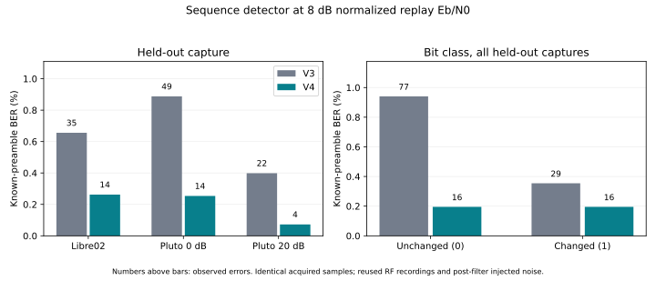

# Sequence detector with shared phase-state decisions — 2026-10-23

This offline follow-up tries to reduce v3's false transitions without losing its
known-preamble BER gains. The [v3 pair detector and results](../offline-geometry-v3/README.md)
remain unchanged. Development uses **libre01 IQ only**. Acquisition, its threshold
and learned phase geometry remain fixed; only sequence decisions change.
No hardware access, RF commands, live receiver changes or original-data edits occur.

## Detector

V3 independently fits unknown complex gain/phase to each adjacent symbol pair.
Overlapping pairs can prefer incompatible state labels. V4 instead requires
local windows to agree on one binary phase-state sequence across the entire
808-symbol heartbeat observation. For a candidate path s and window length L:

```
v_k(s) = [mu[s[k]], ..., mu[s[k+L-1]]]
J(s) = sum_k |v_k(s)ᴴ z[k:k+L]|² / ||v_k(s)||²
selected_path = argmax_s J(s)
bit[k] = s[k] XOR s[k-1]
```

Each term profiles out its own unknown complex gain and is equivalent to a
local least-squares residual score. A Viterbi trellis with 2^(L−1) states maximizes
the sum exactly. **The sum is a composite profile-likelihood objective**: overlapping
windows reuse observations, and nuisance gains are fitted separately. It is not
exact whole-frame AWGN maximum likelihood or a claim of optimal sequence BER.
The same learned 134.0815° state separation and 1.06758 amplitude ratio are used.

There is **no transition penalty or zero-heavy payload prior**. Both initial phase
states are free. No known preamble, sync, header, CRC, guard bits, expected body or
sequence number constrains the state path. Those fields are used only for the
unchanged acquisition or by the evaluation harness after decisions. Bit zero
remains unscorable because its preceding symbol was not observed. The algorithm
uses the full fixed-length frame and a backward traceback; live-stream latency,
resource use and framing integration are not validated here.

The wrapper calls unchanged v3/v2 code to reproduce the pair baseline and acquire
start/CFO, then replaces only decisions. `acquire(iq, model)` receives no timing,
CFO or body truth. The model has the same previous fields plus the selected
`sequence_window`. No held-out geometry is learned.

## Training-only selection

The bounded candidate set is **L = 3, 5, 7**. `train.py` opens only libre01 IQ,
with isolated [training metadata](training-source.json). Every candidate uses
the same acquisition result and symbols for each case. There are 60 noisy
training replays, 30 at 8/12 dB with separate seeds 66001–66003, plus one clean
case and 30 noise-only windows (870000–870029). Each has the same delay/CFO/phase/
gain/noise distributions as before; these are new training noise seeds, not new RF
bursts. The one 8 dB training miss is shared by all versions.

| Detector | 8 dB errors / 5,336 bits | 8 dB false changes / 2,668 zeros | 8 dB missed changes / 2,668 ones | 8 dB frames / 30 | 12 dB errors / 5,520 bits |
| --- | --- | --- | --- | --- | --- |
| V3 pair | 24 | 17 | 7 | 2 | 1 |
| L=3 | **6** | **3** | **3** | 22 | 0 |
| L=5 | 6 | 3 | 3 | 22 | 0 |
| L=7 | 8 | 4 | 4 | 22 | 0 |

All have a valid clean frame and emit zero candidates in the 30 training noise-only
windows. Eligibility requires no increase in preamble errors at either point,
fewer 8 dB false changes, identical acquisition and the clean/control checks.
Among eligible windows, selection minimizes total false changes, then errors,
then window length. **L=3 wins the tie with L=5**, giving a four-state trellis.
No noisy CRC/frame or body-reference count is optimized in selection.

Fourteen behavioral tests pass on the selected configuration. They include an
independent exhaustive 2^8-path check of the trellis objective at all three window
lengths, varied noiseless states under unknown gain/phase and slow drift, a context
example rejecting pairwise false changes, invalid inputs and the previous
acquisition/pair-detector tests. The [selection record](selection.json), saved at 19:57:11 UTC, freezes
source/model, both code dependencies, training evidence and harness hashes before
held-out execution. Only the selected L=3 version is evaluated on held-out IQ in
this follow-up, with no later detector or parameter changes.

## Paired held-out protocol

The exact same 214 cases are replayed: three clean held-out captures, 180 noisy
cases (30 per libre02/pluto00/pluto20 capture at 8/12 dB), 30 noise controls and
one clean training check. Exact IQ hashes and all acquisition outputs must match
v3, including its saved pair decision bytes. The full four-second excerpt is
searched with no supplied timing or CFO. The evaluator alone uses old clean
reference timing/energy/CFO to normalize, inject noise and score outputs.

Unknown nuisance values remain integer delay ±40,000 samples, additional CFO
±1,500 Hz, phase ±π and gain 2^U (U uniform [−1,1]), with the same seeds/draw order.
Correct starts are within 20 samples of the old clean start plus delay. Both
detectors score exactly the same 184 known preamble bits 68–251 on shared aligned
cases; misses remain in acquisition/frame denominators. CRC never gates BER.
Frame success is exact sync plus outer CRC32/header checks. The body is compared
only with a clean-decode replay reference, not independently retained TX bytes.

## Results

All 214 IQ hashes, acquisition outputs and saved pair-detector decisions match
v3 exactly. Acquisition stays **179/180 noisy cases**, with the same one miss
and no wrong starts. All three clean held-out captures pass with zero errors in
552 known bits. Noise-only controls stay 0/30; their one-sided 95% upper bound
still permits 9.50% candidate probability per four-second window. These reused
controls cannot be pooled across versions as new independent observations.

| Capture | Replay Eb/N0 | Shared known bits | V3 errors (BER) | V4 errors (BER) | V3 frames / all | V4 frames / all |
| --- | --- | --- | --- | --- | --- | --- |
| libre02 | 8 | 5336 | 35 (0.6559%) | 14 (0.2624%) | 1/30 | 20/30 |
| libre02 | 12 | 5520 | 0 observed | 0 observed | 30/30 | 30/30 |
| pluto00 | 8 | 5520 | 49 (0.8877%) | 14 (0.2536%) | 0/30 | 19/30 |
| pluto00 | 12 | 5520 | 0 observed | 0 observed | 30/30 | 30/30 |
| pluto20 | 8 | 5520 | 22 (0.3986%) | 4 (0.07246%) | 5/30 | 20/30 |
| pluto20 | 12 | 5520 | 0 observed | 0 observed | 30/30 | 30/30 |



At **8 dB**, both detectors score the same **16,376 bits in 89 acquired trials**:

- V3 pair: **106 errors = 0.6473%**.
- V4 sequence: **32 errors = 0.1954%**, **69.8% fewer observed errors** than v3.
- False changes: **77 → 16**, a **79.2% reduction** on 8,188 known zero bits.
- Missed changes: **29 → 16**, on 8,188 known one bits.

Thus the false-transition reduction does not sacrifice the previous average
preamble BER gain in this held-out budget. Each of the three recordings improves
in average 8 dB preamble BER. V4 is also below the original sign detector's
265 errors on these same acquired bits, although its 16 false changes remain
above that detector's 11. This is not domination of every baseline metric.
The paired comparison fixes 84 previous bit errors and introduces ten new ones.
The mean paired BER change is **−0.452 percentage points**, approximate 95%
trial-block interval **−0.578 to −0.325 percentage points**, conditional on these
fixed acquired recordings. It is not an interval over new RF realizations.

At **12 dB**, both have zero observed preamble errors on 16,560 bits and 90/90
valid frames. Neither true BER equality nor zero true BER follows. The paired
normal interval is left unavailable when every observed trial difference is zero,
rather than publishing a misleading zero-width interval. Saved zero-error bounds
remain conservative independent-trial bounds, not fictitious IID-bit bounds.

Frame success improves **96/180 → 149/180**: 54 recoveries and **one regression**.
At 8 dB it is 6/90 → 59/90, with all cases retained in the denominator; at 12 dB
it stays 90/90. Both previously documented v3 regressions against v2 now pass.
The new regression is Pluto20, 8 dB, seed 73191, trial 0: sync is correct, but
body-reference positions 490/491 change from 00 to 11 and outer CRC fails.
[Regression details](frame-regressions.json) retain this case and the earlier-case
checks. Body differences remain comparisons to a clean-decode reference, not
independently saved TX truth. Adjacent differential-bit errors can result from a
state error; packet outcomes must not be inferred from an IID-bit BER formula.


## Interpretation and limits

A shared state path substantially reduces the pair detector's false changes and
improves its known-preamble BER on these reused recordings. The training-selected
four-state trellis does this without a zero-heavy payload prior, forced known
bits or changed acquisition. It is a useful demonstration of why waveform geometry
and detector memory matter in connecting the hardware to the paper's ideal model.
It does not prove exact maximum-likelihood performance or a universal RF noise
margin benefit. Only two normalized replay noise points were tested here.

The result is **retrospective**: earlier v3 held-out outcomes were known, while
all three new windows were selected using libre01 only and just L=3 was evaluated
on held-out IQ. There is no held-out retuning. The acquisition stage can observe
the scored preamble, and this detector uses future symbol context and full-frame
traceback. Reported BER remains conditional on the same known-data acquisition;
it is not a live-stream or unknown-payload BER qualification. Full TX-body truth
is still unavailable. The one retained miss and new packet regression prevent
claiming perfect reception.

Noise is added after receive filtering at the 48 ksample/s replay plane. Recorded
waveforms are fixed, with only three held-out RF events, so Monte Carlo intervals
do not cover hardware/channel diversity or calibrated analog sensitivity. Next,
freeze this receiver as a candidate and test varied independently known payloads,
phase drift/fading and longer stream boundaries using training/synthetic data;
reserve new RF captures with saved TX bytes and pre-filter noise for prospective
evaluation. Live integration, resource/latency measurements and RF qualification
remain future work. The operational receiver remains unchanged.


## Files and reproduction

[Sequence receiver](receiver.py) · [selected model](model.json) ·
[training script](train.py) · [all candidate training decisions](training-trials.jsonl) ·
[training counts](training-summary.csv) · [pre-evaluation selection](selection.json) ·
[behavioral tests](test_receiver.py) · [selected-configuration test output](tests.txt)

[Held-out harness](run.py) · [all held-out decisions](trials.jsonl) ·
[counts](summary.csv) · [paired BER/frame comparison](paired-summary.csv) ·
[bit-class counts](bit-class-summary.csv) · [conditional intervals](intervals.csv) ·
[pairing checks](paired-validation.json) · [decision checks](validation.json) ·
[hash/count audit](audit.json) · [publication hashes](publication.json)

Keep this directory beside `offline-geometry-v3/`, `offline-start-v2/` and
`offline-ber/` for unchanged dependencies, baseline decisions and public inputs.
Python 3 and NumPy suffice; from this directory:

```sh
OPENBLAS_NUM_THREADS=1 python3 train.py
python3 select.py --prepare
OPENBLAS_NUM_THREADS=1 python3 -m unittest discover -s . -p 'test_receiver.py' -v > tests.txt 2>&1
python3 select.py
OPENBLAS_NUM_THREADS=1 python3 run.py
python3 analyze.py
python3 compare.py
python3 audit.py
```

These commands replace derived files here; archive them before reproducing.
The saved selection is the original pre-evaluation record; reproduction changes
timestamps/wall times, not intended decision/count results. For a single offline
decode without evaluator truth: `python3 decode.py ../offline-ber/pluto20-48k.npz`.
`plot.py` additionally requires Matplotlib and plots saved counts. All original
course-project files, IQ and previous result directories remain unchanged.
