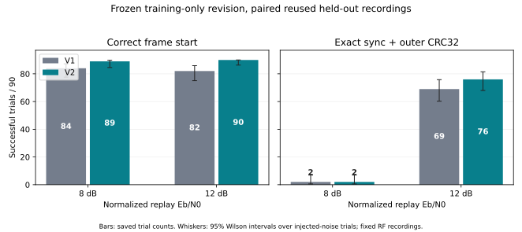

# Frame-start ambiguity revision — 2026-10-23

This offline follow-up preserves the [v1 receiver and its results](../offline-blind/README.md).
The goal is to improve unknown-start acquisition using **libre01 only** for development,
then freeze the receiver before reusing the same held-out trials. No hardware was
accessed, no RF command was sent, and no original IQ or previous result was overwritten.

## Change and training-only selection

V1 adds the complex correlation from the first 64 preamble symbols to that from
the 32-symbol sync field before taking magnitude. A residual frequency error can
rotate those fields against one another across the intervening 192-symbol gap,
creating cancellation and multiple narrow frequency maxima. This is a mechanism
suggested by the score's mathematics; the experiment does not establish that it
caused every prior failed candidate.

V2 gives each field its own unknown complex amplitude/phase. For a candidate
start and CFO, compute squared normalized correlation C_p and C_s in the early
preamble and sync separately, and rank with sqrt(C_p * C_s). Both fields support
the same start and CFO, but their correlation phasors cannot cancel across the gap.
CFO refinement uses the same separate-field magnitude objective. This also changes
field-energy normalization/weighting; the experiment tests this combined revision,
not an ablation isolating independent phase fitting from weighting.

The trained state geometry, 0.04 threshold, coarse periodic-window frequency search,
three frequency candidates, ±4 Hz initial offsets, local refinement grids,
integer-sample timing search, differential bit detector and protocol information
remain the same. The nominal coarse CFO range is ±12 kHz, followed by the existing
small local neighborhoods. There is no expected-body or CRC-based candidate selection,
and bad sync/CRC decisions are retained. `acquire(iq, model)` receives no true
start, CFO, sequence or capture identifier. The receiver is still a bounded
coarse-to-fine prototype, not an exhaustive joint estimator.

`train.py` opens **only libre01 IQ**, with its isolated training metadata in
[training-source.json](training-source.json). It compares v1/v2 on the identical
clean waveform, 60 noisy replays (30 each at 8/12 dB, seeds 44001–44003) and 30
noise-only windows (seeds 850000–850029). The nuisance delay/CFO/phase/gain and
post-filter noise distributions match the held-out harness but use separate seeds.
The version was selected on acquisition, not scored BER or CRC improvement:

| Training case | V1 correct start | V2 correct start | V1 sync + CRC | V2 sync + CRC |
| --- | --- | --- | --- | --- |
| Clean | 1/1 | 1/1 | 1/1 | 1/1 |
| 8 dB | 25/30 | 30/30 | 2/30 | 1/30 |
| 12 dB | 29/30 | 30/30 | 27/30 | 28/30 |

Both versions emit zero candidates in 30 training noise-only windows. V2 removes
six training wrong starts, while training frame counts are mixed. Six behavioral
tests pass, including a synthetic 2.5 Hz residual-CFO case that isolates start
ranking across the long gap, unknown delay/CFO signs/gain/phase, zero/invalid IQ,
and decision retention with a bad CRC. [selection.json](selection.json) freezes
source/model hashes and records selection at **19:06:01 UTC, before** held-out execution. No
threshold, geometry or receiver changes were made after inspecting v2 held-out results.
Only this one revised receiver was evaluated on the held-out set in this follow-up.

## Paired held-out evaluation

The held-out harness uses the same four-second libre02/pluto00/pluto20 excerpts,
three clean trials, 180 noisy trials (30 per capture at 8/12 dB), and 30 noise-only
controls as v1. Source hashes, seeds, draw order and transformations are unchanged;
all recorded nuisance values are checked pair by pair. V2 also logs each exact
input IQ hash. `run.py` refuses to execute unless the selected model/receiver
hashes match. Existing truth metadata is used **only outside the receiver** for
normalization, controlled noise generation and scoring after its output.

The complete 192,000-sample excerpts are searched. Each noisy trial applies an
unknown circular delay ±40,000 samples, added CFO ±1,500 Hz, phase ±π and gain
2^U, U uniform [−1,1]. The frame fits and the circular seam remains in idle data.
Correct starts are within half a symbol (20 samples) of the frozen clean reference
plus injected delay. Wrong starts/misses remain separate from aligned BER.
Frame success requires exact sync plus outer CRC32/header checks, with all 30 trials in the denominator.

These are **retrospective, reused held-out recordings**: previous v1 outcomes were
known before this revision. The new receiver was selected using training IQ only,
but this is not fresh prospective evidence or three new hardware bursts. Injected
noise is added after receive filtering at the normalized 48 ksample/s replay plane,
so the dB values are replay Eb/N0, not calibrated RF sensitivity. The initial
periodic acquisition search can observe the known scored preamble; conditional
preamble BER is not independent unknown-payload BER. Original body bytes remain
unavailable independently; body comparisons use clean-decode replay references.

## Results

All three clean held-out recordings still acquire and pass sync/CRC, with zero
errors in 552 known preamble bits. V2's largest clean CFO residual is 0.862 Hz,
compared with 0.338 Hz for v1; the revision was selected for start acquisition,
not for the smallest clean CFO residual.

| Capture | Replay Eb/N0 | Correct start / all | Misses | Wrong starts | Sync + CRC / all | Conditional preamble errors / bits (BER) |
| --- | --- | --- | --- | --- | --- | --- |
| libre02 | clean | 1/1 | 0 | 0 | 1/1 | 0/184 (0%) |
| libre02 | 8 | 29/30 | 1 | 0 | 0/30 | 100/5336 (1.874%) |
| libre02 | 12 | 30/30 | 0 | 0 | 23/30 | 7/5520 (0.1268%) |
| pluto00 | clean | 1/1 | 0 | 0 | 1/1 | 0/184 (0%) |
| pluto00 | 8 | 30/30 | 0 | 0 | 2/30 | 90/5520 (1.63%) |
| pluto00 | 12 | 30/30 | 0 | 0 | 25/30 | 1/5520 (0.01812%) |
| pluto20 | clean | 1/1 | 0 | 0 | 1/1 | 0/184 (0%) |
| pluto20 | 8 | 30/30 | 0 | 0 | 0/30 | 75/5520 (1.359%) |
| pluto20 | 12 | 30/30 | 0 | 0 | 28/30 | 5/5520 (0.09058%) |



Across the same 180 noisy cases, correct starts rise from **166/180 to 179/180**.
Thirteen previous wrong starts are recovered; the remaining previous wrong start
is now a below-threshold miss. There are **zero emitted wrong-start candidates**
and no previously correct start becomes a failure. This is not 180/180 acquisition:
libre02, 8 dB, seed 73193, trial 2 returns metric 0.030579 below the unchanged 0.04
threshold and contributes zero aligned BER bits. It remains in every all-trial
denominator. The threshold was not lowered after seeing this case.

Full frame counts rise from **71/180 to 78/180**, with seven recovered frames and
no regressions in this paired budget. At 8 dB, frames remain 2/90 for both versions;
at 12 dB they improve from 69/90 to 76/90. Thirty reused held-out noise-only controls
produce zero candidates. Their one-sided 95% upper bound remains 9.50% per
four-second window; do not pool those same windows across versions as 60 samples.
[Per-capture paired counts](paired-summary.csv) and [uncertainty intervals](intervals.csv)
retain the exact denominators. Intervals describe injected noise conditional on
these fixed recordings, not variability across RF hardware/channel realizations.


## What this establishes

Separately fitting the preamble and sync fields removes emitted frame-start
mistakes in this tested budget while retaining one acquisition erasure. That is
a useful receiver change, but not proof that periodic ambiguities are eliminated
for arbitrary recordings, longer streams or other CFO/noise conditions. There is
no fresh held-out population here, and no claim of deployment readiness.

The paper connection remains the same: known-preamble frequency/phase estimation
can prevent acquisition loss, while the roughly 135° waveform and current
differential detector retain a separate noise penalty. Correctly acquired 8 dB
trials still have **1.36–1.87% known-preamble BER**, and packet success at 8 dB is
unchanged. Conditional BER denominators differ because more cases now acquire;
those ratios are not a paired BER improvement test or independent payload BER.
Sparse 12 dB error counts also do not establish a waveform improvement.

The next training-only work should broaden coarse-CFO candidate coverage and
challenge the fixed threshold with longer noise/interference streams. Keep the
one missed held-out case as a reported limitation rather than tuning to it.
Reserve genuinely new captures with independently saved transmitted payloads
for prospective evaluation, and use pre-filter noise before analog sensitivity
claims. The source, model, threshold and selected revision remain frozen.


## Files and reproduction

- [Training source](training-source.json), [training script](train.py),
  [all training decisions](training-trials.jsonl), [training counts](training-summary.csv).
- [Frozen model](model.json), [receiver](receiver.py), [selection record](selection.json),
  [behavioral tests](test_receiver.py), [test output](tests.txt).
- [Held-out harness](run.py), [all held-out decisions and failures](trials.jsonl),
  [counts](summary.csv), [uncertainty intervals](intervals.csv).
- [Paired comparison](paired-summary.csv), [pairing validation](paired-validation.json),
  [decision recount validation](validation.json), [hash/count audit](audit.json),
  [publication hashes](publication.json).

Keep this directory beside `offline-blind/` (unchanged baseline source/ledger)
and `offline-ber/` (original published inputs, manifest and shared diagnostics).
Python 3 and NumPy suffice. From this directory:

```sh
OPENBLAS_NUM_THREADS=1 python3 -m unittest discover -s . -p 'test_receiver.py' -v
OPENBLAS_NUM_THREADS=1 python3 train.py
python3 select.py
OPENBLAS_NUM_THREADS=1 python3 run.py
python3 analyze.py
python3 compare.py
python3 audit.py
```

Training/selection and evaluation replace only derived files in this directory;
archive them before reproducing. Reproduction regenerates the selection timestamp
and wall times, but decision/count results should match. The saved selection record
is the original pre-evaluation record; it is not retrospectively regenerated for
publication. For a single decode without evaluation truth, use
`python3 decode.py ../offline-ber/pluto20-48k.npz`. These programs contain no radio,
serial or network operations. Original inputs and all v1 results remain unchanged.
