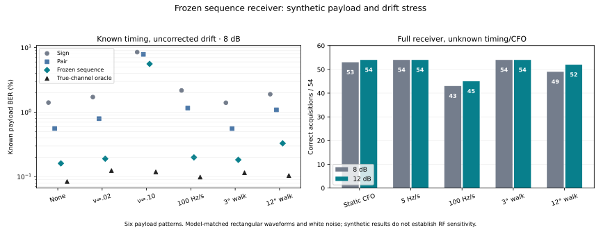

# Frozen receiver: synthetic payload and phase-drift stress — 2026-10-23

This is an offline stress test of the **unchanged, previously selected v4**
three-symbol/four-state sequence detector. No new detector, window, geometry,
threshold, acquisition rule or payload prior is selected. All four original
source/model hashes are checked before and after both runs. The previous capture
results and original paper/course-project files remain unchanged. No radio,
console, RF command or live receiver change is involved.

## Independent synthetic truth and signal model

Each transport frame contains the existing 256-bit 0x55 preamble, 32-bit sync,
7-byte version/sequence/length header, **38 independently generated payload bytes**,
outer CRC32 and 16 guard bytes: 808 differentially encoded symbols. The RF sequence
and payload bytes are retained per trial. These arbitrary payloads test transport
framing; they are not valid native application packets with a native CRC16, and
application/ground-station acceptance is not claimed.

Primary BER scores **all 304 payload bits at indices 344–647**, independently
known from the generator. It does not score only the old 0x55 preamble or use a
clean decode as TX truth. The patterns are all zeros, all ones, alternating 0x55,
32-zero/32-one runs, a one every 64 bits, and independent equiprobable random bits.
Every frame has a fresh random RF sequence, initial phase and nuisance gain.
No known payload/CRC forces the detector's state path or gates BER.

The transmitter model is a rectangular pulse at 1,200 symbols/s, 48 ksample/s,
40 samples/symbol, with the learned **134.0815°** phase geometry and **1.06758**
amplitude ratio. One common normalization makes the equiprobable-state average
symbol energy one. Complex white noise has variance N0 = 10^(−Eb/N0_dB/10),
N0/2 per real dimension. Gain 2^U (U uniform [−1,1]) multiplies signal and noise.
Actual payload mean symbol energy is saved because unequal state amplitudes and
pattern occupancy produce small departures from the reference Eb=1. No per-pattern
geometry is fitted. Common template scaling leaves the profile-likelihood rules
unchanged; a test checks that property.

These are **matched-model synthetic waveforms**, not new RF captures or a replay
of hardware pulse shapes. They omit analog filtering, measured ISI, clock/symbol
rate error, quantization, fading and IQ imbalance. Therefore they cannot establish
RF sensitivity or hardware unknown-payload BER. They can expose failures that the
single repeated heartbeat preamble did not exercise.

## Two separate tests

### Detector isolation: known timing, no acquisition

The receiver is given the correctly integrated 808-symbol vector. It is **not**
given true phase/drift. Integration uses the exact mean of exp(j phase) across
each 40-sample rectangular symbol, retaining within-symbol loss; independent
complex noise of variance N0 is then added, exactly equivalent to projecting
white sample noise through the unit-energy integrator. This is an explicitly
assisted timing test, not a blind acquisition claim.

Compare the unchanged sign rule, v3 pair GLRT, frozen v4 sequence rule and an
**oracle known-channel nearest-state detector**, followed by XOR to recover
original data bits. Only the oracle receives true channel gain/phase; it is a
diagnostic reference, not the paper's practical preamble estimator or a proposed
replacement.

| Profile | Synthetic phase behavior |
| --- | --- |
| static | Random constant phase; no residual frequency |
| residual002 | Uncorrected +0.02 cycles/symbol = +24 Hz |
| residual010 | Uncorrected +0.10 cycles/symbol = +120 Hz |
| ramp100 | Frequency starts at zero and ramps ±100 Hz/s; random sign per trial |
| walk3 | Wiener phase increments, 3° RMS per symbol |
| walk12 | Wiener phase increments, 12° RMS per symbol |

Wiener increments are generated per sample with symbol RMS divided by sqrt(40).
They are a phenomenological phase-noise model, not a measured oscillator spectrum.
The direction field in trial metadata applies to ramps; residual-frequency
profiles are positive, as in the paper's offset sweep.

Budget: 6 patterns × 6 profiles × 3 Eb/N0 points (4/8/12 dB) × 3 seeds
(79001–79003) × 10 trials = **3,240 frames**, each shared by four detectors.
Each pattern/profile/point scores 9,120 known payload bits, 54,720 over six patterns.
No detector/parameter change follows inspection of these results.

### Full frozen receiver: unknown timing and CFO

Generate the complete four-second, 192,000-sample IQ buffer, with random frame
start in [24,000,120,000], initial CFO uniform ±8 kHz, initial phase uniform ±π,
and the same gain/noise convention. Call the actual frozen `acquire(iq, model)`
without passing the true start/CFO/payload. All three bit detectors share that
one acquisition and returned start/CFO. Only evaluator scoring uses truth.

Profiles: static, ±5 Hz/s ramp, ±100 Hz/s ramp, walk3 and walk12. The unknown
constant CFO is added to each profile; it is not deliberately left uncorrected
like the detector-isolation residual profiles. The packet lasts 0.6733 s;
100 Hz/s changes frequency by about 67 Hz over it. Across the 192-symbol gap
between early training and sync, a ramp can challenge the fixed-CFO acquisition
model even when short-window sequence decisions remain useful.

Budget: 6 patterns × 5 profiles × 2 points (8/12 dB) × 3 seeds (81001–81003)
× 3 trials = **540 noisy frames**, plus one **no-added-AWGN** trial for each
pattern/profile = 30 more. Thus **570 total full-receiver trials**. The nine
trials per individual pattern/profile/point are an acquisition pilot, not a
precise threshold or operational false-alarm measurement. There are no new
noise-only controls in this follow-up; the earlier control budget is not enlarged.

A returned start within 20 samples of the known start is aligned. Unreturned or
wrong-start candidates contribute **zero BER bits** and remain acquisition
failures in all-trial packet denominators. Report conditional payload BER and
acquisition coverage separately. A correct packet requires exact sync/header/
payload/CRC recovery against independently generated truth and a valid outer CRC;
it does not require an error-free preamble. All returned decisions and failures
are retained. No expected body is supplied to the receiver.

## Comparison with the paper

The reviewed MATLAB driver uses **Ns=8, Eb=1**, coherent BPSK and Gaussian noise.
Its phase-2 `simulate_ber_cfo` explicitly applies a **true per-symbol center-phase
reference**, isolating sinc-like integration loss. The theory is
Q(sqrt(2 gamma sinc²(nu))) at zero residual center phase. Its separate phase-3
experiment assumes constant nu=0.10, 64 data bits and PN preambles 16/64 with a
frequency estimate and one preamble phase estimate. The existing
[paper reproduction](../offline-ber/README.md) remains the reference for that
preamble estimator; it is not rerun or silently replaced by an oracle here.
Ramps/Wiener phase, 304-bit patterned payloads and learned non-antipodal states
extend beyond those assumptions. This follow-up does not rerun Rayleigh fading.

New ideal controls use Ns=8, nu=0/0.10, true symbol-center phase removal and
250 independent 1,000-bit trials per point at 4/8/12 dB. They test coherent
**state/direct-data** BER Q(sqrt(2 gamma A²)), and two original-data references:
coherent hard-state XOR BER 2p(1−p), and DBPSK BER 0.5 exp(−gamma A²).
A is the exact discrete rectangular integration factor; at nu=0.10 its squared
value is 0.968029 for Ns=8, versus continuous sinc²=0.967531.
These controls use independent RNG streams and fixed budgets, not MATLAB's RNG
or adaptive stopping. Zero observed high-SNR errors are not measured zero BER.

A separate known-channel geometry reference uses normalized learned-state distance
d=|mu1−mu0|: state-error probability p_k=Q(d sqrt(gamma |h_k|²/2)); XOR data error
is p_k+p_(k−1)−2p_k p_(k−1). This is **oracle** theory; it tracks the exact synthetic
channel per symbol. Its distance factor d²/4=0.847098 corresponds to 0.7207 dB
under these ideal equal-noise/known-channel assumptions, not the total hardware
or noncoherent receiver noise penalty.

## Results

### Static, independently known payloads

With known timing, no residual drift and 8 dB, all patterns together give:
sign **770/54,720 = 1.407%**, pair **306/54,720 = 0.5592%**, frozen sequence
**88/54,720 = 0.1608%**. The true-channel geometry oracle has 46/54,720 = 0.0841%.
These methods share the same synthetic symbols; the sequence rule is not retuned.
Each pattern below scores 9,120 independently known payload bits:

| Payload pattern | Sign errors | Pair errors | Sequence errors (BER) |
| --- | --- | --- | --- |
| zeros | 5 | 68 | 8 (0.08772%) |
| ones | 283 | 26 | 10 (0.1096%) |
| alternating55 | 166 | 50 | 16 (0.1754%) |
| runs32 | 149 | 58 | 28 (0.307%) |
| sparse_ones | 8 | 59 | 8 (0.08772%) |
| random_iid | 159 | 45 | 18 (0.1974%) |

The sequence detector beats the pair detector on every tested static pattern at
8 dB. It does **not** beat the sign rule on every pattern: zeros have 8 versus
5 observed errors, and sparse ones tie at 8. These small counts do not establish
a precise pattern ranking. Payload pattern applies only to the 304 data bits;
sync/header/CRC still vary and contribute to packet outcomes.

### Drift with known timing

At 8 dB, sequence payload BER is **0.1901%** for residual nu=0.02, **0.1992%** for
a 100 Hz/s ramp, **0.1827%** for the 3° walk, and **0.3289%** for the 12° walk.
With residual **nu=0.10**, it rises to **3,061/54,720 = 5.594%**; no complete
packet passes in that detector-isolation cell. Aggregate pair BER there is 7.865%,
but that average hides failures: on alternating55, sequence errors are **824/9,120**
versus pair **692/9,120**; on random_iid, **798** versus **685**. Those are seven
pattern/point cells across 4/8/12 dB where sequence error counts exceed pair counts,
all in the nu=0.10 residual profile. At 12 dB alternating55 still has 364 sequence
errors versus 134 pair errors. No change was made to rescue these cases.

The true-channel oracle at nu=0.10/8 dB has only 65/54,720 = 0.1188% errors. This
separates untracked phase/model loss from the modest rectangular-integration loss;
the oracle is deliberately given information the frozen detector lacks.

### Full receiver: acquisition failures remain visible

| Drift profile | 8 dB correct starts | 8 dB misses / wrong starts | 8 dB sequence payload errors / acquired bits | 8 dB correct packets / all | 12 dB correct starts / all |
| --- | --- | --- | --- | --- | --- |
| static | 53/54 | 1 / 0 | 28/16112 (0.1738%) | 39/54 | 54/54 |
| ramp5 | 54/54 | 0 / 0 | 22/16416 (0.134%) | 38/54 | 54/54 |
| ramp100 | 43/54 | 3 / 8 | 48/13072 (0.3672%) | 19/54 | 45/54 |
| walk3 | 54/54 | 0 / 0 | 20/16416 (0.1218%) | 40/54 | 54/54 |
| walk12 | 49/54 | 3 / 2 | 40/14896 (0.2685%) | 24/54 | 52/54 |

At 12 dB, sequence payload errors are zero **among correctly acquired frames**
for every profile. This does not mean every frame is received: ramp100 acquires
45/54 and walk12 acquires 52/54, and only those acquire-and-exact-payload cases
pass. No zero or sparse tail is promoted to a zero true BER claim.

Across the selected noisy pilot profiles, **512/540** starts align; failures are
**nine misses and 19 emitted wrong-start candidates**. Their bits are preserved
but excluded from aligned BER, and every failure stays in all-trial packet
accounting. Among 30 no-added-AWGN cases, **26/30** align: ramp100 fails for
zeros, alternating55 and random_iid; walk12 fails for runs32. All four are wrong
starts. They are [listed individually](acquisition-failures.json), showing that
these phase models can break acquisition even without added white noise.



### Paper control and interpretation of its curves

At 8 dB, no offset, the new ideal controls give **52/250,000 = 0.0208%** coherent
state/direct-data errors, **104/250,000 = 0.0416%** after hard-state XOR data
decoding, and **235/250,000 = 0.0940%** ideal DBPSK errors. The respective theory
values are 0.01909%, 0.03817% and 0.09094%. All 12 control rows with at least ten
expected errors lie within four empirical trial-block standard errors of theory;
12 dB tails have too few expected errors for that check. This validates the model
convention, not a high-SNR sensitivity tail.

The paper's nu=0.10 phase-2 test is **not** an untracked phase-rotation test: its
true symbol-center correction leaves only sinc integration loss (about 0.143 dB
for continuous sinc²). Our 5.594% frozen-sequence result intentionally leaves
that frequency uncorrected. Its ideal center-corrected DBPSK control is
310/250,000 = 0.1240%, with exact-discrete theory 0.1113%; this reference uses
antipodal states and a different detector, not learned hardware geometry.
Direct coherent state BER, differentially decoded data BER, oracle tracking and
actual acquisition must remain separate comparisons.


## What the stress test establishes

The frozen sequence detector's benefit extends beyond the original repeated
preamble to varied **independently known synthetic payloads** under a matched
rectangular-waveform model. Modest drift is tolerable in the tested points, but
large residual frequency can make the three-symbol local model lose its BER gain
on particular patterns. The full receiver has a separate drift-sensitive frame
acquisition limit, including wrong starts with no added AWGN. The frozen receiver
therefore remains a candidate with measured boundaries, not a generally qualified
solution to phase drift.

This adds a direct link to the paper: its ideal noise and integration-loss
references reproduce, while its constant-CFO/preamble compensation assumptions do
not automatically cover chirps or Wiener phase. A point close to an ideal curve
under one profile cannot be generalized to other payloads, drift spectra or RF
hardware. The next design question is how to track phase/frequency through a
packet and make acquisition tolerate drift, using separate training/synthetic
cases before any fresh held-out tests. This task makes **no such receiver change**.

Intervals use independent synthetic trial blocks, allowing dependent adjacent
bit decisions, and are conditional on these exact model/pattern choices. Nine
full-receiver cases per individual pattern/point are only a pilot. Single-trial
no-added-AWGN cases receive no estimated BER interval; no-data and all-zero paired
differences do not get a zero-width normal interval. Original RF payload truth,
analog noise filtering, fading, clock errors and new hardware realizations remain
unresolved. Seven behavioral tests, decision/summary recounts, all 570 regenerated
IQ hashes and the frozen source/model checks pass. The receiver is not retuned.


## Reproduce and inspect

[Generator and frozen imports](model_test.py) · [fixed-budget runner](run.py) ·
[frozen hashes](frozen-hashes.json) · [behavioral tests](test_synthetic.py) ·
[test results](tests.txt) · [paper controls](paper_control.py) ·
[paper count/theory table](paper-control.csv) · [geometry oracle theory](oracle-theory.csv)

[All detector-isolation decisions/truth](detector-trials.jsonl.gz) ·
[detector summary](detector-summary.csv) · [paired detector changes](detector-paired.csv) ·
[detector recount](detector-validation.json)

[All full-receiver decisions/failures/truth](full-trials.jsonl.gz) ·
[full summary](full-summary.csv) · [paired full decisions](full-paired.csv) ·
[full recount](full-validation.json) · [final audit](audit.json) ·
[publication hashes](publication.json)

Keep this directory beside the unchanged `offline-sequence-v4/`,
`offline-geometry-v3/`, `offline-start-v2/` and `offline-ber/` directories.
Python 3 and NumPy suffice; Matplotlib is optional for the figure. From here:

```sh
OPENBLAS_NUM_THREADS=1 python3 -m unittest discover -s . -p 'test_synthetic.py' -v
OPENBLAS_NUM_THREADS=1 python3 run.py detector
OPENBLAS_NUM_THREADS=1 python3 run.py full
python3 analyze.py detector
python3 analyze.py full
python3 paper_control.py
python3 oracle_theory.py
python3 audit.py
```

Archive derived outputs before rerunning: trial writers refuse to overwrite
existing compressed ledgers. Other analysis outputs replace derived summaries.
Gzip ledgers retain generated payload hex, RF sequence, nuisance parameters,
decision hex and every failure; full cases also retain exact IQ hashes. Code,
seeds and config reproduce synthetic input without storing large IQ arrays.
Unchanged v4 remains the frozen candidate even where this stress test fails.
