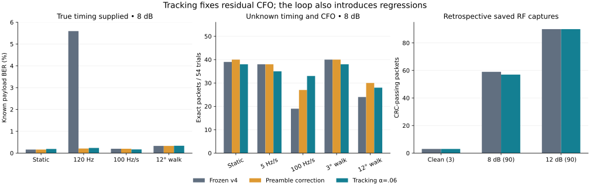

# Phase/frequency tracking and drift-aware acquisition

Performed **2026-10-23**, offline only. Status: **experimental; not promoted to the
live receiver**. The final frozen revision is v5.1, in this `offline-tracking-v5`
directory. It uses the existing libre01 geometry (134.0815° separation), a new
acquisition statistic and a preamble-initialized second-order phase/frequency loop.
No radio, firmware, console, network receiver or hardware setting was changed.

The useful result is stronger acquisition and correction of constant residual
frequency. Continuous tracking improves the large frequency ramp but adds errors
in several static/modest-drift cells. The saved RF packet total regresses slightly.
These are reused **retrospective** tests, not prospective unseen measurements.

## Development boundary and freezes

Only libre01 and new synthetic training cases selected settings. New synthetic
seed 934551 uses IID, 16-bit runs and one-per-32 sparse patterns, with static,
±72/144 Hz offsets, ±60/140 Hz/s ramps and 6°/15° RMS-per-symbol phase walks:
252 symbol-level cases and 42 full-acquisition cases at 8/12 dB. Libre01 contributes
one clean and 24 new noisy cases (seed base 945000). Development tests use separate
seeds 952001/952002 and generator trials 912/913. None reuses the old synthetic
stress realizations. Synthetic normalization, rectangular pulses, 48 ksample/s,
40 samples/symbol, geometry and post-filter complex AWGN follow the prior suite.

An initial broad training sweep tested alpha=0,.1,.25,.5; a second sweep added
.02,.04,.06 after fast loops added errors. Both training ledgers are saved.
The fixed selection criterion minimizes total known training bit errors among
aligned frames, breaking ties toward smaller alpha. **Alpha=.06 wins with 111
errors; alpha=0 has 118**. Both acquire all 42 synthetic and 25 libre01 training
cases. This small training advantage is not a generalization claim. Model geometry,
three-symbol sequence window and .04 coherent acquisition threshold stay fixed.

The initial receiver was frozen at **21:28:58 UTC**, before this replay. It exposed
a numerical bug: FFT roundoff divided by zero energy caused empty acquisition
windows to win. All 30 zero-background controls failed, as did two clean captures.
The [entire initial run](../offline-tracking-v5-initial/README.md) is retained.
A newly constructed training-only zero-background burst reproduced the failure;
a regression test failed before the fix and passed afterward. The only receiver
change is to mask energies at/below machine epsilon times total differential
energy and clip roundoff excursions to [0,1]. This is numerical zero handling,
not a fitted detection threshold. Training selection was rerun unchanged and again
selected .06. V5.1 was frozen at **21:31:22 UTC** before a complete second replay.
No loop setting, candidate budget or signal threshold changed from held-out data.
Since the first replay informed this numerical repair, the second is explicitly
**sequential retrospective validation**, not an untouched holdout claim.

[Selection and dependency hashes](selection.json) · [Training source](train.py) ·
[Initial sweep](training-initial.json) · [Final training ledger](training.json)

## Receiver and ablation

1. Search the whole four-second input using a one-symbol-lag product
   `d[n] = x[n+40] * conj(x[n])`. Correlate its known waveform over symbols
   **224..287** (last 32 preamble plus 32 sync symbols). Constant CFO becomes one
   common phase in this statistic; a frequency ramp varies much less across this
   short boundary than across the old preamble-to-sync gap. This is drift-tolerant
   acquisition, not an explicit fitted chirp model.
2. Keep eight peaks with ±80-sample suppression. At each, estimate absolute CFO
   within ±12 kHz from the known boundary waveform using a 65,536-point FFT.
   Alternate coherent timing refinement ±40 samples and CFO estimation twice.
   Rank normalized coherent correlation and apply the fixed .04 threshold.
3. Integrate all 808 symbols. Estimate residual CFO within ±300 Hz with a
   16,384-point FFT over the **first 64 known preamble symbols**, then fit their
   complex gain/initial phase. The alpha=0 ablation applies this fixed frequency
   and phase correction throughout the frame, with no continuous updates.
4. For alpha=.06, predict carrier phase, pick the nearest learned state, clip its
   phase innovation to ±pi/3 and update a second-order loop: beta=alpha²/4,
   `omega += beta*error`, `phase += omega + alpha*error`. Updates begin at symbol64;
   the initial 64 are derotated by their fitted phase/frequency. No true CFO,
   phase trajectory, payload bits, CRC answer or transmit sequence enters tracking.
5. Apply the unchanged three-symbol/four-state sequence GLRT to corrected symbols.
   Both initial states remain free; no known bits or CRC constrain the final path.
   This remains an overlapping composite likelihood with offline traceback, not
   exact whole-frame ML. No loop-confidence gating or cycle-slip repair was added.

[Receiver](receiver.py) · [Model](model.json) · [Six behavioral tests](test_receiver.py)

## Known-payload detector stress

The same **3,240** prior frames, six patterns and six profiles at 4/8/12 dB are
replayed. True symbol timing is supplied only in this isolation layer. Phase,
frequency and drift are estimated. Each 8 dB row below scores 54,720 known payload
bits. No oracle phase/channel is passed to the new detectors.

| Profile, 8 dB | Frozen v4 errors | Preamble-only correction | Tracking .06 |
| --- | ---: | ---: | ---: |
| Static | 88 (0.1608%) | 88 | 104 (0.1901%) |
| Residual 24 Hz | 104 | 96 | 114 |
| Residual 120 Hz, nu=.10 | 3,061 (5.594%) | 115 (0.2102%) | **129 (0.2357%)** |
| ±100 Hz/s ramp | 109 | 109 | **92 (0.1681%)** |
| 3° phase walk | 100 | 100 | 107 |
| 12° phase walk | 180 | 180 | 184 |

The 120 Hz gain is mainly **preamble frequency estimation**, not continuous
tracking: the ablation is slightly better there. At 12 dB its errors fall from
886 to zero with either correction. All other 12 dB detector cells also have
zero errors. At 4 dB the loop hurts most static/modest-drift profiles; the complete
pattern tables retain those results. The 8 dB static paired BER delta is +0.0292
percentage points (approximate trial-block 95% interval +0.00938..+0.0491); the
ramp delta is −0.0311 points with an interval crossing zero. Finite trials do not
establish a universal tracking gain or a hardware drift specification.

## Full receiver stress

The exact **570** prior IQ cases are regenerated and checked against their saved
SHA256 values; the new receiver receives the whole excerpt without true timing
or CFO. Every start is now correct: **540/540 noisy +30/30 no-added-AWGN** versus
512/540 +26/30 for v4. There are zero misses/wrong starts in this budget and zero
detections in 30 separate noise-only capture controls. This is not a measured
false-alarm probability over arbitrary observation time.

| Profile | 8 dB starts v4 → new /54 | Exact packets v4 → preamble-only → tracking /54 |
| --- | --- | --- |
| Static unknown CFO | 53 → 54 | 39 → 40 → 38 |
| ±5 Hz/s ramp | 54 → 54 | 38 → 38 → 35 |
| ±100 Hz/s ramp | 43 → 54 | **19 → 27 → 33** |
| 3° phase walk | 54 → 54 | 40 → 40 → 38 |
| 12° phase walk | 49 → 54 | 24 → 30 → 28 |

At 8 dB, tracking gives **172/270 packets versus 160/270** v4; there are 22
recoveries and **10 regressions**. The preamble-only version is 175/270. All
12 dB packets pass (270/270 vs259/270); all 30 no-added-AWGN packets pass (vs26).
Noisy total: **442/540 tracking, 445/540 preamble-only, 419/540 v4**.

Acquisition changes the population eligible for conditional BER. On the **same
76,912 bits** in the 253 mutually aligned 8 dB trials, errors are v4 **158**,
preamble-only **160**, tracking **172**. On all newly aligned frames, tracking
has 176/82,080 errors. The packet gain largely comes from recovering acquisition;
it must not be called an across-the-board conditional BER gain. Within the ramp
shared subset, errors improve 48→40 on 13,072 bits, while the other profiles regress.

## Saved hardware captures

All **214 input IQ hashes** match the earlier capture harness exactly (training,
noise-only, clean held-out and noisy held-out). The three clean held-out captures
all pass with zero known-bit errors; all 180 noisy starts align (v4 179/180).
Noisy packets are **147/180 vs149/180**: six regressions and four recoveries at
8 dB, with 90/90 passing 12 dB for both. Every regression remains in its ledger.
No result is discarded because acquisition or CRC failed.

Because new acquisition uses preamble symbols 224..251, the comparable scoring
subset excludes them: **symbols 68..223, 156 known bits**. At 8 dB on the same
13,884 bits in mutually aligned trials, errors are **24 v4 vs30 new**. With the
newly recovered trial, new remains30/14,040. Legacy184-bit counts are retained
for continuity (32/16,376 vs39/16,560), but 28 of the new scorer's bits participated
in acquisition and are not an independent evaluation. The remaining preamble
still shares a waveform/oscillator with acquisition, so BER is conditional.
The captured body remains a clean-decode reference, not independently saved TX
payload truth; CRC success does not establish native application acceptance.



## Connection to the paper

The paper's phase-2 frequency experiment supplies the true symbol-center phase
reference. It isolates finite integration loss, approximately sinc²(nu), rather
than the receiver's ability to estimate a changing carrier. At nu=.10 the prior
Ns=8 control gives about **0.143 dB** integration loss. Preamble correction moves
the practical sequence detector much closer to that assumption: the 5.594% stress
BER drops to 0.2102% before continuous tracking is enabled. Residual integration
loss, noisy frequency estimates, differential XOR errors and learned 135° geometry
still separate these results from ideal coherent 180° BPSK theory.

The paper's phase-3 PN preamble compensation uses a single preamble estimate over
a finite frame. The new 64-symbol hardware-preamble initializer is the closest
ablation; continuous phase/frequency tracking extends it to evolving carriers.
The ±100 Hz/s results show why a static estimate/acquisition gap can matter, while
the static regressions show that tracking injects noise and can follow wrong
state decisions. The hardware 0x55 preamble and sync are not the paper's PN sequence.
The [prior ideal controls](../offline-synthetic-stress/paper-control.csv) and
[original comparison](../offline-ber/README.md) remain separate and unchanged;
they were not rerun or reinterpreted as an exact prediction for this receiver.

The MATLAB driver's previously recorded SHA256 remains
`10a505c6135a493d87d2960340860cffd8bee35981fd23a6388ccc4725f88fc3`.
No new RF sensitivity, fading, clock stability or hardware payload BER is claimed.

## Reproduction and evidence

Run with Python3 and NumPy from this directory; no radio/network package is used:

```sh
OPENBLAS_NUM_THREADS=1 python3 -m unittest test_receiver.py
# Training only; regenerates model/training ledgers. Do not tune on test outputs.
OPENBLAS_NUM_THREADS=1 python3 train.py
# Verify selection/dependency hashes before replaying the frozen selection.
OPENBLAS_NUM_THREADS=1 python3 run.py
OPENBLAS_NUM_THREADS=1 python3 stress.py detector
OPENBLAS_NUM_THREADS=1 python3 stress.py full
python3 analyze.py
```

Stress runners refuse to overwrite existing gzipped trial archives. Copy/archive
outputs before any rerun. Training/model changes invalidate the freeze; do not
rewrite a selection timestamp to imply a new holdout. Baseline decisions and all
new decisions are saved. Summary counts are independently reconstructed from frame
bytes, decision bits and CRC; all 570 full IQ hashes reproduce in each revision.
Six behavioral tests pass, including unknown timing/frequency, gain invariance,
frequency correction, tracking a ramp, unforced payload decisions and the new
zero-background regression. Frozen dependencies remain unchanged after replay.

Trial-block normal intervals use whole 304-bit frames; zero-error rows instead use
a conservative zero-error trial bound. Paired all-zero differences have no
estimated interval. Packet intervals use Wilson counts on **all trials**. These
are Monte Carlo intervals conditional on the synthetic model, not independent RF
replicates or hardware confidence limits. Per-pattern cells have nine noisy full
trials each; zero observed failures is not qualification.

[Audit](audit.json) · [Capture comparison](capture-comparison.csv) ·
[Capture paired trials](capture-paired-trials.csv) · [Capture regressions](capture-regressions.json) ·
[Stress summary](stress-summary.csv) · [Pattern summary](pattern-summary.csv) ·
[Shared-trial comparisons](paired-stress.json) ·
[Acquisition/packet changes and failures](stress-failures-and-changes.json) ·
[Detector decision archive](detector-trials.jsonl.gz) ·
[Full receiver decision archive](full-trials.jsonl.gz) ·
[Capture decision archive](trials.jsonl) · [Analyzer](analyze.py) · [Plot source](plot.py)

Keep v4 and the new ablation as frozen references. A next training-only experiment
could investigate reliable loop gating or a better carrier/state estimator, but
this replay must not select a new setting. The important prospective step remains
new RF captures with independently saved transmitted bytes and matched pre-filter
noise. Any conducted validation requires a separately bounded bench run; nothing
has been installed in the live receiver.
