# 008 SDRB J14 doubler drive check

**Status:** In progress  
**Started:** 2026-10-25  
**Updated:** 2026-10-25

I wanted to take the DEMI transverter out of the measurement chain and check whether I could see a signal directly from SDRB's J14 output. I tried three TX gain settings with both amplifier supplies off, then repeated them with the driver supply on at 9 V. **None of the six steps produced a distinct tone near 5.184050 GHz.** All six two-second streams completed without reported stream or cleanup errors.

A subsequent **J10 fundamental measurement detected 5.184050 GHz at about −69.2 dBm with 20.3 dB contrast**, using 10 dB analyzer attenuation and the same gain 60/amplitude 0.1. See the J10 follow-up below.

These are exploratory measurements below the doubler's specified frequency range. The readings near the noise floor are not calibrated SDRB output-power measurements.

This is a separate part of the [SDRB RF_Out investigation](../007-sdrb-rf-out/README.md).

## Correcting the connection

On October 25 I identified a wiring mistake in the earlier October 24 tests: the cable had been on **Jx1, marked Path C**, rather than **J14, marked X2_RF_Out**. Jx1 connects to the unused branch of output switch U1; it is not the doubler output. Those earlier nondetections did not measure the intended J14 output.

For this investigation I moved the cable to J14. The initial direct measurement used:

`SDRB J14 → DC block → tinySA Ultra RF input`

The DEMI was bypassed and **no external attenuation pad was installed**. I retained the tinySA's 31 dB internal attenuation, with its LNA off. These are separate settings: removing the external pad did not remove the analyzer's internal attenuation.

## What the power controls mean

The installed native SDRB control uses a positive TX gain setting from **0 to 89.75 dB**. The AD9361 attenuation control has **0.25 dB increments**:

`nominal native TX attenuation = 89.75 − SDRB TX gain`

Gain 0 therefore means maximum attenuation; gain 89.75 means minimum attenuation. These numbers are **not output dBm**. Digital amplitude is another control: amplitude 0.1 is −20 dB relative to amplitude 1, and amplitude 0.01 is −40 dB. The gain of the driver stages, filter and switch losses, doubler behavior, cable loss and frequency all affect the level eventually reaching the analyzer.

The [AD9361 reference manual](https://www.analog.com/media/en/technical-documentation/user-guides/ad9361.pdf?isDownload=true) describes the attenuation range and resolution. This run checked only gain 0, 30 and 60, at amplitude 0.1; it did not characterize the full range.

AmpPwr1 powers the two PHA-83W+ driver stages. AmpPwr2 powers a separate final amplifier in Path A. **AmpPwr2 stayed off in every step.** The second sweep compares the driver supply on/off, not the separate final PA on/off.

## Frequency choice and its limitation

To bring the nominal doubled output within the tinySA's Ultra-mode range, I used:

| Parameter | Setting |
| --- | --- |
| Requested TX LO | 2,592,000,000 Hz |
| Reported TX LO, all six runs | 2,591,999,998.092648 Hz |
| Complex tone offset | +25,000 Hz |
| Nominal fundamental | 2,592,025,000 Hz |
| Nominal doubled output / analyzer marker | **5,184,050,000 Hz** |
| TX bank and route | High-pass / temporary Path C to J14 |
| Physical TX selector | UHD channel 1 |
| Sample rate / frame size | 2.304 MS/s / 8,000 bytes |
| Digital amplitude / requested duration | 0.1 / 2 seconds |
| External attenuation / gain correction | 0 dB / 0 dB |
| tinySA configuration | Ultra on; internal attenuation 31 dB; LNA off |
| Numeric scan | 5.183550–5.184550 GHz, 101 points, 10 kHz spacing |
| RBW | 10 kHz |
| LCD | 10 dB/div; reference −20 dBm; marker 5.184050 GHz |

The CY2-283+ is specified for **3.5–14 GHz input and 7–28 GHz output**, with +12 to +18 dBm drive. This test's 2.592025 GHz fundamental and 5.184050 GHz nominal output are below that band. A visible response would be useful, but **no response here does not establish that the doubler is faulty**. Actual drive at the doubler input was not measured.

Sources: [CY2-283+ datasheet](https://www.minicircuits.com/pdfs/CY2-283%2B.pdf), [tinySA specifications](https://tinysa.org/wiki/pmwiki.php?n=TinySA4.Specification).

## Procedure and controls

I ran the lowest gain first and checked each result before advancing. The initial three steps used both supplies off. After that sweep finished, I powered only AmpPwr1 at 9 V and repeated the same settings. Supply voltage/state were owner-reported; driver current was not recorded.

For each step I saved a numeric scan and a real LCD capture before the tone, during the tone, and after it stopped. A numeric scan and an LCD sweep are **separate sweeps**, so their instantaneous levels can differ. The active LCD was paused during the transmitting window; transferring its frozen pixels could finish after the tone stopped. Active freezes were verified within 1.8 seconds of the received stream-start marker. These are host timing observations, not RF timing calibration.

The instrument displays **REDUCED LINEARITY** on these captures. Its absolute calibration was not independently checked. Values below are the analyzer's indicated input dBm, not values with another 31 dB added. Cable and DC-block losses are uncorrected.

I used a measured full-band peak of −10 dBm as an escalation stop, kept the LNA off and retained the analyzer's internal attenuation. No measured peak approached that stop. The tinySA's published short-term input limit with 30 dB internal attenuation is +20 dBm; that is a damage limit, not a measurement target. No maximum-gain or calibrated-power qualification is implied by this sequence.

One initial analyzer-only preflight stopped because its expected frequency grid still contained an old upper bound. **No source stream started in that attempt.** I corrected the parser and checked it against the original capture, missing-bin, wrong-frequency and nonfinite-data cases before proceeding. The [aborted record](files/pre-rf-grid-validation-abort.json) is retained. The temporary module passed 58 simulated-hardware tests on host and SDRB; four analyzer-parser tests passed on host and measurement computer. Those tests do not validate RF hardware.

The base image remained `0.1.0-dev.4-rc.3`. A RAM-only `x2-c-bench-20261025-r6` option restricted the route to a 2.592 GHz LO within ±10 Hz and TX gain settings 0, 30 or 60. Initialization and cleanup retained gain zero. The installed demonstration's timing and stream-error accounting were preserved. The original persistent module and boot files were not replaced.

## Settings and results

| Step | AmpPwr1 | TX gain requested/read back | Native attenuation (dB) | Amplitude | Nominal output (GHz) | Actual duration (s) |
| --- | --- | ---: | ---: | ---: | ---: | ---: |
| S1 | Both OFF | 0 / 0 | 89.75 | 0.1 | 5.184050 | 2.001389 |
| S2 | Both OFF | 30 / 30 | 59.75 | 0.1 | 5.184050 | 2.000755 |
| S3 | Both OFF | 60 / 60 | 29.75 | 0.1 | 5.184050 | 2.001237 |
| S4 | AmpPwr1 9 V | 0 / 0 | 89.75 | 0.1 | 5.184050 | 2.000750 |
| S5 | AmpPwr1 9 V | 30 / 30 | 59.75 | 0.1 | 5.184050 | 2.001092 |
| S6 | AmpPwr1 9 V | 60 / 60 | 29.75 | 0.1 | 5.184050 | 2.000789 |

AmpPwr2 was OFF and the expected output frequency was 5.184050 GHz in every row. "Native attenuation" describes the RFIC control, not the entire board or the resulting doubled signal.

The following values are the largest numeric readings within **±10 kHz of 5.184050 GHz**. With no distinct tone, they represent local noise-window peaks, not measured signal output powers. Contrast is `on − max(before, after)`; negative values describe noise variation.

| Step | Before (dBm) | Tone on (dBm) | After (dBm) | Rise (dB) | Distinct tone | Active screen |
| --- | ---: | ---: | ---: | ---: | --- | --- |
| S1 | -69.75 | -70.41 | -71.75 | -0.66 | No | [LCD](images/amps-off-gain-0-active.png) |
| S2 | -69.25 | -71.25 | -69.91 | -2.00 | No | [LCD](images/amps-off-gain-30-active.png) |
| S3 | -65.69 | -71.69 | -68.84 | -6.00 | No | [LCD](images/amps-off-gain-60-active.png) |
| S4 | -71.19 | -70.34 | -68.84 | -1.50 | No | [LCD](images/drivers-on-gain-0-active.png) |
| S5 | -68.69 | -69.84 | -69.34 | -1.16 | No | [LCD](images/drivers-on-gain-30-active.png) |
| S6 | -67.69 | -70.84 | -66.34 | -4.50 | No | [LCD](images/drivers-on-gain-60-active.png) |

The predeclared detection candidate was a rise of at least 10 dB in that target window during the verified active interval. No step met it. All six reported actual TX gain settings matched their requests, all six streams completed, and no stream, decode or cleanup errors were reported. A benign post-stop burst acknowledgement was retained for each run.

[Complete CSV](files/measurements.csv) · [JSON summary](files/measurements.json) · [Configuration and module identities](files/test-configuration.json)

## Actual tinySA screens

These are unmodified 480 × 320 LCD pixel captures, not plots reconstructed from numeric data. Each step includes a before, active and after image. The per-screen JSON files include hashes of the PNG and original RGB565 payload, freeze times and capture timing. Original payloads and complete private bench records remain archived separately; public measurement JSON omits local result paths and connection arguments.

### S1: Both OFF, gain 0

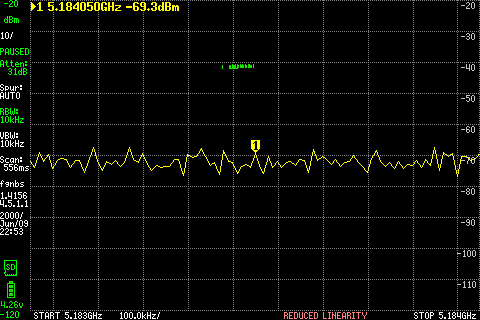

Before. [Numeric scan](files/amps-off-gain-0-before.txt) · [LCD metadata](files/amps-off-gain-0-before-screen.json)

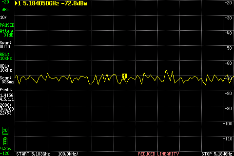

Tone on — frozen during the two-second stream. [Numeric scan](files/amps-off-gain-0-active.txt) · [LCD metadata](files/amps-off-gain-0-active-screen.json)

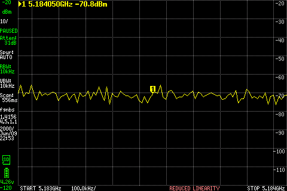

After. [Numeric scan](files/amps-off-gain-0-after.txt) · [LCD metadata](files/amps-off-gain-0-after-screen.json)

[Step measurement record](files/amps-off-gain-0-measurement.json).

### S2: Both OFF, gain 30

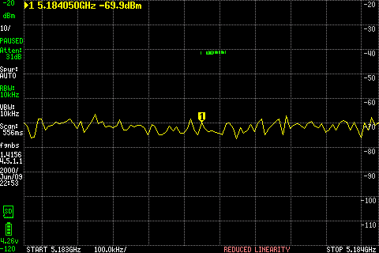

Before. [Numeric scan](files/amps-off-gain-30-before.txt) · [LCD metadata](files/amps-off-gain-30-before-screen.json)

Tone on — frozen during the two-second stream. [Numeric scan](files/amps-off-gain-30-active.txt) · [LCD metadata](files/amps-off-gain-30-active-screen.json)

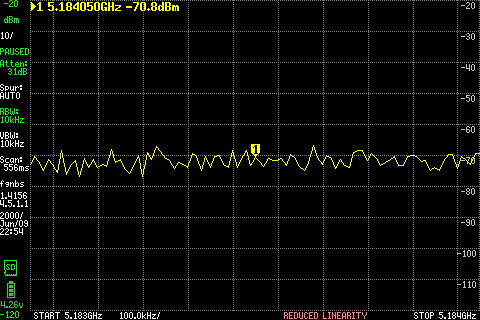

After. [Numeric scan](files/amps-off-gain-30-after.txt) · [LCD metadata](files/amps-off-gain-30-after-screen.json)

[Step measurement record](files/amps-off-gain-30-measurement.json).

### S3: Both OFF, gain 60

Before. [Numeric scan](files/amps-off-gain-60-before.txt) · [LCD metadata](files/amps-off-gain-60-before-screen.json)

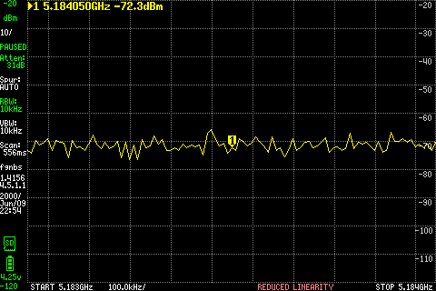

Tone on — frozen during the two-second stream. [Numeric scan](files/amps-off-gain-60-active.txt) · [LCD metadata](files/amps-off-gain-60-active-screen.json)

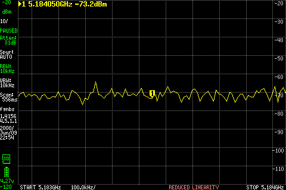

After. [Numeric scan](files/amps-off-gain-60-after.txt) · [LCD metadata](files/amps-off-gain-60-after-screen.json)

[Step measurement record](files/amps-off-gain-60-measurement.json).

### S4: AmpPwr1 9 V, gain 0

Before. [Numeric scan](files/drivers-on-gain-0-before.txt) · [LCD metadata](files/drivers-on-gain-0-before-screen.json)

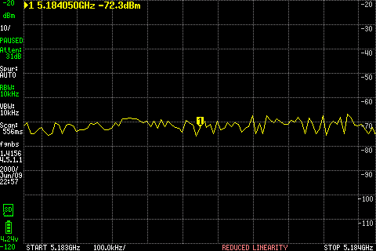

Tone on — frozen during the two-second stream. [Numeric scan](files/drivers-on-gain-0-active.txt) · [LCD metadata](files/drivers-on-gain-0-active-screen.json)

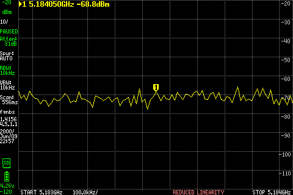

After. [Numeric scan](files/drivers-on-gain-0-after.txt) · [LCD metadata](files/drivers-on-gain-0-after-screen.json)

[Step measurement record](files/drivers-on-gain-0-measurement.json).

### S5: AmpPwr1 9 V, gain 30

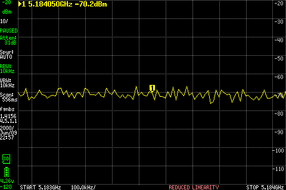

Before. [Numeric scan](files/drivers-on-gain-30-before.txt) · [LCD metadata](files/drivers-on-gain-30-before-screen.json)

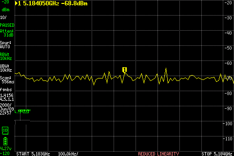

Tone on — frozen during the two-second stream. [Numeric scan](files/drivers-on-gain-30-active.txt) · [LCD metadata](files/drivers-on-gain-30-active-screen.json)

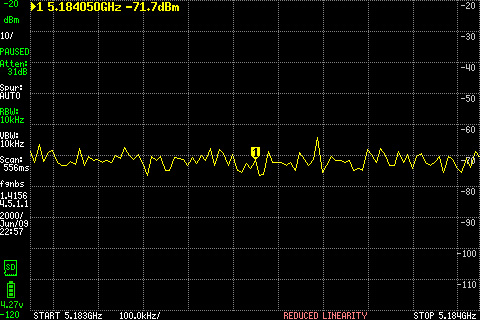

After. [Numeric scan](files/drivers-on-gain-30-after.txt) · [LCD metadata](files/drivers-on-gain-30-after-screen.json)

[Step measurement record](files/drivers-on-gain-30-measurement.json).

### S6: AmpPwr1 9 V, gain 60

Before. [Numeric scan](files/drivers-on-gain-60-before.txt) · [LCD metadata](files/drivers-on-gain-60-before-screen.json)

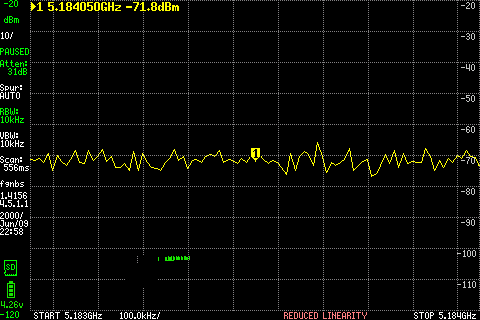

Tone on — frozen during the two-second stream. [Numeric scan](files/drivers-on-gain-60-active.txt) · [LCD metadata](files/drivers-on-gain-60-active-screen.json)

After. [Numeric scan](files/drivers-on-gain-60-after.txt) · [LCD metadata](files/drivers-on-gain-60-after-screen.json)

[Step measurement record](files/drivers-on-gain-60-measurement.json).

## Current outcome and next check

The commanded gain steps and finite source streams worked, and the actual analyzer screens and scans were saved. This direct, no-external-pad check did **not** produce a distinct expected doubled tone at any tested gain, with the driver supply either off or on at 9 V.

This does not locate the fault or establish the 10 GHz chain's performance. The doubler was tested below its specified band; actual driver current, fundamental power into the doubler and J14 output power remain unmeasured. Path C control voltages were subsequently checked as recorded below. The 10.3681 GHz output and DEMI downconversion are separate checks.

The next useful diagnostic is to check the fundamental through the driver-only Path B/J10 route at an analyzer-supported frequency, then return to an in-band doubler test with a suitable receiver. No additional RF run or power increase is implied by that proposal.

After the six runs, the original installed module was restored and its hash verified. MPM reported the radio unclaimed and no failed services were listed. AmpPwr1 was last reported on at 9 V; AmpPwr2 remained off. The investigation remains **In progress**.

## Datasheet and route review — October 25, 2026

This is a read-only review and a proposed diagnostic sequence. No additional RF run, KiCad edit or component replacement was performed.

The live KiCad PCB pad queries show U12 pin 3 and IC3 pin 5 on `Xmit Path C`, and IC3 pin 11 and J14 center pad 1 on the same output net. Routed segments are present between those endpoints. This supports the intended connection, but does not verify solder joints, RF impedance, or continuity on the assembled board.

`TX-B → U37/U45 drivers → U13 → U12 → IC3 → J14`

Path B instead leaves U12 through J2 and passes through U1 to J10. Path C's doubled output bypasses U1; the 10 GHz signal does not pass through either 6 GHz RF switch.

The [Skyworks truth table](https://www.skyworksinc.com/-/media/SkyWorks/Documents/Products/2201-2300/SKY13588_460LF_203512D.pdf) requires:

| State | U12 V1, pin 4 | U12 V2, pin 5 | Selected branch |
| --- | --- | --- | --- |
| Shutdown | low | low | None |
| Path B | high | low | J2, toward J10 |
| Path C | high | high | J3, toward IC3 |

The reviewed FPGA uses low-or-release outputs with external 1.8 V pull-ups. Measure **R92 pad 1 for V1 and R91 pad 1 for V2**, not the resistors' supply-side pad 2. Expect approximately 1.8/1.8 V during a held Path C selection, approximately 1.8/0 V during Path B, and near 0/0 V in shutdown. Verify U12's 3.3 V supply and the 1.8 V pull-up rail too.

The temporary module requested state 3 for Path C. That is command/software evidence, not physical voltage evidence. The reviewed FPGA source ties the processor GPIO input feedback low; a GPIO readback alone cannot establish the voltage at the switch. At that review point no R91/R92 voltage measurements had been recorded; the subsequent held-state readings below agree with Path C. The temporary module was removed after testing, so the restored idle state should not be mistaken for an active Path C selection.

[CY2-283+ datasheet](https://www.minicircuits.com/pdfs/CY2-283%2B.pdf) limits: input 3.5–14 GHz; output 7–28 GHz; drive +12 to +18 dBm; absolute maximum RF input +21 dBm. The recent lower-frequency test was outside specification; 5.184050 → 10.368100 GHz is in band. +12/+18/+21 dBm correspond to approximately 16/63/126 mW, leaving only 3 dB from the upper drive point to the damage limit.

IC3 has no DC supply/enable pin. AmpPwr1 supplies its preceding drivers; excessive RF from those drivers is the relevant overdrive mechanism. An attenuator after J14 protects a receiver, not IC3's input. Gain settings and supply voltage alone do not establish RF power at IC3.

Entry 007's historical 5.8001 GHz measurement was −71.5 dBm after a nominal 20 dB pad, or roughly −51.5 dBm before that pad if its nominal loss is added. This is uncalibrated and from a different frequency/configuration, not an IC3 input measurement. It illustrates why detecting RF_Out does not establish adequate doubler drive. Recheck the current setup at the actual intended fundamental before extrapolating earlier levels.

One pin-assignment detail needs manufacturer clarification: the datasheet labels pads 1, 2, 3, 7, 8 and 9 “no connections,” while the live layout assigns them to ground. This may be harmless if genuinely internally unconnected. It is not a demonstrated fault or a reason to rework the board without further evidence.

Proposed order, with each step recorded before proceeding:

1. **Verify selection electrically (subsequently completed below).** Use a deliberate low-drive route-hold diagnostic so a meter can read R92/R91 during B and C selection. Start with the driver supply off. Confirm the control states, supply rails and software mapping without relying on a two-second LCD or GPIO readback.
2. **Check assembly with power off.** Verify same-net continuity U12 pin 3 to IC3 pin 5, and IC3 pin 11 to J14 center; inspect the actual connector launch and ground/paddle joints. Resistance from an RF port to ground alone is not a conclusive failure test.
3. **Measure current fundamental drive (single-setting J10 check subsequently completed below).** Reproduce Path B/J10 detection at 5.184050 GHz on the current image, record actual AmpPwr1 voltage/current and gain/amplitude, and establish a measured level versus control setting. J10 is a first surrogate; its extra switch and launch losses mean it is not exactly IC3 input power.
4. **Establish a bounded in-band IC3 input.** Use suitable 50 ohm RF access and measured loss/uncertainty to establish the power reaching IC3 pin 5. Start at the lower specified drive point, +12 dBm, rather than blindly increasing software gain or using +21 dBm as a target. Typical conversion loss is around 13 dB, so an output near −1 dBm would be an order-of-magnitude expectation under the manufacturer's matched test conditions, not a board guarantee.
5. **Validate the 10 GHz receive path and test doubling.** Confirm the DEMI's LO/receive configuration and sensitivity with an independent reference where available. Verify the output connector, cable and DC block are suitable at 10.368 GHz; the previously inventoried 6 GHz-rated block does not establish 10 GHz performance. Restore appropriate receiver protection for a potentially much stronger in-band doubled output. With verified Path C selection and measured drive, look for on/off contrast at 144.100 MHz if the DEMI LO is 10.224 GHz. A second planned tone offset +10 kHz higher should move the doubled RF and the uninverted IF by +20 kHz; choose scan resolution that can resolve that shift.

There is presently **no evidence sufficient to declare IC3 damaged**. A useful failure diagnosis requires known in-band input power at IC3, verified switching and assembly, and a working output measurement chain. Grossly missing conversion under those conditions makes the IC or its assembly suspect; an independent component test or known-good substitution can then distinguish them.

## Path C control-voltage check — October 25, 2026

The owner measured the switch-connected pad 1 of each pull-up resistor during a dedicated GPIO-only Path C hold:

| Point | Signal | Owner-reported reading | Expected Path C state |
| --- | --- | ---: | --- |
| R92 pad 1 | U12 V1 | **1.8 V** | High |
| R91 pad 1 | U12 V2 | **1.8 V** | High |

The hold service was independently observed active when the readings were reported. The AD9361 was held in reset throughout; no RFIC initialization, tuning or sample stream was performed. MPM was stopped while the diagnostic exclusively owned the GPIO controls. These are manual meter readings reported by the owner, not automated GPIO voltage readbacks.

The owner also confirmed that all switching circuits had already been tested and read correctly. Individual values for those earlier checks were not supplied here and have not been invented. **Switch-control verification is complete; repeating it is not the next diagnostic.**

The next focus is the actual fundamental RF drive and in-band doubling. This check closes the outstanding Path C control-voltage question without changing the earlier RF measurements.

The diagnostic hold was released after measurement. Cleanup returned the controls to their inactive state and restarted MPM without errors; the radio was unclaimed and no failed services were listed. No new RF tone was sent.

## J10 fundamental measurement — October 25, 2026

With the switching checks complete, I moved the cable to **J10/RF_Out** to measure the fundamental before attempting further doubler tests:

`J10 → DC block → tinySA input`

No external pad was installed. AmpPwr1 remained at 9 V and AmpPwr2 stayed off, as owner-confirmed. This used driver-only **Path B / high-pass**, not J14 and not the separate final PA.

Both runs used requested LO **5.184000 GHz**, complex tone **+50 kHz**, expected fundamental **5.184050 GHz**, TX gain **60**, digital amplitude **0.1**, channel 1, 2.304 MS/s, 8,000-byte frames and a two-second duration. The reported gain was 60.0 and reported LO was 5,183,999,996.185296 Hz in both runs. The LO value is software readback, not independent RF frequency calibration.

The first run retained 31 dB analyzer attenuation. It did not give a clear target-window detection. All peaks were below −25 dBm, so I reduced **only the analyzer attenuation to 10 dB** and repeated the same source settings. No TX gain or amplitude increase occurred.

The analyzer remained in Ultra mode with LNA off, 10 kHz RBW, zero external correction and a 5.183550–5.184550 GHz / 101-point scan. Numeric values are peaks within ±10 kHz of the nominal tone; contrast is `on − max(before, after)`.

| Analyzer internal attenuation | Before (dBm) | Tone on (dBm) | After (dBm) | Rise (dB) | Duration (s) | Detection |
| ---: | ---: | ---: | ---: | ---: | ---: | --- |
| 31 dB | -71.03 | **-67.69** | -71.53 | +3.34 | 2.001208 | Not clear |
| 10 dB | -90.56 | **-69.22** | -89.56 | +20.34 | 2.000740 | Clear |

**The 10 dB setting clearly detected the fundamental:** the strongest active numeric bin was **5.184050 GHz at −69.22 dBm**, with **20.34 dB** off/on/off contrast. The fixed LCD marker on its separate active sweep read approximately **−70.1 dBm**. The 31 dB run's fixed LCD marker read approximately −72.5 dBm; its noise-window numeric peak is not a reliable isolated signal-power measurement.

These are indicated levels at the analyzer input. **Do not add the internal 10 or 31 dB attenuation to them.** There is no external pad correction; cable/DC-block losses and absolute calibration remain unqualified. The display still shows REDUCED LINEARITY. Improving analyzer sensitivity established detection without increasing source power.

Both streams completed with no reported stream, decode or cleanup errors. Each retained one benign post-stop burst acknowledgement. The numeric scans and actual active LCD freezes were verified inside the source windows; the LCD freezes occurred about 1.72 seconds after the received start markers. Each PNG is an unmodified device pixel capture; the numeric and LCD sweeps are separate observations.

The installed rc.3 native Path B/high-pass support was used. A RAM-only adapter changed the installed demo's device arguments and supplied fixed source parameters; it preserved the original demo's timing and error accounting. Twelve adapter/parser tests passed on host and SDRB ARM. No installed module, application or FPGA replacement was needed, and final hashes remained unchanged. The radio returned unclaimed with no failed services.

This confirms a detectable fundamental through the current J10 path at the intended frequency. It does **not** measure IC3 pin 5 directly: the J10 path includes an extra switch/launch, and the cable/DC-block loss is uncorrected. The indicated J10 level at this setting is very low relative to the doubler's specified drive. Actual driver bias/current, RF level progression through the chain, and a bounded IC3 input-power measurement are the next focus. No higher TX setting or 10 GHz run was performed here.

[CSV](files/j10-fundamental.csv) · [JSON summary](files/j10-fundamental.json) · [Fixed configuration](files/j10-test-configuration.json)

### J10, analyzer attenuation 31 dB

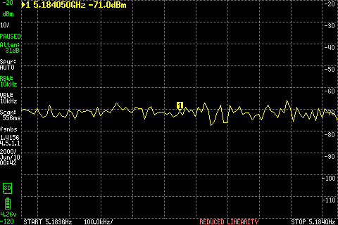

Before. [Numeric scan](files/j10-att31-before.txt) · [LCD metadata](files/j10-att31-before-screen.json)

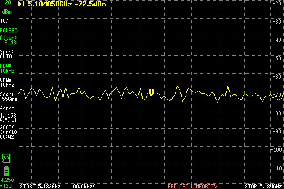

Tone on, frozen during the source window. [Numeric scan](files/j10-att31-active.txt) · [LCD metadata](files/j10-att31-active-screen.json)

After. [Numeric scan](files/j10-att31-after.txt) · [LCD metadata](files/j10-att31-after-screen.json)

[Run record](files/j10-att31-measurement.json).

### J10, analyzer attenuation 10 dB

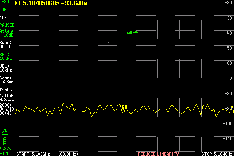

Before. [Numeric scan](files/j10-att10-before.txt) · [LCD metadata](files/j10-att10-before-screen.json)

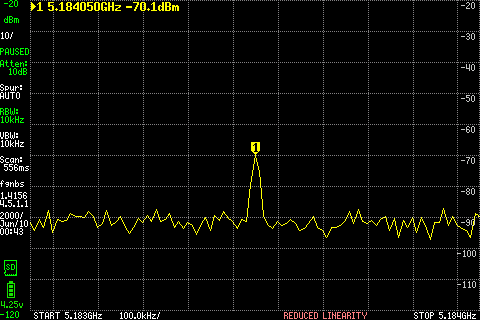

Tone on, frozen during the source window. [Numeric scan](files/j10-att10-active.txt) · [LCD metadata](files/j10-att10-active-screen.json)

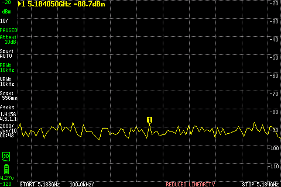

After. [Numeric scan](files/j10-att10-after.txt) · [LCD metadata](files/j10-att10-after-screen.json)

[Run record](files/j10-att10-measurement.json).

## Driver DC bias check — October 25, 2026

With RF idle, AmpPwr1 powered and AmpPwr2 off, the owner reported these manual meter readings on schematic page 3, “Transmit Amplifier and Switching.” The black probe was directed to AmpPwr1 negative / board ground; the red probe points were the component-side right pads of the two bias chokes.

| Measurement | Owner-reported value | Meaning |
| --- | ---: | --- |
| Bench supply voltage display | 9 V | Supply setting/display, not the measured board-terminal voltage |
| Bench supply current display | 0.572 A | Combined main SDRB board + AmpPwr1 load |
| L30 pad 2, U45 RF-output/DC-bias net | **8.637 V DC** | Voltage present on the second driver's bias feed |
| L23 pad 2, U37 RF-output/DC-bias net | **8.637 V DC** | Voltage present on the first driver's bias feed |

Both bias feeds have DC voltage close to the nominal 9 V supply. The difference from the supply display is 0.363 V; its location has not been isolated by measurements at the connector and intervening components. The combined 0.572 A reading does not establish either driver's individual current. These readings do not prove transistor operation, RF gain or correct solder contact at each IC pin. No additional RF run or power increase was performed for this check.

The next RF diagnosis is to establish gain through the driver chain and locate the large loss responsible for the weak J10 fundamental. Switch-control checks are already complete.

## Driver-off comparison — October 25, 2026

Disconnecting only AmpPwr1 reduced the owner-reported bench reading from **9 V / 0.572 A** to **9.00 V / 0.356 A**, while the main SDRB board remained powered. The difference is **0.216 A (216 mA)** for the AmpPwr1 branch, assuming the other load remained unchanged. This does not resolve the current through each driver individually. AmpPwr2 stayed off.

I then ran one two-second tone with AmpPwr1 off, retaining J10 → DC block → tinySA, no external pad, Path B/high-pass, channel 1, LO 5.184000 GHz, +50 kHz tone offset, TX gain 60 and amplitude 0.1. Analyzer settings matched the earlier 10 dB internal-attenuation run, including LNA off and 10 kHz RBW. No power escalation or retry occurred.

| AmpPwr1 | Before (dBm) | Tone on (dBm) | After (dBm) | Off/on/off contrast | Distinct tone |
| --- | ---: | ---: | ---: | ---: | --- |
| On, earlier reference | −90.56 | **−69.22** | −89.56 | +20.34 dB | Yes |
| Off, new measurement | −93.50 | **−90.50** | −90.00 | −0.50 dB | No |

Values are target-window peaks within ±10 kHz of 5.184050 GHz. The off-driver readings are noise-window peaks, not measured tone power; subtracting them from the powered result does not establish calibrated amplifier gain. The powered and unpowered runs show that enabling the driver branch improves RF transmission through the current path. The absolute J10 level remains weak, and neither individual amplifier gain nor IC3 input power has been established.

The source completed in **2.000751 seconds**, with reported gain 60, no stream/decode/cleanup errors, and one benign post-stop burst acknowledgement. Both the active numeric scan and actual LCD freeze were verified inside the transmitting window. The separate active LCD sweep's marker read approximately −95.7 dBm. The radio returned unclaimed with no failed services. AmpPwr1 was left off; no subsequent tone was sent.

[Measurement record](files/j10-drivers-off-measurement.json). These are unmodified instrument captures; numeric and LCD measurements are separate sweeps.

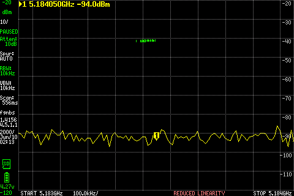

Before. [Numeric scan](files/j10-drivers-off-before.txt).

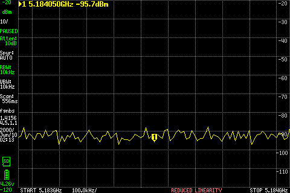

Tone active. [Numeric scan](files/j10-drivers-off-active.txt).

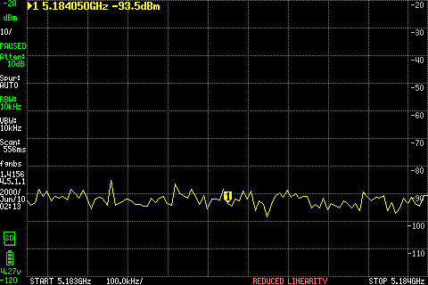

After. [Numeric scan](files/j10-drivers-off-after.txt).

## LibreSDR reference measurement — October 25, 2026

To check the receiver/cable chain independently of SDRB, I moved the connection to:

`LibreSDR TXRA → DC block → coax → tinySA RF input`

No external pad was installed. LibreSDR initialized with its verified custom FPGA image (SHA-256 `7f0e329b4724e0d919a06b9924aaa3c77305b6f25038deebd6171657ac7c8a99`) and UHD 4.6.0.0. Both register loopback tests passed. It operated over USB 2. Channel 0 with antenna `TX/RX` used the prior TXA mapping recorded in entry 004; detection on the connected port supports that mapping for this run. SDRB was disconnected from the RF measurement chain.

Source settings: LO **5.184000 GHz**, complex tone **+50 kHz**, sample rate **1 MS/s**, TX gain **40**, digital amplitude **0.1**. Readback was LO 5,183,999,999.999993 Hz, rate 1,000,000 samples/s and gain 40.0. tinySA retained Ultra on, LNA off, **10 dB internal attenuation**, 10 kHz RBW, zero external correction and the same 101-point 5.183550–5.184550 GHz scan.

| Stage | Peak within ±10 kHz of nominal tone (dBm) | Indicated peak frequency |
| --- | ---: | ---: |
| Before | −88.13 | 5.184040 GHz |
| Tone on | **−52.97** | **5.184040 GHz** |
| After | −90.47 | 5.184040 GHz |

The tone produced **35.16 dB** contrast against the larger before/after window peak and disappeared after transmission. The separate LCD sweep's marker at the nominal 5.184050 GHz read approximately **−57.0 dBm**. The strongest numeric bin was 10 kHz below nominal, one scan increment; neither oscillator nor analyzer frequency calibration was independently established. The LCD marker and numeric peak are different frequency/sweep observations.

The source send loop completed in **2.010266 seconds** and queued **2,080,000 samples** (2.08 seconds at the nominal sample rate). Those are software timing/sample counts, not independent RF burst-duration measurements. No TX error events or cleanup errors were reported; the only asynchronous event was a burst acknowledgement. TX gain was returned to zero and the process exited normally.

**Timing-guard exception retained:** the measurement controller stopped the sequence because the active LCD freeze occurred **1.816333 seconds** after the received stream-start marker, exceeding its conservative **1.8-second** acceptance threshold. The active numeric scan completed about 0.713 seconds after that marker and is valid for the source window. The actual screen shows the tone, and its freeze precedes the source's reported send-loop duration, but the original guard-failure status is preserved in the derived record rather than silently rewritten as a clean automated run. No retry or further gain step followed.

This establishes that the current tinySA/DC-block/coax chain can detect a substantially stronger signal near 5.184 GHz than the earlier SDRB J10 result. It does not calibrate LibreSDR power, determine cable loss, or establish the gain of either SDRB driver. The two radios used different TX gain settings; their indicated output difference is not a gain comparison. The remaining weak SDRB output is an upstream diagnosis, with absolute power calibration still open.

[CSV](files/libresdr-reference-gain40.csv) · [Measurement and timing review](files/libresdr-reference-gain40.json). PNGs below are unmodified device captures; original RGB565 payloads and complete controller logs are archived privately.

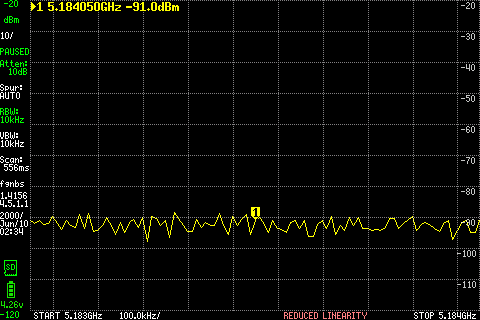

Before. [Numeric scan](files/libresdr-reference-gain40-before.txt).

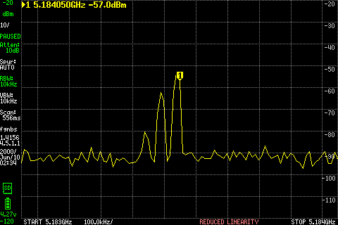

Tone observation; timing-guard exception described above. [Numeric scan](files/libresdr-reference-gain40-active.txt).

After. [Numeric scan](files/libresdr-reference-gain40-after.txt).

## J10 gain sweep after reboot — October 25, 2026

After an accidental SDRB reboot and USB reconnection, SDRB was found at its U-Boot prompt. Running its configured normal boot started Linux. The boot log reported that the FAT boot volume had not been cleanly unmounted; no filesystem repair or persistent software change was performed here. The boot image, installed radio module and demo application subsequently matched their earlier hashes. MPM was active and the radio unclaimed.

The owner restored **J10 → DC block → coax → tinySA** and confirmed AmpPwr1 powered after preparation. AmpPwr2 remained off. No new supply current or driver bias voltage was measured during this sweep; the earlier manual readings remain separate observations.

All runs used Path B/high-pass, UHD channel 1, LO **5.184000 GHz**, +50 kHz complex tone, amplitude **0.1**, 2.304 MS/s, 8,000-byte frames and a requested two seconds. Gain settings were run in ascending order, inspecting completion and received levels before advancing. Only **40, 50 and 60** were allowed by the temporary launcher; no higher setting was tried. tinySA retained Ultra on, LNA off, **10 dB internal attenuation**, 10 kHz RBW, zero external correction and 101 points over 5.183550–5.184550 GHz. No external pad was installed.

| TX gain requested/read back | Before (dBm) | Tone on (dBm) | After (dBm) | Contrast (dB) | Detection | Duration (s) |
| --- | ---: | ---: | ---: | ---: | --- | ---: |
| 40 / 40 | -91.12 | **-88.62** | -91.62 | +2.50 | Not clear | 2.000711 |
| 50 / 50 | -91.62 | **-79.62** | -90.47 | +10.84 | Candidate | 2.000774 |
| 60 / 60 | -91.97 | **-69.47** | -91.97 | +22.50 | Candidate | 2.001061 |

Levels are peaks within ±10 kHz of 5.184050 GHz. Gain 40 is too close to the noise floor for a reliable isolated tone-power reading. The gain-50 and gain-60 active peaks were at **5.184050 GHz**. Raising commanded gain by 10 dB from 50 to 60 raised the indicated tone by **10.15625 dB**. This supports correct relative TX gain response over that step; it does not measure either driver's individual gain or establish a calibrated output power. The gain-60 result is within 0.25 dB of the earlier −69.22 dBm reading despite the reboot and cable reconnection.

All three source runs completed without reported stream, decode or cleanup errors; each retained one benign post-stop burst acknowledgement. Numeric scans and actual active LCD freezes were verified within their source windows. The separate active LCD marker readings were approximately −79.1 dBm at gain 50 and −70.6 dBm at gain 60. The display continues to show REDUCED LINEARITY; cable/DC-block loss and absolute calibration remain unqualified. Do not add internal analyzer attenuation to the indicated levels.

The RAM-only launcher retained the installed demo's original timing and error accounting. Its 12 adapter/parser tests passed on host and SDRB. A staging test initially lacked its parser fixture; including the unchanged original fixture resolved that preparation error before any RF run. Final boot/module/application hashes were unchanged, no failed services were listed and the radio returned unclaimed. No GPIO switching check was repeated. AmpPwr1 was left powered; AmpPwr2 remained off, and transmission stopped.

The gain control responds, but the weak absolute fundamental and actual power at the doubler input remain unresolved. This sweep neither qualifies the 10 GHz output nor establishes that the doubler is damaged.

[CSV](files/j10-gain-sweep.csv). Numeric and LCD sweeps are separate observations. PNGs below are unmodified instrument captures; original RGB565 payloads are archived privately, with capture hashes in each measurement record.

### J10 sweep, gain 40

[Measurement record](files/j10-sweep-gain40.json).

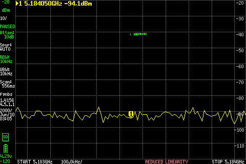

Before. [Numeric scan](files/j10-sweep-gain40-before.txt).

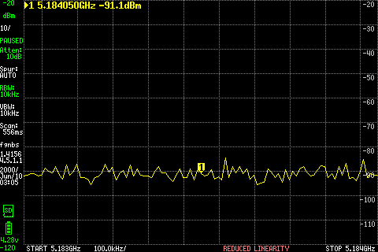

Active. [Numeric scan](files/j10-sweep-gain40-active.txt).

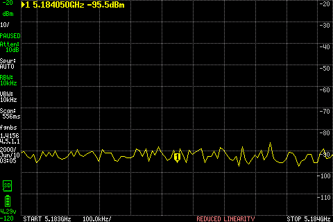

After. [Numeric scan](files/j10-sweep-gain40-after.txt).

### J10 sweep, gain 50

[Measurement record](files/j10-sweep-gain50.json).

Before. [Numeric scan](files/j10-sweep-gain50-before.txt).

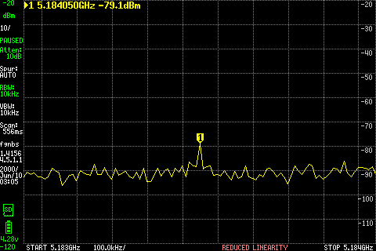

Active. [Numeric scan](files/j10-sweep-gain50-active.txt).

After. [Numeric scan](files/j10-sweep-gain50-after.txt).

### J10 sweep, gain 60

[Measurement record](files/j10-sweep-gain60.json).

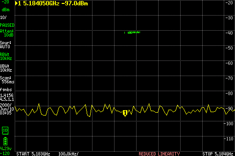

Before. [Numeric scan](files/j10-sweep-gain60-before.txt).

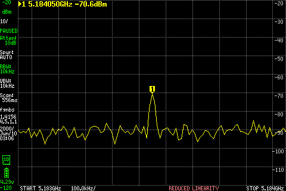

Active. [Numeric scan](files/j10-sweep-gain60-active.txt).

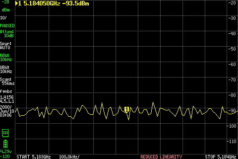

After. [Numeric scan](files/j10-sweep-gain60-after.txt).

## TX channel and bank source audit — October 25, 2026

This was a read-only audit of the rc.3 image's recorded source commit `be5e96e015921c2a5c438fbce5293489853ebb50`, the UHD recipe's pinned upstream commit `308126a479ca19dfaebfe4784b375e608788d763`, the exported schematic netlist and live PCB pad assignments. No RFIC initialization, tone, register write, schematic/PCB edit or component rework was performed. Installed `sdrb.py`, `sdrb_radio.py` and `sdrb_rpc.py` hashes matched the reviewed source. The radio remained unclaimed.

**No inconsistent TX channel or bank selection was identified in the reviewed source.** The intended mapping for our existing test is:

| Layer | Selection or connection found |
| --- | --- |
| GNU Radio/UHD | Channel 1 |
| SDRB host adaptation | Frontend swap enabled; channel 1 maps to physical TX1 |
| Streaming topology | TX1 enabled, TX2 disabled; SISO_TX0 |
| FPGA sample selection | Dboard control bit 1 clear selects the physical-TX1 input; the top-level wiring feeds RFNoC port 1 samples into that input |
| Bank request | `sdrb_tx_filter=highpass` constructs the native manager with its TX-B option |
| Native tuner | Requests register 0x004 bit 6 set at 5.184 GHz, selecting TX1B/TX2B bank B |
| Board route from TX1B | U25 M9/M10 → C131/C130 → T9 → U28 → U24 port 1/sum → C23 → U32 → C154 → U37 |
| Remaining J10 route | U37 → C158 → U45 → C209 → U13 → U12 Path B → U1 Path B → J10 |

The frontend helper, gain control and streaming topology agree on physical TX1. The pinned FPGA contains both the top-level channel swap and an explicit SISO channel selector; those agree with channel 1 / physical TX1 rather than requiring another channel change. The release source uses the same shared TX LO for both physical transmitters, so the native tune call naming TX1 does not itself select which sample stream is enabled.

**The legacy antenna label is misleading:** `TX1A_Direct1` remains the advertised string even when the separate claim-scoped high-pass option requests bank B. It is not an RF bank readback. [Analog Devices confirms that register 0x004 bit 6 selects B when set and A when clear](https://ez.analog.com/rf/wide-band-rf-transceivers/design-support/f/q-a/535515/ad9361-configuration-question/388745). The expected register bit here is a source-derived setting; it was not sampled during an active stream.

The input chain includes **U28 HFCN-2275+**, **U24 EP2K1+**, and **U32 LFCN-5850+** before either driver. Live PCB queries for T9, U28, U24, U32 and U37 agreed with the exported net assignments. The high-pass filter is specified across 2450–7000 MHz, and the combiner across 2000–26500 MHz, so 5.184 GHz is within those listed bands. [HFCN-2275+ datasheet](https://www.minicircuits.com/pdfs/HFCN-2275%2B.pdf), [EP2K1+ product specifications](https://www.minicircuits.com/WebStore/dashboard.html?model=EP2K1%2B). This is a design-connectivity check; actual population, solder quality and insertion loss remain unverified.

This audit does not prove the active RFIC registers or compiled C++ execution matched every expected setting, and it does not rule out leakage, an assembly problem or excess analog loss. No raw SPI access was attempted alongside MPM. Switch-control voltage checks already completed earlier were not repeated.

The next proposed non-rework check is a J10 frequency-response comparison within the high-band passband, retaining gain 60 and amplitude 0.1: for example nominal tones near **3.0, 4.0, 5.18405 and 5.8 GHz**, with analyzer scans recentered at each frequency and before/during/after records. No frequency sweep or higher TX setting was run as part of this audit.

## J10 frequency sweep — October 25, 2026

Following the source audit, I measured four nominal frequencies using **the same J10 → DC block → coax → tinySA chain**, with no external pad. AmpPwr1 remained powered under the prior 9 V setup, AmpPwr2 off. No new current/bias reading was taken during this sweep.

Source settings stayed at **gain 60, amplitude 0.1, two seconds**, Path B/high-pass, UHD channel 1, 2.304 MS/s and 8,000-byte frames. Each LO was nominal tone frequency minus 50 kHz; the complex tone offset stayed +50 kHz. Only these four LO values were permitted by the RAM-only launcher. The analyzer scan and marker were recentered for each frequency, retaining a 1 MHz span, 101 points, 10 kHz RBW, Ultra on, LNA off, **10 dB internal attenuation** and zero external correction.

| Nominal tone (GHz) | Before (dBm) | Tone-on window peak (dBm) | After (dBm) | Contrast (dB) | Interpretation |
| ---: | ---: | ---: | ---: | ---: | --- |
| 3.000000 | -98.62 | **-57.12** | -95.16 | +38.03 | Isolated tone |
| 4.000000 | -98.16 | **-70.00** | -99.66 | +28.16 | Isolated tone |
| 5.184050 | -88.94 | **-69.44** | -91.09 | +19.50 | Isolated tone |
| 5.800000 | -77.59 | **-65.09** | -81.59 | +12.50 | Broad spectral rise; isolated tone not established |

Values are numeric peaks within ±10 kHz of nominal. **3 GHz was 12.31 dB higher than 5.184050 GHz**, while 4 GHz and 5.184050 GHz differed by only 0.56 dB. This is the indicated response of the complete source/board/cable/DC-block/analyzer chain, not calibrated board insertion loss. Frequency response of the RFIC, board components, cables and analyzer has not been separated. The result is not a simple monotonic roll-off.

**Do not interpret the 5.8 GHz window peak as clean tone power.** Its active scan had a broad level rise, and the largest full-span bin was 5.800490 GHz at −64.56 dBm, slightly above the target bin. Excluding ±50 kHz around the target, the median scan level rose from **−81.06 dBm before to −71.56 dBm active**, returning to −81.59 dBm after. The separate active LCD also lacked the clearly isolated line seen at the other frequencies. Source noise, spurs or analyzer behavior remain possibilities; the present data does not distinguish them. This point needs a separate measurement check before power conclusions.

All four sources completed without reported stream/decode/cleanup errors; each retained one benign post-stop burst acknowledgement. Source-reported durations were approximately 2.0007–2.0014 seconds. Requested gain 60 matched readback in every run, and LO readbacks were within 10 Hz of request. Numeric scans completed within their active windows. No tone was retried and no gain/amplitude increase occurred.

### Capture-timing exception and acquisition correction

The 3 GHz capture passed the original 1.8-second LCD-freeze gate. At 4 GHz the source completed normally and the numeric scan was inside its active window, but the screen froze **1.824218 seconds** after the received start marker, causing the controller to stop the sequence. The 4 GHz original failure status remains in its measurement record. Its actual LCD shows the tone; the source reported 2.001329 seconds. These host timing observations are not independent RF timing calibration.

RF was paused while addressing acquisition overhead. Reducing serial read timeout from 100 ms to 20 ms gave an analyzer-only scan/freeze time of 1.604316 seconds, which narrowly failed an additional conservative 1.6-second preparation assertion. No RF was started in that preparation check. Queueing the same resume/wait/pause commands together and checking all three returned prompts then completed an analyzer-only check in **1.610519 seconds**, below its 1.7-second preparation threshold. [Initial analyzer-only record](files/j10-frequency-timing-initial.json) · [Batched-command timing record](files/j10-frequency-timing-batched.json).

The actual RF capture gate stayed **1.8 seconds**, and source timing/settings were unchanged. With the revised acquisition, the remaining 5.184050 and 5.8 GHz LCD freezes occurred at **1.625843 and 1.674699 seconds** and passed. No 4 GHz RF retry was needed to retain its valid numeric result and explicitly qualified screenshot.

The frequency allowlist/adapter/parser checks passed **13 tests on host and SDRB** before RF. Final checks showed the radio unclaimed, no failed services, and unchanged boot/module/application hashes. BACKUP-A remained mounted. RF is stopped; AmpPwr1 was left powered and AmpPwr2 off. No soldering, switch-control retest or doubler run occurred.

[Complete CSV](files/j10-frequency-sweep.csv). Every record retains original controller status, source result, scans and capture hashes, with derived interpretation separated. Below are 12 unmodified instrument LCD captures; numeric and LCD sweeps are distinct observations. Original RGB565 payloads and private console logs remain archived.

### J10 frequency sweep, 3.000000 GHz

[Measurement and review](files/j10-freq-3000000000.json).

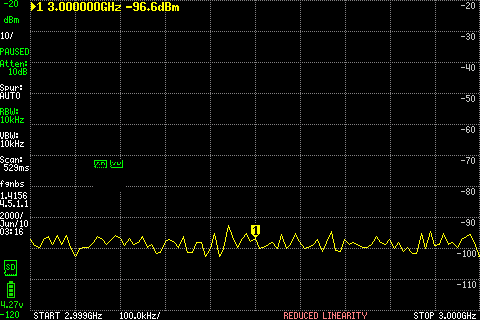

Before. [Numeric scan](files/j10-freq-3000000000-before.txt).

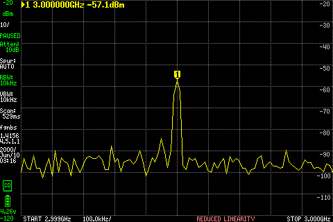

Active. [Numeric scan](files/j10-freq-3000000000-active.txt).

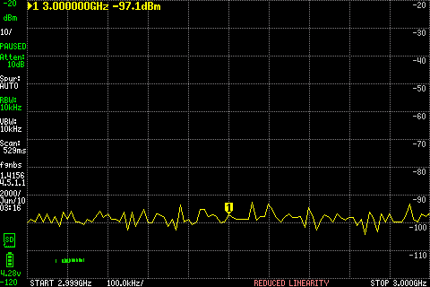

After. [Numeric scan](files/j10-freq-3000000000-after.txt).

### J10 frequency sweep, 4.000000 GHz

[Measurement and review](files/j10-freq-4000000000.json).

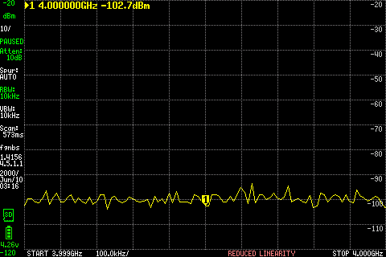

Before. [Numeric scan](files/j10-freq-4000000000-before.txt).

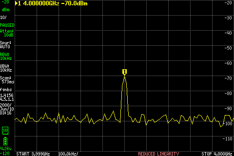

Active. [Numeric scan](files/j10-freq-4000000000-active.txt).

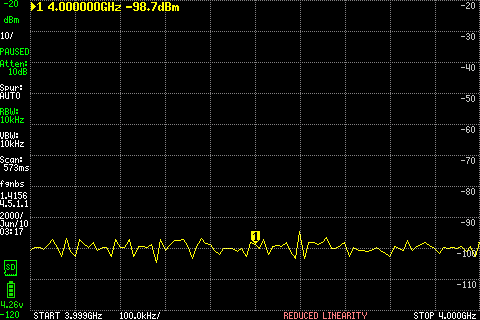

After. [Numeric scan](files/j10-freq-4000000000-after.txt).

### J10 frequency sweep, 5.184050 GHz

[Measurement and review](files/j10-freq-5184050000.json).

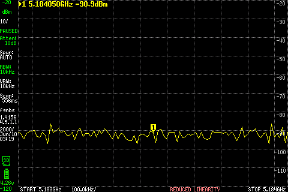

Before. [Numeric scan](files/j10-freq-5184050000-before.txt).

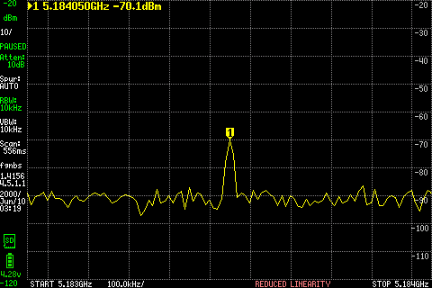

Active. [Numeric scan](files/j10-freq-5184050000-active.txt).

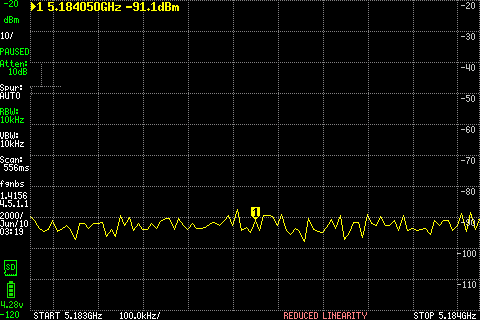

After. [Numeric scan](files/j10-freq-5184050000-after.txt).

### J10 frequency sweep, 5.800000 GHz

[Measurement and review](files/j10-freq-5800000000.json).

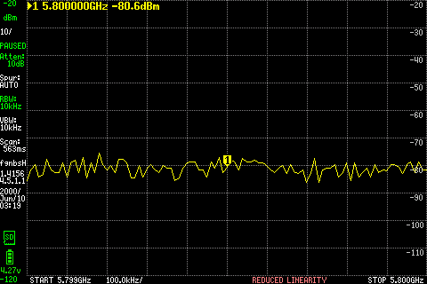

Before. [Numeric scan](files/j10-freq-5800000000-before.txt).

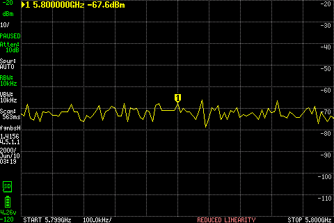

Active. [Numeric scan](files/j10-freq-5800000000-active.txt).

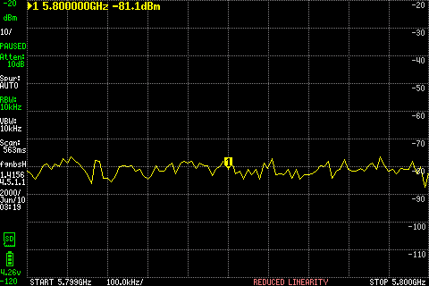

After. [Numeric scan](files/j10-freq-5800000000-after.txt).

## LibreSDR matching frequency sweep — October 25, 2026

The owner connected LibreSDR and moved the same measurement chain to **LibreSDR TXRA → DC block → coax → tinySA RF input**, with no external pad. SDRB was independently observed unclaimed before testing and remained disconnected from this RF chain. Its amplifier supply state was not remeasured or independently reconfirmed during this comparison.

LibreSDR used **UHD channel 0 / TX-RX, gain 40, amplitude 0.1**, 1 MS/s, a +50 kHz complex tone offset and a two-second host send-loop limit. Each requested LO was nominal tone frequency minus 50 kHz. The verified custom LibreSDR FPGA image was explicitly selected; the first initialization reloaded it after USB reconnection. No stock FPGA substitution was made. Eight dry configuration checks and three invalid-source-argument rejection checks passed without RF before the sweep.

The analyzer retained the SDRB sweep settings: Ultra on, LNA off, **10 dB internal attenuation**, 10 kHz RBW, zero external correction and a 101-point 1 MHz span recentered for each nominal frequency. The shorter serial timeout and batched display commands from the prior acquisition correction were retained; the capture gate remained 1.8 seconds.

| Nominal frequency (GHz) | Libre before (dBm) | Libre active peak (dBm) | Libre after (dBm) | Libre contrast (dB) | Earlier SDRB active window peak (dBm) |
| ---: | ---: | ---: | ---: | ---: | ---: |
| 3.000000 | -99.06 | **-50.09** | -94.06 | +43.97 | -57.12 |
| 4.000000 | -98.59 | **-53.44** | -98.59 | +45.16 | -70.00 |
| 5.184050 | -91.06 | **-53.41** | -90.56 | +37.16 | -69.44 |
| 5.800000 | -80.56 | **-60.56** | -81.56 | +20.00 | -65.09* |

Peaks are within ±10 kHz of nominal. LibreSDR's strongest active numeric bin was one 10 kHz grid step below nominal at each frequency. Independent oscillator/analyzer frequency calibration was not performed. The separate LCD markers at nominal read approximately **−50.1, −55.1, −56.9 and −65.6 dBm**, respectively; they are different frequency/sweep observations from the numeric peak values. Additional spectral components are visible, so this is not a spectral-purity qualification.

*The SDRB 5.8 GHz number remains a broad-rise target-window peak, not reliable isolated tone power. Do not treat that row as a calibrated source-power comparison.* The radios used different gain settings (LibreSDR 40, SDRB 60), and their own frequency responses and output calibrations are unqualified.

### What the comparison establishes

- LibreSDR's indicated target level dropped **3.34 dB from 3 to 4 GHz**, whereas SDRB's dropped **12.88 dB**. The difference in these relative changes is **9.53 dB**. This suggests an additional frequency dependence specific to the SDRB source/path compared with LibreSDR, but does not isolate its RFIC, amplifiers, filters or assembly, or yield calibrated board loss.
- LibreSDR's 4 and 5.184050 GHz levels were essentially equal. At 5.184050 GHz, the new −53.41 dBm reference is within 0.44 dB of its earlier −52.97 dBm result.
- **At 5.8 GHz, LibreSDR produced a resolved target tone without SDRB's broad active rise.** Outside ±50 kHz of nominal, LibreSDR scan medians were **−81.03 dBm before, −81.05 dBm active and −81.30 dBm after**. SDRB's earlier medians were −81.06 / −71.56 / −81.59 dBm. This demonstrates that the same receiver chain can resolve a nearby stronger tone without that broad rise; it focuses the next investigation on behavior associated with the SDRB test. It still does not rule out source-dependent analyzer responses or establish SDRB noise power.

All four LibreSDR source runs returned normally with no reported TX error events or cleanup errors, retaining only one burst acknowledgement per run. Actual gain readback was 40.0 and LO readback was within 10 Hz of each request. The host send loop lasted approximately **2.01025–2.01028 seconds** and queued **2,080,000 samples per run**, or 2.08 seconds at the nominal rate. These software counts/times are not independently measured RF burst durations. Gain was returned to zero during cleanup and no source process remained running.

All numeric scans and actual LCD freezes passed their active-window checks; freezes occurred approximately **1.542, 1.672, 1.597 and 1.661 seconds** after the received start marker. There was no screenshot timing exception, RF retry, power increase or change to SDRB software in this sweep. BACKUP-A remained mounted. RF is stopped.

[Complete CSV and side-by-side values](files/libresdr-frequency-sweep.csv). Below are 12 unmodified device captures; numeric and LCD scans are distinct observations. Each measurement record includes source results, original status, numeric scans, capture timing/hashes and a separately labeled derived median summary. Original RGB565 payloads and console logs are archived privately.

### LibreSDR frequency sweep, 3.000000 GHz

[Measurement and review](files/libre-freq-3000000000.json).

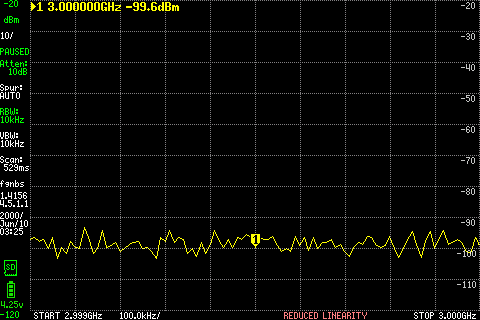

Before. [Numeric scan](files/libre-freq-3000000000-before.txt).

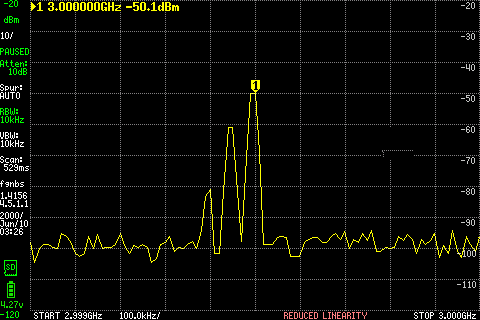

Active. [Numeric scan](files/libre-freq-3000000000-active.txt).

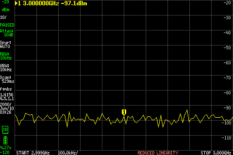

After. [Numeric scan](files/libre-freq-3000000000-after.txt).

### LibreSDR frequency sweep, 4.000000 GHz

[Measurement and review](files/libre-freq-4000000000.json).

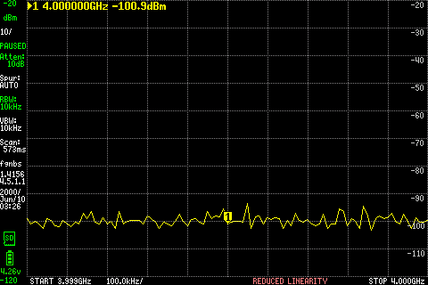

Before. [Numeric scan](files/libre-freq-4000000000-before.txt).

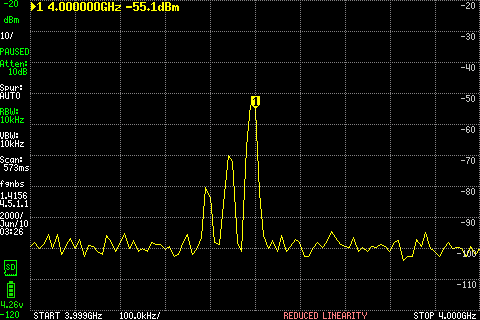

Active. [Numeric scan](files/libre-freq-4000000000-active.txt).

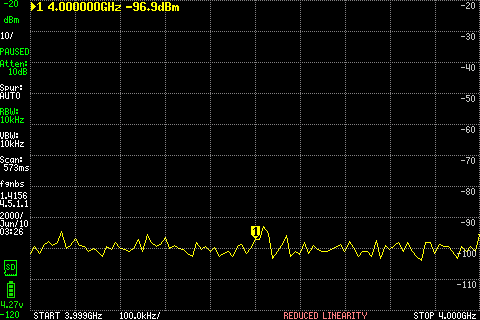

After. [Numeric scan](files/libre-freq-4000000000-after.txt).

### LibreSDR frequency sweep, 5.184050 GHz

[Measurement and review](files/libre-freq-5184050000.json).

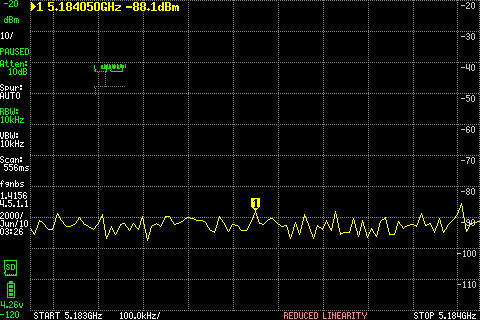

Before. [Numeric scan](files/libre-freq-5184050000-before.txt).

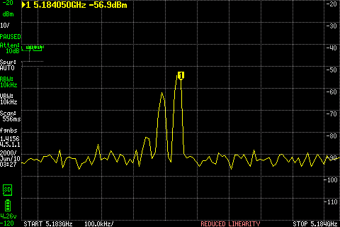

Active. [Numeric scan](files/libre-freq-5184050000-active.txt).

After. [Numeric scan](files/libre-freq-5184050000-after.txt).

### LibreSDR frequency sweep, 5.800000 GHz

[Measurement and review](files/libre-freq-5800000000.json).

Before. [Numeric scan](files/libre-freq-5800000000-before.txt).

Active. [Numeric scan](files/libre-freq-5800000000-active.txt).

After. [Numeric scan](files/libre-freq-5800000000-after.txt).

[Back to SDRB RF_Out](../007-sdrb-rf-out/README.md) · [Equipment reference](../../equipment/README.md) · [Lab Log](../../README.md)
