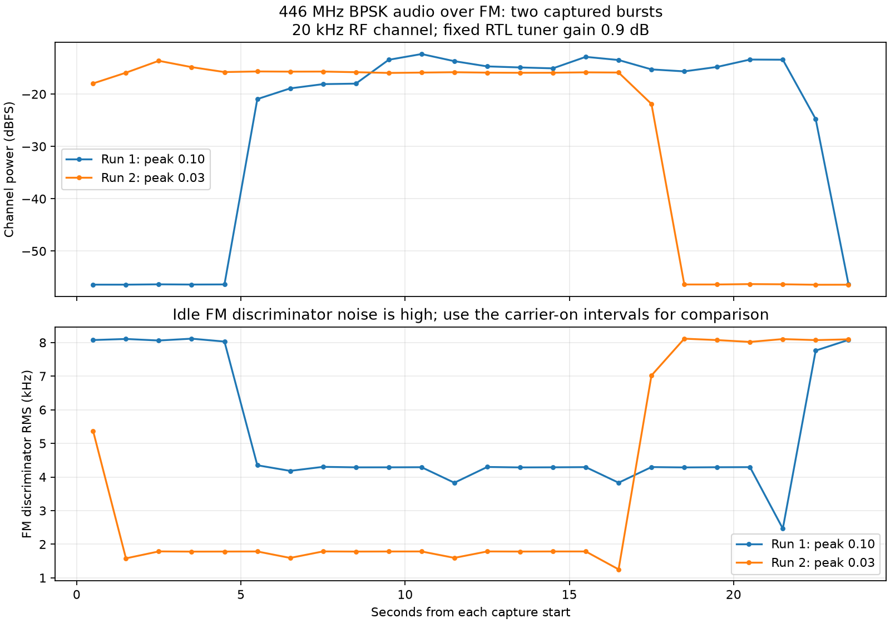

# 009 BPSK audio through a Quansheng FM radio to an RTL-SDR

**Status:** In progress

**Started:** 2026-10-28

**Updated:** 2026-10-28

I wanted to send an actual message from ember-ground through a Digirig Lite and handheld radio, then recover it with the RTL-SDR in my mobile Pi, outpost1. The first two bursts worked: **six of six packets decoded with valid CRCs and the exact transmitted text**. This was a nearby coupling test with a barrel load on the transmitter, not an antenna range test. A follow-up using the outdoor SatNOGS station recovered another **3/3 packets**, making **9/9 across three bursts**; that receiver was roughly 60+ feet away through the house, still with the barrel load on the transmitter.

## The question and signal path

The UV-5R and Quansheng are FM radios. Feeding BPSK audio into the microphone input produces **BPSK audio carried by FM**, rather than BPSK directly on the UHF carrier. The receiver therefore needs two demodulation steps:

```text
UTF-8 message → differential BPSK audio → Digirig Lite → UV-K5 microphone/PTT
→ 446.000 MHz FM → nearby RF coupling → RTL-SDR IQ capture
→ FM discriminator → audio BPSK decoder → sequence, text and CRC check
```

The decoder was given the packet format and carrier frequency, but was not given the expected message. Expected text was used afterward to compare the recovered bytes.

## Equipment and setup

| Part | Actual setup and limits |
| --- | --- |
| Transmit computer | ember-ground, Linux ARM64, Python 3.13.5, NumPy 2.2.4, ALSA aplay 1.2.14 |
| Interface | Digirig Lite, C-Media USB audio `0d8c:0012`, ALSA `plughw:CARD=Device,DEV=0`, C-Media GPIO3 PTT through `/dev/hidraw0` |
| Radio cable | The **black audio/PTT cable** tested earlier with both the UV-5R and Quansheng. The green cable did not key the UV-5R; manufacturer's green cable in the Baofeng set is for serial programming. See [equipment notes](../../equipment/README.md#digirig-lite--uv-5r-cable-selection-and-test). |
| Transmitter | Quansheng **UV-K5 running iJV custom firmware**, owner-reported **Low** power; firmware version, numerical RF power and wide/narrow setting were not recorded |
| Frequency | Radio display setting **446.000 MHz**, supplied by the owner |
| Transmit RF connection | Initially an owner-described “MJF telescoping 144/440” antenna. Before either data burst, the owner replaced it with the **unmarked black barrel load**, one connector, fitted in place of the antenna. Identity, impedance, frequency coverage and power rating unverified. |
| Receive computer | **outpost1**, Raspberry Pi 4 Model B Rev 1.4, approximately 2 GB RAM, fresh 64 GB microSD, 64-bit Raspberry Pi OS Lite / Debian 13 Trixie. Mobile Pelican-case setup with keyboard and screen; no desktop environment installed. |
| Receiver | RTL2838 USB dongle, tuner identified by librtlsdr as **Rafael Micro R820T**; exact marketed dongle model not recorded |
| Receive antenna and spacing | Antenna supplied with the LibreSDR, owner reports suitable for 70 cm; exact antenna details unknown. Roughly **three feet** between radios/receiver before testing; no surveyed distance after fitting the barrel load. |
| Receiver settings | 446.050 MHz center, 240 ksample/s, **0.9 dB requested and reported tuner gain**, no ppm correction supplied, 24-second unsigned 8-bit interleaved IQ captures |
| Receive software | rtl-sdr and librtlsdr0 **2.0.2-2+b1**, NumPy **2.2.4**, SciPy **1.15.3** |

The receiver is deliberately tuned 50 kHz above the radio setting. Software shifts the wanted channel down from −50 kHz, keeping it away from receiver DC artifacts. No cable connects transmitter RF output to the RTL-SDR input. The coupling mechanism with the barrel load was not characterized.

There are no setup photos in this entry yet. The equipment identities and physical arrangement above come from owner reports and live software checks, not a reconstructed photo.

## Bringing up outpost1

The old Houston installation developed SD-card write and filesystem errors while updating. I chose a spare card rather than preserve that installation. The replacement was written with the official **2026-10-06 Raspberry Pi OS Lite 64-bit** image. Both the uncompressed image checksum and the card readback matched the published SHA-256. Offline FAT and ext4 checks passed. The initial headless setup used cloud-init, wired DHCP and SSH keys; the login was subsequently changed to `ngrabbs`, and `pi` login was disabled. Twenty-one available package updates completed on the fresh card.

For this experiment I installed:

```sh
# On outpost1
sudo apt-get update
sudo apt-get install -y rtl-sdr python3-numpy python3-scipy
```

The first SDR open failed with `usb_open error -3`, a permissions error. The installed librtlsdr package supplied `/usr/lib/udev/rules.d/60-librtlsdr0.rules`, but the already-attached device had not received those permissions. I applied the rules without unplugging it:

```sh
sudo udevadm trigger --action=change --subsystem-match=usb
sudo udevadm settle
```

The USB device then belonged to `root:plugdev` with group read/write permission, and `ngrabbs` was already in `plugdev`. librtlsdr detached the DVB kernel driver for each capture and reattached it afterward. No permanent kernel-module blacklist was needed. A five-second receiver-only capture at gain 14.4 dB preceded the data tests; it is not used in the reported comparisons. Both data captures used 0.9 dB.

## The modem and packet format

The full source is [modem.py](files/modem.py). This is a custom experimental format, **not PSK31** and not an implementation of an interoperable packet standard.

| Parameter | Value |
| --- | --- |
| Modulation | Differential binary PSK of a 1,500 Hz audio carrier; bit 1 reverses phase, bit 0 preserves phase |
| Symbol and raw bit rate | 100 symbols/s = 100 bit/s; one bit per symbol |
| Audio | 48,000 samples/s, signed 16-bit PCM; signal on left channel, zero on right |
| Training | 64 alternating bits |
| Sync word | `1a cf fc 1d`, 32 bits |
| Header | Version 1: one byte; sequence: two bytes; UTF-8 payload length: two bytes |
| Byte/bit order | Big endian, most significant bit first |
| Error detection | Four-byte CRC32 of header plus payload, Python `zlib.crc32` |
| Error correction / acknowledgments | None; three numbered copies sent in each burst, no automatic retransmissions |
| Phase transitions | Symbol signs convolved with a normalized 49-sample Hann window, about 1 ms smoothing; not root-raised-cosine shaping |

Each payload was 41 bytes:

```text
EMBER > outpost1: BPSK/FM test 2026-10-28
```

Each complete frame is **496 bits / 4.96 seconds**. Three frames, initial silence, interframe silences and trailing silence make a **16.18-second WAV**. [transmit.py](files/transmit.py) asserts GPIO3, waits 0.3 seconds, plays the WAV, and releases GPIO3 in a `finally` block. A separate process sends another release after the waveform duration plus three seconds. It rejects WAVs longer than 25 seconds and checks the HID device identity. The watchdog is software protection, not a guarantee against hardware or OS failure.

ALSA playback stayed at **46% / −20 dB** in both runs. Run 1 used digital peak amplitude 0.10 (−20 dBFS peak); run 2 used 0.03 (−30.46 dBFS peak). These digital and mixer settings are not RF power settings. Input AGC was disabled and microphone playback monitoring muted during the earlier interface checks.

The receive path applies a sixth-order 10 kHz low-pass to the translated complex samples, producing a nominal 20 kHz RF channel, then decimates from 240 ksample/s to 48 ksample/s. The FM discriminator uses adjacent-sample phase differences. A 300–3,000 Hz audio bandpass precedes BPSK decoding. The decoder mixes at 1,500 Hz, resamples to 6 ksample/s, low-passes at 250 Hz, integrates over symbols and tries all 60 integer timing offsets. Adjacent complex symbol products recover differential bits. Candidates allow at most two sync errors but require a valid header and CRC. Results are deduplicated by sequence number; this receiver is for these short bench captures, not a general streaming protocol.

The offline self-test decodes delayed, polarity-inverted audio with added noise, and rejects a noise-only sample. Those synthetic data are separate from the RF results below.

## Commands to reproduce the transfer

The private LAN addresses used during the experiment are omitted. Substitute SSH destinations for the two host variables. Run these workstation commands from a clone of this repository:

```sh
TX_HOST=ngrabbs@YOUR_EMBER_HOST
RX_HOST=ngrabbs@YOUR_OUTPOST_HOST
FILES=entries/009-bpsk-over-fm/files
REMOTE=/home/ngrabbs/work/bpsk-fm-test

ssh "$RX_HOST" "mkdir -p $REMOTE"
ssh "$TX_HOST" "mkdir -p $REMOTE"
scp "$FILES/modem.py" "$RX_HOST:$REMOTE/"
scp "$FILES/transmit.py" "$TX_HOST:$REMOTE/"
```

I first ran the self-test, then generated run 1 on outpost1:

```sh
cd /home/ngrabbs/work/bpsk-fm-test
python3 modem.py selftest
python3 modem.py encode \
  --message 'EMBER > outpost1: BPSK/FM test 2026-10-28' \
  --count 3 --wav tx.wav
```

Copy the WAV through the workstation to ember-ground; the Pi-to-Pi copy does not require sharing private SSH keys:

```sh
scp "$RX_HOST:$REMOTE/tx.wav" ./tx.wav
scp ./tx.wav "$TX_HOST:$REMOTE/tx.wav"
```

In the receiver SSH session, start the capture:

```sh
cd /home/ngrabbs/work/bpsk-fm-test
date -u +%FT%TZ > rx01-start.txt
rtl_sdr -f 446050000 -s 240000 -g 0.9 -n 5760000 \
  rx01.iq > rx01-rtl.log 2>&1
```

As soon as its log says `Reading samples in async mode...`, run in the transmitter session, leaving enough time for the full 16.6-second burst inside the 24-second capture:

```sh
cd /home/ngrabbs/work/bpsk-fm-test
python3 -u transmit.py tx.wav > tx01.log 2>&1
```

After capture completes, decode on outpost1:

```sh
python3 modem.py decode rx01.iq --json rx01.json
```

For run 2, I regenerated the WAV at a lower amplitude, transferred it in the same way, and repeated the capture/transmit/decode commands with the `02` filenames:

```sh
python3 modem.py encode \
  --message 'EMBER > outpost1: BPSK/FM test 2026-10-28' \
  --count 3 --amplitude 0.03 --wav tx02.wav
# Copy tx02.wav to ember-ground, then use:
# Receiver: rtl_sdr ... rx02.iq > rx02-rtl.log 2>&1
# Transmitter: python3 -u transmit.py tx02.wav > tx02.log 2>&1
# Receiver: python3 modem.py decode rx02.iq --json rx02.json
```

The optional [run_trial.sh](files/run_trial.sh) automates copying, capture readiness, transmit and decode for a future numbered run. It was written after these first two tests; the original captures used the commands above. From the workstation, an example is:

```sh
TX_HOST=ngrabbs@YOUR_EMBER_HOST RX_HOST=ngrabbs@YOUR_OUTPOST_HOST \
  bash entries/009-bpsk-over-fm/files/run_trial.sh 04 0.03
```

Check the selected radio, frequency, RF connection and clear channel before running any transmit command. These scripts do not set the radio's frequency or power. A future antenna test should be separate from this barrel-load test.

## Captures and results

The first two captures each contain **5,760,000 complex samples / 11,520,000 bytes / 24.0 seconds**. The original files are [rx01.iq](files/rx01.iq) and [rx02.iq](files/rx02.iq); derived FM audio is [rx01.wav](files/rx01.wav) and [rx02.wav](files/rx02.wav). The WAV files use a fixed conversion of ±12 kHz discriminator output to digital full scale; their amplitude is not received RF power.

| Result | Run 1: peak 0.10 | Run 2: peak 0.03 |
| --- | ---: | ---: |
| Valid packets / transmitted packets | **3 / 3** | **3 / 3** |
| Recovered payload | 123 bytes | 123 bytes |
| Payload-byte mismatches versus transmitted data | 0 | 0 |
| Sync-bit errors in accepted packets | 0 | 0 |
| Host-measured PTT interval | 16.586 s | 16.587 s |
| Aggregate payload throughput, including repeated copies | 59.33 bit/s | 59.32 bit/s |
| Median carrier-on channel power | −14.86 dBFS | −15.83 dBFS |
| Carrier-off channel power, final one-second window | −56.35 dBFS | −56.43 dBFS |
| On/off channel-power contrast | 41.49 dB | 40.60 dB |
| Combined transmitter/receiver frequency offset estimate | +359 Hz | +361 Hz |
| Median FM discriminator frequency variation, RMS | 4.291 kHz | 1.785 kHz |
| ADC samples at ≤1 or ≥254, fraction | 0 | 0 |

The message is repeated three times: **41 distinct text bytes per burst**, or 123 aggregate payload bytes. Each packet has a distinct sequence field and CRC. For sequences 1, 2 and 3, both runs recovered CRC values `0cb8c656`, `72c08ef0` and `58e8b692`.



The plot now includes the SatNOGS follow-up below. Levels from the two different receivers are not cross-calibrated. The bursts start at different times within their captures. Carrier-off FM discriminator noise is high, so the lower plot is meaningful as a modulation comparison only during the carrier-on intervals. Lowering digital drive by **10.46 dB** reduced the recovered frequency variation while preserving all three packets. The response was not a calibrated linear gain measurement; the lower amplitude is the better starting setting for subsequent tests, not a proven optimum.

### What the dB and frequency numbers mean

The channel-power reference is `10 log10(mean(|IQ_filtered|²))`, after mapping each ADC component from 0–255 to approximately −1…+1. Thus a complex magnitude of 1 is the 0 dBFS reference. This is **not dBm**. The 0.9 dB tuner gain setting is a receiver control, not a received-power measurement.

[analyze.py](files/analyze.py) selects full-second blocks whose midpoints fall within decoded packet-body windows. It uses the median linear channel power in those blocks and compares it with the final, carrier-off second of each recording. Under stable noise/interference and linear receiver assumptions, `(P_on − P_off) / P_off` gives a rough signal-to-off-noise estimate: **41.49 dB** and **40.59 dB** in this nominal 20 kHz channel. The safer direct observation is the listed **on/off contrast**. This is not calibrated RF SNR, audio SNR, Eb/N0 or a sensitivity test; external interference, changing coupling, receiver compression or gain behavior could bias it. Zero rail hits does not prove absence of analog overload.

The +359/+361 Hz values come from mean FM discriminator output in the selected carrier-on blocks. They combine the radio's offset, receiver oscillator error and processing effects; neither oscillator was calibrated. RMS frequency variation includes modulation, noise, filtering and distortion and is **not a calibrated peak-deviation measurement**.

The radio remained on the owner-reported Low setting. No RF wattmeter was used, and no calibrated antenna factor, path loss or load isolation is available. Consequently this entry makes **no numerical claim for transmitter watts, EIRP, received dBm or link budget**. Six successful packets are a short functional demonstration, not a long-run packet-error-rate or BER characterization.

The published receiver logs omit the USB serial field; their unredacted originals remain outside the repository. IQ captures are unchanged. The first two rtl-sdr logs print an initial `[R82XX] PLL not locked!` message, then report the requested frequency, sample rate and gain and deliver the complete captures. This startup warning is preserved in the logs. Successful decoding establishes reception in this setup, not frequency calibration. The logs do not report sample-loss errors, but that does not independently prove loss-free USB delivery.

## Reanalyzing the saved evidence

Keep the IQ originals unchanged. To reproduce decoding on a Linux machine with NumPy and SciPy:

```sh
cd entries/009-bpsk-over-fm/files
sha256sum -c SHA256SUMS
python3 modem.py selftest
python3 modem.py decode rx01.iq --json replay01.json
python3 modem.py decode rx02.iq --json replay02.json
python3 modem.py decode rx03.iq --json replay03.json
```

The originally recorded outputs remain [rx01.json](files/rx01.json), [rx02.json](files/rx02.json) and [rx03.json](files/rx03.json). To regenerate derived summaries and the plot, install Matplotlib as well and run `python3 analyze.py`. This updates only `summary.json`, `summary.csv`, `SHA256SUMS` and the comparison PNG; it does not change the original captures or original decoder JSON.

## Follow-up: outdoor SatNOGS station, still with the barrel load

The next receiver was the existing SatNOGS station, with a **VHF/UHF J-pole at the back of the house on the side of the tower**. The owner estimated **60 feet or more** from the Quansheng, with the house in between. The Quansheng stayed at **446.000 MHz, Low power, barrel load fitted**, and used the same black Digirig cable and peak-0.03 WAV from run 2. The text still says “outpost1” because the same waveform was intentionally reused; the actual receiver for run 3 was the SatNOGS station.

This dongle identifies as an **RTL-SDR Blog V4 with a Rafael Micro R828D tuner**, different from outpost1's R820T. Its Linux host runs Debian 12 Bookworm. Host rtl-sdr/SciPy were not installed, but its existing `librespace/satnogs-client:2.1.2` container already supplied Python 3.11.2, NumPy 1.24.2, SciPy 1.10.1, and rtl-sdr/librtlsdr0 `2.0.2-2~bpo12+1satnogs1`.

The client was idle: no observation worker was running and the USB device was not held open. I briefly paused the SatNOGS client, ran a separate temporary container from the same existing image, then unpaused the client as soon as capture finished. A one-minute systemd timer provided a backup unpause in case the shell exited unexpectedly. Decoding then ran in another temporary container without access to the USB device. No host packages were installed for this follow-up.

After copying `modem.py` to the same work directory on the station, the station-side capture commands were:

```sh
sudo bash <<'SH'
set -euo pipefail
cd /home/ngrabbs/work/bpsk-fm-test
test ! -e rx03.iq
cleanup() {
  docker unpause satnogs_satnogs-client
  systemctl stop satnogs-bpsk-resume03.timer || true
}
docker pause satnogs_satnogs-client
trap cleanup EXIT
systemd-run --unit=satnogs-bpsk-resume03 --on-active=60s \
  /usr/bin/docker unpause satnogs_satnogs-client
date -u +%FT%TZ > rx03-start.txt
docker run --rm --name bpsk-capture03 --network none \
  --device /dev/bus/usb/001/003 \
  -v /home/ngrabbs/work/bpsk-fm-test:/work -w /work \
  --entrypoint /usr/bin/rtl_sdr librespace/satnogs-client:2.1.2 \
  -f 446050000 -s 240000 -g 0.9 -n 5760000 rx03.iq \
  > rx03-rtl.log 2>&1
SH
```

The USB path above was the path observed during this test; check `lsusb` and current device use before repeating. Do not pause an active observation. In the ember-ground session, while this capture was running:

```sh
cd /home/ngrabbs/work/bpsk-fm-test
python3 -u transmit.py tx02.wav > tx03.log 2>&1
```

Then, on the station:

```sh
sudo docker run --rm --network none \
  -v /home/ngrabbs/work/bpsk-fm-test:/work -w /work \
  --entrypoint /usr/bin/python3 librespace/satnogs-client:2.1.2 \
  modem.py decode rx03.iq --json rx03.json
sudo docker inspect --format 'running={{.State.Running}} paused={{.State.Paused}}' \
  satnogs_satnogs-client
# Verified after capture: running=true paused=false
```

### SatNOGS result

**All three packets decoded**, with the same exact 41-byte message, sequences 1–3 and expected CRCs. There were zero payload-byte mismatches and zero sync-bit errors in the accepted packets. Host-measured PTT was **16.586 seconds**, with **59.33 bit/s** aggregate payload throughput including the repeated copies.

| Run 3 measurement | Result |
| --- | ---: |
| Valid / sent packets | **3 / 3** |
| Capture | 24.0 s / 5,760,000 complex samples / 11,520,000 bytes |
| Median carrier-on channel power | −31.93 dBFS |
| Carrier-off final second | −56.36 dBFS |
| On/off channel-power contrast | **24.43 dB** |
| Estimated signal-to-off-noise ratio under the earlier assumptions | 24.42 dB |
| Combined transmitter/receiver frequency offset | +1,812 Hz |
| Median FM discriminator frequency variation, RMS | 1.793 kHz |
| ADC rail fraction | 0 |

The same measurement definitions and limitations apply. The R828D and R820T receivers, antennas and paths differ, so subtracting their dBFS numbers would not be a calibrated path-loss measurement. The offset is a combined estimate, not an error assigned to either radio. The receiver-only contrast is not a calibrated SNR or sensitivity figure.

This establishes reception at the outdoor J-pole across the reported house path, **with the barrel load on the transmitter**. It is not yet a comparison using the telescoping transmit antenna, a measured distance test, or an RF-power measurement. The successful result should not be used to infer a characterized load isolation or link budget.

Evidence: [original IQ](files/rx03.iq), [derived audio](files/rx03.wav), [decoder result](files/rx03.json), [receiver log with serial omitted](files/rx03-rtl.log), [PTT log](files/tx03.log), [transmit manifest](files/tx03.json). The manifest is copied from run 2 because exactly that waveform was played again. The updated summary and comparison plot include all three runs. The original receiver JSON remains unchanged, and a second offline replay independently recovered all three packets.

## Watching the signal in a terminal

A screenshot supplied by the owner showed a custom UHD/USRP text display (`uhd_audio_bars.py`) and a scrolling ASCII waterfall. `RFNOC::GRAPH` in that screenshot is a UHD diagnostic tag, not the display program's name. For the RTL-SDR station, [live_waterfall.py](files/live_waterfall.py) provides a comparable terminal waterfall using the existing container, NumPy and Python curses. The script displays a 40 kHz span centered on 446.000 MHz, using 8,192-point Hann-window FFTs and four-frame averaging at 240 ksample/s. The fixed color scale is −95 to −40 dBFS per FFT bin, uncalibrated. It is a receiver display, not a message decoder or a calibrated RF instrument.

[waterfall.sh](files/waterfall.sh) checks whether the USB device is in use, pauses the idle SatNOGS client, starts the live receiver and restores the client on exit. Both files are installed in the station's existing `/home/ngrabbs/work/bpsk-fm-test` directory. A four-second live startup/exit test passed, and the client was verified running and unpaused afterward. No additional transmission was made for that startup test.

From one workstation terminal:

```sh
ssh -t ngrabbs@YOUR_SATNOGS_HOST '~/work/bpsk-fm-test/waterfall.sh'
```

Then from a second terminal, trigger the already prepared lower-drive burst on ember-ground:

```sh
ssh ngrabbs@YOUR_EMBER_HOST \
  'cd ~/work/bpsk-fm-test && python3 transmit.py tx02.wav'
```

Watch near 446.000 MHz for the roughly 16.6-second FM burst. The earlier receiver offset estimate suggests it may appear around 446.002 MHz on this receiver. Press **q** or **Ctrl-C** in the waterfall to quit and resume SatNOGS. The script uses the USB path observed in this session; update it if the dongle moves. It refuses to start if the dongle is already open, and should not be used to interrupt a scheduled observation.

## Follow-up on October 29

[Entry 010](../010-ember-fm-beacon/README.md) moves the Digirig to outpost1 and the Baofeng, sends 1,200-baud EMBER-format ground-test heartbeats over FM, appends CW KI5YNG identification, and adds a two-minute timer with short SatNOGS receiver reservations. It remains distinct from native RF BPSK.

## Next steps

- Restore the telescoping transmit antenna, increase separation, and record actual antenna models, distance, radio bandwidth and iJV firmware version. Treat that as a new test configuration.
- Begin with digital peak 0.03 and fixed receiver gain, then measure a longer sequence of distinct messages and packet outcomes across distance and attenuation.
- Use a calibrated power meter and a suitable characterized RF load/attenuator if watts, dBm or a real link budget are required. The barrel device and Pacific Antenna load have not been qualified here at 446 MHz.
- Record an independent known-good receive signal or frequency reference before separating transmitter and receiver frequency errors.

## Files and references

- [Source modem](files/modem.py), [bounded PTT playback](files/transmit.py), [optional future-run helper](files/run_trial.sh), [summary/plot analysis](files/analyze.py)
- [Run 1 transmit manifest](files/tx.json), [run 2 manifest](files/tx02.json), [summary JSON](files/summary.json), [summary CSV](files/summary.csv), [capture hashes](files/SHA256SUMS)
- [Run 1 receiver log](files/rx01-rtl.log), [run 2 receiver log](files/rx02-rtl.log), [run 1 PTT log](files/tx01.log), [run 2 PTT log](files/tx02.log)
- [Digirig Lite setup manual](https://digirig.net/digirig-lite-setup-manual/) and [Baofeng cable set](https://digirig.net/product/baofeng-cables/)
- [RTL-SDR project](https://osmocom.org/projects/rtl-sdr/wiki) and [rtl_fm source](https://github.com/osmocom/rtl-sdr/blob/master/src/rtl_fm.c), useful background for the FM stage; this experiment demodulates saved IQ in Python rather than running rtl_fm
- [Raspberry Pi headless cloud-init setup](https://www.raspberrypi.com/news/cloud-init-on-raspberry-pi-os/)
- [Equipment inventory](../../equipment/README.md) · [Back to Lab Log](../../README.md)
