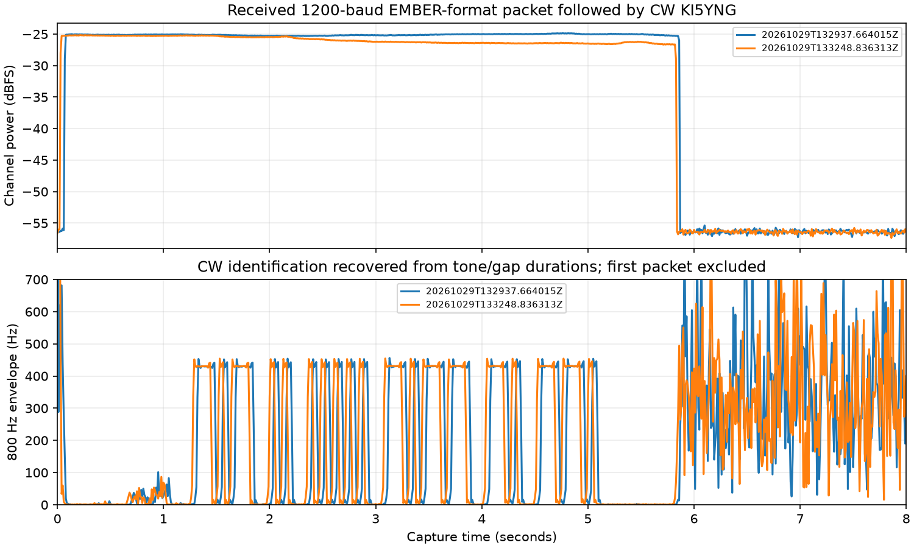

# 010 Two-minute EMBER-format beacon through the Baofeng

**Status:** In progress

**Started:** 2026-10-29

**Updated:** 2026-10-29

I moved the Digirig Lite to **outpost1** and connected the working black audio/PTT cable to the **Baofeng UV-5R**. The goal was to send an EMBER-format 1,200-baud packet every two minutes and decode it at the outdoor SatNOGS station, while returning the shared RTL-SDR to normal SatNOGS use between bursts. The callsign is **KI5YNG**.

## What is actually being tested

This uses the **native EMBER packet format and unchanged native DBPSK decoder**, carried as audio inside FM. The Baofeng is an FM transmitter; this is not EMBER's native RF BPSK waveform or a FUNcube/AO-40-compatible transmission. It extends the earlier [100-baud HT test](../009-bpsk-over-fm/README.md) with a 1,200-baud modem and the real EMBER framing/codec.

```text
outpost1 → native-format ground-test HEARTBEAT → EMBER v3 frame
→ 1,200-baud differential BPSK on 1,500 Hz audio → Digirig Lite
→ Baofeng FM at 446.000 MHz → SatNOGS outdoor J-pole / RTL-SDR
→ FM discriminator → audio downconversion → unchanged EMBER decoder
→ native CRC/schema checks → exact byte comparison with the transmit record
```

No Pico or IHU is attached to outpost1 for this test. The transmitter **emulates source=COMMS, target=GROUND** so it can exercise the native telemetry codec. The packet is a `HEARTBEAT` with `COMMISSIONING`, `GROUND_TEST`, and `telemetry_period_ms=120000`. Uptime comes from outpost1's `/proc/uptime`, and the nonzero 32-bit source boot identity is derived from its Linux boot UUID. These are **Pi-generated bench packets, not spacecraft measurements**. Every TX/RX record is marked `bench_source_emulated=true`. There is no Yamcs forwarding or command dispatch.

The callsign is appended **audibly in CW at 800 Hz / 20 WPM** after each packet. The native HEARTBEAT has no callsign string field. Receiver JSON's `callsign` is configuration metadata, not an independently decoded CW result.

## Equipment and settings

| Part | Setup |
| --- | --- |
| Transmitter host | outpost1, Raspberry Pi 4, 64-bit Raspberry Pi OS Lite, account `ngrabbs` |
| Radio | Baofeng UV-5R; owner confirmed the earlier 446.000 MHz / Low / barrel-load arrangement for this test |
| Interface | Digirig Lite `0d8c:0012`, black audio/PTT cable, ALSA `plughw:CARD=Device,DEV=0` |
| PTT | C-Media GPIO3. The Digirig was **`/dev/hidraw2`**, while hidraw0/1 were the keyboard. Code discovers and verifies the USB identity; it never assumes hidraw0. |
| Audio settings | Speaker playback 46% / −20 dB; digital waveform peak 0.03 (−30.46 dBFS). Mic playback monitoring muted; AGC disabled. These are not RF watts or deviation calibration. |
| Receive station | Existing SatNOGS host and `librespace/satnogs-client:2.1.2` image, RTL-SDR Blog V4/R828D |
| Receive antenna/path | Outdoor VHF/UHF J-pole at the back of the house on the side of the tower; previously reported roughly 60+ feet away through the house. No new surveyed distance or feedline measurement. |
| Capture | 446.050 MHz center; 240 ksample/s; gain 0.9 dB; 12 seconds / 2,880,000 complex samples / 5,760,000 unsigned 8-bit IQ bytes |
| Native packet / frame | 38-byte HEARTBEAT, including native CRC16; 101-byte EMBER v3 frame including outer CRC32, preamble, sync and guard |
| Data airtime | 808 symbols / 1,200 = **0.673333 seconds** |
| Complete WAV | **5.083333 seconds**, including initial tone/silences and CW identification; PTT includes another 0.3-second settling interval and device overhead |

RF load match/rating, transmitter watts, received dBm, antenna gain and link budget remain unmeasured. Radio frequency and power are manual settings; the configuration field records intent and does not program the Baofeng.

## Code and provenance

- [radio.py](files/radio.py): native packet creation, 1,200-baud audio modulation, CW identification, identity-checked GPIO3 PTT and FM receive processing.
- [beacon.py](files/beacon.py): one attempted beacon, persistent sequence number, receiver-readiness handshake, TX/RX logging and exact received-byte comparison.
- [receiver.py](files/receiver.py): command-restricted SSH capture request, idle admission, temporary SDR reservation, restoration and native decoding.
- [service](files/ember-beacon.service) and [timer](files/ember-beacon.timer): run one attempt every 120 seconds while armed.
- [vendor source](files/vendor/SOURCE.txt): **unmodified** `ground/bpsk/modem.py`, `ground/ember/codec.py` and `dictionary.json` from [EMBER commit 06680f3](https://github.com/ngrabbs/ember/tree/06680f3d256bc71e107fe5be377b929e5bf25033). These provide the real frame builder, native codec and strict decoder. No new license is assigned to these files.

The audio modulator uses 40 samples per symbol at 48 ksample/s and a normalized 9-sample Hann kernel to soften phase transitions. It is not root-raised-cosine shaping. The packet has the same 32-byte `0x55` preamble, `1ACFFC1D` sync, version 3, 32-bit sequence, 16-bit native length, native bytes, outer CRC32 and 16-byte zero guard as EMBER.

Receive processing translates the desired channel from −50 kHz to DC, applies a sixth-order 10 kHz low-pass, decimates to 48 ksample/s, and performs FM discrimination. A 300–3,000 Hz bandpass precedes mixing the BPSK audio down from 1,500 Hz. A 1,100 Hz low-pass feeds the unchanged EMBER decoder. A simple carrier-on power threshold locates the beginning of a 1.5-second decode window; the packet precedes the longer CW ID, which is excluded from native carrier acquisition. This acquisition method is tailored to this short, strong bench link, not a general weak-signal modem.

Offline checks covered canonical native packet/CRC agreement, 1,200-baud audio loopback, a corrupted native CRC rejection, and a synthetic FM/unsigned-8-bit-IQ round trip through the receive pipeline. Synthetic data are not RF evidence.

## Sharing the receiver and controlling transmission

Each outpost1 attempt requests a receive window over SSH before opening PTT. The dedicated SSH key is restricted to this source host and a forced `receiver.py` command; a request other than `capture` is rejected. Private keys, host-key files and private LAN addresses are not published.

The receiver skips if its own lock is held, the SDR is open, the client is stopped/already paused, or a SatNOGS worker is present. It checks the process list again after pausing to catch a worker that started during admission. Only after the SDR reports buffer allocation does it print `READY`. Outpost1 transmits only after that response. It checks the resulting sequence and complete native hex against its own generated packet, rather than counting any received packet as success.

The 12-second capture runs in a temporary container with USB access and no network. The SatNOGS client is unpaused immediately after capture, **before** decoding in a second container without USB access. A separate 25-second systemd recovery timer stops the temporary capture and unpauses the client if the receiver process is lost. Normal cleanup cancels that timer. These short reservations can still delay a job that becomes due inside a reservation; this is not a guarantee that a shared receiver can observe two signals simultaneously.

Every TX attempt holds a local file lock. The audio helper sends PTT release in `finally`; a separate process verifies the Digirig identity and sends a backup release. `ExecStopPost` sends another release when the service exits or is stopped. The service timeout bounds a stuck attempt. These are software safeguards, not a hardware RF interlock.

All decoded JSON results are retained. Only the first **three** receive-window IQ captures are copied to the receiver's `proofs/` directory; subsequent routine IQ is temporary in `/dev/shm`, decoded, and discarded. This keeps an unattended two-minute beacon from filling the station's small SD card. The saved proof originals are not modified; public copies of their RTL logs omit the USB serial field.

## Deployment commands

The code lives on each machine in `/home/ngrabbs/work/ember-beacon`. On outpost1, the directory contains `radio.py`, `beacon.py`, `vendor/`, a local `config.json`, the dedicated SSH key, pinned receiver host key, and the `ARMED` file. On the station, it contains `radio.py`, `receiver.py` and `vendor/`.

From a repository checkout on the operator workstation, substitute the two SSH destinations:

```sh
TX_HOST=ngrabbs@YOUR_OUTPOST1_HOST
RX_HOST=ngrabbs@YOUR_SATNOGS_HOST
FILES=entries/010-ember-fm-beacon/files
REMOTE=/home/ngrabbs/work/ember-beacon
ssh "$TX_HOST" "mkdir -p $REMOTE"
ssh "$RX_HOST" "mkdir -p $REMOTE"
scp -r "$FILES/vendor" "$FILES/radio.py" "$FILES/beacon.py" "$TX_HOST:$REMOTE/"
scp -r "$FILES/vendor" "$FILES/radio.py" "$FILES/receiver.py" "$RX_HOST:$REMOTE/"
scp "$FILES/ember-beacon.service" "$FILES/ember-beacon.timer" "$TX_HOST:$REMOTE/"
```

On outpost1, provision the audio/HID permissions. The rule matches only the Digirig USB identity; do not grant keyboard HID access:

```sh
sudo tee /etc/udev/rules.d/70-digirig-lite.rules <<'RULE'
SUBSYSTEM=="hidraw", ATTRS{idVendor}=="0d8c", ATTRS{idProduct}=="0012", GROUP="audio", MODE="0660"
RULE
sudo udevadm control --reload-rules
sudo udevadm trigger --action=change --subsystem-match=hidraw
sudo udevadm settle
amixer -c Device sset 'Auto Gain Control' off
python3 /home/ngrabbs/work/ember-beacon/radio.py selftest
```

Use [config.example.json](files/config.example.json) for `config.json`, replacing the receiver destination. The live configuration uses the private station address; the public example does not. NumPy and SciPy were already installed on outpost1 in the earlier setup. `ngrabbs` belongs to `audio`; the station scripts use its already configured passwordless sudo for Docker and the recovery timer.

Create the dedicated key **on outpost1**, without overwriting an existing key:

```sh
cd /home/ngrabbs/work/ember-beacon
ssh-keygen -t ed25519 -N '' -C ember-beacon-capture-only -f receiver_key
```

Transfer only `receiver_key.pub` to the station through the trusted operator connection, then append an `authorized_keys` entry with this form (substitute outpost1's source address and the generated public key):

```text
from="OUTPOST1_SOURCE_ADDRESS",restrict,command="/usr/bin/python3 /home/ngrabbs/work/ember-beacon/receiver.py" ssh-ed25519 PUBLIC_KEY ember-beacon-capture-only
```

Pin the receiver's ED25519 host public key in outpost1's `known_hosts`, obtained through the existing trusted station connection. The line has the receiver's destination hostname/address followed by its public key type and key. The beacon always uses `StrictHostKeyChecking=yes` and this dedicated known-hosts file. The negative authorization test used this key to request `true`; the station rejected it with `Only capture is permitted`.

Install the units **on outpost1**:

```sh
cd /home/ngrabbs/work/ember-beacon
sudo install -m 644 ember-beacon.service ember-beacon.timer /etc/systemd/system/
sudo systemctl daemon-reload
sudo systemd-analyze verify /etc/systemd/system/ember-beacon.service /etc/systemd/system/ember-beacon.timer
touch ARMED
# First one-off test; this commands an actual RF burst when the receiver is ready.
sudo systemctl start ember-beacon.service
journalctl -u ember-beacon.service -n 20 --no-pager
# Enable repeating attempts after the one-off result is checked.
sudo systemctl enable --now ember-beacon.timer
systemctl list-timers ember-beacon.timer --no-pager
```

The timer uses `OnActiveSec=120s`, `OnUnitActiveSec=120s`, and `AccuracySec=1s`, rather than adding 120 seconds after each service finishes. It is enabled across reboot. The persistent `ARMED` file is also required. Manual service starts can shift the next timer deadline. Busy observations cause skipped attempts, not delayed catch-up transmissions.

Monitor with:

```sh
# On outpost1
tail -f /home/ngrabbs/work/ember-beacon/beacons.jsonl
journalctl -fu ember-beacon.service
# On the station
tail -f /home/ngrabbs/work/ember-beacon/results.jsonl
sudo docker inspect --format 'running={{.State.Running}} paused={{.State.Paused}}' satnogs_satnogs-client
```

Stop future beacons and any current attempt on outpost1:

```sh
sudo systemctl disable --now ember-beacon.timer
sudo systemctl stop ember-beacon.service
rm /home/ngrabbs/work/ember-beacon/ARMED
```

For a later explicitly requested restart, confirm the radio frequency, power and RF connection, recreate `ARMED`, and enable the timer again. The scripts cannot detect a manually retuned radio or changed antenna/load.

## What happened

The first service attempt did **not transmit**. Docker's `top` implementation required a PID column and rejected `-eo comm`. The receiver never sent `READY`, so the transmitter failed closed. The saved [startup failure](files/evidence/startup-failure.log) preserves this attempt. The final receiver uses `-eo pid,comm`, and the transmitter now includes receiver-side diagnostic messages in readiness failures.

The retry, outer sequence **2**, decoded the complete native HEARTBEAT byte-for-byte. Both the outer CRC32 and native CRC16 passed through the unchanged EMBER codec. Its packet was 38 bytes in a 101-byte RF-envelope frame. The waveform was 5.083333 seconds and host-measured PTT was 5.478 seconds including settling/device overhead. The packet header contained outpost1 uptime **4,060,810 ms** and the ground-test boot identity; these describe the Pi, not a physical EMBER transceiver.

A separate negative test held the receiver's file lock for ten seconds and manually started the service. Sequence **3** logged `status=skipped`, reason `beacon receiver already busy`, and no PTT timestamps. That sequence was consumed but was not transmitted, so the gap is not an over-the-air packet loss. The lock was then released, and the two-minute timer enabled.

The following result table and original snapshots record the subsequent automatic attempts. Successful byte comparisons establish this packet-format-over-FM link, not native RF BPSK compatibility, continuous weak-signal performance or a measured transmitter power.

| Attempt | Outcome | Native frame / ID | Measured PTT | Channel on/off contrast |
| --- | --- | --- | ---: | ---: |
| Sequence 1, startup | Receiver process-list query failed; no transmission | No RF packet | — | — |
| Sequence 2, one-off | Exact transmitted native bytes recovered; both CRCs valid | HEARTBEAT; CW **KI5YNG** recovered offline | 5.478 s | 31.21 dB |
| Sequence 3, deliberate receiver lock | Skipped; no PTT timestamps | No transmission | — | — |
| Sequence 4, first automatic timer attempt | Exact native bytes recovered and acknowledged in TX record; both CRCs valid | HEARTBEAT; CW **KI5YNG** recovered offline | 5.478 s | 31.10 dB |

Both successful captures contained one 38-byte native packet and zero ADC rail hits. No FEC or retransmission was used. The on/off contrast is filtered digital channel power, not a calibrated RF SNR or power measurement. The original TX records and receiver records agree on the sequence and complete native hex.



[analyze.py](files/analyze.py) independently replays each saved IQ capture through the native decoder. It also mixes received FM audio at 800 Hz, applies a 35 Hz envelope low-pass, gates on carrier presence, and classifies tone and gap durations. It recovered the observed groups `-.- .. ..... -.-- -. --.` as **KI5YNG** from both received recordings. Startup filter artifacts and the preceding BPSK packet are excluded from the CW threshold window. This is a capture-specific timing check, not a general-purpose CW decoder or weak-signal qualification.

### Moving outpost1 outdoors

After sequence 4, the station could no longer reach outpost1 at its old address. The owner then confirmed that outpost1 had been moved outdoors and supplied its new address. Its SSH host key matched the existing installation. I stopped the timer during maintenance and updated only the dedicated capture key's source-address restriction.

The rebooted Pi no longer enumerated the Digirig USB/audio device, and a boot-time attempt failed rather than transmit. A local HID/permission preflight was added so a missing Digirig is rejected before reserving the shared SDR. SatNOGS was verified running and unpaused. The subsequent outdoor hookup and timer checks are recorded below when completed; indoor results above should not be treated as an outdoor range test.

At the outdoor continuation check, the host was reachable and its SSH identity matched, but `lsusb` and `/proc/asound/cards` did not list the Digirig. Only keyboard HID devices were present. The timer was stopped during this maintenance check. The owner was asked to reseat the USB connection. **No outdoor transmission or two-consecutive-period timing result is claimed yet.** The timer definition is installed and enabled across boot, but was inactive at this check; the first indoor automatic beacon above is the observed timer result. Reconnection and a new live check are needed before restarting it.

## Evidence and replay

Initial proof captures, decoder outputs, redacted receiver logs, transmit/result snapshots and SHA-256 hashes are under [files/evidence](files/evidence). They distinguish RF-received data from the synthetic offline tests. The vendor files retain the exact source snapshot used by the test.

For an offline replay, copy the entry's `files/` directory into a writable directory with NumPy and SciPy installed, then run:

```sh
python3 radio.py selftest
python3 radio.py decode evidence/CAPTURE_ID/rx.iq replay.json
```

The output must contain the same native hex and sequence as that capture's original `result.json` and its matching TX snapshot. `radio.py decode` does not transmit, forward telemetry or dispatch commands. Reported channel power is normalized digital power in the software-filtered nominal 20 kHz channel, not dBm. On/off contrast is a bench diagnostic, not calibrated SNR. The residual `carrier_offset_hz` in the native decoder is an **audio residual after FM demodulation**, not an estimate of RF oscillator error.

## Remaining work

- Replace source emulation with a packet source from actual EMBER hardware if spacecraft telemetry is the intended test.
- Test native RF DBPSK separately, using the actual EMBER transmitter or a suitable SDR transmitter and the FM discriminator bypassed.
- Extend CW identification verification beyond the two strong captures checked offline; the live telemetry receiver does not decode CW.
- Characterize RF power, deviation, load match/isolation and antenna-path performance before making a link-budget claim.
- Review observation scheduling if the short reservations become disruptive; one RTL-SDR cannot serve overlapping observations and the beacon simultaneously.

[Previous HT link test](../009-bpsk-over-fm/README.md) · [Equipment](../../equipment/README.md) · [Back to Lab Log](../../README.md)
