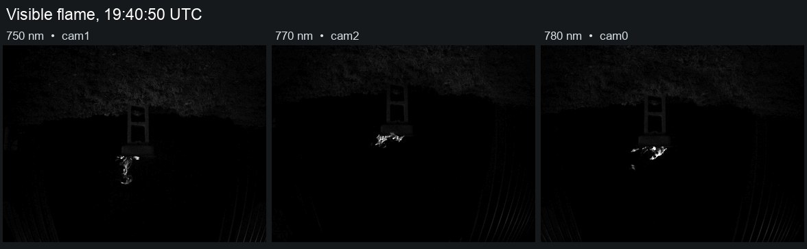
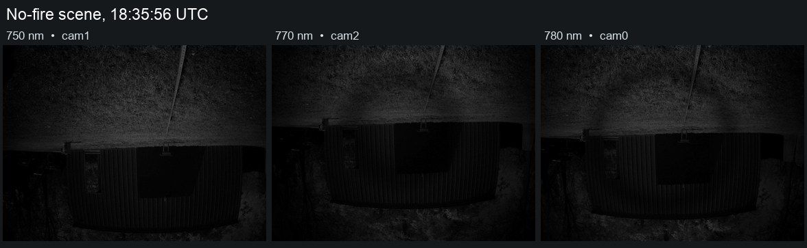

# 012 Timing the EMBER fire detector on the Raspberry Pi 4

**Status:** In progress

**Started:** 2026-11-07

**Updated:** 2026-11-07

Eight November Test 2 triplets with visible flame failed feature alignment in the payload's fire detector, EMBER Guarded Spectral Excess (EGSE). A replay with phase registration recovered those eight. This run measures what the fallback costs on the payload Pi and compares it with Jacob's pixelwise and integrated-brightness methods. The earlier [daylight capture log](../002-kline-daylight-burn/README.md) describes how the three-camera experiment started.

## Images and setup

The input was 104 corrected Test 2 triplets and three controls from the same test day. The controls were an outdoor scene with no fire, a flat-field capture, and a capture with the lenses covered. Each band was a 1456 × 1088 JPEG from an IMX296 camera. The corrected physical assignment is cam1 = 750 nm, cam2 = 770 nm, and cam0 = 780 nm. The November files were renamed to match the physical filters, and the corresponding EGSE gain maps were swapped. This correction applies to these files and this rig.

The camera UI was set to 200 µs. Test 2 sensor metadata reports approximately 192 µs, and the control replay used the nominal 200 µs. The three images were captured sequentially. The flame changes shape between bands, including in the example below.



Test 2 capture `20261107_194050_646`. Each panel is 384 × 287 pixels. The display brightness is multiplied by four in all three panels. See the [aperture crops for all eight ORB misses](images/eight-orb-misses.jpg).



No-fire scene `20261107_183556_555`. The display brightness is multiplied by two. Both figures retain the saved camera orientation. All timings and scores use the original full-size JPEGs.

## What ran on the Pi

- **EGSE with ORB.** Normalize a copy of each image for matching, then fit homographies into the 770 nm image. Apply the corrected gain maps and run the same guarded excess and connected-region checks used in the offline sweep. The profile uses 4,000 features, a 40% inlier gate, a 0.5% minimum valid-signal fraction, a two-pixel guard, and a 16-pixel minimum region.
- **EGSE with phase fallback.** Attempt ORB first. On an alignment or overlap rejection, ask Jacob's phase fitter for both transforms. If accepted, rerun EGSE preparation with those transforms and the same detector profile. Convert the 750 nm transform from saved JPEG coordinates to EGSE's sensor coordinates before applying it.
- **Jacob's P.** Align the bands with phase correlation, then compute pixelwise 770 nm excess relative to a continuum estimated from the two reference bands. The example score is the 99th percentile of the fractional excess over valid pixels.
- **Jacob's Integrated Brightness (I), registered or independent boxes.** Subtract an estimated background from each source sum, then compare the net 770 nm sum with the interpolated continuum. Registered I uses one pair of boxes on the common grid. Independent I uses a fixed pair of boxes per native camera view and skips registration. The separate whole-frame run reports gross sums and a fractional excess without background subtraction.

The [EGSE profile](files/egse-profile.json) and [Jacob box definitions](files/jacob-regions.json) record the settings. The run used the [EMBER detector](https://github.com/ngrabbs/ember/tree/3e4d0b40866ee0f76402db0cfb236c17e5229c8f/firmware/payload/ember_detector) and [Jacob's JPEG evaluator](https://github.com/ngrabbs/koenig_wildfire/tree/ff715830f2d165a7268e2b975b10b34fd8093993/research/anchor_g2) at the linked revisions. Jacob's 18 adapter and JPEG mode tests passed on the Pi before the benchmark.

## How timing was measured

I replayed one recorded triplet at a time on a Raspberry Pi 4 Model B Rev 1.4, pinned to one core with one OpenCV thread. Both runtimes warmed up on the same triplet before timing began. Each of the 107 triplets then ran once. EGSE used the Pi's Python 3.13.5, NumPy 2.2.4, and OpenCV 4.10.0. Jacob's evaluator used its pinned Python 3.12.14, NumPy 2.3.5, and OpenCV 5.0.0 runtime in a separate process.

The wall times include reading and decoding the stored JPEGs and the preparation each method requires. The hybrid time includes the failed ORB attempt, the round trip to the resident phase fitter, and the second EGSE preparation when phase succeeds. On an ORB success, the hybrid reuses the timed ORB result. The timings cover stored-image replay, so the camera capture, CAN traffic, process startup, and writing benchmark logs are outside that interval.

P and registered I share the same evaluator pass. I timed each calculation separately inside that pass. Their standalone totals in the table are estimates formed by subtracting the other method's measured computation from the combined wall time. The CSV preserves the combined time and both computation times. The two native modes and both EGSE routes use measured wall times.

## Results

The table covers the 104 Test 2 triplets. “Numeric” means a score was available.
Calculation times summarize the samples that reached the calculation.

| Method | Decisions or scores | Median total | p95 total | Median calculation |
| --- | --- | ---: | ---: | ---: |
| EGSE with ORB | 73 FIRE, 23 NO_FIRE, 8 UNKNOWN | 3.348 s | 3.398 s | 93.8 ms |
| EGSE with phase fallback | 81 FIRE, 23 NO_FIRE | 3.355 s | 4.269 s | 96.9 ms |
| Jacob P | 97 NUMERIC, 7 UNAVAILABLE | 2.114 s | 2.153 s | 292.2 ms |
| Jacob I, registered | 97 NUMERIC, 7 UNAVAILABLE | 1.834 s | 1.868 s | 11.5 ms |
| Jacob I, independent boxes | 104 NUMERIC | 0.377 s | 0.403 s | 156.1 ms |
| Jacob whole frame, gross | 104 NUMERIC | 0.306 s | 0.333 s | 89.3 ms |

**The phase fallback found fire in all 8 original ORB misses.** Those triplets took 4.968 s median and 5.734 s maximum through the fallback route. The median phase worker round trip on those misses was 1.756 s. The all-triplet median is lower because most triplets finished on ORB alone.

For Jacob’s registered methods, the common registration stage took a median 1.522 s on Test 2 triplets with usable scores. Independent boxes avoid that stage. Their timing covers JPEG decoding, input statistics, box validation, and the background-subtracted measurement.

### Controls

| Capture | EGSE with ORB / fallback | Jacob P p99 | Jacob I registered | Jacob I independent | Whole-frame ratio |
| --- | --- | ---: | ---: | ---: | ---: |
| No-fire scene | `NO_FIRE` | +1.252 | -0.147 | -0.089 | -0.102 |
| Flat | `UNKNOWN` | Unavailable | Unavailable | -0.225 | -0.195 |
| Covered | `UNKNOWN` | Unavailable | Unavailable | Unavailable | +0.415 |

Whole-frame gross brightness gave a positive ratio even with the lenses
covered. That mode divides by the gross continuum and can return a ratio from
small nonzero totals.

In the pictured flame triplet, EGSE went from `UNKNOWN` to `FIRE` in 4.264 s using phase fallback. The largest region was 38 pixels. Independent I reported -0.109. This is a visible flame with a negative independent I score.

The Pi used the `ondemand` CPU governor. It reported 51.1 °C before the run and 62.3 °C at the end. The throttling flags were `0x0` at the start and `0x0` at the end.

## What this run establishes

The benchmark compares coverage and time on one Pi and one stored bench dataset. Jacob's P and I are exploratory JPEG measurements, with no fire threshold applied. Test 2 lacks a complete independent set of fire and no-fire labels, so its decision counts cannot establish sensitivity or specificity. The three controls include one real no-fire scene and two diagnostic captures with little or no matchable scene content.

## Files

- [Per-triplet decisions, scores, and timings](files/per-triplet.csv)
- [Summary and Pi conditions](files/summary.json)
- [Input JPEG hashes and wavelength assignments](files/input-sha256.csv)
- [Timing harness](files/benchmark.py)
- [Replay manifests](files/benchmark-manifests.tar.gz)

To repeat the replay, unpack the manifests next to `benchmark.py` and place the
original JPEGs under `images/test2/` and `images/controls/`. The hashes identify
the exact files. Put the pinned Jacob `research/` package next to the harness
and use a separate virtual environment for its pinned dependencies. The
corrected gain-map NPZ must match the hash in the EGSE profile. From the harness
directory on a Pi 4, run:

```sh
taskset -c 2 env OPENBLAS_NUM_THREADS=1 OMP_NUM_THREADS=1 \
  python3 -B benchmark.py /path/to/ember-payload /path/to/jacob-venv/bin/python \
  /path/to/corrected-gain-maps.npz images/test2 images/controls
```
