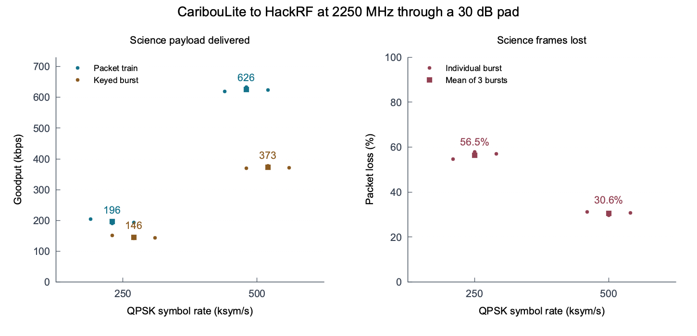
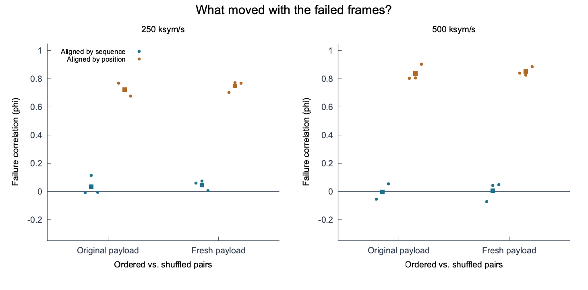
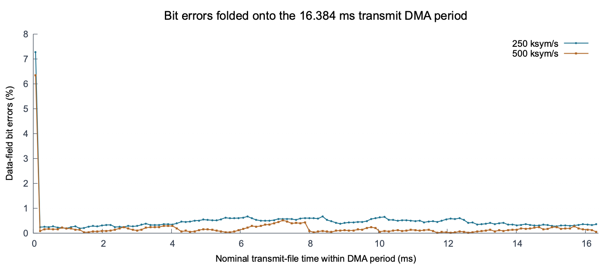
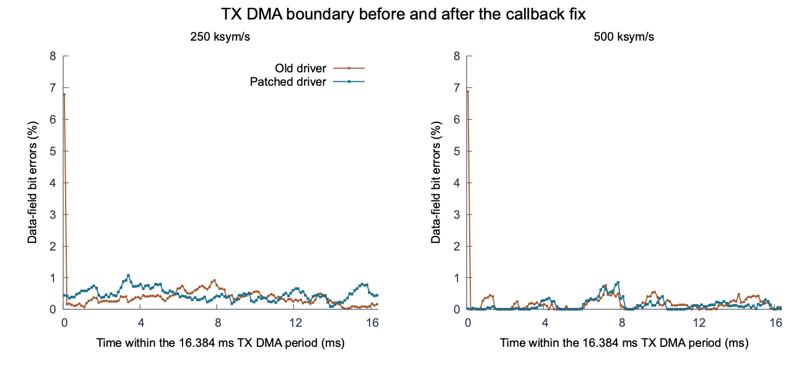
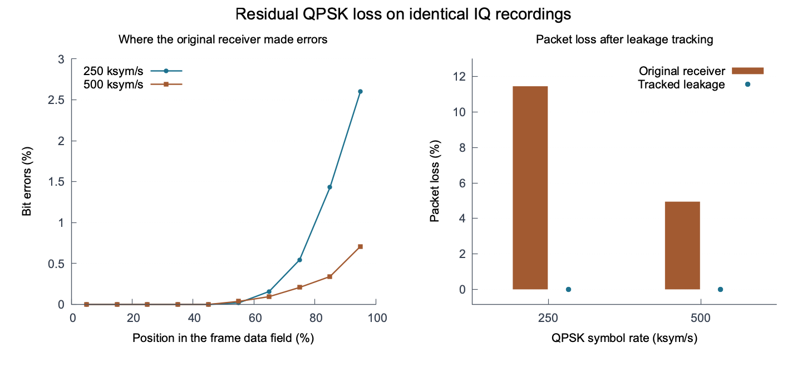
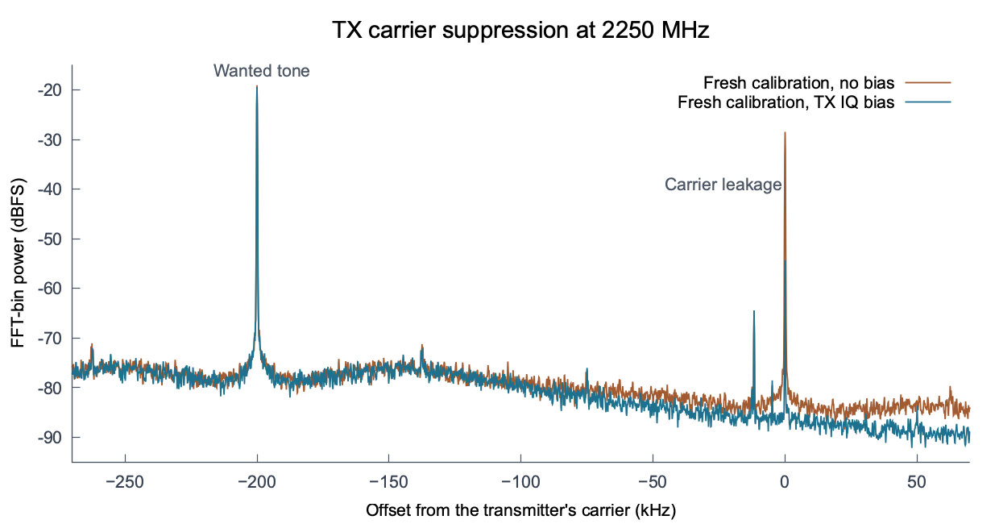
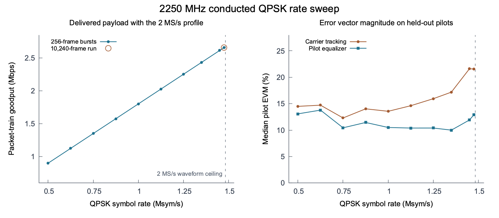
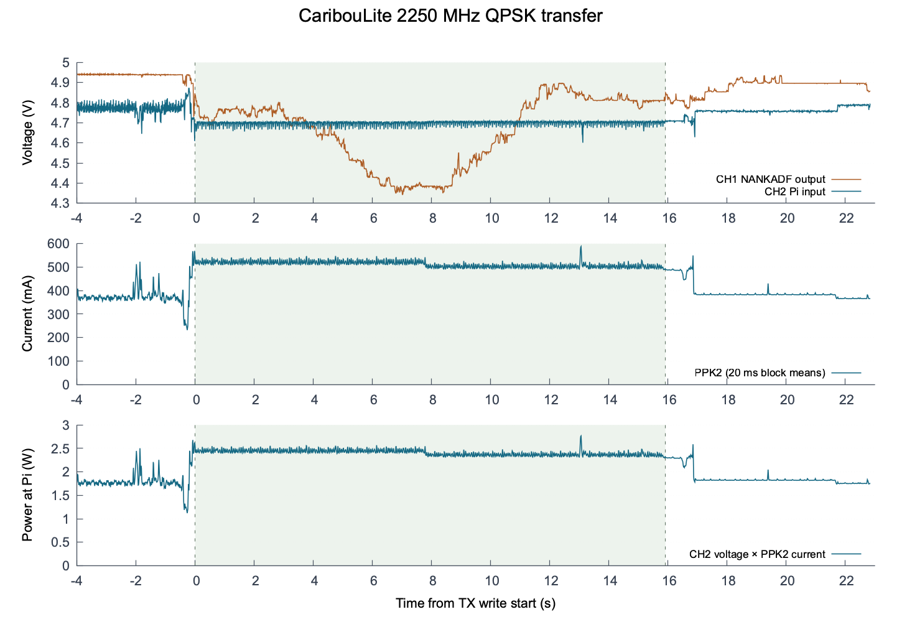
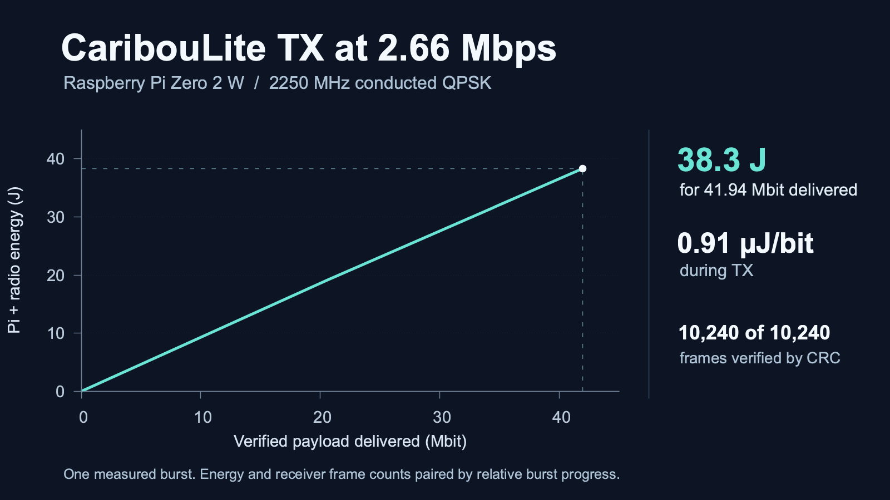

# CaribouLite conducted S-band QPSK science downlink

Started and updated 2026-11-22. **In progress.**

I wanted to see how much science data the Pi Zero 2 W and CaribouLite could deliver at 2.25 GHz, and how much of it would arrive intact. I sent numbered, synthetic 512-byte science frames at 250 and 500 ksym/s over a conducted link, then decoded the saved HackRF IQ. Each sequence number could earn credit once, after a CRC check and a byte-for-byte comparison.

## Results

Three validation bursts per rate, 256 frames per burst.

| Rate | Valid frames by burst | Total delivered | Packet loss | Packet-train goodput | Whole keyed-burst goodput |
| --- | --- | ---: | ---: | ---: | ---: |
| 250 ksym/s | 116, 108, 110 | 334/768 | 56.5% | 196.0 kbps (190.1–204.2) | 145.7 kbps (141.3–151.8) |
| 500 ksym/s | 176, 180, 177 | 533/768 | 30.6% | 625.6 kbps (619.7–633.8) | 373.2 kbps (369.7–378.1) |



Each dot is a burst. Squares and labels show the mean. Goodput counts only the 512-byte payloads that passed both checks. The packet-train denominator is the scheduled frame train including all framing overhead. The keyed-burst denominator uses the 10 ms energy gate on the recording, about 3.13 s and 1.95 s respectively. It includes the period of RF energy during startup and around the zero-IQ padding. Without packet loss, this frame format would carry 450.7 or 901.4 kbps within the corresponding packet train.

The [run summaries](files/run-summary.csv) include the receiver gate, clipping check, estimated symbol clock and Pi write counts. The [frame outcomes](files/frames.csv) contain one row per expected sequence per burst, and the [preamble detections](files/detections.csv) retain preamble timings, pilot-fit diagnostics and CRC flags. The [Pi transmit logs](files/transmit-logs.txt) show that all requested I/Q samples were accepted with zero partial writes. The [capture manifest](files/capture-manifest.json) records each raw capture's SHA-256, settings, host command timestamp and SigMF metadata. The signed 8-bit interleaved originals and their individual SigMF metadata sidecars were preserved on the Mac. TX was idle after the run.

## Wiring and radio settings

With TX idle, remove both antennas and disconnect the spectrum analyzer. Attach the fixed **50 Ω, 30 dB S-band-rated pad** to the CaribouLite **HiF** output, then connect the pad through 50 Ω coax to the HackRF One's RF SMA input. The HackRF stays in receive, with antenna-port power and its RF amplifier disabled. Leave **S1G** outside the signal path. This is a point-to-point coax test at nominal **2250.000 MHz**. The pad's model, measured loss at 2250 MHz and cable loss were unrecorded. The [HackRF One hardware documentation](https://hackrf.readthedocs.io/en/stable/hackrf_one.html) specifies −5 dBm maximum input power.

| Setting | Value |
| --- | --- |
| TX | CaribouLite 6G HiF on a Raspberry Pi Zero 2 W, minimum PA code, CLI gain 0 |
| Pi build | [Merged fork at `7a7c11f`](https://github.com/ngrabbs/cariboulite/tree/7a7c11f9218a3c1858121c049a2ae018308d4267), SMI source version `5658A45097B9795A4F8D5E3`, FPGA loaded by boot service |
| TX files | 2 MS/s, interleaved signed 16-bit little-endian IQ, 12,000 RMS envelope counts, 0.2 s of zero IQ at each end plus zero padding to the DMA block boundary |
| RX | HackRF One on a ThinkPad X1 Carbon, firmware 2024.02.1, host tools 2023.01.1 |
| RX settings | Center 2249.500 MHz, 8 MS/s signed 8-bit IQ, 2.5 MHz baseband filter, 32 dB LNA and 24 dB VGA for validation |
| Capture | 60,000,000 complex samples per burst, 7.5 s, receiver running before TX |
| Modulation | Gray QPSK, root-raised-cosine rolloff 0.35, 12-symbol filter span, no FEC or retransmission |
| Nominal null-to-null width | 337.5 kHz at 250 ksym/s and 675 kHz at 500 ksym/s, derived from symbol rate and rolloff |

## Frame and receiver

Each burst has 256 frames. Each frame starts with 64 constant QPSK symbols and a 128-symbol seeded pseudorandom pilot. The 520-byte data portion has a four-byte little-endian sequence number, 512 deterministic pseudorandom payload bytes and a four-byte little-endian CRC-32 over sequence and payload. Each byte goes out most significant bit first, with the first bit in each pair selecting the I sign and the second selecting the Q sign. The burst carries 131,072 potential science bytes. It lasts 2.326528 s at 250 ksym/s and 1.163264 s at 500 ksym/s, excluding padding and RF startup. The [250 ksym/s](files/qpsk-250000.json) and [500 ksym/s](files/qpsk-500000.json) waveform manifests give file sizes, generation parameters and hashes.

The [bench script](files/qpsk_bench.py) regenerates the waveforms and decodes interleaved signed 8-bit receive IQ using NumPy 1.26.4 and SciPy 1.11.4. It translates the 500 kHz receive LO offset, decimates to 2 MS/s, looks for a sustained burst, estimates residual carrier offset and applies an RRC matched filter. It correlates the known pilot in both IQ orientations, fits symbol spacing from the detections and interpolates samples at symbol times. The pilot fits a complex gain, conjugate image term, carrier leakage term and a small residual frequency correction. A smoothed fourth-power QPSK phase estimate tracks phase through the payload. The transmitted science bytes are used after demodulation to verify the CRC-valid payload.

```sh
python3 qpsk_bench.py generate 250000 qpsk-250000.cs16
python3 qpsk_bench.py generate 500000 qpsk-500000.cs16
# On the receiver, start this first. Wait until receive samples are flowing.
hackrf_transfer -r receive.sigmf-data -f 2249500000 -a 0 -p 0 -l 32 -g 24 -b 2500000 -s 8000000 -n 60000000
# On the Pi, play one bounded waveform through HiF.
timeout -k 2 10 cariboulite-tx -c 1 -f 2250000000 -r 2000000 qpsk-250000.cs16
# Substitute the 500000 file and symbol rate for the other test condition.
python3 qpsk_bench.py decode 250000 receive.sigmf-data --out decoded-250
```

## Receiver bring-up

At 16 dB LNA and 16 dB VGA, the 250 ksym/s capture showed energy near the expected frequency but fell below the decoder's sustained-burst gate. At 32/24 dB the 250 ksym/s burst yielded 256 preamble detections and zero valid CRCs with the initial detector. Adding the pilot-based image and carrier-leakage correction recovered 65 frames from the same IQ. Adding fourth-power phase tracking brought that capture to 115/256 and a separate exploratory 500 ksym/s capture to 185/256. Those captures were used to develop the receiver. The validation bursts were taken afterward, alternating the rates with gain and decoder held constant.

## What the run established

The 500 ksym/s condition delivered about 3.19× the packet-train goodput of 250 ksym/s in this setup. It still lost about three out of ten science frames. All six bursts had 256 candidate preambles, no duplicate accepted frames and no samples at the receive ADC rails. The measured carrier offset relative to the two radios' nominal tuning was +21.59 to +21.71 kHz. The pilot fit indicated a residual carrier term around −6 dB relative to the wanted term before equalization, and a conjugate image around −30 dB.

There was substantial repetition by sequence. At 250 ksym/s, 126 sequence numbers failed in all three bursts. At 500 ksym/s, 67 did. The repeated test also reused the same payload and the same position in the burst for each sequence, so this cannot distinguish data-dependent distortion from a timing-dependent impairment. That ambiguity motivated the shuffled-order and fresh-payload follow-up below.

This measures finite, buffered transmission with offline reception. There is no calibrated S-band TX power, input level, SNR or EVM instrument measurement. Bench pilot EVM is an in-sample statistic after fitting the same pilot and the run summary reports its median only for accepted frames. The experiment did not exercise flight Doppler, antenna losses, free-space path loss, live receiver throughput, long-run Pi underruns or a sustained spacecraft data source. Three bursts per rate sample repeatability on this one bench path. Frames within a burst can share impairments.

## Follow-up on burst position and payload

I reran both rates through the same 30 dB pad at minimum CaribouLite PA, HackRF LNA 32 dB and VGA 24 dB, with the same sample rates, frequencies, capture length and decoder. Each of three blocks had one burst of every combination of rate, order and payload, for 24 bursts and 6,144 scheduled frames. A pseudorandom schedule interleaved conditions within each block. Each block used a different shuffle and a different fresh payload seed. Within a block, both rates used the same frame orders and payloads. The original-payload, ordered waveforms matched the original IQ hashes. An archived capture decoded to the same summary with the follow-up script.

| Payload | Ordered | Shuffled |
| --- | --- | --- |
| Original, seed 225002 | Original baseline | Exact original frame bytes, moved to different slots |
| Fresh, seeds 225201–225203 | New payloads and CRCs, same sequence order | Same new frame bytes as the fresh ordered run in that block, moved to shuffled slots |

The shuffle seeds were 225301–225303. The sequence number travels with the payload. The receiver requires the CRC and the correct payload bytes, and its timing estimate checks the arrival slot of each accepted frame. In ordered/shuffled pair comparisons I excluded accidental fixed slots. I calculated the phi correlation of the two binary failure masks after aligning them either by transmitted frame identity or by position in the burst. Positive values show shared failures beyond the overlap expected from the two failure rates alone. The plot shows the three paired comparisons as dots and their mean as a square. The comparisons are descriptive because packet errors can share an impairment.

For a second diagnostic, I compared hard decisions with the known transmitted bits **after** demodulation, including decisions from CRC failures. I aligned the decisions by the received preamble times and grouped the bits by nominal position in the transmit file, modulo 32,768 complex samples. This corresponds to 16.384 ms at 2 MS/s. The mapping includes the TX file's lead-in and pulse-shaping delay. The Pi driver programs a cyclic DMA period of 128 KiB, which holds 32,768 packed four-byte complex samples. This comparison checks for alignment with that cadence using the received waveform. [Driver period definition](https://github.com/ngrabbs/cariboulite/blob/7a7c11f9218a3c1858121c049a2ae018308d4267/driver/smi_stream_dev.c#L673-L680)

### Goodput and loss by condition

| Rate | Payload/order | Valid frames | Loss | Packet-train goodput | Whole-burst goodput |
| --- | --- | ---: | ---: | ---: | ---: |
| 250 ksym/s | Original, ordered | 319/768 | 58.5% | 187.2 kbps | 139.2 kbps |
| 250 ksym/s | Original, shuffled | 326/768 | 57.6% | 191.3 kbps | 142.2 kbps |
| 250 ksym/s | Fresh, ordered | 325/768 | 57.7% | 190.7 kbps | 141.8 kbps |
| 250 ksym/s | Fresh, shuffled | 339/768 | 55.9% | 198.9 kbps | 147.9 kbps |
| 500 ksym/s | Original, ordered | 539/768 | 29.8% | 632.6 kbps | 377.4 kbps |
| 500 ksym/s | Original, shuffled | 545/768 | 29.0% | 639.7 kbps | 381.6 kbps |
| 500 ksym/s | Fresh, ordered | 544/768 | 29.2% | 638.5 kbps | 380.9 kbps |
| 500 ksym/s | Fresh, shuffled | 537/768 | 30.1% | 630.3 kbps | 376.0 kbps |

### What the failures followed

| Rate | Payload in ordered/shuffled comparison | Same frame identity, moved to a new slot | Same burst slot, containing a different frame |
| --- | --- | ---: | ---: |
| 250 ksym/s | Original | 0.03 | 0.72 |
| 250 ksym/s | Fresh | 0.05 | 0.75 |
| 500 ksym/s | Original | −0.004 | 0.84 |
| 500 ksym/s | Fresh | 0.01 | 0.85 |



Failure correlation stayed between **0.72 and 0.85 by burst position** and between **−0.004 and 0.045 by frame identity** across the four comparisons in the table. Replacing the payload while holding the order fixed also preserved the failure pattern. The position correlations in those pairs ranged from 0.70 to 0.84. All 6,144 scheduled slots had a detected preamble, and no receive components reached the ADC rails. The bulk of the packet loss followed where the frame was in the burst.

### Alignment with the TX DMA period



The first 128 µs after each nominal boundary was the highest-error bin in **all 24 captures**. The data-field bit-error rate in that bin was **7.27%** at 250 ksym/s and **6.35%** at 500 ksym/s. Across the rest of the cycle it averaged 0.42% and 0.15%, respectively.

| Rate | Frame loss when the data field overlaps the first 128 µs | Frame loss for other data fields |
| --- | ---: | ---: |
| 250 ksym/s | 1,550/1,584 (97.9%) | 213/1,488 (14.3%) |
| 500 ksym/s | 789/804 (98.1%) | 118/2,268 (5.2%) |

The match to the programmed DMA cadence narrows the fault to an impairment synchronized with the TX stream. The bench test observed that alignment in received IQ. It did not instrument the internal SMI/FPGA path, so the exact source of corruption remains open. TX was idle after the final capture.

The [run summaries](files/shuffle-followup/run-summary.csv), [condition summaries](files/shuffle-followup/condition-summary.csv), [per-frame outcomes](files/shuffle-followup/frame-outcomes.csv) and [preamble diagnostics](files/shuffle-followup/preamble-detections.csv) retain the individual measurements. The [paired comparisons](files/shuffle-followup/failure-agreement.csv) and [DMA-phase bit counts](files/shuffle-followup/dma-phase-by-run.csv) back the two plots. The [schedule](files/shuffle-followup/schedule.tsv), [waveform manifest](files/shuffle-followup/waveform-manifest.json) and [capture manifest](files/shuffle-followup/capture-manifest.json) record seeds, permutations and hashes. All 24 raw captures were copied to the Mac and checked against their capture hashes. The [generator and decoder](files/shuffle-followup/qpsk_bench_shuffled.py) accept matching seeds, and the [analysis script](files/shuffle-followup/analyze_followup.py) reads a capture folder with the scheduled run subdirectories and waveform manifests.

```sh
python3 qpsk_bench_shuffled.py generate 250000 wave.cs16 --payload-seed 225201 --order-seed 225301
python3 qpsk_bench_shuffled.py decode 250000 receive.sigmf-data --out decoded \
  --payload-seed 225201 --order-seed 225301 --diagnose-dma
```

## TX DMA boundary fix

The TX completion callback advanced its software index before it copied the next chunk from the FIFO. When period 0 completed, for example, the callback wrote to period 1 while the cyclic DMA engine was already reading period 1. That allowed old or zeroed samples at the start of the period to reach the radio before the queued samples were copied over them. The driver now refills period 0 after it completes, then advances the index. The new samples have the rest of the four-period ring's rotation before DMA reads them. The patch changes only the TX callback. [CaribouLite driver fix](https://github.com/ngrabbs/cariboulite/commit/8d0b9504593f6d00d3e400b622501830e4085ba0) · [Raspberry Pi cyclic DMA implementation](https://github.com/raspberrypi/linux/blob/rpi-6.18.y/drivers/dma/bcm2835-dma.c)

I replayed the exact six fresh, shuffled waveforms from the earlier test, with the 30 dB pad, minimum TX PA, HackRF LNA 32 dB and VGA 24 dB, frequencies, sample rates and decoder held fixed. The main comparison uses three bursts per rate on each driver. I also captured one new old-driver control at each rate immediately before the swap, followed by a live-loaded 250 ksym/s smoke test. The six measured patched bursts came after a reboot. The FPGA boot service verified the patched module source version `8BE3FF80584317A366FD47D`. The old driver reported `5658A45097B9795A4F8D5E3`. The FPGA bitstream and TX executable were the same.

### Matched results

Three bursts per rate on each driver. Goodput counts CRC-valid, byte-verified science payload and uses the scheduled packet train as its time base.

| Rate | Old driver | Patched driver after reboot | Packet loss before → after | Packet-train goodput before → after | Whole-burst goodput before → after |
| --- | ---: | ---: | ---: | ---: | ---: |
| 250 ksym/s | 339/768 | 680/768 | 55.9% → 11.5% | 198.9 → 399.1 kbps | 147.9 → 301.4 kbps |
| 500 ksym/s | 537/768 | 730/768 | 30.1% → 4.9% | 630.3 → 856.8 kbps | 376.0 → 524.6 kbps |

The immediate old-driver controls received 108/256 and 181/256 frames. The live-loaded patch received 227/256 at 250 ksym/s in the smoke test. These runs are excluded from the three-burst averages. All six post-reboot bursts yielded 256 preambles, zero ADC clipping and zero partial transmitter writes.

### Bit errors at the boundary



| Rate | BER in first 128 µs, before → after | BER in rest of period, before → after | Loss for frames overlapping first 128 µs, before → after |
| --- | ---: | ---: | ---: |
| 250 ksym/s | 6.799% → 0.445% | 0.354% → 0.476% | 391/396 → 55/396 |
| 500 ksym/s | 6.883% → 0.020% | 0.167% → 0.140% | 196/201 → 9/201 |

Correcting the ring index removed the large periodic error spike and improved packet delivery at both rates. Residual loss remains even within this conducted setup. These runs quantify the callback fix and leave the remaining link or decoder errors unresolved. HiF RX streamed at 1.998 MS/s after reboot in a separate SoapySDR rate check. The Pi's FPGA service remained active and the radio was idle after testing.

The [matched summary](files/dma-boundary-fix/before-after.csv), [individual runs](files/dma-boundary-fix/run-summary.csv), [per-frame outcomes](files/dma-boundary-fix/frame-outcomes.csv), [folded bit counts](files/dma-boundary-fix/phase-by-run.csv) and [capture hashes](files/dma-boundary-fix/capture-manifest.json) cover the before, after, and control runs. The [six-waveform schedule](files/dma-boundary-fix/schedule.tsv) specifies the byte-matched inputs. The [analysis script](files/dma-boundary-fix/compare_dma_fix.py) joins the archived waveforms' decoded results to the new runs and writes the tabular data. Nine new raw IQ captures were preserved as SigMF pairs on the Mac.

## Residual packet loss in the receiver

After the DMA fix, the original receiver's remaining failures came from its carrier-leakage correction. The captured QPSK had a strong carrier term at the modulation center, about −5.8 dBc at 250 ksym/s and −5.6 dBc at 500 ksym/s relative to the fitted QPSK term. The original decoder estimated residual frequency from the 128-symbol sync pilot and extrapolated the leakage phasor through the data field. A small error in that estimate let the subtraction drift away from the actual leakage, so the constellation was displaced late in the frame.

I checked the six patched-driver captures, including all the failed frames. With the original receiver, every one of the **15,188** bit errors at 250 ksym/s and **4,443** at 500 ksym/s was in the second half of the data field. More than half at each rate occurred in its final tenth. In frames that failed, the median pilot frequency error relative to a full-frame fit was 22.3 Hz and 41.6 Hz, respectively. The median end-of-frame error in the modeled leakage was about 56% and 53% of the wanted symbol amplitude. This full-frame fit used the known data after demodulation for diagnosis.



I developed the receiver change on the first patched-driver capture at each rate. The decoder subtracts a local mean of the complex samples, using a centered 385-symbol Hann window, with the sync pilot contribution removed from that mean. It then applies the existing fourth-power phase tracker and checks the CRC. The receiver gets the known sync pilot. The expected science bytes and frame order are used only to score the decoded output. I fixed the receiver settings before evaluating the other four captures. A separate ablation that updated only the leakage estimate in the original equalizer recovered the same frames. Setting the pilot frequency correction to zero increased loss at both rates.

| Rate | Original receiver | Tracked leakage | Held-back frames recovered | Packet-train payload goodput with tracking |
| --- | ---: | ---: | ---: | ---: |
| 250 ksym/s | 680/768 (11.5% loss) | 768/768 (0 observed loss) | 512/512 | 450.7 kbps |
| 500 ksym/s | 730/768 (4.9% loss) | 768/768 (0 observed loss) | 512/512 | 901.4 kbps |

The corrected decoder recovered **1,536/1,536 frames** with zero observed data-field bit errors across the six captures. Including RF startup and padding, mean payload goodput was 340.4 and 551.9 kbps. The same decoder still lost 130/256 and 66/256 frames in the old-driver controls at the two rates. That control separates the receiver's leakage correction from the earlier DMA corruption. The measurements establish the decoder failure on this bench link. They leave the physical source of the carrier term and performance on longer or weaker links open.

The comparison replayed the same captured IQ, with the original 30 dB pad and receive gains of 32 dB LNA and 24 dB VGA already baked into the recordings. No additional transmission was required. The [run table](files/residual-loss/replay-by-run.csv) links each result to its capture hash. The [receiver comparisons](files/residual-loss/replay-by-rate.csv), [per-frame measurements](files/residual-loss/frame-ablation.csv), [bit errors by frame decile](files/residual-loss/bit-errors-by-decile.csv), and [data-aided leakage fits](files/residual-loss/data-aided-leakage-fit.csv) retain the evidence.

To reproduce the replay, use the [symbol extractor](files/residual-loss/iq_residual.py) and [receiver replay](files/residual-loss/replay_receivers.py), with the existing waveform code on the module path. This example uses the first 250 ksym/s capture. The [schedule](files/residual-loss/schedule.tsv) gives the seeds for the other captures.

```sh
PYTHONPATH=../shuffle-followup python3 iq_residual.py extract 250000 /path/to/receive.sigmf-data symbols.npz
PYTHONPATH=../shuffle-followup python3 replay_receivers.py symbols.npz 225201 225301 replay
```

## Carrier leakage source and suppression

The leakage is generated in the CaribouLite's **AT86RF215 RF24 transmit path**. On the 2250 MHz path, the board translates the RF24 modem's nominal 2495 MHz output through the RFFC5072. With the modem tuned directly near 2494.9 MHz, the same carrier line appeared with the external mixer bypassed. The exact analog node inside the modem remains unmeasured. [CaribouLite frequency-conversion code](https://github.com/ngrabbs/cariboulite/blob/8d0b9504593f6d00d3e400b622501830e4085ba0/software/libcariboulite/src/cariboulite_radio.c) · [AT86RF215 datasheet, §6.8 and erratum 15.2.1](https://ww1.microchip.com/downloads/en/DeviceDoc/Atmel-42415-WIRELESS-AT86RF215_Datasheet.pdf)

I kept the original 30 dB pad, minimum TX PA, 2 MS/s TX IQ, and HackRF LNA/VGA at 32/24 dB. The receiver took 7.5 s of 8 MS/s signed 8-bit IQ per capture through its 2.5 MHz baseband filter, with RF amp and antenna power off. The diagnostic waveform alternated zero IQ and two 12,000-count complex tones at +200 and −200 kHz, each segment lasting 262.144 ms. The wanted tones moved to opposite sides of the carrier. The unwanted line stayed at the carrier during both tones and during the zero-IQ interval. In the nominal 2250 MHz case the mixer inverted the digital tone direction.

Retuning the HackRF from 2249.500 to 2250.600 MHz moved the leakage from +521.9 to −578.0 kHz in the captured baseband. The inferred RF frequency stayed near 2250.022 MHz on the HackRF's uncalibrated frequency reference. During the zero-IQ interval, the carrier was about −22.5 dBFS with the original calibration at 2250 MHz. The idle baseline at that frequency was −84.8 dBFS in the same line estimator. These controls separate the carrier line from the test waveform and the HackRF's center spur. The direct RF24 bypass control used nominal TX 2494.900 MHz and RX 2494.400 MHz.

### RF24 calibration and transmit I/Q bias

The existing standalone transmitter collects five RF24 calibration readings at startup and reapplies their median after subsequent state changes. That median was commonly I=39, Q=35 in this session. The [bench-only calibration patch](files/carrier-leakage/rf24-auto-calibration.patch) compared it with a fresh automatic calibration after tuning and setting minimum PA. It also tested the chip vendor's median approach at the tuned frequency and power. Fresh and tuned-median calibration gave I=62 or 63, Q=1 here. Fresh calibration reduced the residual carrier by about 3 dB at both the mixed output and the direct RF24 output. At the 2250 MHz mixed output, the tuned median matched the two fresh trials to within 0.1 dB when comparing carrier to the first wanted tone.

With fresh calibration, I sent a +200 kHz tone and swept I and Q sample offsets independently over −6000, 0 and +6000 counts, repeating the zero-bias measurement at the end. I fitted a quadratic to carrier power normalized by tone power. The minimum rounded to **I +128, Q −4280** in signed IQ16 input counts. These are waveform offsets applied before the driver's right shift. The RF24 calibration registers retain their automatic values. A separate capture alternated the fitted correction with zero bias twice. The carrier changed from **−9.15 and −9.18 dBc** to **−34.88 and −35.54 dBc**, a 26 dB improvement, while the wanted tone moved only 0.04 dB in each pair. Line power uses the median of five-bin sums around the peak in 65,536-point Hann FFT blocks.



### QPSK validation

I replayed one matched 256-frame waveform at each rate with fresh calibration, first at zero sample bias and then with the fitted bias. The median carrier term below comes from a data-aided fit relative to the wanted QPSK term. The paired tone results above measure the narrow RF line relative to a tone, so the QPSK figures use a different reference.

| Rate | Fresh RF24 calibration | Fresh calibration + I/Q bias | Additional suppression | Biased frames recovered |
| --- | ---: | ---: | ---: | ---: |
| 250 ksym/s | −9.19 dBc | −44.11 dBc | 34.92 dB | 256/256 |
| 500 ksym/s | −8.93 dBc | −43.45 dBc | 34.52 dB | 256/256 |

The earlier wide coarse-frequency search chose other in-band peaks in the two suppressed captures. For a matched decode I seeded all four QPSK runs with the same +22.1 kHz coarse offset, rounded from the independently measured tone probe. The frame pilot and existing tracker then recovered all frames with zero observed data-field bit errors in the biased captures. Carrier suppression affects acquisition when a receiver relies on the carrier line as a frequency reference.

The bias is a bench calibration for this board, frequency, power and RF24 calibration state. Stability across temperatures, gain settings and boards remains unmeasured. The bench transmitter was invoked explicitly for these runs. The normal Pi launcher still uses its existing calibration and the DMA-fixed module, and TX was idle at the end.

The [probe results](files/carrier-leakage/probe-results.csv), [tuned-median result](files/carrier-leakage/median-results.csv), [bias grid](files/carrier-leakage/bias-grid.csv), [independent bias validation](files/carrier-leakage/bias-validation.csv), [QPSK summary](files/carrier-leakage/qpsk-results.csv), and [per-frame fits](files/carrier-leakage/qpsk-carrier-fits.csv) retain the measurements. The [waveform builder](files/carrier-leakage/make_probe.py), [bias sweep script](files/carrier-leakage/bias_probe.py), [bias application script](files/carrier-leakage/apply_bias.py), and [waveform hashes](files/carrier-leakage/waveform-metadata.txt) record how to reproduce the inputs. All 13 captures were saved on the Mac with SigMF sidecars and checked against the [capture manifest](files/carrier-leakage/capture-manifest.json).

## Saved 2250 MHz TX profile and reboot check

The Pi now has an explicit `cariboulite-tx-2250` command for HiF. It reads `/etc/cariboulite/tx-2250.json` and invokes the RF24-calibration build at `/opt/cariboulite-fixed/tx-test-rf24`. The profile fixes the frequency at 2250 MHz, applies I +128 and Q −4280 to the signed IQ16 samples, and lets the modem run fresh RF24 calibration at each TX start. The launcher checks for input clipping, pads a partial DMA block, and requires the FPGA service and an idle SMI interface. Transmitting requires invoking the profile with an input file.

```sh
cariboulite-tx-2250 --show-profile
cariboulite-tx-2250 uncorrected-waveform.cs16
```

Input is interleaved little-endian signed 16-bit I/Q at 2 MS/s, prior to applying any sample bias. The profile is the bench calibration for this board at minimum TX power. For the RF24 helper, use the [bench source patch](files/carrier-leakage/rf24-auto-calibration.patch) on the [DMA-fixed revision](https://github.com/ngrabbs/cariboulite/commit/8d0b9504593f6d00d3e400b622501830e4085ba0). The [launcher](files/tx-profile-2250/cariboulite-tx-2250), [profile JSON](files/tx-profile-2250/tx-2250.json), and [Pi-installed SHA-256s](files/tx-profile-2250/installed-sha256.txt) identify the installed files.

After reboot, I verified a new boot ID, the same installed profile and helper hashes, the active FPGA service and SMI source version `8BE3FF80584317A366FD47D`. Both first-set waveforms passed a byte-for-byte check against the previously tested corrected IQ files. An input that would clip was rejected before TX.

The post-reboot RF check used the same 30 dB conducted pad, minimum TX PA, and HackRF 32 dB LNA and 24 dB VGA. RF amp and port bias stayed off. I replayed two fresh shuffled 256-frame waveforms at each symbol rate and seeded acquisition with the prior independently measured +22.1 kHz coarse offset. This preserves the acquisition setup used in the previous low-leakage comparison.

| Rate | Valid frames by burst | Median carrier by burst | Packet-train payload goodput |
| --- | ---: | ---: | ---: |
| 250 ksym/s | 256/256, 256/256 | −39.54, −41.59 dBc | 450.7 kbps |
| 500 ksym/s | 256/256, 256/256 | −44.97, −34.79 dBc | 901.4 kbps |

Fresh calibration returned I=63, Q=1 on three bursts and I=63, Q=2 on the second 500 ksym/s burst. The Q=2 burst had the highest residual carrier, at −34.79 dBc, and still decoded all 256 frames. All four bursts had 256 detected preambles and zero partial TX writes or receive ADC clipping. The receiver recovered **1,024/1,024** frames with 0 observed data-field bit errors. The carrier figures are the median per-frame leakage terms relative to fitted QPSK amplitude, using the same estimator as the prior bench run. TX was idle after the check.

The [run results](files/tx-profile-2250/profile-runs.csv), [per-frame measurements](files/tx-profile-2250/profile-frame-fits.csv), [run plan](files/tx-profile-2250/plan.tsv), and [capture hashes](files/tx-profile-2250/capture-manifest.json) record the verification. The four raw captures and SigMF sidecars are archived on the Mac.

## Conducted QPSK rate limit

The saved 2 MS/s profile delivered **2.659 Mbps of payload** at **1.475 Msym/s** for 15.773 s. The receiver recovered all **10,240/10,240** frames, totaling 5 MiB of payload. That is within 0.44% of the nominal baud-rate ceiling imposed by a 2 MS/s complex sample stream and this 0.35-rolloff QPSK waveform. The corresponding payload ceiling for this frame format is about 2.671 Mbps.

I kept the nominal 2250 MHz TX, 30 dB conducted pad, minimum PA code, fresh RF24 calibration and I/Q bias of +128/−4280. HackRF gain stayed at 32 dB LNA and 24 dB VGA, with RF amp and port bias off. I moved the HackRF center to 2249.850 MHz to keep the wider signal inside the same 2.5 MHz receive filter. The receiver recorded 8 MS/s signed 8-bit IQ. I reran the 500 ksym/s control at this new receive center before using it for the sweep.



Ten short 256-frame bursts covered 0.500 through 1.475 Msym/s. All 2,560 frames passed CRC and matched the expected bytes with carrier tracking alone, and with a seven-tap equalizer trained on the sync pilot. The last 24 pilot symbols were excluded from equalizer training and used for the EVM estimate. At 1.475 Msym/s the nominal pulse-shaped bandwidth is 1.991 MHz, and the waveform kept the same 512-byte payload, frame overhead, and 0.35 RRC rolloff as the earlier tests. The long run accepted all 32,374,784 IQ samples with zero short writes. All 10,240 pilots arrived at regular intervals, consistent with the roughly 10 ppm relative clock offset seen in the shorter 2 MS/s runs. The long test used file-fed IQ and offline decoding.

### 4 MS/s TX sample-clock trials

CaribouLabs lists a 4 MS/s converter rate. I tested that sample clock with the same RF settings and calibration, using a separate bench invocation of the RF24 helper. Register readback showed `TXDFE=0x61` and `FPGA_GAP=0`, compared with `0x82` and gap 1 in the saved 2 MS/s profile. [CaribouLite specifications](https://github.com/cariboulabs/cariboulite#specifications) · [AT86RF215 datasheet, TX digital front end](https://ww1.microchip.com/downloads/en/DeviceDoc/Atmel-42415-WIRELESS-AT86RF215_Datasheet.pdf)

| TX sample rate | SMI write strobe | QPSK rate | Valid frames with pilot equalizer |
| --- | ---: | ---: | ---: |
| 4 MS/s | 12 | 500 ksym/s | 0/256 |
| 4 MS/s | 12 | 1,450 ksym/s | 0/256 |
| 4 MS/s | 5 | 500 ksym/s | 25/256 |
| 4 MS/s | 5 | 1,450 ksym/s | 0/256 |
| 4 MS/s | 6 | 500 ksym/s | 0/256 |

At strobe 12, the 6.29-million-sample write took 2.60 s, well beyond the complete file's nominal 1.57 s at 4 MS/s. At strobe 5 the write timing was consistent with the nominal 4 MS/s pacing, and all pilots appeared. Their intervals were irregular and typically too short by about 9.4 TX sample intervals at 500 ksym/s and 4.0 at 1.45 Msym/s. The 500 ksym/s control with the saved profile had regular pilot timing and recovered every frame. The comparison implicates sample continuity in the faster Pi-to-modem path. The captures leave the exact source of the slips within the SMI, FPGA and modem interface unresolved. All write calls accepted their full IQ sample counts, which verifies host acceptance.

The demonstrated limit is **2.66 Mbps of QPSK payload with the current 2 MS/s profile**. The sample rate and pulse-shaped bandwidth set the ceiling for this waveform. The tested 4 MS/s settings showed timing or continuity problems, including on the narrower 500 ksym/s control. Longer continuous operation, real-time waveform generation, other modulations and a spacecraft link budget remain outside this measurement. TX was idle at the end.

The [rate results](files/rate-limit/rate-results.csv), [pilot timing](files/rate-limit/pilot-timing.csv), [frame diagnostics](files/rate-limit/frame-diagnostics.csv), and [capture and waveform manifest](files/rate-limit/capture-manifest.json) document all sixteen captures. Raw IQ and SigMF sidecars were checked and archived on the Mac. The [waveform generator](files/rate-limit/generate_limit_wave.py) and [decoder](files/rate-limit/decode_limit_wave.py) use the [prior waveform module](files/shuffle-followup/qpsk_bench_shuffled.py) on the Python module path.

## 2.66 Mbps TX power and energy

On November 22, 2026, the Raspberry Pi Zero 2 W and CaribouLite delivered **2.659 Mbps of verified payload** in a conducted 2250 MHz QPSK burst at 1.475 Msym/s. Offline decoding of the HackRF capture verified **10,240 of 10,240 frames** against their CRCs and expected payloads. That is **5 MiB, or 41.94 Mbit**, in a 15.773 s packet train. The saved 2 MS/s TX profile ran at minimum PA through the same 30 dB pad, with HackRF LNA/VGA at 32/24 dB. IQ was file-fed on TX and decoded offline on RX.

| Measurement | Result |
| --- | ---: |
| TX write time | 15.92 s |
| Mean current and power during TX write | 512 mA, 2.41 W |
| Total energy during TX write | **38.3 J, 0.91 µJ per delivered bit** |
| TX write energy above the pre-run idle baseline | 20.1 J, 0.48 µJ per delivered bit |
| Whole invocation, including setup and teardown | **52.9 J, 1.26 µJ per delivered bit** |

The NANKADF fed the Pi through the PPK2 in Ampere Meter mode. Scope CH1 monitored the supply side of the PPK2 and CH2 monitored the Pi side. Pi input voltage averaged **4.87 V before the invocation** and **4.70 V during the TX write**, with a **4.46 V minimum sample**. The Pi answered **250 of 250 pings**, including 63 during the write, and kept the same boot ID. CH1 intermittently read below CH2 during the write, so the capture leaves the voltage loss in the supply path unresolved.



Energy is the integral of CH2 voltage times PPK2 current at the Pi and radio. The scope captured both channels at 10 kSa/s per channel, and the PPK2 sampled at a nominal 100 kSa/s. Electrical and TX timing were aligned using host timestamps. The extra-energy estimate subtracts the measured pre-run idle power of 1.15 W over the write interval. The energy-versus-payload graph pairs the power trace and verified receiver frame counts by relative burst progress. Its endpoint uses the measured transfer totals.



[Measurement summary](files/tx-energy/tx-energy-summary.json) · [Plot data](files/tx-energy/tx-energy-trace.csv) · [Energy and payload curve](files/tx-energy/energy-vs-payload.csv)
