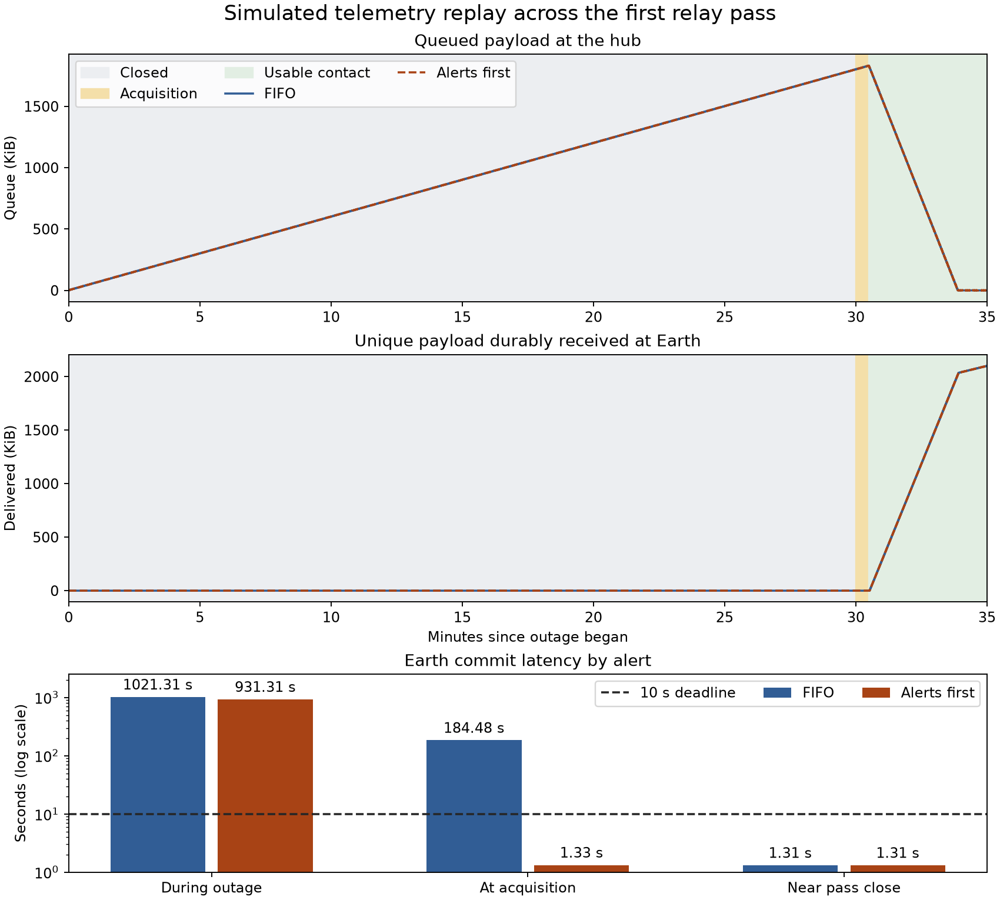
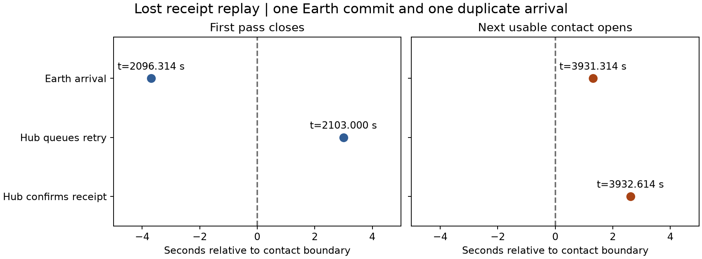
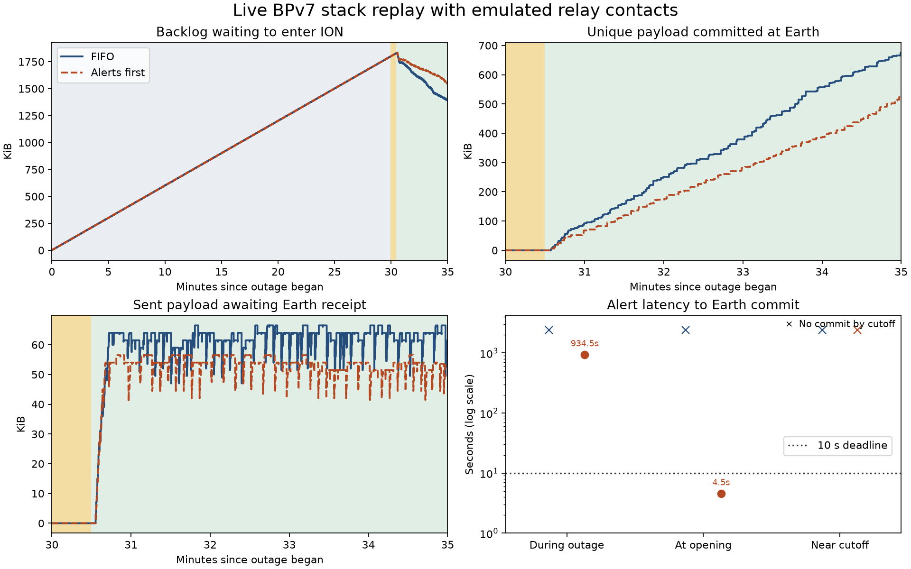
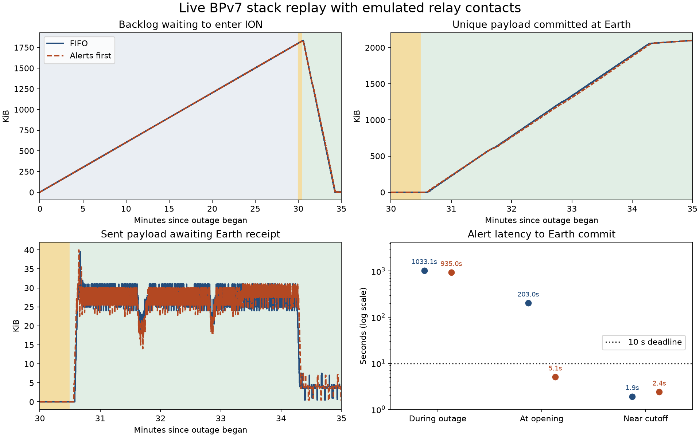
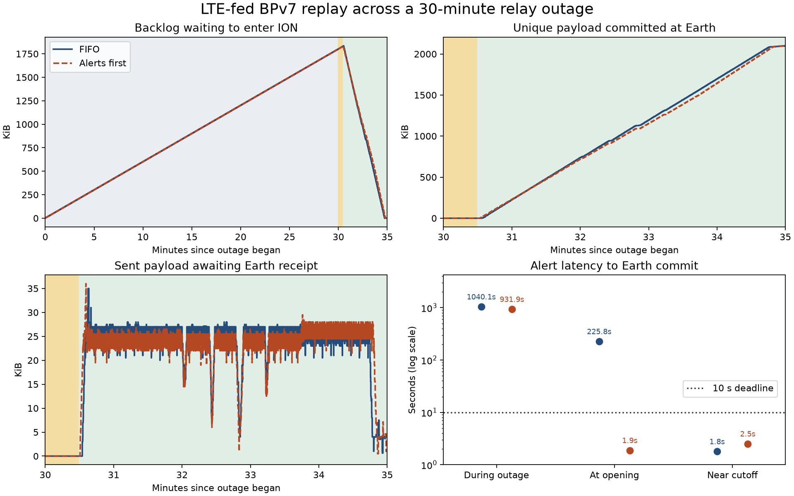
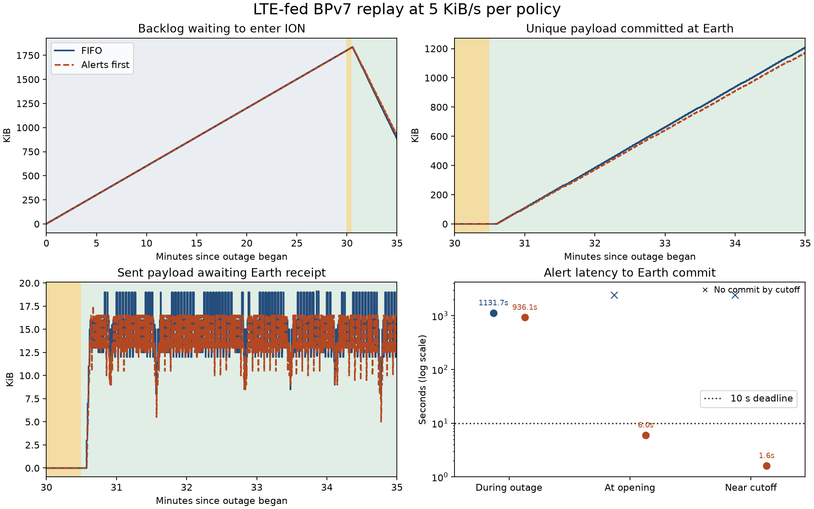
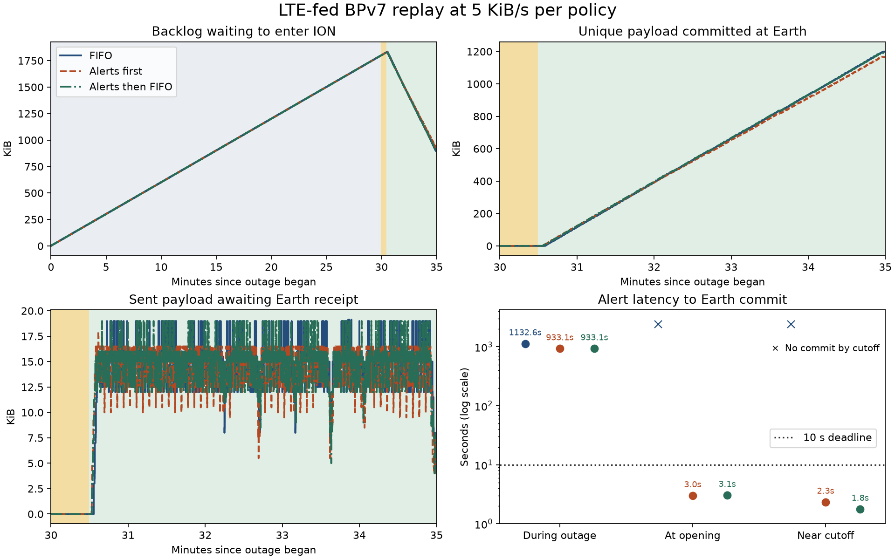

# 014 Moon Base relay contact replay

**Status** — In progress  
**Started** — 2026-11-25  
**Updated** — 2026-11-25

Can a lunar surface hub clear a telemetry backlog in the next relay pass
while the rover keeps sending? I started with a software replay to see
whether priority matters when all the records fit, and what happens when
Earth saves a record but its application receipt goes missing.

## Node build-out

### Local Mac · Python simulator

The Mac ran all commands in this entry. The rover, surface hub, relay, and
Earth are simulated roles in one process. The Toughpad, moonbase-ground, and
radio hardware were outside this run.

Selected setup commands and output from the Moon Base project root follow.
The installer progress and pip upgrade notice are omitted.

~~~console
$ mkdir -p simulation
$ python3.14 -m venv simulation/.venv
$ simulation/.venv/bin/python -m pip install matplotlib
Successfully installed contourpy-1.4.0 cycler-0.12.1 fonttools-4.68.0 kiwisolver-1.5.1 matplotlib-3.11.2 numpy-2.5.5 packaging-26.4 pillow-13.0.0 pyparsing-3.3.3 python-dateutil-4.0.0 tzdata-2026.6
$ cd simulation
$ python3.14 --version
Python 3.14.8
$ .venv/bin/python -m pip freeze > requirements.txt
$ .venv/bin/python -m pip check
No broken requirements found.
~~~

The shell's default Python was 3.15 and did not have Matplotlib. The replay
uses Python 3.14 in a project-local environment with pinned dependencies.

## Experiment 1 — Scheduled outage and lost receipt

### Inputs

| Input | Simulation assumption |
| --- | --- |
| First contact | 30 minutes closed, then a five-minute geometric pass with 30 seconds of acquisition. Usable from t=1,830 to 2,100 s. |
| Second contact | Usable from t=3,930 to 4,200 s. |
| Hub to relay | 10 KiB/s payload capacity and 50 ms propagation. |
| Relay to Earth | Always up, 100 KiB/s payload capacity and 1,250 ms propagation. |
| Offered load | 512 B status every 2 s and 3,072 B science every 4 s, totaling 1 KiB/s before alerts. Three scripted alerts of 128 B each with a 10 s deadline. |
| Policies | FIFO, then alerts first with one science dispatch after at most three status dispatches when science is waiting. A transmission in progress finishes first. |
| Lost-receipt injection | Suppress the near-close alert's application receipt after Earth commits it. The hub's eight-second test timer queues the retry. |

### Local Mac · Replay command and output

From the original project's simulation directory, using the environment
created above. The capture uses pipefail so a simulation error is reflected
in the pipeline status even when tee succeeds.

~~~console
$ set -o pipefail
$ .venv/bin/python simulate.py --out output | tee /tmp/moonbase-sim-run.txt
Trace: 3153 records, JSONL SHA-256 e5fc01939c9080b41d37f89ff0e52c891347049f07047e4018e07ada70fd4c59
fifo: 1578/1578 unique Earth records by first close (2,150,784 B); 1/3 alerts on time; 0 repeated arrivals over both passes
alerts_first: 1578/1578 unique Earth records by first close (2,150,784 B); 2/3 alerts on time; 0 repeated arrivals over both passes
lost_receipt: 1578/1578 unique Earth records by first close (2,150,784 B); 2/3 alerts on time; 1 repeated arrivals over both passes
2095.000000 s  hub_send
2095.062500 s  relay_arrival
2096.313750 s  earth_commit
2096.313750 s  receipt_suppressed
2103.000000 s  retry_queued
3930.000000 s  hub_send
3930.062500 s  relay_arrival
3931.313750 s  earth_duplicate
3932.613750 s  receipt
~~~

### What happened

The first pass delivered all 1,578 offered records under both policies,
including 525 science chunks and 1,050 status records. The hub held about
1.79 MiB at peak and had no waiting records from the first interval at pass
close. The relay never had a waiting queue at this rate. Priority changed
which data arrived first. The alert generated just after acquisition went
from 184.48 s to 1.33 s. The alert generated during the outage missed its
deadline under both policies.

The near-close alert committed once at t=2,096.314 s. The same record arrived
again in the next pass at t=3,931.314 s and matched the saved payload hash.
The hub confirmed its receipt 2.614 s after the next contact became usable.
The result is from a model with assumed payload rates and simulated commits.
The live BPv7 handoff and LTE-fed run come next.

### Reproduce

From this entry's directory, the [simulator snapshot](files/simulate.py) and
[pinned dependencies](files/requirements.txt) generate the trace, CSV event
and queue logs, JSON metrics, and both plots.

~~~sh
python3.14 -m venv .venv
.venv/bin/python -m pip install -r files/requirements.txt
.venv/bin/python files/simulate.py --out output
cmp files/summary.json output/summary.json
~~~

A separate fresh environment reproduced the summary and compressed
telemetry trace byte for byte on the local Mac. I also checked payload
sizes and hashes, relay arrival times against the contact windows,
first-pass accounting, and the single-commit retry event sequence.
The [metrics](files/summary.json) and [terminal capture](files/experiment-01-terminal.txt)
preserve the run output. The trace checksum in the metrics covers the
uncompressed JSON Lines stream so it can be compared across gzip builds.

## Bench preflight — 2026-11-25

The first hostname lookups failed. SSH to the recorded LAN addresses
then succeeded for the Linux build host, the Raspberry Pi 5 surface hub,
the rover Toughpad, the RF monitor, and the Pi Zero 2 W used in the
[CaribouLite RF tests](../013-cariboulite-sband-qpsk/README.md).

The Linux build host has working Docker, 55 GiB of available memory, and
40 GiB of root space free. The surface Pi has the LTE lab files, with
the eNB and EPC stopped. The Toughpad sees the LilyGO modem and its LTE
interface is down. The RF monitor sees the HackRF and reports zero
available root space. The reachable CaribouLite host identifies as a
Pi Zero 2 W. A separate CaribouLite Pi 5 endpoint remains unverified.

Use the Linux build host for the first three isolated DTN roles, then move
the hub onto the surface Pi for the LTE-fed run. The spare Mac VM from the
first attempt was stopped. The Linux and Raspberry Pi checks were read-only,
and this preflight collected no BPv7 or RF results.

## Experiment 2 — BPv7 relay smoke test

### Node build-out · Linux build host

All three roles ran on one x86-64 Linux Docker host. Hub and Earth used
NASA/JPL ION revision `b7e2c84` with the external TCPCLv4 agent. The
relay used NASA HDTN v3.0.0 at `7fbe90c`. Each build used four compile
jobs. Both images used Ubuntu 24.04 with base manifest
`sha256:786a8b558f7be160c6c8c4a54f9a57274f3b4fb1491cf65146521ae77ff1dc54`.

From the experiment directory, the two builds ran in parallel.

~~~console
$ docker build --progress=plain -f Dockerfile.ion -t moonbase-dtn-ion:smoke . > build-ion.log 2>&1
$ docker build --progress=plain -f Dockerfile.hdtn -t moonbase-dtn-hdtn:smoke . > build-hdtn.log 2>&1
$ bash run-smoke.sh
~~~

Hub, relay and Earth were BP nodes 10, 20 and 30. The relay was the only
container on both internal Docker networks. The test containers had
no published ports. Both links were available throughout the test
and TCPCLv4 ran without TLS in this isolated setup.

### Relay test · 13:29 UTC

The first attempt timed out before sending. I had given the ION agents
one BP duct each. This build of the TCPCLv4 agent waits for both the
send and the receive shared-memory pools under the same duct name,
including on the passive side. I configured a matched induct and outduct
for each agent and ran the same script again.

~~~console
Earth committed smoke-001, 71 bytes, SHA-256 114ee1ba632409fcb3daccf67d27c8833874574a6b2be21837df786e76f1e5bb
Hub received application receipt for smoke-001, SHA-256 114ee1ba632409fcb3daccf67d27c8833874574a6b2be21837df786e76f1e5bb
~~~

The Earth SQLite ledger held one row containing the exact bytes sent.
The receipt carried the same record ID and SHA-256 and was sent as a
separate BP bundle after the commit. HDTN counted one inbound bundle
and one acknowledged outbound transfer on each bidirectional session.
That accounts for two relay receives and two acknowledged forwards,
one through the relay in each direction. The smoke runner removed its
three containers and two networks after collecting the evidence.
The build images remain available for replay.

[Reproduction files](files/experiment-02/README.md) ·
[Terminal transcript](files/experiment-02/terminal.txt) ·
[Transport counters and startup failure](files/experiment-02/transport.txt) ·
[Docker topology](files/experiment-02/topology.txt) ·
[Returned receipt](files/experiment-02/hub-receipt.json)

## Experiment 3 — Short outage and lost receipt

### Linux build host · Container replay

I reused the Experiment 2 images and topology. The runner disconnected
only the hub from the uplink bridge. All three containers stayed up.
The Earth-to-relay TCP socket had the same inode before and after both
cuts. The controller used the Linux host's monotonic clock for intervals.
Commit and receipt timestamps include polling and Docker command latency.

~~~console
$ bash run-smoke.sh outage
RuntimeError: Timed out waiting for mb-dtn-20261125T140906Z-hub testfile1
$ TCPCL_KEEPALIVE=3 bash run-smoke.sh outage
Run 20261125T141107Z (2026-11-25T14:11:07Z), exit 0.
~~~

The first run delivered and committed all three payloads after the cut.
The receipts timed out. HDTN logged an existing opportunistic route when
the new session connected, then showed three unacknowledged sends on
the stale session. I repeated the test with both ION agents proposing
a three-second TCPCLv4 keepalive. HDTN accepted the lower interval.

| Check in the repeat | Result |
| --- | --- |
| Hub-to-relay cut | 30.17 s with three bundles submitted and zero new arrivals at Earth |
| First Earth commit after restoration | 4.03 s |
| All three records committed | 4.45 s |
| All three receipts returned and hashes checked | 4.69 s |
| Arrival order | 002, 003, 001 |
| Lost-receipt case | Earth committed lost-001 and deliberately suppressed the application receipt. The controller resubmitted the same ID and bytes after five seconds during a second cut. |
| Next contact after the 10.18 s cut | Repeat arrival at 4.85 s and a valid receipt at 4.97 s |
| Earth ledger and process continuity | One saved row for lost-001 across two arrivals. All four expected payloads matched byte for byte. Zero container restarts. |

The recovery test passed. The hub agent logged 186,830 transfer failures
with no TCPCL session during the successful run. Those are local handoff
attempts while the session was absent. Guarding bundle admission or
backing off retries is the next issue to investigate before loading the
full trace. The three-second keepalive was a bench setting.

The [runner](files/experiment-03/run-smoke.sh) uses the existing
[build recipes](files/experiment-02/README.md), role scripts, and
[controller](files/experiment-03/outage.py).
[Passing timeline](files/experiment-03/timeline.jsonl) ·
[First attempt timeline](files/experiment-03/initial-timeline.jsonl) ·
[Terminal transcript](files/experiment-03/terminal.txt) ·
[Transport excerpts](files/experiment-03/transport-excerpts.txt) ·
[Returned receipt](files/experiment-03/lost-001.receipt.json)

## Experiment 4 — Hub queue and interrupted bundle

### Linux build host · Contact-gated dispatch

I used the same ION and HDTN images as Experiment 3. The bench controller
saved each record in SQLite at the hub and allowed one record at a time
to wait for an Earth receipt. It submitted to ION when the test contact
was open and a fresh TCPCLv4 session was present.

~~~console
$ TCPCL_KEEPALIVE=3 bash run-smoke.sh gated
Run 20261125T142048Z (2026-11-25T14:20:48Z), exit 0.
~~~

The initial run drained the three queued records without any no-session
transfer failures, then timed out waiting for the lost-receipt retry
confirmation. HDTN had logged a duplicate route and an unacknowledged send
on the old session. For the repeat, the controller waited for HDTN to log
the removal of the old return route before restoring each link.
The second and third cuts therefore lasted longer than the planned
minimums of 10 and 12 seconds.

| Trial | Measured result |
| --- | --- |
| 30.16 s cut with three new records | SQLite showed three queued records with zero ION submissions. Zero Earth arrivals during the cut. After restore, first Earth commit at 4.32 s and final receipt at 5.68 s. Zero no-session transfer failures. |
| 15.45 s cut after a suppressed receipt | The retry waited in SQLite during the cut. Earth saw the same record twice, stored one row, and returned the matching receipt 0.89 s after restore. Zero no-session transfer failures. |
| 16.76 s cut during a native transfer | I delayed only the hub container's egress by 2.2 s and cut the link about 0.22 s after observing the ION transfer start. Earth received nothing during the cut. ION recovered the original submission and the hub confirmed the receipt 3.76 s after restore. The hub agent logged 65,946 local no-session transfer failures. |

The Earth-to-relay TCP socket retained the same inode around each cut, and
the container start times and restart counts matched before and after the
tests. Both SQLite ledgers were copied out and checked. All five payloads
matched their expected bytes and receipts. The in-flight record had one
application submission. The no-session failures came from the ION transfer
loop after that submission.

Waiting to dispatch new records solves one source of retries. A bundle
already inside ION still needs bounded retry behavior before using this
setup for the full contact trace. The stale-route check currently depends
on access to the relay's logs from the shared host.

To reproduce, use the [Experiment 2 images](files/experiment-02/README.md)
and combine the [Experiment 4 runner](files/experiment-04/run-smoke.sh),
[controller](files/experiment-04/gated.py), and
[hub queue](files/experiment-04/hub-queue.py) with the
[Experiment 3 support scripts](files/experiment-03/outage.py),
[Earth ledger](files/experiment-03/ledger.py), and role scripts.
The interrupted-transfer test uses sudo, nsenter, and tc on the Linux
Docker host. The controller applies delay inside the test hub's network
namespace.

[Passing timeline](files/experiment-04/timeline.jsonl) ·
[Initial attempt timeline](files/experiment-04/initial-timeline.jsonl) ·
[Terminal transcript](files/experiment-04/terminal.txt)

## Experiment 5 — ION transfer retries during session loss

### Linux build host · Patched ION hub

The stock ION outduct paused when its local TCPCLv4 agent disconnected.
During Experiment 4 the local agent was still connected to ION while
the remote TCPCL session was down. Each attempted transfer failed and
returned to ION for another attempt. The patch adds the remote session
state to the dequeue condition. It also checks again after a blocking
dequeue so a bundle acquired during a disconnect keeps its ION
stewardship until the session is ready, without taking a transmit slot.

I built a separate image from the pinned ION build. Only the hub used
the derived image. Earth used the original ION image and the relay used
the same HDTN image as Experiment 4. I kept the three-second keepalive
and the harness's HDTN stale-route check.

~~~console
$ docker build --progress=plain -t moonbase-dtn-ion:session-gate session-gate
$ HUB_ION_IMAGE=moonbase-dtn-ion:session-gate TCPCL_KEEPALIVE=3 bash run-smoke.sh gated
Run 20261125T150833Z (2026-11-25T15:08:33Z), exit 0.
~~~

| Interrupted-transfer check | Experiment 4 | Experiment 5 |
| --- | ---: | ---: |
| Cut length | 16.76 s | 16.75 s |
| Hub agent failures with no TCPCL session | 65,946 | 0 |
| Application submissions of the interrupted record | 1 | 1 |
| Earth commits of the interrupted record | 1 | 1 |
| Matching receipt after restore | 3.76 s | 2.95 s |

The run also repeated the queued-record and lost-receipt cases with zero
no-session failures. The three-record batch returned its final receipt
in 5.71 s. The intentionally suppressed receipt case produced two Earth
arrivals, one stored row, and a matching receipt 5.40 s after reopening.
I checked all five payloads and receipts against the exported SQLite
ledgers. None of the containers restarted.

I ran ION's upstream TCP4 two-node test inside a separate, isolated
container. It exited 0 and reported delivery of its text and 6 MB payloads
and source SDR cleanup. Its fragmentation diagnostic saw seven fragments
against an estimate of two. The test logs showed a one-MiB slot, while its
estimate used five MiB.

~~~console
$ timeout 100 docker run --rm --network none --label experiment=moonbase-dtn-upstream-check moonbase-dtn-ion:session-gate bash -c "cd /src/ion/tests/tcp4-twonodes && ./dotest"
SUCCESS: Bundle received correctly via TCP4+TCPCLv4!
SUCCESS: 6MB bundle received correctly!
~~~

The short in-flight regression passed on this topology. The harness's
relay-side guard remains in use and depends on shared-host log access.
The full contact trace is a separate experiment.

[Dockerfile](files/experiment-05/session-gate/Dockerfile) ·
[ION patch](files/experiment-05/session-gate/ion-tcpclv4-session-gate.patch) ·
[Runner](files/experiment-05/run-smoke.sh) ·
[Timeline](files/experiment-05/timeline.jsonl) ·
[Terminal transcript](files/experiment-05/terminal.txt) ·
[Upstream check](files/experiment-05/upstream-check.txt)

## Experiment 6 — Live BPv7 replay of the full contact trace

### Linux build host · Two isolated policy runs

I ran FIFO and alerts-first at the same time in independent ION → HDTN →
ION container networks on one Docker host. Each started with a fresh
SQLite spool and used the same 1,578 records and payload bytes from
Experiment 1. The host-side controller wrote the spool and Earth ledger
in the respective run directories and used ION file tools to send and
receive bundles. Only the hub image used the Experiment 5 patch.

I kept the hub disconnected for 30 minutes, allowed 30 seconds for
acquisition, and closed the contact at 35 minutes. Each usable window
was 270 seconds. Both runs used 10 KiB/s payload admission pacing, a
maximum of 48 records awaiting Earth receipts, and a five-second
TCPCLv4 keepalive proposal. Linux netem added 50 ms on the hub-to-relay
hop and 1,250 ms on the relay-to-Earth hop in each direction. Admission
pacing applies to payload bytes. BP and TCPCL frame bytes travel through
the container networks in addition to that payload.

The preliminary 44-second rehearsal delivered 34 of 36 records by
cutoff, with two more commits observed afterward. The full runs used the
original trace times, including the three scripted alerts. At relay rise
each full run had 1,353 records queued and zero received. The hub sessions
established about 3.1 seconds after the scheduled acquisition ended.

~~~console
$ TRACE_POLICY=alerts-first TRACE_REHEARSAL=1 HUB_ION_IMAGE=moonbase-dtn-ion:session-gate TCPCL_KEEPALIVE=5 bash run-smoke.sh trace
Run 20261125T152224Z-alerts-first (2026-11-25T15:22:24Z), exit 0.
$ nohup bash replay-pair.sh > experiment-06-supervisor.log 2>&1 </dev/null & disown
~~~

The supervisor recorded both policy exits as zero. The clock for cutoff
and delivery latency was the host's monotonic clock. Application commit
times include polling and SQLite writes. The five-second observation
after cutoff tracked late Earth commits separately.

### Results at first pass close

| Metric | FIFO | Alerts first |
| --- | ---: | ---: |
| Unique records committed at Earth | 507 / 1,578 | 469 / 1,578 |
| Earth commits by class, status / science / alert | 338 / 169 / 0 | 351 / 116 / 2 |
| Earth payload committed | 676 KiB | 523.75 KiB |
| Mean Earth payload goodput over 270 s | 2.50 KiB/s | 1.94 KiB/s |
| Payload still missing at Earth | 1,424.375 KiB | 1,576.625 KiB |
| Payload awaiting Earth confirmation at hub, including unsent | 1,449.875 KiB | 1,598.625 KiB |
| Hub application receipts | 486 | 450 |
| Alerts meeting their 10-second deadline | 0 / 3 | 1 / 3 |
| Additional Earth commits in the five-second post-cutoff observation | 3 | 13 |
| Duplicate arrivals / ION no-session failures | 0 / 0 | 0 / 0 |

Alerts-first got the contact-opening alert to Earth in 4.54 seconds.
The alert generated during the outage arrived in 934.49 seconds and
missed its deadline. The late alert was submitted at 2,095.01 seconds,
but Earth observed no commit for it by cutoff or in the five seconds
afterward. FIFO never submitted any of the three alerts, which were
behind the backlog when the pass ended.

Both runs delivered less than the simulation's initial sizing case.
The 48-record window was full for 202.2 seconds with FIFO and 215.8 seconds
with alerts-first. Median submission-to-receipt time was 24.00 and
27.02 seconds respectively. The window therefore blocked further
admission for much of the pass. The experiment does not isolate
where those receipt delays accumulated. The policy comparison also
changes the payload mix because a science record is larger than
a status record.

I verified both SQLite ledgers against the original trace and reconciled
the output files, event times, cutoff counts, and outstanding limit.
The temporary containers and networks were removed after the runs.

To replay, copy the Experiment 1 trace into the experiment directory and
use the [Experiment 2](#experiment-2--bpv7-relay-smoke-test) and
[Experiment 5](#experiment-5--ion-transfer-retries-during-session-loss)
images. The [runner](files/experiment-06/run-smoke.sh) uses the same
role scripts as Experiment 3, [gated controller](files/experiment-04/gated.py),
and [outage helpers](files/experiment-03/outage.py).
The [trace runner](files/experiment-06/trace.py) and
[pair script](files/experiment-06/replay-pair.sh) supply the Experiment 6
logic. The host needs sudo access for netem within the test namespaces.

- **FIFO** [Metrics](files/experiment-06/fifo/summary.json) · [Events](files/experiment-06/fifo/records.jsonl.gz) · [Terminal](files/experiment-06/fifo/terminal.txt)
- **Alerts first** [Metrics](files/experiment-06/alerts-first/summary.json) · [Events](files/experiment-06/alerts-first/records.jsonl.gz) · [Terminal](files/experiment-06/alerts-first/terminal.txt)
- **Verification** [Rehearsal metrics](files/experiment-06/rehearsal.json) · [Reconciliation output](files/experiment-06/validation.txt) · [Analysis script](files/experiment-06/validate-trace.py)

## Experiment 7 — Relay timing and receipt-window sweep

### Linux build host · Three FIFO runs

I used the Experiment 6 images, 10 KiB/s payload pacing, and the same
50 ms and 1,250 ms per-hop delays in each direction. All three runs
used FIFO. Each carried one science record over an empty path first.
At elapsed time 43 seconds, the runner released the rest of the same
trace as a backlog and measured 90 seconds of forwarding. Only the
application receipt window changed between runs. The containers and
bridges were separate, and the runs shared the same physical host.

~~~console
$ bash replay-windows.sh
pairs/window-20261125T164837Z
$ cat pairs/window-20261125T164837Z/w{16,48,128}.exit
0
0
0
~~~

I captured TCP on both of HDTN's experiment interfaces and matched
the exact payload and receipt bytes to the application record ID.
For each packet stage I used the timestamp when its full payload
had been observed on that interface. Packet captures used the
Linux host clock, correlated to the controller's elapsed-time clock
at trace start. The relay intervals include the corresponding netem
egress delay. The kernel reported zero capture drops, and every
receipt at cutoff matched all eight checkpoints. The raw captures
and full logs are retained on the lab host.

### Results during the 90-second backlog

| Outstanding limit | Earth records | Goodput | Receipts / submitted | Median submission to receipt for completed records | HDTN opportunistic-forward timeouts |
| --- | ---: | ---: | ---: | ---: | ---: |
| 16 | 302 | 4.46 KiB/s | 299 / 314 | 4.43 s | 0 |
| 48 | 151 | 2.23 KiB/s | 127 / 175 | 27.34 s | 48 |
| 128 | 97 | 1.46 KiB/s | 69 / 197 | 9.14 s | 44 |

The 128-record median covers only the completed receipts. At cutoff,
128 submissions still lacked receipts and the oldest was 78.31 seconds
old. These observations show how that window can deliver less data
while the median for the completed subset looks smaller.

The isolated record took about 2.64 seconds in all three runs. At
window 48 under load, the median interval between payload arrival
and outgoing observation at the relay was 12.39 seconds, versus
1.25 seconds for the solo record. On the return path it was
13.13 seconds, versus 0.05 seconds solo. The Earth commit and
receipt-submission steps were each well below one tenth of a
second in the loaded median. The packet captures locate the
difference at the relay's forwarding intervals. HDTN also logged
three-second opportunistic forward timeouts and fallback attempts.
The measurements do not separate delay inside HDTN from delay
in the relay's TCP send queues.

Window 16 delivered the most in this sweep. Its 4.46 KiB/s was still
below the 7.78 KiB/s estimate for clearing one pass, so I kept this
as a short diagnostic. All three timelines showed zero duplicate
Earth arrivals or ION no-session transfer failures.

[Comparison and stage medians](files/experiment-07/comparison.json) ·
[Runner](files/experiment-07/replay-windows.sh) ·
[Packet/event matching code](files/experiment-07/analyze-windows.py)

- **Window 16** [Stages](files/experiment-07/w16/stages.csv.gz) · [Terminal](files/experiment-07/w16/terminal.txt) · [HDTN excerpt](files/experiment-07/w16/hdtn-excerpt.txt)
- **Window 48** [Stages](files/experiment-07/w48/stages.csv.gz) · [Terminal](files/experiment-07/w48/terminal.txt) · [HDTN excerpt](files/experiment-07/w48/hdtn-excerpt.txt)
- **Window 128** [Stages](files/experiment-07/w128/stages.csv.gz) · [Terminal](files/experiment-07/w128/terminal.txt) · [HDTN excerpt](files/experiment-07/w128/hdtn-excerpt.txt)

## Experiment 8 — HDTN forwarding path comparison

### Linux build host · Stock and configured-outduct relay images

I built a derived HDTN relay image from the stock v3.0.0 image.
The source change suppresses registration of inbound TCPCLv4 sessions
as opportunistic forwarding routes. The sessions still accept incoming
bundles. Egress uses the TCPCLv4 outducts already configured for hub and
Earth, with HDTN's normal storage fallback.

~~~console
$ docker build --progress=plain -t moonbase-dtn-hdtn:configured-outducts configured-relay
$ bash replay-relay-paths.sh 48
pairs/relay-path-w48-20261125T165513Z
$ bash replay-relay-paths.sh 16
pairs/relay-path-w16-20261125T165743Z
~~~

Each pair used the same FIFO trace, 90-second loaded interval, 10 KiB/s
payload pacing, 50 ms and 1,250 ms per-hop delays, and identical hub and
Earth ION images. Both arms ran on independent networks and containers
on the shared Linux host. The stock arm retained its stale-return-route
check. The derived arm waited for the relay-initiated connection to the
hub to return. Both sent an isolated record before releasing the backlog.

| Window and relay | Earth commits in loaded interval | Earth payload goodput | Median submission to receipt | HDTN opportunistic forward timeouts |
| --- | ---: | ---: | ---: | ---: |
| 48, stock | 158 | 2.35 KiB/s | 26.21 s | 48 |
| 48, configured outducts | 557 | 8.23 KiB/s | 2.79 s | 0 |
| 16, stock | 302 | 4.46 KiB/s | 4.54 s | 0 |
| 16, configured outducts | 450 | 6.67 KiB/s | 2.83 s | 0 |

The loaded median is for completed receipts. At window 48, the stock
relay's median inbound-to-outbound observation gap was 14.35 seconds
for payloads and 9.64 seconds for receipts. The configured relay brought
those intervals to 1.36 and 0.095 seconds, including the configured
egress delays. The stock relay used both ingress-session forwarding
and configured outducts. Packet captures put all 557 loaded payload
forwards and 549 loaded receipt forwards observed by cutoff in the
configured arm on its configured outduct connections.

Window 48 with configured outducts reached 8.23 KiB/s in the short
loaded test, above the 7.78 KiB/s one-pass sizing threshold. It peaked
at 24 outstanding records. The limit of 16 was reached in the smaller
configured run, and its goodput remained below the target.
The experiment does not establish how much clears a five-minute pass
with the real trace release times and acquisition overhead.

All four runs exited zero. The capture reports showed zero kernel
drops, and the packet analyzer matched all receipts through all eight
checkpoints. I checked Earth payload hashes and cutoff counts against
the SQLite ledgers. The temporary containers and bridges were removed.

The [Dockerfile and patch](files/experiment-08/configured-relay/Dockerfile)
build from the original Experiment 2 image. Run the
[paired replay](files/experiment-08/replay-relay-paths.sh) with the
[trace](files/experiment-08/trace.py) and [container runner](files/experiment-08/run-smoke.sh).
The [packet analyzer](files/experiment-08/analyze-windows.py) reports the
observed outgoing connection for each stage.

- **Window 48** [Comparison](files/experiment-08/comparison-w48.json) · [Stock log](files/experiment-08/w48-stock/terminal.txt) · [Configured log](files/experiment-08/w48-configured/terminal.txt) · [Configured packet stages](files/experiment-08/w48-configured/stages.csv.gz)
- **Window 16** [Comparison](files/experiment-08/comparison-w16.json) · [Stock log](files/experiment-08/w16-stock/terminal.txt) · [Configured log](files/experiment-08/w16-configured/terminal.txt) · [Configured packet stages](files/experiment-08/w16-configured/stages.csv.gz)

## Experiment 9 — Full contact replay with configured HDTN outducts

### Linux build host · FIFO and alerts-first

I repeated Experiment 6 with the configured-outduct HDTN image from
Experiment 8 and kept the 48-record receipt window. The paired runs
used the original trace, isolated Docker networks on the same Linux
host, and separate fresh ledgers. The hub and Earth ION images stayed
the same. Both runs used 10 KiB/s application payload pacing, with
50 ms hub-to-relay delay and 1,250 ms relay-to-Earth delay in each
direction. Contact opened after 30 minutes of outage and 30 seconds
of acquisition, then closed at 2,100 seconds elapsed.

~~~console
$ TRACE_DIAGNOSTIC=0 TRACE_REHEARSAL=0 TRACE_WINDOW=48 HDTN_RELAY_PATH=configured HDTN_IMAGE=moonbase-dtn-hdtn:configured-outducts nohup bash replay-pair.sh > experiment-09-20261125T171026Z.log 2>&1 </dev/null &
$ cat experiment-09-20261125T171026Z.log
pairs/20261125T171026Z
$ cat pairs/20261125T171026Z/{fifo,alerts-first}.exit
0
0
~~~

### What cleared by pass close

| Metric | FIFO | Alerts first |
| --- | ---: | ---: |
| Pre-contact records committed at Earth | 1,374 / 1,374 | 1,374 / 1,374 |
| Time to clear pre-contact backlog after scheduled opening | 203.04 s | 210.49 s |
| All offered records committed at Earth by cutoff | 1,578 / 1,578 | 1,577 / 1,578 |
| Hub receipts by cutoff | 1,575 / 1,578 | 1,577 / 1,578 |
| Earth payload missing at cutoff | 0 B | 512 B |
| Median submission-to-receipt time | 2.78 s | 2.79 s |
| Peak outstanding records | 29 | 35 |
| Alerts meeting their 10-second deadline | 1 / 3 | 2 / 3 |

The pre-contact set includes every record generated before the
30-second acquisition interval ended. Both policies also returned
all 1,374 receipts for that set by cutoff. Earth committed the last
FIFO record 0.60 seconds before cutoff. Three late FIFO records
still lacked receipts at the hub. In the alerts-first run,
status-1049 was the only Earth commit after cutoff. It arrived
0.737 seconds late and was recorded in the five-second follow-up.

Alerts-first delivered the contact-opening alert in 5.06 seconds.
FIFO took 203.01 seconds for the same alert. Both met the deadline
for the alert generated near pass close. The alert generated during
the outage missed its deadline in both runs.

The 48-record window never filled. HDTN logged zero opportunistic
forward timeouts, and the hub logged zero no-session transfer
failures. Neither Earth ledger had duplicate arrivals. The average
Earth payload goodput across the full usable interval was about
7.78 KiB/s for both policies. The total offered payload limits that
average once the backlog clears and the source returns to its
steady generation rate.

I checked payloads against the trace, and reconciled the SQLite
ledgers, cutoff counts, and receipt events. This was one wall-clock
pair with emulated relay contacts on the wired lab host. The
containers and bridges were removed after scoring.

[Reproduction script](files/experiment-09/replay-pair.sh) ·
[Backlog reconciliation](files/experiment-09/backlog.json) ·
[Validation output](files/experiment-09/validation.txt)

- **FIFO** [Metrics](files/experiment-09/fifo/summary.json) · [Events](files/experiment-09/fifo/records.jsonl.gz) · [Terminal](files/experiment-09/fifo/terminal.txt)
- **Alerts first** [Metrics](files/experiment-09/alerts-first/summary.json) · [Events](files/experiment-09/alerts-first/records.jsonl.gz) · [Terminal](files/experiment-09/alerts-first/terminal.txt)

## Experiment 10 — LTE-fed hub on the Raspberry Pi 5

### Node build-out · Mac, surface Pi, Linux relay host, and Toughpad

I moved the hub's ION process to the ARM64 `moonbase-ground` Pi 5.
The configured-outduct HDTN relay and the separate Earth ION container
stayed on the Linux build host. Earth used a private bridge to the relay.
The two TCPCLv4 connections between the hub and relay used the lab LAN.
The Toughpad used Wi-Fi for SSH and LilyGO LTE for the telemetry socket.

I reused the pinned upstream ION revision and its session-state patch.
The Pi Docker client needed the legacy builder commands. The first
container inherited a 1,073,741,816 open-file limit and stuck before its
ION daemons launched. ION closes file descriptors in a loop before
executing each child. Setting `--ulimit nofile=4096:4096` on the test hub
container let it start with the original container security settings.

~~~console
pi$ DOCKER_BUILDKIT=0 docker build -f Dockerfile.ion -t moonbase-dtn-ion:smoke .
pi$ DOCKER_BUILDKIT=0 docker build -t moonbase-dtn-ion:session-gate session-gate
pi$ docker image inspect --format '{{.Architecture}} {{.Id}}' moonbase-dtn-ion:session-gate
arm64 sha256:9f7b1c8184a69f68787161ece1032922ead05513f8d107779865acd113886f60
mac$ RUN_ID=20261125T185347Z bash dtn/lte/split-smoke.sh setup
mac$ RUN_ID=20261125T185347Z bash dtn/lte/split-smoke.sh send 1 control.json split-control
~~~

The wired control reached the Earth ledger and its receipt returned to
the Pi. A quoting error interrupted the first receipt verifier. I
verified the saved receipt directly against the source hash and updated
the runner's argument quoting before the LTE test.

### LTE packet through BPv7 · 18:55 UTC

The authorized over-the-air test used the existing Band 7 configuration,
10 MHz bandwidth and 65 dB requested eNB TX gain. The first attempt
registered on the test PLMN and the EPC logged Attach Complete, but the
QMI data request reported `interface-in-use-config-match`. I ran a
LilyGO-only disconnect, disable, low-power and enable cycle before
opening a new RF window. ModemManager identified the LilyGO as modem
0 with `wwan0` on this boot. The older bench logs used `wwan1`.

~~~console
mac$ RUN_ID=20261125T185347Z LTE_ATTEMPT=rf-retry LTE_RESET=1 bash dtn/lte/lte-flow.sh
successfully registered the modem
successfully connected the modem
172.16.0.1 dev wwan0 src 172.16.0.2 uid 0
3 packets transmitted, 3 received, 0% packet loss, time 2003ms
rtt min/avg/max/mdev = 20.957/27.619/39.667/8.535 ms
~~~

The rover sender bound its socket to `wwan0`. The Pi's SGi capture
showed the TCP payload from the LTE address, and the receiver log and
SQLite row matched the rover ID. The rover received the Pi's intake
acknowledgment. The controller exported that same saved row once and
injected it into BPv7 from the Pi. Earth stored the exact bytes and
returned a separate application receipt with the matching ID and
SHA-256 to the Pi through HDTN. I checked both Earth rows and both
receipts byte for byte. The relay reported four acknowledged forwards,
covering a payload and receipt for each of the wired and LTE records.

This was a one-record LTE smoke test with a one-shot intake export.
The eNB and EPC were stopped afterward. The LTE bearer and test route
were removed, and the Wi-Fi default route was unchanged. The split DTN
containers and bridges were removed. The Pi retains its ARM64 ION
images and the hosts retain the saved run files.

[Sanitized LTE terminal input and output](files/experiment-10/lte-terminal.txt) ·
[Startup and forwarding log excerpts](files/experiment-10/diagnostics.txt) ·
[Exact BP payload](files/experiment-10/telemetry.json) ·
[Earth receipt](files/experiment-10/earth-receipt.json)

## Experiment 11 — Automatic forwarding after a 30-second relay cut

### Node build-out · Pi hub, m75q relay and Earth, and Toughpad

The Pi still acknowledges LTE telemetry after committing it to SQLite.
A Python worker now reads that intake automatically and stages each
record in its own durable forwarding ledger. The worker sends pending
records in intake order when both hub TCPCL sessions are up, one
unconfirmed record at a time. A second worker on m75q commits the
received BP payload to the Earth ledger and sends a separate receipt.
The Pi marks a record confirmed only when the receipt's ID and SHA-256
match. The experiment starts and stops both workers with the test
window. The run did not exercise the worker's 45-second missing-receipt
retry.

The relay cut ran inside the Pi hub container's network namespace.
The Pi host's LTE interface and the relay's connection to Earth stayed
up. The Toughpad sent a baseline record and then three new records
over LilyGO LTE while the hub's relay path was down.

~~~console
mac$ # Stage dtn/lte/forward-worker.py in ~/moonbase-dtn-lte on the Pi and m75q.
mac$ RUN_ID=<utc-run-id> SPLIT_RECEIVER_LIMIT=0 bash dtn/lte/split-smoke.sh setup
mac$ RUN_ID=<utc-run-id> LTE_ATTEMPT=<attempt> LTE_AUTOMATIC=1 bash dtn/lte/lte-flow.sh
pi$ sudo -n nsenter -t "$hub_pid" -n /usr/sbin/ip link set dev eth0 down
pi$ sleep 30
pi$ sudo -n nsenter -t "$hub_pid" -n /usr/sbin/ip link set dev eth0 up
pi$ sudo -n nsenter -t "$hub_pid" -n /usr/sbin/ip route replace default via "$gateway" dev eth0
mac$ RUN_ID=<utc-run-id> bash dtn/lte/split-smoke.sh cleanup
~~~

### Initial attempts and recovery

The first LTE registration timed out. Retrying with the modem already
awake attached and carried all 43 pings. The Pi held three records
during the first cut. Raising the hub container interface after the
cut left its Docker default route missing. I restored the route in the
container namespace and the queue drained. I then updated the
controller to restore the interface and default route together as the
end of each cut.

Before the final run, one bearer request returned an LTE address but
received no ping replies. A LilyGO power cycle restored traffic. A
separate retry reached Earth with its baseline, then stopped before
the cut because the route precheck expected the interface name in
filtered `ip route` output. I corrected that check to read the full
default route.
A subsequent LTE attach passed the ping check, but the intake server
could not bind its TCP port after a fast restart. I enabled address
reuse on the bench intake listener and made the RF helper confirm
that intake is listening before starting the eNB.

### Verified live run · 19:07 UTC

Run `20261125T190651Z` reused the 10 MHz Band 7 cell and the 65 dB
requested eNB TX gain. The relay cut began at 19:07:33.940 UTC.
The measured cut was 30.049 s. Both hub TCPCL sessions were up
3.028 s after restore, the first outage receipt returned at +3.435 s,
and the last returned at +4.229 s.

| Check | Result |
| --- | --- |
| LilyGO LTE continuity | 43/43 ping replies, including 30 during the relay cut |
| LTE ping RTT, min / mean / max | 21.635 / 32.103 / 41.958 ms |
| During the cut | Pi acknowledged three new LTE records and held all three before BP submission. Earth contained only the baseline. |
| After restore | All three queued records reached Earth in intake order and returned matching application receipts. |
| Ledger reconciliation | Four matching records including baseline, with zero duplicate Earth commits. HDTN acknowledged four payloads and four receipts. |
| eNB and EPC | Same process IDs and start times before and after the cut. |

No operator action was needed after the verified cut began. The eNB,
EPC, and forwarding workers stopped at teardown. The temporary LTE
address and route and the test containers and bridges were removed.

[Summary](files/experiment-11/summary.json) ·
[Final terminal input and output](files/experiment-11/terminal.txt) ·
[Earlier attempts](files/experiment-11/initial-terminal.txt) ·
[Hub events](files/experiment-11/hub-events.jsonl) ·
[Earth events](files/experiment-11/earth-events.jsonl) ·
[LTE ping log](files/experiment-11/lte-ping.txt)

## Experiment 12 — Full relay contact replay with live LilyGO intake

### Node build-out · Toughpad, Pi hub, and m75q relay and Earth

The Toughpad replayed the original telemetry trace over the LilyGO
using the saved 10 MHz Band 7 cell at 65 dB requested eNB TX gain.
The source sent each trace record to one Pi SQLite intake over
`wwan0`, bound to the modem interface. Two Pi workers read those same
committed bytes. Each worker had its own SQLite queue, ION hub, HDTN
relay, and Earth ION ledger. The relay and Earth containers ran on
m75q. Both policy arms ran concurrently so that they saw the same
intake timing and LTE conditions.

The configured-outduct HDTN image, 48-record receipt window, 10 KiB/s
payload pacing, and 50 ms / 1,250 ms one-way link delays matched the
wired replay in Experiment 9. The Pi cut only the two hub namespaces.
The cell and EPC kept running. The five-minute pass included
30 seconds of acquisition, giving a scheduled usable interval of
270 seconds from t=1,830 through t=2,100. The score uses Earth commit
time, with Pi application receipts counted separately.

~~~console
mac$ export RUN_ID=$(date -u +%Y%m%dT%H%M%SZ)
mac$ bash dtn/lte/split-trace.sh setup
mac$ LTE_ATTEMPT=rf-full LTE_WINDOW=2300 LTE_RESET=1 LTE_REGISTER_TRIES=2 LTE_TRACE_REPLAY=1 bash dtn/lte/lte-flow.sh
mac$ bash dtn/lte/split-trace.sh cleanup
mac$ python3 dtn/lte/score-split-trace.py "dtn/lte/runs/$RUN_ID" simulation/output/telemetry.jsonl.gz
~~~

The first rehearsal LTE registration timed out. The next RF window
used an awake modem and allowed a second manual test-PLMN registration
request if the first one timed out.

### Full wall-clock result

Run `20261125T191951Z` started at 2026-11-25T19:20:44+00:00. The Pi stored and acknowledged all
**1,578** source records over LTE with 2 rover send retries.
Both arm ledgers matched the original payload bytes and the Earth
commit logs. The eNB and EPC process IDs and start times matched
before and after the test. The RF cell, bearer, and test containers
were torn down after the run.

| Metric | FIFO | Alerts first |
| --- | ---: | ---: |
| Both TCPCL sessions ready after scheduled open | 2.48 s | 0.46 s |
| Pre-contact records committed at Earth | 1,374 / 1,374 | 1,374 / 1,374 |
| Time to clear pre-contact backlog from scheduled open | 225.78 s | 237.16 s |
| All records committed at Earth by cutoff | 1,577 / 1,578 | 1,576 / 1,578 |
| Alert delivered by cutoff | 3 | 3 |
| Status delivered by cutoff | 1,049 | 1,048 |
| Science delivered by cutoff | 525 | 525 |
| Missing at Earth by cutoff | 1 status | 2 status |
| Payload committed by cutoff, bytes | 2,150,272 | 2,149,760 |
| Earth commits in six-second follow-up | 1 | 2 |
| Pi receipts by cutoff | 1,575 / 1,578 | 1,576 / 1,578 |
| Peak outstanding receipt window | 25 / 48 | 32 / 48 |
| Duplicate Earth arrivals | 0 | 0 |
| Outage alert latency and 10 s deadline | 1040.05 s (missed) | 931.92 s (missed) |
| Contact-opening alert latency and 10 s deadline | 225.84 s (missed) | 1.88 s (met) |
| Pass-close alert latency and 10 s deadline | 1.79 s (met) | 2.51 s (met) |

The Pi acknowledged 1,351 records during the 30-minute outage and
1,374 before the relay paths opened. Both schedules cleared that
backlog. The only records that missed the cutoff were status packets
already submitted to ION. FIFO's late record committed 1.79 s after
cutoff. The two late alerts-first records both committed about 0.11 s
after cutoff. Both arms had all 1,578 records at Earth by the end of
the follow-up.

Times use each node's synchronized UTC clock. No Earth commits fell
within 50 ms of the scheduled cutoff.
The two arms shared the LTE intake and Linux hosts. TCPCL reconnection
timing varied by arm and is included in the measured pass results.
This is one matched pair.

[Full metrics](files/experiment-12/summary.json) ·
[Record-by-record receipt and Earth outcome](files/experiment-12/earth-delivery.csv.gz) ·
[Full run terminal](files/experiment-12/terminal.txt) ·
[Rehearsal metrics](files/experiment-12/rehearsal-summary.json) ·
[Rehearsal terminal](files/experiment-12/rehearsal-terminal.txt)

## Experiment 13 — LilyGO-fed replay at 5 KiB/s

### Node build-out and contact schedule

I reused the Experiment 12 trace and LTE setup. The Toughpad sent one
stream over the LilyGO to the Pi 5's SQLite intake. Separate FIFO and
alerts-first queues on the Pi read the same committed records. Both
arms used configured HDTN outducts on m75q, independent Earth ledgers,
a 48-record receipt window, and 50 ms / 1,250 ms one-way link delays.

I halved the application payload pacing from 10 KiB/s to 5 KiB/s per
arm. The LTE bearer, telemetry generation schedule, and contact timing
stayed the same. The five-minute pass began after 30 minutes of outage
and allowed 30 seconds for acquisition, leaving 270 seconds of
scheduled usable contact. At 5 KiB/s that interval has a maximum
payload budget of 1,382,400 bytes before transport startup and
scheduling overhead. The pre-contact backlog alone exceeded that
budget.

~~~console
mac$ export RUN_ID=$(date -u +%Y%m%dT%H%M%SZ)
mac$ bash dtn/lte/split-trace.sh setup
mac$ TRACE_RATE_BPS=5120 LTE_ATTEMPT=rf-full LTE_WINDOW=2300 LTE_RESET=1 LTE_REGISTER_TRIES=2 LTE_TRACE_REPLAY=1 bash dtn/lte/lte-flow.sh
mac$ bash dtn/lte/split-trace.sh cleanup
mac$ python3 dtn/lte/score-split-trace.py "dtn/lte/runs/$RUN_ID" simulation/output/telemetry.jsonl.gz --expected-rate 5120
~~~

### Full wall-clock result

Run `20261125T204132Z` started at 2026-11-25T20:42:27+00:00. The Pi stored and acknowledged all
**1,578** source records over LTE with 0 rover send retries.
Of those, 1,351 reached Pi intake during the outage.
Both arms had 1,374 intake records at the scheduled opening.
I checked the configured rate and every observed submission gap
against the 5,120 bytes/s payload pacing. The source trace, Pi and
Earth payload bytes, and record event logs reconciled. The eNB and EPC process IDs and
start times matched before and after the test. The RF cell, bearer, and test containers
were torn down after the run.

| Metric | FIFO | Alerts first |
| --- | ---: | ---: |
| Both TCPCL sessions ready after scheduled open | 4.38 s | 4.53 s |
| Pre-contact records committed at Earth | 908 / 1,374 | 1,044 / 1,374 |
| Time to clear pre-contact backlog from scheduled open | Incomplete at cutoff | Incomplete at cutoff |
| All records committed at Earth by cutoff | 908 / 1,578 | 1,046 / 1,578 |
| Alert delivered by cutoff | 1 | 3 |
| Status delivered by cutoff | 604 | 783 |
| Science delivered by cutoff | 303 | 260 |
| Missing at Earth by cutoff | 2 alert, 222 science, 446 status | 265 science, 267 status |
| Payload committed by cutoff, bytes | 1,240,192 | 1,200,000 |
| Records still queued on the Pi at cutoff | 666 | 528 |
| Submitted without an Earth commit at cutoff | 4 | 4 |
| Earth commits in six-second follow-up | 4 | 4 |
| Pi receipts by cutoff | 901 / 1,578 | 1,038 / 1,578 |
| Peak outstanding receipt window | 14 / 48 | 15 / 48 |
| Duplicate Earth arrivals | 0 | 0 |
| Outage alert latency and 10 s deadline | 1131.67 s (missed) | 936.07 s (missed) |
| Contact-opening alert latency and 10 s deadline | No delivery by cutoff | 6.02 s (met) |
| Pass-close alert latency and 10 s deadline | No delivery by cutoff | 1.62 s (met) |

Alerts-first committed 138 more records by cutoff, including 179
more status packets and two more alerts. FIFO committed 43 more
science packets and 40,192 more payload bytes. Alerts-first met both
in-pass alert deadlines while the outage alert missed its deadline
under both policies. At cutoff, 466 records from FIFO's pre-contact
backlog and 330 from the alerts-first backlog still lacked an Earth
commit. Neither arm filled the 48-record receipt window.

Times use each node's synchronized UTC clock. In the alerts-first arm,
Earth committed `status-0782` 20 ms before cutoff and `science-0260`
39 ms after. The cutoff counts use the recorded commit times.
The two arms shared the LTE intake and Linux hosts. TCPCL reconnection
timing varied by arm and is included in the measured pass results.
This is one matched pair.

[Full metrics](files/experiment-13/summary.json) ·
[Record-by-record receipt and Earth outcome](files/experiment-13/earth-delivery.csv.gz) ·
[Full run terminal](files/experiment-13/terminal.txt)

## Experiment 14 — Alert priority with FIFO for routine telemetry

### Python check and live setup

The previous alerts-first policy combines alert priority with a rule
that dispatches up to three status records before each waiting science
record. I added **alerts then FIFO** to isolate the effect of alert
priority. Each dispatch takes the oldest waiting alert, or the oldest
waiting record of either routine class when no alerts are queued. A
transmission in progress finishes before the scheduler chooses again.

I checked the original trace in the Python simulator at 5 KiB/s.
For each dispatch before cutoff the checker verified the oldest-alert
or oldest-record rule, and checked that the next dispatch did not start
before payload serialization finished. Both in-pass alerts met the
10-second deadline in the alert-only simulation. It delivered 335
science records by cutoff, compared with 336 for FIFO and 298 for the
original alerts-first policy. These were model outputs with scheduled
delays and no live transport startup.

~~~console
mac$ python3 simulation/check-alert-fifo.py simulation/output/telemetry.jsonl.gz
mac$ export RUN_ID=$(date -u +%Y%m%dT%H%M%SZ)
mac$ export TRACE_COMPARE_ALERT_FIFO=1 TRACE_RATE_BPS=5120
mac$ bash dtn/lte/split-trace.sh setup
mac$ LTE_ATTEMPT=rf-full LTE_WINDOW=2300 LTE_RESET=1 LTE_REGISTER_TRIES=2 LTE_TRACE_REPLAY=1 bash dtn/lte/lte-flow.sh
mac$ bash dtn/lte/split-trace.sh cleanup
mac$ python3 dtn/lte/score-split-trace.py "dtn/lte/runs/$RUN_ID" simulation/output/telemetry.jsonl.gz --expected-rate 5120
~~~

The three live arms ran simultaneously over the same Pi intake from
one LilyGO source. Each arm used its own Pi ION hub, m75q HDTN relay
and Earth ledger. All three used 5 KiB/s payload pacing, a 48-record
receipt window, configured HDTN outducts, and 50 ms / 1,250 ms one-way
link delays. The relay paths stayed closed for the 30-minute outage
and 30-second acquisition, with 270 seconds of scheduled usable
contact in the five-minute pass.

### Full wall-clock result

Run `20261125T213105Z` started at 2026-11-25T21:32:06+00:00. The Pi accepted all
**1,578** trace records over LilyGO, including
1,351 during the 30-minute outage.
The rover logged 2 send retries. The eNB and EPC process IDs
and start times matched before and after the test. After cutoff I
reconciled original payload bytes with the intake and Earth ledgers
and checked the live alert-only dispatch order and pacing. The test
cell, LTE route, and containers were removed.

| Metric | FIFO | Alerts first with status preference | Alerts then FIFO |
| --- | ---: | ---: | ---: |
| TCPCL sessions ready after scheduled opening | 3.24 s | 1.53 s | 1.70 s |
| Earth commits by cutoff | 900 / 1,578 | 1,042 / 1,578 | 898 / 1,578 |
| Alert | 1 | 3 | 3 |
| Status | 599 | 780 | 596 |
| Science | 300 | 259 | 299 |
| Science payload at Earth, bytes | 921,600 | 795,648 | 918,528 |
| Total Earth payload, bytes | 1,228,416 | 1,195,392 | 1,224,064 |
| Pre-contact records at Earth | 900 / 1,374 | 1,040 / 1,374 | 896 / 1,374 |
| Still queued on Pi | 674 | 532 | 677 |
| Submitted without Earth commit by cutoff | 4 | 4 | 3 |
| Earth commits during six-second follow-up | 4 | 4 | 3 |
| Peak outstanding receipt window | 14 / 48 | 16 / 48 | 13 / 48 |
| Duplicate Earth arrivals | 0 | 0 | 0 |
| Outage alert latency | 1132.56 s (missed) | 933.05 s (missed) | 933.11 s (missed) |
| Opening alert latency | No commit by cutoff | 3.00 s (met) | 3.06 s (met) |
| Pass-close alert latency | No commit by cutoff | 2.34 s (met) | 1.78 s (met) |

Alerts then FIFO met both in-pass alert deadlines and committed 299
science records, one fewer than FIFO and 40 more than the original
alerts-first policy. It recovered 40 of the 41 science records that
separated the two controls. The original alerts-first policy committed
184 more status records and 144 more total records than alerts then
FIFO. Both priority policies committed all three alerts. The outage
alert missed its deadline in every arm, and none of the arms cleared
the pre-contact backlog.

The alert-only hub logged one routine submission, `status-0598`,
4.9 ms after the scheduled cutoff. Earth logged no commit for that
record during the observation window. The scorer excludes it from
submissions by cutoff. A second deadline check after the Pi prepares
the payload now leaves the record queued if the remaining time is
insufficient. I verified that boundary with a deterministic Python
test. The live run used the earlier admission check.

Earth commits within 50 ms of cutoff are listed in the per-arm metrics. This was one concurrent bench run with emulated
relay contacts and propagation delays. The three arms shared the same
LTE intake and two Linux hosts.

[Python model results](files/experiment-14/simulation.json) ·
[Full live metrics](files/experiment-14/summary.json) ·
[Record-by-record receipt and Earth outcome](files/experiment-14/earth-delivery.csv.gz) ·
[Run terminal](files/experiment-14/terminal.txt)

## Log format for the next runs

Use one node subsection per host under **Node build-out**, followed by
**Experiment 2**, **Experiment 3**, and so on. Put the host role, working
directory, and version or revision above each terminal block. Keep setup
commands, experiment commands, and output from any recovery attempts in
execution order. Times from different nodes should have a common time
reference or a clearly labeled offset. Keep short outputs inline, attach
long outputs with the run ID, and mark omissions or redactions. Use
public-facing host roles and check captures for credentials before sharing.
