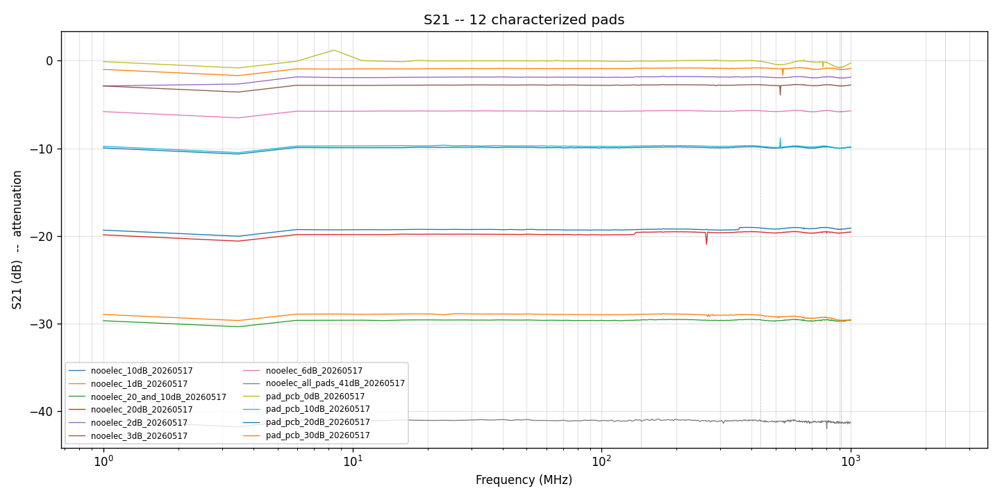
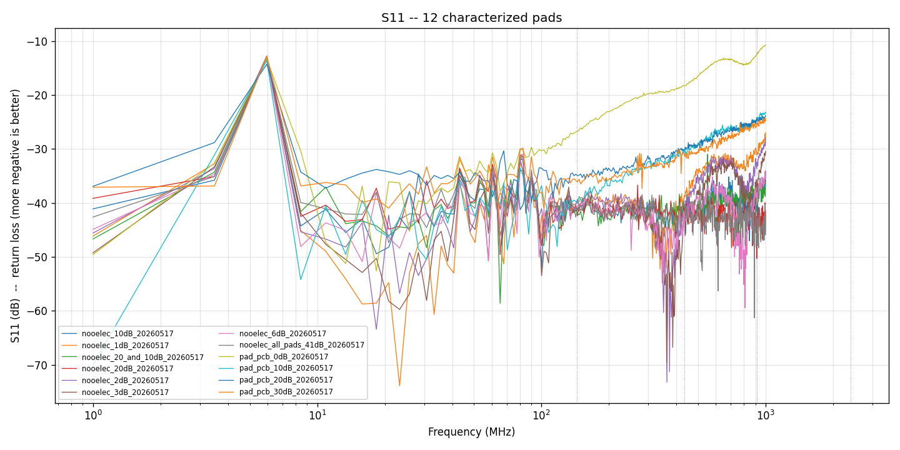

# Attenuator characterization

**Measured:** 2026-05-17

**Imported and checked:** 2026-10-23

Original testbed captures cover six Nooelec fixed pads, four PCB attenuator/through boards, and two Nooelec chains. The recorded range is 1 MHz to approximately 1 GHz, with 404 samples per Touchstone file and a 50 Ω reference. There are no 2.4 GHz measurements in these captures.

## Recorded transmission measurements

Columns below are S21 in dB calculated from the original complex samples. Negative S21 is transmission loss; for example −41.13 dB corresponds to 41.13 dB attenuation. The exact sampled frequencies, shown in MHz, are nearest to the requested bands; these are not interpolated values. Largest S11 means the least negative recorded value across the entire saved span.

| Capture | Sample near 144 MHz | Sample near 434 MHz | Sample near 915 MHz | Largest S11 in saved span | Files |
| --- | --- | --- | --- | --- | --- |
| nooelec_10dB | -9.88 dB at 144.777 | -9.85 dB at 434.809 | -9.98 dB at 915.717 | -13.05 dB at 5.958 MHz | [Touchstone](files/nooelec_10dB_20260517.s2p) · [Original plot](images/nooelec_10dB_20260517.png) |
| nooelec_1dB | -0.84 dB at 144.777 | -0.81 dB at 434.809 | -1.00 dB at 915.717 | -13.17 dB at 5.958 MHz | [Touchstone](files/nooelec_1dB_20260517.s2p) · [Original plot](images/nooelec_1dB_20260517.png) |
| nooelec_20_and_10dB | -29.58 dB at 144.777 | -29.56 dB at 434.809 | -29.69 dB at 915.717 | -13.14 dB at 5.958 MHz | [Touchstone](files/nooelec_20_and_10dB_20260517.s2p) · [Original plot](images/nooelec_10_and_20dB_20260517.png) |
| nooelec_20dB | -19.56 dB at 144.777 | -19.53 dB at 434.809 | -19.66 dB at 915.717 | -13.02 dB at 5.958 MHz | [Touchstone](files/nooelec_20dB_20260517.s2p) · [Original plot](images/nooelec_20dB_20260517.png) |
| nooelec_2dB | -1.84 dB at 144.777 | -1.82 dB at 434.809 | -1.95 dB at 915.717 | -12.73 dB at 5.958 MHz | [Touchstone](files/nooelec_2dB_20260517.s2p) · [Original plot](images/nooelec_2dB_20260517.png) |
| nooelec_3dB | -2.76 dB at 144.777 | -2.76 dB at 434.809 | -2.87 dB at 915.717 | -13.31 dB at 5.958 MHz | [Touchstone](files/nooelec_3dB_20260517.s2p) |
| nooelec_6dB | -5.73 dB at 144.777 | -5.71 dB at 434.809 | -5.80 dB at 915.717 | -13.22 dB at 5.958 MHz | [Touchstone](files/nooelec_6dB_20260517.s2p) · [Original plot](images/nooelec_6dB_20260517.png) |
| nooelec_all_pads_41dB | -41.12 dB at 144.777 | -41.13 dB at 434.809 | -41.24 dB at 915.717 | -13.11 dB at 5.958 MHz | [Touchstone](files/nooelec_all_pads_41dB_20260517.s2p) · [Original plot](images/nooelec_all_pads_41dB_20260517.png) |
| pad_pcb_0dB | -0.03 dB at 144.777 | -0.07 dB at 434.809 | -0.73 dB at 915.717 | -10.74 dB at 995.042 MHz | [Touchstone](files/pad_pcb_0dB_20260517.s2p) · [Original plot](images/pad_pcb_0dB_20260517.png) |
| pad_pcb_10dB | -9.72 dB at 144.777 | -9.75 dB at 434.809 | -9.97 dB at 915.717 | -13.60 dB at 5.958 MHz | [Touchstone](files/pad_pcb_10dB_20260517.s2p) · [Original plot](images/pad_pcb_10dB_20260517.png) |
| pad_pcb_20dB | -19.24 dB at 144.777 | -19.09 dB at 434.809 | -19.22 dB at 915.717 | -14.28 dB at 5.958 MHz | [Touchstone](files/pad_pcb_20dB_20260517.s2p) · [Original plot](images/pad_pcb_20dB_20260517.png) |
| pad_pcb_30dB | -28.92 dB at 144.777 | -29.02 dB at 434.809 | -29.62 dB at 915.717 | -12.78 dB at 5.958 MHz | [Touchstone](files/pad_pcb_30dB_20260517.s2p) · [Original plot](images/pad_pcb_30dB_20260517.png) |

The all-six Nooelec chain is nominally 42 dB; the saved sample near 434 MHz gives about 41.13 dB attenuation. Use measured chain values only within the documented setup and span. Power handling was not established by these low-power VNA captures.

## Original plots

Original testbed transmission comparison, preserved without modification.

Original testbed reflection comparison. Review the full trace rather than only a few band markers.

## Limits and open questions

- The source inventory's “S11 worst” column is inconsistent with full-span maxima in the saved files. For example, the Nooelec 1 dB row says −31.1 dB at 915 MHz, while the file contains a maximum near −13.17 dB elsewhere in the span. The table above reports the file-wide maxima. Whether the common excursions reflect the setup, processing or actual device response remains unresolved; do not infer a cause from this import.
- Reverse S12 and S22 fields in these files are zero-filled. Treat them as unavailable measurements, not measured zero transmission/reflection or a fully characterized two-port model.
- The original calibration file is retained as historical provenance. Exact instrument identity, cables, standards, reference planes and uncertainty are not fully documented here. Do not load that old calibration as a substitute for calibrating a current setup.
- Source-listed DC–6 GHz product ratings do not extend the measured span. No Mini-Circuits pad capture or 2.4 GHz sweep was found in this folder.
- Individual plots are linked where present. No individual 3 dB plot was supplied. The chain plot filename reverses “10 and 20” relative to the Touchstone filename; that source naming discrepancy is retained.

## Files and provenance

The `.s2p` and `.cal` files in [files](files/) and PNGs in [images](images/) were copied byte for byte from `planetary_network_testbed/bench/pad_characterizations/`. [SHA256SUMS](SHA256SUMS) records their digests. The source comparison scripts were not imported: one rounds requests to the nearest sample without rejecting out-of-range requests, which could label a 1 GHz-edge value as 2.4 GHz. No acquisition or new bench test was performed during this import.

[Original NanoVNA-Saver calibration](files/nanovna1M-1G_cal_20260517.cal)

[Back to Equipment on Hand](../../README.md)
